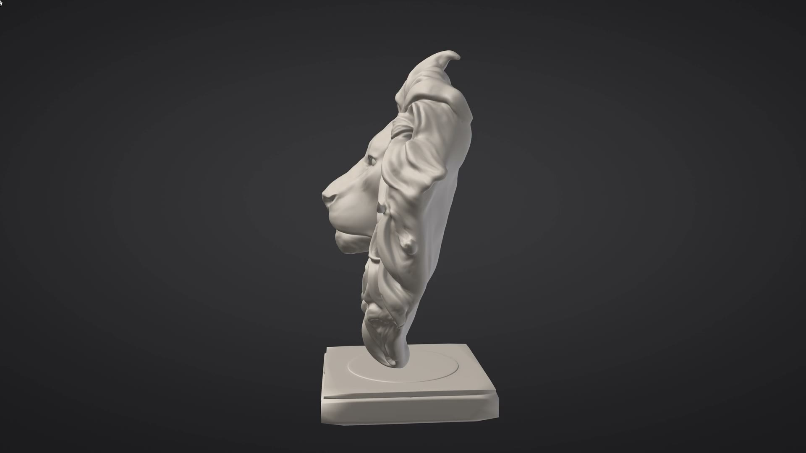
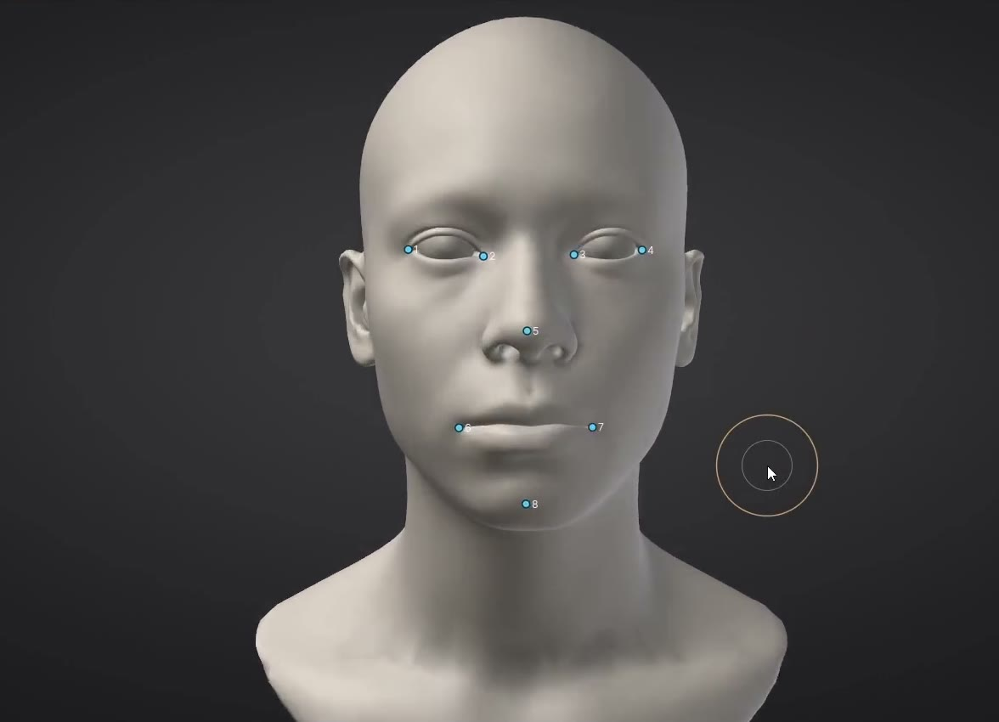
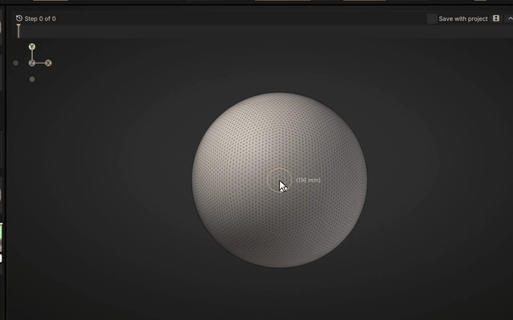
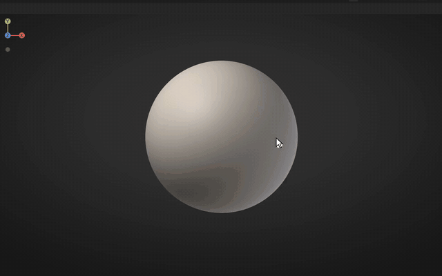
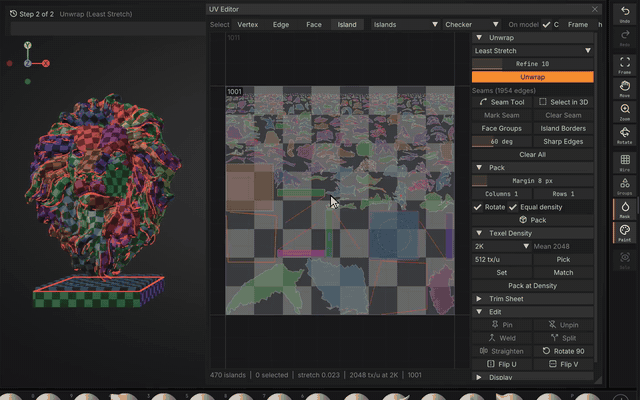

<p align="center">
  <picture>
    <source media="(prefers-color-scheme: dark)" srcset="docs/images/readme/banner-dark.png">
    
  </picture>
</p>

<p align="center">
  <strong>New in 0.12.12:</strong> the user guide is redesigned, with new pictures, and big Clay strokes no longer ring (<a href="https://sculptforge.app/guide/whats-new.html#version-01212">how it works</a>)
</p>

<p align="center">
  <a href="https://github.com/islandmed/SculptForge/actions/workflows/ci.yml"></a>
  <a href="https://github.com/islandmed/SculptForge/releases/latest"></a>
  <a href="LICENSE"></a>
  
</p>

<p align="center">
  <a href="https://sculptforge.app/"><b>Website & demo videos</b></a> ·
  <a href="https://github.com/islandmed/SculptForge/releases/latest"><b>Download</b></a> ·
  <a href="https://sculptforge.app/guide/"><b>User guide</b></a> ·
  <a href="#features">Features</a> ·
  <a href="#building">Build from source</a> ·
  <a href="CONTRIBUTING.md">Contribute</a> ·
  <a href="https://discord.gg/gWrYkEmQhH">Discord</a> ·
  <a href="https://sculptforge.app/support.html?utm_campaign=github">Membership</a>
</p>

<p align="center">
  <a href="https://sculptforge.app/#demos"></a>
</p>

**Sculpt with the brushes, symmetry and navigation you already know.** Free, open source, no subscription, no account.

- **Fast and native:** starts instantly, works offline, on Linux, macOS and Windows.
- **Free AI, built in:** describe a brush and Brush Lab builds it, or turn a sketch or a description into a sculptable model. Bring your own Claude, fal.ai or Meshy key, or run models on your machine.
- **Made for pipelines:** LOD chains, blend shapes, Send to Unreal, Blender bridge, OpenUSD, FBX and glTF.

<p align="center">
  <b><a href="https://github.com/islandmed/SculptForge/releases/latest">Download</a></b> ·
  <a href="https://sculptforge.app/guide/">Read the guide</a> ·
  <a href="https://discord.gg/gWrYkEmQhH">Join the Discord</a>
</p>

<p align="center">
  <a href="https://www.youtube.com/watch?v=8oMCKB_7TRs"></a><br>
  <sub>Video review by <a href="https://www.youtube.com/@asknk">askNK</a>. Click to watch on YouTube.</sub>
</p>

<p align="center"><sub>
  If sculptforge.app is blocked on your network: <a href="https://github.com/islandmed/SculptForge/releases/latest">download from GitHub Releases</a>
  and read the <a href="docs/guide/index.md">user guide on GitHub</a>.
</sub></p>

## In motion

<table>
  <tr>
    <td align="center" width="50%"><br><sub>Pull out forms, the mesh follows</sub></td>
    <td align="center" width="50%"><br><sub>Vector displacement stamps</sub></td>
  </tr>
  <tr>
    <td align="center"><br><sub>Pose with the Gizmo and a mask</sub></td>
    <td align="center"><br><sub>UV editor with UDIM tiles</sub></td>
  </tr>
</table>

## Experienced sculptor?

Pick **Classic sculpting keys** at the first start and your hands know the way. Bring models over as OBJ, FBX, glTF or USD, or through the Bridge (face groups, mask and vertex paint come along).

You get:
- Familiar brushes, symmetry, and Alt and Shift modifiers
- Masking and face groups on Ctrl and Ctrl+Shift
- Parts, subdivision levels, dynamic topology, quad remeshing and a Gizmo

## Features

Each group opens to the details.

<details open>
<summary><b>Sculpting</b>: brushes, masks, layers, remesh, paint</summary>

- Standard, Clay, Smooth, Move, Inflate, Crease, Flatten, Pinch, Sharp Crease, Clay Block, Tendril, Trim, Layer and Nudge brushes; X/Y/Z symmetry; tablet pressure
- Stroke types (dots, drag-rect, spray, lazy mouse) and brush alphas (built-in or any grayscale image)
- **Masking** that every brush respects: paint, invert, blur, sharpen, grow/shrink, by cavity or face group
- **Face Groups and visibility** with Ctrl+Shift isolate, hide and rectangle hide
- **Parts**: body, eyes, teeth and armour as separate meshes, each with its own undo history; append, solo, reorder, duplicate, merge and split
- **Gizmo** (W Move, E Scale, R Rotate): a Part, or only its unmasked area with a soft falloff for posing a limb; Shift snaps
- **Vertex Paint** and six Lit Sphere materials
- **Texture painting** on UV maps: Auto UV (xatlas), 1K-8K textures, paint layers and blend modes; vertex paint and texture convert both ways
- **Voxel remesh**, **Quad Remesh** (target count, Size Variation, Follow Face Groups, symmetry), **Project Detail**, Loop subdivision and quadric decimation
- **Sculpt layers** that work as blend shapes, with live weights and playback
- **Project files** (`.sfproj`) with autosave, recent files and unlimited undo
</details>

<details>
<summary><b>Interface</b>: yours to arrange</summary>

- Task menus (File, Edit, Sculpt, Paint, Mesh, View, Render, Help) in the Forge Terminal look, or the Classic layout in one click (Preferences > Interface > Look)
- Shelves, palettes, a Library (`,`) of thumbnails, the brush picker (`B`), a command palette (F3) and a script console (`` ` ``)
- A built-in **user guide** (Shift+F1) with search, also [online](https://sculptforge.app/guide/); hold Ctrl over any control and press F1 for its chapter
- More in [docs/ui-design.md](docs/ui-design.md)
</details>

<details>
<summary><b>Free AI</b>: Brush Lab and image or text to 3D</summary>

**Brush Lab** turns "dry cracked mud" or "overlapping dragon scales" into a brush, then "make it sharper".
- Brushes are recipes (data, never code) with every value a slider, kept in your library
- Share them as `.sfbrush` files or one-line brush codes (right-click > Copy brush code); studios share a folder through `SCULPTFORGE_BRUSH_PATH`
- The [community gallery](https://sculptforge.app/brushes.html) installs brushes in one click (Brush > Community brushes); see [docs/brushes.md](docs/brushes.md)
- Free out of the box (no account or key): an open model (GPT-OSS 20B) hosted by Pollinations.ai, with a local Ollama as the offline fallback
- Or bring your own: Claude, any OpenAI-compatible endpoint, or a private local model ([5-minute setup](docs/local-ai.md))

**Generate 3D** turns a sketch, concept art or a description into a model, remeshed so you can sculpt it at once.
- Free through the official Hugging Face demos of Hunyuan3D 2 / 2.1, TRELLIS.2 and Stable Fast 3D
- Or your own ComfyUI workflow, a paid fal.ai or Meshy key, or any local model; see [AI services & model licences](docs/ai-services.md)
- Offline tools too: silhouette blockout, relief, and stamp-from-view
</details>

<details>
<summary><b>Pipelines</b>: Unreal, Blender, USD, splats, ComfyUI</summary>

- One-click **LOD chains**; blend shapes survive on every level
- **Send to Unreal** (Ctrl+U) imports or updates the asset in a running Unreal Editor, even on another computer, with no plugin; see [docs/unreal.md](docs/unreal.md)
- **FBX** (LOD groups, blend shapes), **glTF/GLB** (morph targets), **OpenUSD** (UsdSkel blend shapes), OBJ, PLY and STL, checked with the Khronos glTF validator and `usdchecker`
- **Blender bridge** add-on (4.2+, `addons/blender`): Send to SculptForge, sculpt, Send to Blender; objects update in place with transforms, materials and modifiers ([guide](docs/guide/blender.md))
- **Bridge** files keep face groups, mask, vertex paint and UVs; File > Bridge on Windows and macOS sends each visible Part as its own object ([Exporting](docs/guide/exporting.md#exchange-models-through-the-bridge))
- **Gaussian splats**: open phone captures (Polycam, Luma, Postshot, Scaniverse) as reference or convert them to watertight meshes; PLY, `.splat`, `KHR_gaussian_splatting`, OpenUSD
- **ComfyUI**, both ways: generate with any workflow ([docs/comfyui.md](docs/comfyui.md)), or use the [ComfyUI-SculptForge](https://github.com/islandmed/ComfyUI-SculptForge) nodes for remesh, decimate, LODs and export (ComfyUI-Manager: *Install via Git URL*)
</details>

<details>
<summary><b>Automation</b>: headless CLI, MCP, Python</summary>

- `sculptforge-cli` runs every operation headless, for build farms and pipelines
- A built-in **MCP server** (`sculptforge-cli --mcp`) lets Claude Code, Claude Desktop or any MCP client sculpt, convert and export
- Headless thumbnail and turntable rendering, plus a scripted demo recorder (`--demo ... --record`)
</details>

## For studios and pipelines

Built for studios with their own pipelines: **[VFX Reference Platform](https://vfxplatform.com) CY2026/CY2027 builds**, a Python API (`import sculptforge`), a Rez package, headless CLI and farm rendering, and no licence server.

The GPL lets you modify it in-house without publishing your changes. See **[docs/studios.md](docs/studios.md)**.

## Install

**[Download for Windows](https://github.com/islandmed/SculptForge/releases/latest/download/SculptForge-windows-x86_64-setup.exe)** ·
**[Download for macOS](https://github.com/islandmed/SculptForge/releases/latest/download/SculptForge-macos.dmg)** ·
**[Download for Linux](https://github.com/islandmed/SculptForge/releases/latest/download/SculptForge-linux-x86_64.AppImage)** (AppImage, x86_64)

Every link gets the newest version straight from GitHub. **[install/](install/README.md)** lists every package (.deb, .rpm, ARM64, portable .zip, Arch). Or install with one command:

```sh
# macOS / Linux
curl -fsSL https://raw.githubusercontent.com/islandmed/SculptForge/main/install/install.sh | sh
```

```powershell
# Windows (PowerShell)
irm https://raw.githubusercontent.com/islandmed/SculptForge/main/install/install.ps1 | iex
```

The builds aren't code-signed yet:
- **macOS:** right-click the app and choose **Open** the first time
- **Windows:** if SmartScreen appears, choose **More info → Run anyway**

Studio builds ([Rez](packaging/rez/package.py)), older versions and checksums are on the [releases page](https://github.com/islandmed/SculptForge/releases).

## Building

Requirements: CMake 3.24+ and a C++20 compiler (GCC 11+, Clang 14+, Xcode 15+ or Visual Studio 2022).
Dear ImGui, GLM and (if it isn't installed already) SDL3 are fetched automatically. AI features use libcurl
on Linux and macOS, and the built-in WinHTTP on Windows.

```sh
# Linux only: install compilers and X11/Wayland/GL/curl headers (Debian/Ubuntu or Fedora/RHEL)
sudo ./packaging/linux/install-build-deps.sh

cmake -S . -B build -DCMAKE_BUILD_TYPE=Release
cmake --build build --parallel
ctest --test-dir build --output-on-failure
./build/sculptforge            # Windows: build\Release\sculptforge.exe · macOS: open build/SculptForge.app
```

`cpack` in the build folder makes the platform's packages (`.deb`/`.rpm`/`.tar.gz`, `.dmg`, or installer and
`.zip`).

## Pipelines & automation

```sh
# LOD chain for a game asset
sculptforge-cli -c 'open path=rock.obj; export_lods path=out/rock.glb levels=4 ratio=0.5'

# Concept art or a description -> sculptable 3D model (free, via Hugging Face)
sculptforge-cli -c 'image_to_3d path=hero.png; export_usd path=hero.usdz'
sculptforge-cli -c 'text_to_3d prompt="a stylised dragon head"; export_glb path=dragon.glb'

# Sculpt -> Unreal (static mesh with 4 LODs, 2 m tall)
sculptforge-cli -c 'open path=statue.obj; unreal_send destination=/Game/Props height_cm=200 lods=4'

# Phone capture -> watertight base mesh
sculptforge-cli -c 'open path=scan.ply; splat_transform rotate_x=180 fit=true; splat_clean; splat_to_mesh resolution=256; export_glb path=base.glb'

# Design a brush (free, no key) and save it for the team
sculptforge-cli -c 'brush_ai prompt="weathered stone edges"; brush_save path=stone.sfbrush'

# ...or with a private local model
sculptforge-cli -c 'brush_ai prompt="weathered stone edges" provider=openai-compatible model=qwen3:4b-instruct'

# Review-sheet turntable (8 frames)
sculptforge model.glb --render review/model.png --turntable 8 --size 1024x1024
```

Run `sculptforge-cli --list` for every command.

### Use with AI tools

SculptForge works from Claude, ChatGPT (Codex CLI), Gemini, Grok, Cursor, VS Code, JetBrains, Zed and other MCP clients. The AI tool starts `sculptforge-cli --mcp` on your computer; nothing listens on the network.

In the app, **Help > Connect an AI tool...** shows the exact command for your install, with Copy buttons. Claude Desktop installs it from a bundle (`SculptForge-*.mcpb` on each [release](https://github.com/islandmed/SculptForge/releases/latest)).

```sh
claude mcp add --scope user sculptforge -- /path/to/sculptforge-cli --mcp      # Claude Code
codex mcp add sculptforge -- /path/to/sculptforge-cli --mcp                     # Codex CLI (sign in with ChatGPT)
```

Every command is a tool, plus `viewport_image` (a picture of the scene) and ready-made recipes (MCP prompts). Every
client, your own agent and plain function calling (`sculptforge-cli --schema`):
[the guide](docs/guide/scripting.md#ai-agents-mcp).

## Controls

Sculpt with left-drag, Alt inverts, Shift smooths. The [full list](https://sculptforge.app/guide/shortcuts.html) is in the app too (F1).

<details>
<summary>Show the controls table</summary>

| Action | Input |
|---|---|
| Sculpt | Left-drag on the model |
| Subtract / invert | Hold **Alt** |
| Smooth | Hold **Shift** |
| Rotate | Left-drag background, or right-drag |
| Pan | Alt + left-drag background, or middle-drag |
| Zoom | Mouse wheel, Ctrl + middle-drag, or Ctrl + left-drag background when nothing is masked |
| Paint / erase mask | Hold **Ctrl** / **Ctrl+Alt** while stroking |
| Invert / clear mask | Ctrl + click / Ctrl + drag on the background |
| Isolate / hide face group | Ctrl+Shift + click / Ctrl+Shift+Alt + click |
| Select a Part | Alt + click it |
| Show all | Ctrl+Shift + click on the background |
| Hide outside / inside a rectangle | Ctrl+Shift + drag / Ctrl+Shift+Alt + drag |
| Pen pressure | Strength (and optionally size); curve and test area in **Preferences > Tablet** |
| Pen eraser end | Inverts the brush (Ctrl + eraser erases mask); or Smooth / Erase mask |
| Pen side buttons | Lower: right-click (drag to rotate), upper: Alt (invert), third: pan; remappable |
| Brush size | `[` / `]` |
| Select brush | `1`–`9`, `0` |
| Paint brush / pick colour | `P` / `C` |
| Toggle X symmetry / wireframe | `X` / `Shift+F` |
| Gizmo: Move / Scale / Rotate / back to Draw | `W` / `E` / `R` / `Q` (Alt+drag: the gizmo only; Shift snaps) |
| Frame model | `F` |
| Subdivide | Ctrl+D |
| Undo / Redo | Ctrl+Z / Ctrl+Shift+Z |
| Open / Save project / Save as | Ctrl+O / Ctrl+S / Ctrl+Shift+S |
| Export GLB | Ctrl+E |
| Send to Unreal | Ctrl+U |

</details>

- **Tablets** (Wacom, XP-Pen, Huion ...) work through the system driver on Windows, macOS and Linux; see [docs/tablet.md](docs/tablet.md)
- **Linux** runs as a native Wayland window (sharp at fractional scales) or on X11

## Project layout

<details>
<summary>Show the source tree</summary>

```
src/core     Mesh, BVH, brushes & recipes, layers, undo, subdivision, decimation,
             voxel remesh, Gaussian splats, image-to-3D, command registry (no GPU/UI)
src/io       File formats: OBJ, FBX, glTF/GLB (+ KHR_gaussian_splatting), PLY, .splat, USDA/USDZ
src/ai       AI services (free built-in and bring-your-own): HTTPS client, brush assistant, image/text-to-3D services, Gradio client
src/link     Live links to game engines (Unreal Python remote execution)
src/cli      sculptforge-cli and its MCP server
src/render   OpenGL 3.3 renderer, splat renderer, offscreen capture
src/app      SDL3 + Dear ImGui application, scripted demo recorder
src/python   Python module (import sculptforge)
packaging    Linux desktop/AppStream files, Windows resources, Arch PKGBUILD, Rez package
website      Project website (GitHub Pages)
tests        Unit tests
```
</details>

## Privacy

SculptForge has no telemetry, no account and no servers of its own. AI features are optional and talk
directly to the service you choose. See [docs/ai-services.md](docs/ai-services.md) for exactly what is sent
where, and for the licences of the AI models.

## Membership

SculptForge is free, and nothing in the app is ever paywalled. Every release stays free for everyone; bug-fix and security releases go out to all the same day.

- **[Member](https://sculptforge.app/support.html?utm_campaign=github)** ($5 / month or $48 / year): betas and early builds, the monthly feature vote, one Member Request a month (built first, credited to you), #members on Discord and your name in the [credits](https://sculptforge.app/supporters.html). The first 100 are Founding Members, price locked for good.
- **[Studio](https://sculptforge.app/studios.html?utm_campaign=github#membership)** ($300 / month flat, any number of artists; Founding Studio $150 for the first 5): your own isolated build with your assets built in, a pinned version with security fixes, an offline signed installer, support and a private channel.

<!-- Studio members' logos go here. -->

## Contributing

Contributions are welcome: bug reports, brushes, docs and code. Read [CONTRIBUTING.md](CONTRIBUTING.md)
and the [Code of Conduct](CODE_OF_CONDUCT.md). For questions, tips and showing your work, join the
[SculptForge Discord](https://discord.gg/gWrYkEmQhH); bugs and feature requests go to [GitHub issues](https://github.com/islandmed/SculptForge/issues). Please report security issues privately (see
[SECURITY.md](SECURITY.md)).

## License

Copyright © 2026 The SculptForge contributors.

SculptForge is free software, licensed under the [GNU General Public License v3.0 or later](LICENSE). You own
everything you make with it; the GPL covers the program, not your models. Third-party components and their
licences are listed in [THIRD_PARTY_NOTICES.md](THIRD_PARTY_NOTICES.md).

<sub>SculptForge is an independent project and is not affiliated with or endorsed by Epic Games,
Autodesk, Pixar, the Khronos Group, Hugging Face, Tencent, Microsoft, Stability AI, Anthropic, fal or Meshy.
Unreal and Unreal Engine are trademarks of Epic Games, Inc. FBX is a trademark
of Autodesk, Inc. glTF is a trademark of the Khronos Group Inc. Other names are trademarks of their respective
owners.</sub>
