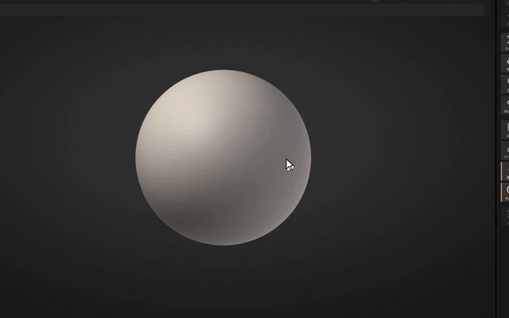

<p align="center">
  <picture>
    <source media="(prefers-color-scheme: dark)" srcset="docs/images/readme/banner-dark.png">
    
  </picture>
</p>


<p align="center">
  <strong>New in 0.13.0:</strong> shadows and ambient occlusion in the PBR view, and say what you want in the F3 search (<a href="https://sculptforge.app/guide/whats-new.html#version-0130">how it works</a>)
</p>

<p align="center">
  <a href="https://github.com/islandmed/SculptForge/actions/workflows/ci.yml"></a>
  <a href="https://github.com/islandmed/SculptForge/releases/latest"></a>
  <a href="LICENSE"></a>
  
</p>

**Sculpt with the brushes, symmetry and navigation you already know.** Free, open source, no subscription, no account.

- **Fast and native:** starts instantly, works offline, on Linux, macOS and Windows.
- **Free AI, built in:** describe a brush and Brush Lab builds it, or turn a sketch or a description into a sculptable model.
- **Made for pipelines:** LOD chains, blend shapes, Send to Unreal, Blender, OpenUSD, FBX and glTF.

<p align="center">
  <b><a href="https://github.com/islandmed/SculptForge/releases/latest">Download</a></b> ·
  <a href="https://sculptforge.app/guide/">Guide</a> ·
  <a href="https://discord.gg/gWrYkEmQhH">Discord</a>
</p>

<p align="center">
  
</p>

## Install

**[Download for Windows](https://github.com/islandmed/SculptForge/releases/latest/download/SculptForge-windows-x86_64-setup.exe)** ·
**[Download for macOS](https://github.com/islandmed/SculptForge/releases/latest/download/SculptForge-macos.dmg)** ·
**[Download for Linux](https://github.com/islandmed/SculptForge/releases/latest/download/SculptForge-linux-x86_64.AppImage)** (AppImage, x86_64)

Every link gets the newest version straight from GitHub. **[install/](install/README.md)** lists every package (.deb, .rpm, ARM64, portable .zip, Arch). Or install with one command:

```sh
# macOS / Linux
curl -fsSL https://raw.githubusercontent.com/islandmed/SculptForge/main/install/install.sh | sh
```

```powershell
# Windows (PowerShell)
irm https://raw.githubusercontent.com/islandmed/SculptForge/main/install/install.ps1 | iex
```

The builds aren't code-signed yet:
- **macOS:** right-click the app and choose **Open** the first time
- **Windows:** if SmartScreen appears, choose **More info → Run anyway**

Studio builds ([Rez](packaging/rez/package.py)), older versions and checksums are on the [releases page](https://github.com/islandmed/SculptForge/releases).

## More

[Features](docs/features.md) · [Pipelines and automation](docs/pipelines.md) · [Controls](docs/controls.md) · [Building from source](docs/building.md) · [Project layout](docs/project-layout.md) · [Studios](docs/studios.md)

Video review by [askNK](https://www.youtube.com/watch?v=8oMCKB_7TRs). If sculptforge.app is blocked on your network, the [guide is on GitHub](docs/guide/index.md) too.

## Privacy

SculptForge has no telemetry, no account and no servers of its own. AI features are optional and talk directly to the service you choose; [what is sent where](docs/ai-services.md).

## Membership

SculptForge is free, and nothing in the app is ever paywalled. Every release stays free for everyone; bug-fix and security releases go out to all the same day.

- **[Member](https://sculptforge.app/support.html?utm_campaign=github)** ($5 / month or $48 / year):
  - Betas and early builds, and the monthly feature vote
  - One Member Request a month, built first and credited to you
  - #members on Discord and your name in the [credits](https://sculptforge.app/supporters.html)
  - The first 100 are Founding Members, price locked for good
- **[Studio](https://sculptforge.app/studios.html?utm_campaign=github#membership)** ($300 / month flat, any number of artists; Founding Studio $150 for the first 5): your own isolated build with your assets built in, a pinned version with security fixes, an offline signed installer, support and a private channel.

<!-- Studio members' logos go here. -->

## Contributing

Contributions are welcome: bug reports, brushes, docs and code. Read [CONTRIBUTING.md](CONTRIBUTING.md)
and the [Code of Conduct](CODE_OF_CONDUCT.md). For questions, tips and showing your work, join the
[SculptForge Discord](https://discord.gg/gWrYkEmQhH); bugs and feature requests go to [GitHub issues](https://github.com/islandmed/SculptForge/issues). Please report security issues privately (see
[SECURITY.md](SECURITY.md)).

## License

Copyright © 2026 The SculptForge contributors.

SculptForge is free software, licensed under the [GNU General Public License v3.0 or later](LICENSE). You own
everything you make with it; the GPL covers the program, not your models. Third-party components and their
licences are listed in [THIRD_PARTY_NOTICES.md](THIRD_PARTY_NOTICES.md).

<sub>SculptForge is an independent project and is not affiliated with or endorsed by Epic Games,
Autodesk, Pixar, the Khronos Group, Hugging Face, Tencent, Microsoft, Stability AI, Anthropic, fal or Meshy.
Unreal and Unreal Engine are trademarks of Epic Games, Inc. FBX is a trademark
of Autodesk, Inc. glTF is a trademark of the Khronos Group Inc. Other names are trademarks of their respective
owners.</sub>
