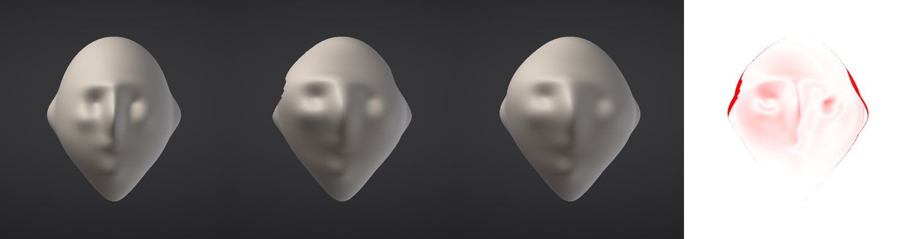

# Core 200M: 200 million sculptable polygons on a 16 GB laptop with an integrated GPU

Research branch `research/core-200m` (2026-11-03). Generic techniques, designed here from first principles (regular
grids, multiresolution offsets, quantization, page tables, copy-on-write); no competitor code, files or docs.

**Headline target, floor profile** (integrated GPU, GL 3.3, 4 cores; perf-moonshots.md §0, `SF_HW_SIMULATE=floor`):

| | target |
|---|---|
| Asset | 200M triangles on a 16 GB laptop with an iGPU (shared video memory) |
| Stroke latency (pen to visible surface) | < 16 ms |
| Frame while sculpting | p99 < 33 ms |
| Orbit | smooth (p99 < 33 ms), full detail refined on release |
| Open | < 5 s to a sculptable, fully shaded view |
| Memory | 0.6-1.2 GB for the 200M asset (RSS, everything) |

The rule behind every piece: **cost follows the pixels on screen and the brush footprint, never the total count.**

## 0. What we already have (mapped before designing)

| Piece | Where | State | What it gives 200M | Gap |
|---|---|---|---|---|
| Regular grid patches over the base cage, implicit topology | `core/Micro.h` (`MicroMesh`, `MicroPatch`, `BaseCage`) | on | the storage model of §1: one grid of `(n+1)(n+2)/2` points per base triangle, no index buffer, edges stitched | heights are one level, measured from the Phong surface of the cage, not from a smoothed lower level |
| 16-bit quantized displacement | `MicroMesh::disp` (`MicroStore`) | on | 2 B a grid point, 1.11 B a triangle at Micro 5 | edges and corners stored once per patch (~10% extra at Micro 5) |
| Derived normals | `MicroShader` (CPU), shading grid on the GPU | on | no normals stored on the CPU | the GPU shading grid is 4 B a point for every patch (440 MB at 200M) and the first full shading runs at open |
| Per-cluster LOD to a triangle budget | `render/MicroRenderer` | on | draw cost bounded by `renderTriangleBudget` (3-4M drawn at 299M-1B, 8-13 ms on this laptop) | every patch's full grid is resident on the GPU (6 B a point); the budget is triangles, not pixels |
| Stride-sampled ("scale-adaptive") dabs | `MicroStroke::adaptive`, `kBrushSamples = 48` | on | the kernel evaluates ~48 samples across the radius at any level | the interpolated values are still written to every fine point: a 300 px dab at 1B writes millions of points (283 ms) |
| Out of core | `MicroStore` (mmap sparse file), `PatchPageTable` | on (auto above 1/4 of RAM) | levels larger than RAM; the OS page cache is the LRU | no compression in memory, no visible-first order |
| Compressed streamed patches | `core/FocusDetail` (`.sfdetail`, zstd, coarse level-3 grids, focus promotion 0.04 ms a tile) | prototype, off | 1.02B opens in < 1 s from 241 MB; `tileLevel(tri)` per patch | CPU array still dense; GPU doesn't use per-tile levels; not wired into projects |
| Per-patch undo | `MicroUndo` journal (Morton-ordered tiles, delta + bit-packed) | on | 0.6-11 MB a 30-dab stroke (31 KB for a short stroke at 5M) | rounding noise of fine writes inflates it; coarse-level edits (§3) would shrink it to KBs |
| Patch-parallel jobs | `ThreadPool::poolFor` in MicroSculpt / Micro / MicroRenderer / FocusDetail | on | deterministic block-parallel kernels | the parallel loops are fork-join per dab; dirty bits are plain words written by one thread at a time; stitching serialises at patch edges |
| Canvas cache | perf-moonshots.md §7 (research/perf-moonshots) | design | idle frames composite only; a dab re-rasterizes its rectangle | not built |

So phase 1 needs no new storage: a 200M micro level fits on today's code. What it doesn't do yet is make the GPU
copy, the open time and the big-brush cost follow the screen and the brush. That is phases 2-5.

## 1. Storage

**Layout.** Each base triangle of the cage (the Part's top subdivision level) carries a regular grid of
`n = 2^L` segments per edge: `n^2` micro triangles, `(n+1)(n+2)/2` points. Topology is implicit (index arithmetic,
`MicroMesh::index`); only heights are stored.

**Heights against the smoothed lower level.** Phase 1 stores, as today, one 16-bit height per point along the
normal of the Phong-tessellated cage. The target layout (phase 3) is multiresolution: level `l` stores, per point
it adds (the odd points of the level-`l` grid), a 16-bit offset from the *smoothed* level `l-1` surface (the
Loop-style average of its neighbours, evaluated from the coarser level), along that surface's normal. Points that
exist at `l-1` are not stored again. Total points over all levels are the same as the finest grid (each point is
stored once, at the level that introduces it), so the memory is the same 2 B a point; what changes is that a big
form lives in a few coarse values and the fine values stay small (and compress, §4).

**Arithmetic for 200M** (Micro 5: n = 32, 1,024 triangles and 561 points a patch; 195,313 base triangles):

| Item | Per | Count | Bytes |
|---|---|---|---|
| Micro triangles | | 195,313 x 1,024 | **200.0M** |
| Grid points, per-patch copies (today) | 561 a patch | 109.6M | |
| Grid points, unique (edges once) | ~triangles / 2 | 100.0M | |
| Heights, today's layout | 2 B a point | 109.6M | **219 MB** (1.10 B a triangle) |
| Heights, edges stored once (phase 3) | 2 B a point | 100.0M | 200 MB |
| Base cage + BVH (195K triangles, ~90 B + BVH) | | | ~25 MB |
| Mask, sparse 32x32-point tiles, 1 B a point | where masked | 10% of the surface | ~11 MB (0 when unused) |
| Colour, sparse tiles, RGBA8 | where painted | 25% painted / all | ~110 MB / 440 MB |
| Derived normals | | | 0 on the CPU (computed per patch when drawn) |
| GPU: today (2 B height + 4 B shading, every patch) | 6 B a point | 109.6M | 658 MB |
| GPU: pixel-bounded (§2), resident patches only | 6 B a point | ~10-20M points | 60-120 MB |
| Undo, per-patch copy-on-write (§5), 50 steps | | | ~5-50 MB |
| App, fonts, GL driver, UI | | | ~250 MB |

- **Sculpt only, pixel-bounded GPU:** 219 + 25 + 120 + 50 + 250 = **~0.66 GB**.
- **Mask + all-over colour:** + 11 + 440 = **~1.1 GB**.
- **Today's renderer (phase 1 prototype):** 219 + 25 + 658 (on unified memory this is system RAM) + 250 = ~1.15 GB,
  plus the shading pass at open. Phase 1 measures this.

So 2 B a vertex for shape, 3 with a mask, 6 with colour everywhere: 2-6 B a vertex, 0.6-1.2 GB for 200M.

## 2. Pixel-bounded draw

- **Per-patch stride LOD.** A patch draws at stride `s = 2^k` (its grid every `s` points: `(n/s)^2` triangles),
  chosen so its micro edge projects to about one pixel (`targetPx`), clamped by the frame's triangle budget from
  the hardware profile. MicroRenderer does this per cluster today; phase 2 makes it per patch and makes the GPU
  *residency* follow it: a patch's GPU grid holds only the levels the view needs (coarse level-3 grids for
  everything, full grids for the patches whose projected edge needs them), using `FocusDetail::tileLevel(tri)`.
  Crack-free borders: the finer side snaps its edge points to the coarser edge (as now).
- **Budget.** At 1920x1080 about 2M pixels are covered at most: ~2-4M triangles drawn at one triangle a pixel,
  whatever the asset size. On the floor profile 2M (1M moving).
- **Shading on demand.** Shading (octahedral normal, curvature) is computed for resident patches at their resident
  level only, visible first; a coarse patch shades its 45 points, not 561 (cuts the open-time shading ~12x at
  Micro 5, ~180x at Micro 7).
- **Canvas cache** (perf-moonshots.md §7): with the screen cached, an idle frame composites one quad and a dab
  re-rasterizes only the patches under its dirty rectangle, so stroke frames cost the brush's pixels.
- **Orbit:** draw the moving budget (coarser stride, lower view resolution on the floor), refine to full on release.

## 3. Scale-adaptive dabs and lazy push-up

- A dab is applied at the level `l` where its radius spans **64-256 samples** (`r / edge(l)` in that range), not
  at the finest level. A 300 px brush at 200M lands on a level with ~10^4 points under it instead of ~10^6.
- With the multiresolution layout (§1) the finer levels are offsets from the smoothed coarser one, so the detail
  rides along with no write at all; Clay, Standard, Inflate and Move are pure coarse edits.
- Brushes that need fine values (Smooth of fine detail, Flatten to a plane, Pinch) read the finest level under the
  brush, so they apply at the finest level their radius allows (radius / 256 or coarser) and only there.
- **Lazy push-up:** where a coarse edit invalidates something fine (the shading grid, a cached finest-level
  position on the GPU, a Focus Detail tile's compressed copy), the patch is marked `stale(l)`. Visible stale patches
  are refreshed within the frame's budget, nearest the brush first; hidden ones by a background job at idle
  ("catch-up"), or when they become visible. Nothing is pushed into patches nobody looks at.
- **Checkpoint numbers to beat** (docs/performance.md, today): Standard 300 px 115 ms a step at 299M Micro 4,
  283 ms at 1.02B; phase 3 target < 8 ms CPU a dab at 200M on the laptop, < 16 ms on the floor profile.

## 4. Out-of-core compressed patches, visible-first

Reuse Focus Detail (`core/FocusDetail`, docs/design/focus-detail.md): patches as quantized, row-delta coded,
zstd-compressed tiles, a coarse level-3 grid per tile in compressed chunks, a directory, crash-safe header-last
saves, promotion 0.04 ms a tile. What 200M adds:
- **Visible-first open:** read the cage and the coarse chunks (a few MB), draw; then decompress the visible patches
  nearest the camera first; the rest stream in the background or stay compressed. First frame < 1 s.
- **Sparse CPU pool** (focus-detail.md §7 item 4): full grids only for promoted patches, indexed per patch, so RSS
  follows the focus, not the asset. Only required past ~1B on 16 GB; for 200M the dense array (219 MB) is
  affordable, so this is the last step, not the first.
- **Project integration:** `.sfproj` stores or references the detail file; Save writes dirty tiles only (53 ms).

## 5. Per-patch copy-on-write undo

A stroke saves, the first time it touches a patch, that patch's old heights (and mask / colour tile); the step is
the set of touched patches, delta-coded and bit-packed (the `MicroUndo` journal already does this, Morton
ordered). With coarse-level edits (§3) a big stroke touches thousands of coarse values instead of millions of fine
ones, so steps become **KBs per stroke** (today 0.6-11 MB for a 30-dab benchmark stroke, from rounding noise in
fine writes). Undo and redo apply the same deltas; Focus Detail promotes the patches first (`ensureFull`).

## 6. Lock-free patch-parallel jobs

- Patches are the unit of work and ownership: a job owns a patch for the dab (no locks inside), interior points
  are independent; only edge stitching reads a neighbour, done in a second pass after a barrier, edge by edge
  (each shared edge has one owner: the patch with the lower index).
- Dirty and stale state is an atomic bitset (`fetch_or`), so the solver, the renderer's sync and background
  catch-up never take a lock; the renderer swaps out the dirty words it consumed.
- A small job graph per frame (pick → dab kernels per patch → stitch → shade visible → upload) on the existing
  `ThreadPool`, with the block-ordered determinism it already guarantees; background catch-up and decompression
  run at low priority and yield to the stroke.
- Floor profile: 4 workers; the stroke's jobs run first, everything else fills idle time.

## 7. Phases and checkpoints

Every number twice: this laptop and the floor profile (`SF_HW_SIMULATE=floor`), at load < 2.

| Phase | What | Checkpoint (measurable) |
|---|---|---|
| **1** (this branch) | Memory-only 200M prototype on today's micro levels: `--benchmark core-200m` (off by default; writes the scene once, then opens it and orbits) | RSS, open time (project open, first frame, fully shaded), orbit p50 / p99, GPU MB: measured below |
| 2 | Pixel-bounded GPU: per-patch resident levels (coarse grids + full where needed), shading on demand, visible first; lower view resolution while moving (helps the median, §8); find the p99 tail with GPU timer queries | GPU < 150 MB at 200M; open to fully shaded < 2 s; orbit p99 < 33 ms on the floor profile; picture equal to today's at rest (screenshot test) |
| 3 | Multiresolution offsets + dabs at the 64-256-sample level + lazy push-up + background catch-up | 300 px dab < 8 ms CPU on the laptop, < 16 ms floor; stroke latency < 16 ms; p99 frame while sculpting < 33 ms floor; same result as the fine-level brush within quantization (test) |
| 4 | Focus Detail for 200M: compressed patches, visible-first open, project integration, sparse pool | open < 5 s floor (first frame < 1 s); file < 300 MB; RSS with colour < 1.2 GB |
| 5 | COW undo on coarse edits; atomic dirty/stale bits; per-frame job graph | undo < 100 KB a typical stroke; 4-thread speed-up > 3x on dab kernels; no lock on the stroke path (TSan clean) |
| 6 | Canvas cache (perf-moonshots §7) on top; real iGPU runs by testers (Windows UHD 620 / Iris Xe first) | idle frame ~0 ms GPU; floor numbers confirmed on real hardware before anything defaults on |

Nothing here merges into a release without the floor-tier numbers.

## 7b. The novel track (Tony, 11-03: beyond the known playbook)

Sections 1-6 are the known playbook done well (multiresolution offsets, cluster LOD to a pixel budget, a cached
screen, scale-adaptive dabs). The novel track changes *what a stroke is*, not only how fast it runs. Each item is a
prototype with numbers before anything ships; measured on this laptop, the floor profile and the Windows PC.

**N1. Optimistic screen-space strokes.** The screen is the first thing a dab changes, the mesh the last. Each dab is
applied at once to the cached screen (depth, normal, colour) by one GPU pass over the dab's screen rectangle: the
surface point from depth, the brush's displacement along the dab normal, the bent normal from the kernel's gradient,
the colour re-shaded by the ratio of the Lit Sphere lookups at the bent and the original normal (so cavity, material
and paint stay). Cost: the brush's pixels, under 1 ms, whatever the mesh size. The true mesh is solved on the solver
thread a few frames later and replaces the optimistic pixels; the swap is pop-free where the estimate holds (open
surface, no silhouette change), and the residual is measured (the "pop": the per-pixel difference between the
optimistic image and the solved mesh at the same dabs). Stroke latency stops depending on mesh size. Differs from the
geometry preview we have (render/Ghost.h): that moves the mesh's vertices in the vertex shader, so its cost follows the
clusters under the brush; N1 never touches geometry. Limits: silhouettes (the outline doesn't move until reconcile),
brushes that read the surface (Smooth, Flatten: approximated from the canvas's depth), occluded surface (not on screen,
nothing to show, nothing lost: the solver is exact).

**N2. Wavelet (multi-scale) displacement.** Store each patch's heights as interpolating-wavelet coefficients (integer
lifting on the triangle grid: a point new at level k stores its height minus the floor-average of its two parents on the
coarser edge), losslessly invertible. A dab whose radius spans 64-256 samples at level l adds its kernel to the level-l
coefficients only: a 300 px brush writes thousands of values instead of millions, so **cost falls as the brush grows**,
and the fine coefficients (the detail) ride along unchanged. Reconstruction (the inverse transform) runs lazily for what
is drawn or picked, and can move to the GPU (each level is one pass over its new points). The result is identical, bit
for bit, to adding the coarse kernel and linearly interpolating it to the fine points (tested), which is what today's
stride-sampled micro brushes approximate at full write cost.

**N3. Procedural stroke layers (research).** A stroke stored as an operation (path, brush, parameters, the base it was
applied to) instead of its result; detail is evaluated at any resolution on demand, so it isn't bounded by memory, and a
stroke can be edited after the fact (strength, path, falloff). Hard parts: brushes that read the surface (order
dependence: replay is sequential), determinism across versions, the cost of evaluating many layers (cache per patch per
level; N2's coefficients are the cache). Prototype after N1 and N2: a layer stack of Standard / Clay strokes evaluated
into N2 coefficients per patch on demand.

**N4. Pen prediction for the last frames.** The alpha-beta-gamma predictor (core/PenPredictor.h, from the zero-latency
work) extrapolates the pen ~25 ms; with N1 the predicted dabs are drawn optimistically too (weight < 1, as the preview
does), hiding the last frame or two of display latency. Literature: no gain predicting past ~33 ms.

**N5. Idle-time pre-refinement around the cursor.** When the pen hovers, spend idle frames preparing what the next dab
will need under and ahead of the cursor: Focus Detail promotion, N2 reconstruction of the patches under the cursor, BVH
and undo-tile allocations, shading. The first dab then finds everything warm (the beta measured a 965 ms first-dab stall
on Windows at 15M; perf/beta-boost removes its cause, N5 keeps such costs off the stroke in general).

## 7c. Novel track results (N1, N2)

Three setups: this laptop (M1 Pro, Asahi GL 4.6, load < 2), the floor profile on it (`SF_HW_SIMULATE=floor`: 4 solver
threads; the GPU pass isn't budgeted), and the Windows PC (RTX 3060, Ryzen 5600X, 12 threads; floor = 4).

### N1, optimistic screen-space strokes (`sculptforge --bench-optimistic`)

A 240 px Standard stroke of 30 dabs on the bench head, 1920x1080 canvas. The stroke is placed from the canvas alone
(centres and area normals from depth). Pass = one GPU pass per dab over its rectangle: inverse warp (for each pixel the
canvas point whose displaced position lands there, by fixed-point iteration) + the Lit Sphere ratio re-shade at the bent
normal. Mesh = the same dabs by the real Standard brush on the CPU plus the upload: the latency the canvas hides.
Pop = the per-pixel difference between the optimistic image and the solved mesh at the same dabs (0-255 levels), against
showing nothing until the mesh catches up.

| | mesh | pass per dab, median / max | mesh: brush + upload | interior pop, mean / p99 (> 8 levels) | same, doing nothing | outline pixels: pop vs nothing (mean) |
|---|---|---|---|---|---|---|
| laptop | 4.9M | 4.7 / 9.7 ms | 332 ms | 4.4 / 21 (15.0%) | 17.7 / 74 (60.0%) | 8.8K: 41 vs 98 |
| laptop | 15.1M | 4.4 / 8.0 ms | 916 ms | 4.4 / 20 (15.0%) | 17.5 / 72 (59.8%) | 8.8K: 41 vs 98 |
| laptop | 33.2M | 4.8 / 10.6 ms | 2,450 ms | 4.3 / 19 (15.2%) | 17.1 / 68 (59.4%) | 8.5K: 40 vs 99 |
| floor | 4.9M / 15.1M / 33.2M | 4.5 / 4.2 / 4.5 ms | 595 / 1,665 / 3,667 ms | 4.4 / 21-19 | 17.7-17.1 / 74-68 | as laptop |
| Windows | 4.9M / 15.1M / 33.2M | 3.1 / 3.0 / 6.7 ms | 1,156 / 4,282 / 5,057 ms | 4.4 / 21-19 | 17.7-17.1 / 74-68 | 41 vs 98 |
| Windows floor | 4.9M / 15.1M / 33.2M | 1.3 / 2.2 / 1.4 ms | 1,238 / 3,948 / 8,247 ms | 4.4 / 21-19 | 17.7-17.1 / 74-68 | 41 vs 98 |

- **The pass doesn't depend on the mesh:** 4.2-4.8 ms per dab on the laptop from 5M to 33M while the real brush takes
  0.33 s to 2.45 s for the stroke (0.6-3.7 s on the floor, 1.2-8.2 s on the Windows PC). The surface under the pen
  changes the frame the pen moves, at any mesh size.
- **The pop is a quarter of doing nothing:** interior mean 4.4 against 17.7 levels, p99 19-21 against 68-74; the
  outline (where the stroke grows the silhouette) 40 against 98. Identical on every machine (the same maths).

- **Looked at** (screenshots before / optimistic / truth / pop map at 5M and 33M): smooth, the features in the right
  places; the visible residuals are a slightly stair-stepped outline where the surface grows over the background, and
  shading differences where the solver's per-dab area normals drift from the canvas's estimate.
- **Not yet < 1 ms.** The prototype re-evaluates every dab of the stroke in every pass (30 here). Live, only the dabs
  the solver hasn't committed are evaluated (its backlog, a few to a dozen), and accumulating into the canvas (displaced
  depth and normal written back) makes it one dab per pass; both are the next step. Timing is CPU-side around
  `glFinish` (an upper bound; the Windows spread 1.3-6.7 ms is that).
- **Next:** wire it into the live frame (the canvas cache of perf-moonshots §7 A as its storage), the backlog-only
  evaluation, then Clay / Inflate / Flatten kernels (Flatten reads the canvas plane), then pen prediction (N4) on top.

### N1 live, against Background Preview (floor first)

N1 runs in the app behind `SF_SCREEN_STROKE=1` (render/ScreenStroke, off by default): the dabs Background Preview would
move in the vertex shader (the solver's backlog plus the predicted head) are applied to the resolved view instead, for
Standard and Clay in Lit Sphere views; anything else keeps the geometry preview. Measured with proof mode on
standard-15m, **floor profile, budget pinned** (`SF_HW_SIMULATE=floor SF_GOVERNOR=0`), this laptop, Background Preview
on (`SF_BG_GHOST=1`) with and without N1, interleaved x2 (load 1.7-1.9; the first ghost run 3.7). N1 drew in 72-100% of
the Clay frames (`screen_stroke_frames`); Smooth and Move keep the geometry path in both.

| phase | | frame p50 / p99 | GPU p50 / p99 | preview_lag_px p50 / p99 | lag_ms p50 / p99 (committed) |
|---|---|---|---|---|---|
| Clay small (25 px) | ghost | 5.8-6.9 / 14.6-16.0 ms | 4.8-6.0 / 10-11 | 2-3 / 11 | 22-29 / 79-88 |
| | N1 | 8.6-9.6 / 23-26 ms | 6.8-7.4 / 14-15 | 4-5 / 18-23 | 29-30 / 93-99 |
| Clay large (120 px) | ghost | 9.0-9.3 / 16-22 ms | 7.3 / 13-16 | 4-5 / 13-14 | 145-171 / 228-264 |
| | N1 | 10.2-10.3 / 16.5-16.6 ms | 8.0-8.2 / 13 | 5 / 18 | 115 / 174-177 |
| 240 px | ghost | 10.3-13.5 / 19-48 ms | 8.8-11.0 / 14-32 | 6-7 / 20-62 | 339-472 / 532-921 |
| | N1 | 17.8-17.9 / 25.5-27.9 ms | 15.6-15.7 / 23 | 12 / 29-30 | 238-243 / 370-383 |

Offline on the same 30 dabs (`--bench-optimistic`, floor, load 3.7, indicative): the ghost adds 2.4 ms to a frame at 5M and
7.0 ms at 15M (it grows with the mesh), N1's pass ~4.8 ms flat; reconcile pop inside the surface N1 4.4 / 21 vs the ghost
5.5 / 29 (mean / p99 levels), at the outline N1 41 vs the ghost 12.8 (the ghost moves real geometry, so the silhouette is
right).

**Decision: N1 does not replace the geometry preview.** At 15M on the floor it costs more GPU per frame (15.6 vs 8.8-11 ms
p50 at 240 px), trails the pointer by a few more pixels (12 vs 6-7 px p50) and is worse at the outline; it is a little
better inside the surface and its frame p99 at 240 px is steadier. The crossover in cost is around 15-20M (the ghost grows
with the mesh, N1 doesn't), so N1's place is the meshes the geometry preview can't draw at all: micro levels (no preview
path today: their strokes run synchronously in the frame loop) and 30M+ meshes. That needs a pending-dab list for micro
strokes first; until then N1 stays a research toggle and Background Preview remains the one toggle users see. The
committed lag difference at 240 px (238-243 vs 339-472 ms) is not attributed to N1 yet (the first ghost run was at load
3.7, and N1 changes no solver work): to repeat at load < 2 before reading anything into it.

### N2, wavelet displacement (`sculptforge --bench-wavelet`)

A Micro 7 head (314.6M micro triangles, 19,200 patches), one Standard dab of growing radius. Today = the adaptive micro
brush (kernel on a stride, written to every fine point, stitched, undo tiles saved). Wavelet = the kernel added to the
lattice where the radius spans >= 64 samples; the finer coefficients (the detail) untouched; reconstruct = the inverse
transform of the touched patches, needed only for what is drawn or picked (deferred). Error = against the exact brush
(every fine point evaluated), as a share of its largest change.

| radius (~px) | patches | values written: today / wavelet | today: dab (laptop / floor / Win / Win floor) | wavelet: dab (same) | reconstruct (laptop / Win) | wavelet error, mean / max | today's error |
|---|---|---|---|---|---|---|---|
| 27 | 50 | 0.19M / 21K | 1.3 / 1.0 / 4.8 / 4.3 ms | 0.9 / 0.7 / 1.4 / 5.0 ms | 0.2 / 0.6 ms | 0.02% / 0.6% | 0.00% / 0.6% |
| 54 | 106 | 0.51M / 22K | 2.7 / 1.9 / 6.3 / 8.2 ms | 0.4 / 0.6 / 1.6 / 1.1 ms | 0.4 / 1.1 ms | 0.04% / 0.8% | 0.01% / 0.3% |
| 108 | 301 | 1.69M / 25K | 5.3 / 5.8 / 15.7 / 16.3 ms | 0.3 / 0.4 / 2.8 / 0.9 ms | 1.1 / 5.2 ms | 0.18% / 2.2% | 0.01% / 0.4% |
| 216 | 1,301 | 8.24M / 40K | 17.0 / 25.6 / 71.7 / 89.4 ms | 0.5 / 0.6 / 12.5 / 1.9 ms | 4.6 / 13.3 ms | 0.04% / 0.5% | 0.01% / 0.4% |

- **Cost falls as the brush grows:** a 216 px dab writes 40K values instead of 8.2M; 0.5 ms against 17 ms on the laptop
  (35x), 1.9 ms against 89 ms on the Windows floor (47x). The detail rides along without being touched.
- **Same result within half a percent** of the stroke height at 216 px (max 2.2% at 108 px, where the lattice is
  coarsest relative to the radius's curvature); today's adaptive brush is within 0.4%.
- **One anomaly:** on Windows with 12 threads the 216 px wavelet dab took 12.5 ms against 1.9 ms on 4 (and 0.5 ms on the
  laptop's 10): the thread pool's wake-up cost for 325 tiny jobs on Windows, to fix with bigger blocks before claiming it.
- **What it costs elsewhere:** the reconstruction (4.6 ms laptop, 13 ms Windows at 216 px) moves off the stroke: lazily,
  visible patches first, and later on the GPU (each level is one pass over its new points). Undo of a coarse edit is the
  touched lattice coefficients only (tens of KB). Not measured yet: shading of the reconstructed patches, and a whole
  stroke (30 dabs) end to end.
- **Next:** N2 inside MicroStroke behind a flag (coarse path for radii spanning > 64 samples), reconstruct-on-draw in the
  renderer's sync, then the same idea on the multires mesh path (betaboost's scale-adaptive dabs are its safe first step).

### N2 in a real stroke (`MicroStroke::wavelet`, `SF_MICRO_WAVELET=1`, `sculptforge --bench-wavelet-stroke`)

N2 runs inside MicroStroke behind a flag (off by default). A Standard, Inflate or Clay dab whose radius spans >= 64
points of a lattice at least 4x coarser than the grid keeps the patches it changes as coefficients in a side buffer for
the rest of the stroke (the heights in `disp` stay as they were) and adds its kernel to that lattice only (the plane and
area normal as the brush computes them, on the lattice). Each changed patch's heights are rebuilt from its coefficients
once a frame (`Sculptor::flushMicro`, after the frame's dabs), or earlier for the few patches the brush's pick reads
(`MicroMesh::lazy`, from microRaycast), any other brush (Smooth, Flatten, Pinch, Move, mask: their patches rebuilt and
taken off coefficients first), a rescale, undo or the stroke's end. Shared edges stay bit-identical without stitching
(an edge's lifting reads only that edge, symmetric in its two parents, and both sides add the same kernel values); a
mask or a hidden neighbour under the dab sends it to today's path; undo tiles are saved from the heights before the
first change, so undo / redo stay bit-exact (tests: micro_wavelet_stroke_matches_exact, micro_wavelet_stroke_reads_and_masks).

A 30-dab Standard stroke (strength 0.5, dabs 0.1 radius apart) on the Micro 7 head (314.6M micro triangles) through a
frame loop: the pen delivers a dab every 8.3 ms (120 Hz), a frame places what has arrived (pick + dab) for up to 10 ms
(the app's budget), rebuilds (wavelet), then shades as MicroRenderer::sync does: this frame's changed patches join a
queue and the renderer's budget of them is shaded (1M points a frame, the Laptop tier's: 41 patches and their ring),
then it waits for the next 60 Hz tick. Lag (committed) = a dab's arrival to the end of the frame whose heights hold it;
pending / catch-up = the patches whose shading still trails at release, and shading them all then. Two interleaved runs
each (off, on, off, on); floor = `SF_HW_SIMULATE=floor SF_GOVERNOR=0` (4 threads), load 1.7-1.8 at the start of each pass.

| radius | lattice | | dab (pick + dab) | rebuild / frame | shading / frame | stroke total | committed lag p50 / p99 | shading pending, catch-up | error vs exact, mean / max |
|---|---|---|---|---|---|---|---|---|---|
| 27 px | 2 (today's path) | floor | 1.6-3.2 ms | - | 7.6-10.4 ms | 257-273 ms | 18-32 / 22-81 ms (same path, noise) | 0 | 0.027% / 0.99% |
| 54 px | 4 | floor, off | 2.0-2.2 ms | - | 9.5-10.4 ms | 257-266 ms | 20-21 / 23-31 ms | 12-16, 7 ms | 0.013% / 0.45% |
| | | floor, on | 1.7-1.8 ms | 0.3 ms | 10.5-11.3 ms | 258-260 ms | 21-22 / 31-33 ms | 3, 4 ms | 0.026% / 0.45% |
| 108 px | 8 | floor, off | 4.7-4.8 ms | - | 9.7-9.9 ms | 282-285 ms | 28-32 / 46-51 ms | 269, 35 ms | 0.019% / 0.48% |
| | | floor, on | 1.8 ms | 1.0 ms | 10.0 ms | 278 ms | 22 / 27 ms | 222, 34 ms | 0.024% / 0.50% |
| 216 px | 16 | floor, off | 21.6 ms | - | 10.0 ms | 990-992 ms | 365 / 705-706 ms | 2,818, 240 ms | 0.014% / 0.60% |
| | | floor, on | 3.7-3.8 ms | 5.0-5.3 ms | 10.3-10.6 ms | 316-322 ms | 31-36 / 46-55 ms | 2,700-2,748, 234 ms | 0.017% / 0.59% |
| 108 px | 8 | laptop, off / on | 3.5-3.9 / 2.4 ms | - / 0.7 ms | 6.9-8.7 / 10.4-11.5 ms | 268-274 / 271-273 ms | 19-27 / 30-55 vs 20-26 / 38-43 ms | 272 / 219-227, 18-20 ms | as floor |
| 216 px | 16 | laptop, off / on | 12.2 / 3.2-3.5 ms | - / 2.7-2.9 ms | 6.6-6.7 / 7.6-9.0 ms | 581-586 / 294-300 ms | 163-166 / 301-305 vs 25-28 / 47-50 ms | 2,832-2,853 / 2,736-2,758, 111-120 ms | as floor |

- **It wins on the floor from 108 px up, with the same output.** At 216 px a dab costs 3.7-3.8 ms instead of 21.6 ms and
  the committed lag falls from 365 / 705 ms (p50 / p99) to 31-36 / 46-55 ms; at 108 px from 28-32 / 46-51 to 22 / 27 ms.
  The stroke is done 50-70 ms after the pen's last dab instead of 750 ms. At 54 px it is even (the pen and the 60 Hz frame
  set the lag: ~20 ms is this loop's floor, a dab waits for the next frame). Against the exact brush the wavelet stroke is
  within 0.6% of the stroke's height at the worst point (today's adaptive brush: 0.45-0.99%).
- **The lattice must be >= 4x coarser.** At spacing 2 (27 px here) a first run of the wavelet path cost more than
  today's brush (dab 3.1-3.6 vs 1.9-2.5 ms on the floor, lag p50 23-27 vs 18-21 ms: the rebuild and the coefficients'
  bookkeeping cost what the lattice saves), so such dabs take today's path (`kWaveletMinSpacing`).
- **Shading is now what trails.** The renderer shades a budget a frame (~10 ms here in both modes), so at 216 px the
  shading of ~2,700 changed patches still trails at release (234-240 ms to catch up on the floor, 111-120 on the laptop):
  the surface's shape is committed within ~35 ms but its normals follow later. Shading everything each frame instead
  costs ~90 ms a frame on the floor at 216 px (measured first: it put the lag at 0.4-0.5 s). Next: during a stroke,
  shade the changed patches at the edited lattice's resolution (the fine detail's shading carried), exact catch-up at
  rest and release.
- **Windows PC (Ryzen 5600X, floor = 4 threads, PC idle):** 216 px committed lag 699-735 -> 157-178 ms p50, 108 px
  147-161 -> 35-50 ms; per dab and rebuild are 1.5-1.8x the laptop floor's, which is the CPU (1 thread: 134 vs 82 ms
  for today's 216 px dab; the GCC build in WSL on the same PC is no faster), not the pool or the 15.6 ms timer tick
  (both measured: no change worth a fix). With stroke-time shading held to ~10 ms a frame (256K points) 216 px falls
  to 102-114 ms and 108 px to 25 ms. The M1's floor simulation is optimistic for CPU-bound work. Runs that shared the
  PC with WSL builds were ~2x slower (win.sh now holds pc.sh's lock).
- **On the E-cores (the floor's pessimistic bound, perf-moonshots §0):** 216 px committed lag 3,084 -> 1,455 ms p50
  (with stroke shading capped: 2,551 -> 885 ms), 108 px 1,273 -> 546 ms (749 -> 291), per dab 147 -> 17.5 ms at
  216 px. A clear win (2.1-2.9x) but far from the targets: shading (41-61 ms a frame uncapped) and the dab remain.
- **Pen-up shading catch-up:** taking the patches the brush has left first (`SF_BENCH_SHADE_ORDER=fifo`) cuts it only
  234 -> 198 ms at 216 px: the exact shading of the stroke's ~2,700 patches is ~234 ms of the floor's 4 cores, with no
  CPU left during the stroke. Under 50 ms needs the normals on the GPU (normals from the displacement in the
  MicroRenderer's fragment shader), not CPU shading at the lattice's resolution.

N3-N5 are designed (§7b), not built: N3 builds on N2's coefficients as its cache; N4 and N5 attach to N1 and the
renderer.

## 8. Phase 1 results

Run: `sculptforge --benchmark core-200m --benchmark-no-video` (Release). The scene: the bench head at 196,608 base
triangles (asked for 195,313; the head's cube quads round it), Micro 5, two octaves of `microNoise` (wrinkle- and pore-sized), in memory; written once as a project
in the swap folder, then each run opens it (`loadProject`), shows it, waits until the shading is complete and
orbits twice (10 s each, the view moving every frame).

**This laptop** (MacBook Pro 16" M1 Pro, 10 cores, 32 GB unified, Asahi Mesa 26.1.8 GL 4.6, framebuffer 3408x2136;
Release @ the branch's SHA; three runs back to back at 1-minute load 1.8 / 2.2 / 1.8, so at or just about load 2):

| | run a | run b | run c |
|---|---:|---:|---:|
| Micro triangles (196,608 base x 1,024, Micro 5) | 201.3M | 201.3M | 201.3M |
| Project file (written once) | 148 MB | | |
| Open project (`loadProject`) | 0.17 s | 0.17 s | 0.17 s |
| Open to first frame (shading and upload of every patch included) | 0.69 s | 0.69 s | 0.70 s |
| RSS when shown | 569 MB | 567 MB | 578 MB |
| Peak RSS (whole run) | 579 MB | 569 MB | 591 MB |
| GPU buffers (renderer, not in RSS; on unified memory this is system RAM too) | 640 MB | 640 MB | 640 MB |
| Orbit 1 (10 s, moving every frame): p50 / p99 | 12.4 / 51.7 ms | 12.9 / 35.9 ms | 12.6 / 32.1 ms |
| Orbit 2: p50 / p99 | 12.2 / 37.5 ms | 12.8 / 24.4 ms | 13.3 / 37.7 ms |
| Worst single frame | 68 ms | 66 ms | 67 ms |

Reading it:
- **Memory: met.** 0.57-0.59 GB RSS plus 0.64 GB of GPU buffers = ~1.2 GB in all for 200M, the top of the 0.6-1.2 GB
  range of §1, as predicted for today's renderer (every patch's full grid on the GPU). Phase 2 takes the 640 MB
  down to ~100 MB.
- **Open: met** (0.7 s to a fully shaded view, target < 5 s). The first frame shades every patch at once
  (~0.5 s at 110M points on 10 cores); on 4 floor cores that is ~1.3 s, still a single stall phase 2 removes.
- **Orbit: p50 met (~80 fps), p99 not yet.** p99 24-52 ms against < 33 ms; one 60-68 ms frame per run. The p50 is
  the per-cluster LOD doing its job (the draw follows the budget, not the 200M); the tail is not yet explained
  (candidates: the motion-proxy switch at the start of a move, shared-machine noise at load ~2, the 7.3M-pixel
  framebuffer). To profile in phase 2 before claiming "smooth".
- **Floor profile:** see the next section.

### Floor profile (`SF_HW_SIMULATE=floor`, research/perf-moonshots 94c9136f cherry-picked)

Before the run: the micro renderer did **not** read the governed `renderTriangleBudget()`. It took
`RenderSettings::renderTriangleBudget` (never set) or else `TierConfig::activeTriangleBudget`, which is 2M on the
Laptop tier, so a floor run would have drawn exactly what the laptop draws. Fixed on this branch: the micro budget is
now `min(tier budget, governed budget)`, so the governor and the floor profile can lower it and nothing ever raises
it (the laptop's draw is unchanged). `residentCacheCapMB` (1 GB on the floor) is read only by the out-of-core trim;
this in-memory scene never reaches it (RSS 0.58 GB), so it has no effect here.

Six runs interleaved laptop / floor, each started at 1-minute load < 2 (1.49-1.96):

| | laptop (3 runs) | floor (3 runs) |
|---|---|---|
| Open project / to fully shaded first frame | 0.16-0.19 / 0.69-0.72 s | 0.16-0.17 / 0.68-0.75 s |
| RSS when shown / GPU buffers | 567-583 / 640 MB | 579-582 / 640 MB |
| Governed budget at the end / triangles drawn while orbiting (p50) | 1-2M / 1.22M | 1M / 0.30-0.62M |
| Orbit p50 | 8.1-12.6 ms | 7.1-10.9 ms |
| Orbit p99 | 21.3-41.4 ms | 18.1-38.5 ms |
| Worst frame | 55-71 ms | 50-68 ms |

Orbit frame split (main thread, ms p50 / p99; sculpt and upload are 0.0 / <= 0.1 everywhere):

| | events | UI | draw (issue) | swap wait (GPU) |
|---|---|---|---|---|
| laptop, 6 orbits | 0.0 / 0.1-1.8 | 0.5-1.0 / 1.7-3.3 | 1.2-2.2 / 6.3-14.6 | 6.0-8.7 / 13.7-28.8 |
| floor, 6 orbits | 0.0 / 0.1-1.2 | 0.6-1.0 / 1.8-3.3 | 1.0-1.7 / 6.0-12.1 | 5.5-7.5 / 14.3-25.4 |

**Where the time goes:** 70-80% of an orbit frame is the swap wait (the GPU finishing the frame); sculpt, upload
and UI are negligible. The floor draws a quarter of the triangles (0.3M against 1.2M) yet its swap wait drops only
from ~8.7 to ~6.5 ms p50, so the *median* follows the pixels (3408x2136 = 7.3M, each sampling the full-resolution
shading grid), not the triangles. The tail is a different matter (next section).

### View resolution while moving (perf-moonshots a45b06bd, `SF_MOTION_RESOLUTION`), floor profile

Nine floor runs interleaved 100 / 75 (the floor default) / 50 %, each at 1-minute load < 2 (1.60-1.97). Orbit, two
per run, ms:

| Moving resolution | frame p50 | frame p99 | p99 < 33 ms | worst frame | swap wait p50 / p99 | draw issue p50 / p99 | drawn p50 |
|---|---|---|---|---|---|---|---|
| 100 % | 7.9-11.8 | 15.3-31.7 | 6 of 6 | 27-73 | 6.3-8.2 / 13.2-21.0 | 0.4-2.1 / 3.7-10.7 | 0.3-1.2M |
| 75 % (default) | 9.8-12.8 | 26.7-37.5 | 4 of 6 | 48-67 | 6.9-8.4 / 14.1-24.9 | 1.6-3.2 / 10.4-15.0 | 0.7-1.4M |
| 50 % | 5.2-9.3 | 12.3-33.9 | 5 of 6 | 23-68 | 4.4-6.0 / 11.1-22.7 | 0.3-1.6 / 2.2-15.4 | 0.6M |

- **Resolution moves the median, not the tail.** 50 % takes ~25 % off the swap wait p50 (6.6 → 5.3 ms), as a
  per-pixel cost should; the p99 and the worst frames (50-70 ms in every setting) don't follow it. **Resolution
  alone does not get 200M reliably under 33 ms p99**; between settings the spread from run to run is larger than the
  effect.
- **A confound: the governor.** Triangles drawn differ between runs of the same setting (0.3M or 1.2M at 100 %) because
  the frame governor lowers the budget during some runs; 75 % happened to run at the larger budget (1.44M), which
  explains part of why it looks worse than 100 %. Floor A/Bs need the governor pinned (a fixed budget) to compare.
- **The tail follows draw-issue stalls.** In every orbit the frame p99 tracks the draw p99 (the main thread inside the
  driver): orbits with draw p99 <= 4.5 ms have frame p99 12-18 ms; those with 10-15 ms have 23-38 ms.
- **Tested and ruled out: the per-frame level upload.** The micro renderer rewrites its small per-cluster level buffer
  (a `GL_STATIC_DRAW` texture buffer) every frame with `glBufferSubData`, a classic implicit-sync pattern. Orphaning it
  (a new store per frame, GL 3.3) in a 3 + 3 interleaved A/B (floor, 75 %, load 1.29-1.99): p99 29.7-43.7 ms before
  against 24.7-37.9 ms after, draw p99 11.9-20.8 against 11.1-14.9 ms: a small shift inside the noise, not the cause,
  so it was not kept.
### GPU time vs frame time (governor pinned: `SF_GOVERNOR=0`, perf-moonshots eb2f2aac)

Six floor runs interleaved 100 / 75 %, load 1.39-1.94; GPU time is the frame's own GL work (`GL_TIME_ELAPSED`,
every frame had a result: gpu_frames = frames). Orbit, ms:

| Moving resolution | drawn | frame p50 / p99 / max | GPU p50 / p99 / max | swap wait p99 | draw issue p99 |
|---|---|---|---|---|---|
| 100 % | 1.22M (fixed) | 10.7-13.1 / 30.8-37.9 / 49-83 | 7.2-8.2 / 12.6-15.7 / 32-44 | 15-28 | 11-17 |
| 75 % | 1.44M (fixed) | 11.8-12.3 / 28.9-43.0 / 55-68 | 7.7-7.9 / 12.7-18.1 / 16-51 | 16-27 | 11-17 |

**The tail is not our GPU work.** Our frames cost the GPU 8 ms (p50) and 13-18 ms (p99); the frame p99 is 29-43 ms.
15-25 ms of the tail is outside our GL commands: presentation (the swap through the desktop compositor) and the
driver blocking the draw calls on this shared Asahi desktop. That is this machine's stack, not the engine; the
Windows PC (RTX 3060) run below shows the same scene on a desktop GPU and driver.

### Windows PC (RTX 3060, NVIDIA 616.56, Ryzen 5600X, 32 GB; 1920x1080; CI Windows build of this branch)

Six runs interleaved real GPU / floor 100 % / floor 75 %, governor pinned (`SF_GOVERNOR=0`); every run's log checked
for the profile it ran with. Orbit, ms:

| | drawn | frame p50 / p99 / max | GPU p50 / p99 | swap wait p99 | open / first frame |
|---|---|---|---|---|---|
| real GPU (x2) | 0.62M | 0.8-0.9 / 2.1-2.3 / 3-8 | 0.6 / 1.7-2.1 | 0.4-1.2 | 0.29-0.30 / 1.32-1.34 s |
| floor 100 % (x2) | 0.62M | 0.8-0.9 / 2.2-2.3 / 3-10 | 0.6 / 1.7-2.0 | 0.3-1.1 | 0.28-0.35 / 1.36-1.41 s |
| floor 75 % (x2) | 0.36M | 0.9 / 2.2 / 3-11 | 0.5 / 1.5-1.8 | 0.8-0.9 | 0.30-0.38 / 1.33-1.44 s |

- **200M orbits at ~1,100 fps, p99 2.2 ms**, 15x under the 33 ms target, on the floor budgets too. The 29-43 ms tail of
  the M1 laptop is its presentation stack (above), not the engine.
- First frame 1.3-1.4 s (the first full shading of 110M grid points on 6 cores) against 0.7 s on the M1's 10; within
  the < 5 s target, and phase 2 (shading on demand) removes it.
- The floor profile on a 3060 tests the budgets, not an iGPU's fill rate; real iGPU runs by testers still decide.
- RAM was not measured on Windows: `residentBytes()` read only Linux's /proc, so every Windows and macOS benchmark
  reported 0 MB. Fixed on this branch (working set / Mach task info); remeasured below once the CI build is in.

What the floor simulation does not show: a real iGPU's fill rate (it doesn't slow the GPU) and 4-core open time
(the open stayed 0.7 s; whether the first shading runs on the capped pool is not verified). Real UHD 620 / Iris Xe
runs by testers are what confirm it.

Reproduce: `sculptforge --benchmark core-200m --benchmark-no-video` (the first run writes
`~/.cache/sculptforge/core-200m-v1.sfproj`, about 3 s). Test: `micro_core200m_scene_small` (scene build, in memory,
project round trip bit-exact).
