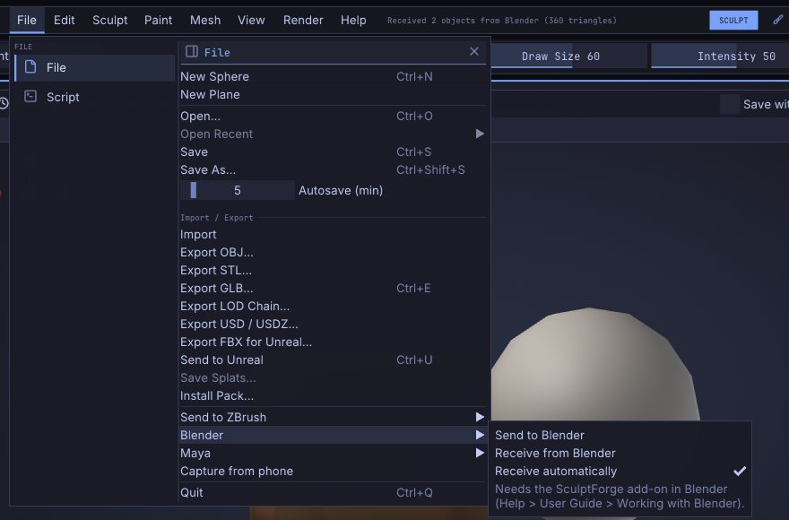

# Working with Blender

Keep Blender for the scene, rigging, shading and animation, and sculpt in SculptForge: the **SculptForge Bridge**
add-on sends the selected objects from Blender to SculptForge with one click, and one click in SculptForge sends
them back. The objects update in place in Blender: their transform, materials and modifiers stay as they were.
It works like ZBrush's GoZ between ZBrush and other apps, on Linux, Windows and macOS, with Blender 4.2 or newer.

## Install the add-on

1. Download `sculptforge_bridge.zip` from the
   [latest release](https://github.com/islandmed/SculptForge/releases/latest/download/sculptforge_bridge.zip)
   (or the [SculptForge website](https://sculptforge.app/)).
2. In Blender choose **Edit > Preferences > Get Extensions**, open the menu at the top right and choose
   **Install from Disk...**, then pick the zip. (You can also drag the zip into Blender's window.)
3. The **SculptForge** tab appears in the 3D View's sidebar (press <kbd>N</kbd>). Send and Receive are also in the
   **Object** menu and in **File > Import / Export**.

Start SculptForge once after installing it: it records where it is installed, so the add-on can start it for
you. If the add-on still can't find it (for example an AppImage you keep somewhere unusual), set its path in the
add-on's preferences (**Edit > Preferences > Add-ons > SculptForge Bridge**).

> **Tip:** Older Blender versions or a classic add-on install: `sculptforge_bridge-<version>-legacy.zip` installs
> through **Edit > Preferences > Add-ons > Install from Disk**. The add-on needs Blender 4.2 or newer either way.

## A round trip

1. In Blender, select one or more mesh objects and click **Send to SculptForge** in the SculptForge tab.
   SculptForge starts, or, if it's already open, loads them within a second. Each object becomes a Part with
   the object's name, placed as it is in the Blender scene.
2. Sculpt, paint, mask, divide, remesh: anything SculptForge does.
3. In SculptForge choose **File > Blender > Send to Blender**. Every visible Part goes back.
4. Blender picks it up by itself within a second (or click **Receive from SculptForge**). Each object that came
   from Blender is updated; a Part you added in SculptForge becomes a new object.

Sending again from Blender updates the same Parts: each update is one undo step on that Part in
SculptForge, and each receive in Blender is one undo step there.

## What comes across

| | Blender | SculptForge |
|---|---|---|
| Shape | The object's mesh, in its own space | The Part, placed in the scene with the object's transform |
| Faces | Triangles and quads; n-gons as triangle fans | Triangles and quads (Wire shows the quads) |
| UVs | The active UV map | UVs |
| Colour | The active colour attribute (point or face corner) | Vertex Paint |
| Mask | The sculpt mask | Mask |
| Face sets | Sculpt mode face sets | Face Groups |
| Name | Object name | Part name |

Blender is Z-up and SculptForge Y-up, both in metres; the add-on and SculptForge convert between them, so the
model stands the same way in both and a round trip changes nothing. Objects with a negative scale (mirrored)
come across the right way out.

**When the topology doesn't change** (you only sculpted, painted or masked), Blender's mesh keeps everything
it had: its n-gons, edges, seams, creases, custom attributes and the other UV maps; only the positions, the active
UV map, colour, mask and face sets are updated.

**When the topology changes** (Divide, a remesh, Quad Remesh, Subdivide...), the object's mesh is rebuilt from what
SculptForge sent. The object keeps its transform, materials, modifiers and the names of its active UV map and
colour attribute; things tied to the old faces (material per face, seams, other UV maps, shape keys) can't
follow and are reset.

## Modifiers

The **Modifiers** setting in the SculptForge tab chooses what an object with modifiers sends:

- **Keep live** (the default): the mesh under the modifiers. They keep working in Blender on the sculpted mesh,
  for example a Mirror or a Subdivision Surface.
- **Apply**: what you see, with the modifiers applied. When it comes back, the mesh holds their result, so the
  add-on turns those modifiers off (they stay on the object, switched off, if you want them again).

## Settings

In the SculptForge tab:

- **Receive automatically**: after a send, load what SculptForge sends back as soon as it arrives (on by
  default). Off: click **Receive from SculptForge** yourself.

In SculptForge's **File > Blender**:

- **Receive automatically**: load what Blender sends as soon as it arrives (on by default).

The add-on's preferences add the path of SculptForge and the exchange folder (below).

## ZBrush-style keys in Sculpt Mode

Sculpting in Blender too? Turn on **ZBrush-style keys in Sculpt Mode** in the add-on's preferences (**Edit >
Preferences > Add-ons > SculptForge Bridge**) and Blender's Sculpt Mode answers to ZBrush's keys where Blender
has the same thing. Turning it off removes them again, and Blender's own keys are back; so does disabling the
add-on. The preferences list every key while it's on.

| ZBrush key | In Blender's Sculpt Mode |
|---|---|
| <kbd>S</kbd> / <kbd>U</kbd> / <kbd>O</kbd> | Draw Size / Intensity (Strength) / Falloff (Hardness), dragged at the cursor |
| <kbd>Space</kbd> | Blender's Sculpt quick menu at the cursor (brush, size, strength) |
| <kbd>B</kbd> | The brush list by ZBrush brush name (Standard, DamStandard, Clay, ClayBuildup, Move, SnakeHook...): type a few letters, <kbd>Enter</kbd> picks |
| <kbd>Alt</kbd>+drag | Sub: the brush digs in |
| <kbd>Ctrl</kbd>+drag / <kbd>Ctrl</kbd>+<kbd>Alt</kbd>+drag | Mask / unmask, drawn as a lasso |
| <kbd>Ctrl</kbd>+<kbd>Shift</kbd>+drag / <kbd>Ctrl</kbd>+<kbd>Shift</kbd>+<kbd>Alt</kbd>+drag | Show only what's inside / hide what's inside |
| <kbd>Ctrl</kbd>+<kbd>W</kbd> | Group the masked part as a face set and clear the mask (with nothing masked: the visible part) |
| <kbd>Ctrl</kbd>+<kbd>D</kbd> / <kbd>D</kbd> / <kbd>Shift</kbd>+<kbd>D</kbd> | Divide (a Multires level) / SDiv up / SDiv down (never adds a level) |
| <kbd>X</kbd> | Symmetry X |
| <kbd>Shift</kbd>+<kbd>F</kbd> | Wireframe (the wireframe overlay) |
| <kbd>F</kbd> / <kbd>P</kbd> | Frame the model / perspective on and off |
| <kbd>L</kbd> | Steady Stroke (Blender: Stabilize Stroke) |
| <kbd>W</kbd> / <kbd>E</kbd> / <kbd>R</kbd> | Move / Scale / Rotate |
| <kbd>Shift</kbd>+drag | Smooth (Blender already does this) |

ZBrush's brushes map to Blender's closest: Standard = Draw, DamStandard = Draw Sharp, ClayBuildup = Clay
Strips, Move = Grab, Move Elastic = Elastic Grab, TrimDynamic = Trim (Scrape in Blender 4.2), Crease = Crease
Sharp, MaskPen = Mask.

What Blender has no key for, or can't do the ZBrush way:

- <kbd>I</kbd> (RGB Intensity): Blender's sculpt brushes don't paint.
- <kbd>Ctrl</kbd>+drag on the model doesn't paint the mask with a round brush: Blender can't switch to the Mask
  brush for one stroke, so it draws a mask lasso (pick the Mask brush with <kbd>B</kbd> to paint it).
- Dragging on the empty background doesn't rotate: a keymap can't tell the model from the background. Use the
  middle mouse button, or Blender's *Emulate 3 Button Mouse*.
- <kbd>Ctrl</kbd>+click on the background (invert or clear the mask) and <kbd>Ctrl</kbd>+<kbd>Shift</kbd>+click
  (show all): use <kbd>Ctrl</kbd>+<kbd>I</kbd>, <kbd>Alt</kbd>+<kbd>M</kbd> and <kbd>Alt</kbd>+<kbd>H</kbd>.
- <kbd>B</kbd> then two letters: a Blender menu takes one key at a time, so <kbd>B</kbd> opens the list and the
  letters filter it.
- <kbd>Alt</kbd>+click a Part: Blender's objects aren't Parts (<kbd>Alt</kbd>+<kbd>Q</kbd> switches the object
  you sculpt).
- Stroke types (Drag Stamp, Spray...): each Blender brush sets its stroke method in its Stroke panel.

These keys take Blender's place while they're on: <kbd>F</kbd> no longer sets the radius (that's <kbd>S</kbd>),
<kbd>B</kbd> no longer draws a box mask, <kbd>Ctrl</kbd>+drag no longer inverts the brush (that's <kbd>Alt</kbd>),
and <kbd>Space</kbd> no longer plays the animation in Sculpt Mode.

## Vector displacement maps

SculptForge's VDM brushes and Blender's use the same maps (see
[Vector displacement brushes](sculpting.md#vector-displacement-brushes)):

- **From Blender**: a map baked with Blender's *VDM Brush Baker* loads with **Sculpt > Brush > Vector Displacement > Load
  VDM...** as it is.
- **To Blender**: **Export EXR...** writes the VDM brush's map. In Blender, in Sculpt Mode with a Draw brush:
  in the brush's **Texture** panel add a new image texture and open the EXR (set its Color Space to
  **Non-Color**), set **Mapping** to **Area Plane**, turn on **Vector Displacement**, then set the stroke method
  to **Anchored** and Strength to 1. Drag on the model to stamp it.

## How it works

The two programs share a folder in your user data: `~/.local/share/SculptForge/SculptForge/blender` on Linux,
`%APPDATA%\SculptForge\SculptForge\blender` on Windows, `~/Library/Application Support/SculptForge/SculptForge/blender`
on macOS. Each side writes its meshes there as `.GoZ` files (the format SculptForge also uses with ZBrush) with a
small list of the objects, and checks the other side's list once a second. Nothing goes over the network.

To use another folder, set it in the add-on's preferences and start SculptForge with the environment variable
`SCULPTFORGE_BLENDER_EXCHANGE` set to the same folder.

From scripts and the MCP server: `blender_send` and `blender_receive` (both take `folder=`). Starting
SculptForge with `--blender` loads what Blender last sent.

## Limits and troubleshooting

- **Blender as a Flatpak or Snap** sees a different user data folder and may not be allowed to start other
  programs. Set the add-on's exchange folder to a folder both can reach, start SculptForge yourself with
  `SCULPTFORGE_BLENDER_EXCHANGE` set to it, and send.
- **Linked duplicates** (objects sharing one mesh) all show the last one received.
- **Shape keys**: the Basis and the keys named like SculptForge's layers are updated; other keys keep their shapes.
- **Subdivision levels** don't go to Blender: it receives the level you're on (like ZBrush's GoZ).
- **Sculpt layers** arrive as **shape keys** (Basis plus one key per layer, with its name and weight), so the 52
  [facial shapes](facial-shapes.md) keep their ARKit names. Shape keys don't come back from Blender, and textures
  stay in SculptForge.
- **Nothing arrives in SculptForge?** Check **File > Blender > Receive automatically**, or choose **Receive from
  Blender**. **Nothing arrives in Blender?** Click **Receive from SculptForge**; automatic receiving starts after the
  first send from that Blender session.
- Objects in Edit Mode or Sculpt Mode are updated too: the add-on switches to Object Mode for the update and back.

## See also

- [Exporting, Unreal and ZBrush](exporting.md): files, game engines and Send to ZBrush
- [Parts](parts.md): each Blender object is a Part
- [Face Groups and visibility](face-groups.md): Blender's face sets
