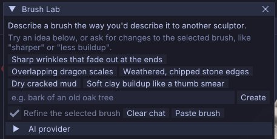
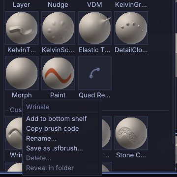
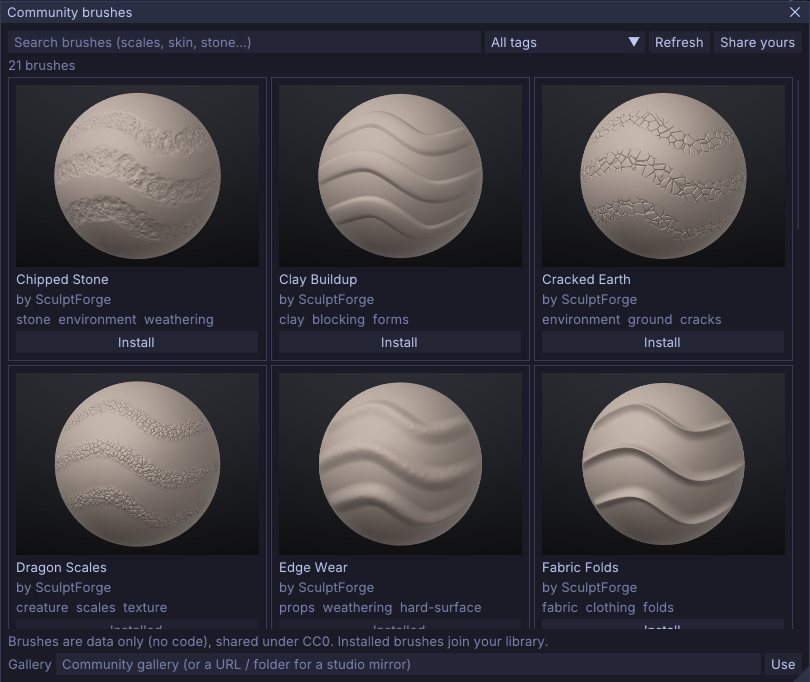

# Brush Lab and sharing brushes

Brush Lab designs sculpting brushes from a description: type "dry cracked mud" and an AI model builds the
brush, then you refine it in words or with sliders. This chapter covers Brush Lab, the AI providers it can use,
the recipe settings, your brush library, and the ways to share brushes: `.sfbrush` files, one-line brush
codes, studio folders and the community gallery.



## What a custom brush is

A custom brush is a *recipe*: about twenty named values that describe how the brush moves the surface, the
shape of its tip, a surface pattern, stroke spacing and masking. A recipe is data, never code, so brushes are
safe to download and share. The AI only fills in these values; you can see and change every one of them.

Custom brushes work everywhere built-in brushes do: on the bottom shelf, in the brush picker (<kbd>B</kbd>),
with <kbd>Alt</kbd>, <kbd>Shift</kbd>, masks, symmetry, strokes and alphas.

## Open Brush Lab

Click **AI Brush** on the top shelf, or **AI Brush** at the top of **Sculpt > Brush**. Brush Lab is a
floating window; it opens at the top-left corner of the canvas the first time, and you can drag it anywhere.
Click the button again, or the window's close box, to hide it. Not there? AI features are off: turn them on in
**Edit > Preferences > AI** (see [Turning AI off](interface.md#turning-ai-off)).

## Design a brush

1. Open Brush Lab.
2. Type a description in the field at the bottom, the way you'd describe the brush to another sculptor, for
   example `bark of an old oak tree` or `soft folds in heavy cloth`. Or click one of the starter ideas, such as
   **Overlapping dragon scales** or **Dry cracked mud**.
3. Press <kbd>Enter</kbd> or click **Create**. While the model works, the conversation shows "Designing brush".
4. When the brush is ready, it becomes the active brush and the status bar says so. Try it on the model.

The model replies with the brush name in brackets and a sentence on what the brush does and what to try next.
Errors (no connection, rate limits, a model that didn't return a recipe) appear in red in the same
conversation.

### Refine a brush in words

With **Refine the selected brush** ticked, your next message changes the active custom brush instead of
creating a new one: "sharper", "less buildup", "make the scales smaller". The model sees the current recipe and
your conversation so far. **Clear chat** starts a new conversation.

### Tune a brush with sliders

Open the **Recipe** section of Brush Lab to see every value of the active custom brush. The same editor
appears in **Sculpt > Brush** as **Edit recipe: NAME** when a custom brush is active. Hover a slider for a
description.

| Setting | Range | What it does |
|---|---|---|
| **Direction** | normal, inflate, view, stroke | Which way the surface moves: out of the surface, outward in every direction, toward the camera, or along the stroke. |
| **Depth** | -1 to 1 | Adds material (positive) or carves it away (negative). |
| **Plane** | none, clay, flatten, fill, scrape | Planar behaviour: flat-topped clay layers, levelling, raising only low spots, or cutting only high spots. |
| **Plane amount** | 0 to 1 | Strength of the plane behaviour. |
| **Pinch** | -1 to 1 | Pulls the surface toward the stroke for crisp creases (negative spreads it apart). |
| **Drag** | 0 to 1 | Smears the surface along the stroke, like a palette knife. |
| **Auto smooth** | 0 to 1 | Relaxes the surface after each dab for softer, cleaner results. |
| **Hardness** | 0 to 1 | Soft airbrush edge (0) to hard-edged stamp (1). |
| **Tip sharpness** | 0 to 1 | Round, broad tip (0) to a narrow needle point (1). |
| **Pattern** | none, noise, scales, ridges, pores, cracks | A surface texture stamped by the brush. |
| **Pattern size** | 0.03 to 2 | Size of the pattern relative to the brush size. |
| **Pattern amount** | 0 to 1 | How strongly the pattern shows. |
| **Spacing** | 0.02 to 2 | Distance between dabs, relative to the brush size. |
| **Jitter** | 0 to 1 | Random scatter of dabs around the stroke. |
| **Pressure curve** | 0.3 to 3 | Tablet response: above 1 needs a firmer press, below 1 responds to a light touch. |
| **Front faces only** | on / off | Only affects surfaces facing the camera, protecting thin parts. |
| **Cavity mask** | -1 to 1 | Positive: only cavities. Negative: only ridges and peaks (as Edge Wear does). |

The name field at the top of the editor renames the brush when you press <kbd>Enter</kbd>.

> **Tip:** to adapt a built-in recipe such as Dragon Scales, select it and move the sliders. Your version is
> saved to your library and replaces the built-in one; delete it to get the original back.

## Choose an AI provider

Brush Lab works out of the box with no account or key. Open the **AI provider** section of Brush Lab (also in
**Mesh > Generate 3D > AI brush provider**) to choose another service.

| Provider | What you need | Notes |
|---|---|---|
| **Free - no account or key** (default) | Nothing | An open model (GPT-OSS 20B) hosted by Pollinations.ai. Only your description and settings are sent. Rate limited to about one request every few seconds. If it can't be reached, a running local Ollama is used instead. |
| **Anthropic (Claude) - your key** | An Anthropic API key | Uses `claude-opus-5-5` by default. **Effort** (low, medium, high) trades speed for more considered brushes. |
| **OpenAI-compatible (OpenAI, Ollama, LM Studio...)** | An endpoint, a model name and, for hosted services, a key | Any server that speaks the OpenAI chat completions API, including local models. |

For Anthropic and OpenAI-compatible providers you can edit the **Endpoint**, **Model** and **API key** fields.
Leave the key empty to use the `ANTHROPIC_API_KEY` or `OPENAI_API_KEY` environment variable. Click
**Save settings** to keep your choice; settings and keys are stored only on your computer, in `ai.json` in the
SculptForge settings folder (readable only by you). Requests go only to the endpoint you set.

### Run a model on your own computer

For private, offline use with no rate limits, run a local model with Ollama or LM Studio:

1. Install [Ollama](https://ollama.com/download) and download the recommended model:
   `ollama pull qwen3:4b-instruct` (2.5 GB, works without a graphics card).
2. In **AI provider**, choose **OpenAI-compatible (OpenAI, Ollama, LM Studio...)**.
3. Click **Ollama** (or **LM Studio**) to fill in the local endpoint.
4. Click **Find models**. SculptForge checks the connection, shows "Connected" with the number of installed
   models, and lets you pick one from the **Model** list.
5. Click **Save settings**.

The **Run a model on this computer** section in the panel shows the install steps for your operating system.
The model needs about 4 GB of free memory; expect 10-20 seconds per brush on a laptop CPU and a few seconds
with a GPU. The full walkthrough for Windows, macOS, Linux and LM Studio is in
[docs/local-ai.md](https://github.com/islandmed/SculptForge/blob/main/docs/local-ai.md).

## Your brush library

Every brush you create or refine in Brush Lab is saved to your brush library automatically, a moment after
your last change (slider edits save when you release the slider). The library loads at every start, in the
app, in `sculptforge-cli` and in the Python module, so your brushes are always there.

The library is a folder of `.sfbrush` files in the SculptForge settings folder:

| System | Brush library |
|---|---|
| Linux | `~/.local/share/SculptForge/SculptForge/brushes` |
| macOS | `~/Library/Application Support/SculptForge/SculptForge/brushes` |
| Windows | `%APPDATA%\SculptForge\SculptForge\brushes` |



### The Custom brushes list

**Sculpt > Brush** lists every custom brush under **Custom brushes**. A small tag after a name says where
the brush comes from when it isn't simply yours or built in:

| Tag | Meaning |
|---|---|
| (none) | A built-in brush, or a brush in your library |
| `yours` | Your version, which replaces a built-in or studio brush of the same name |
| `studio` | From a shared studio folder (read-only) |
| `gallery` | Installed from the community gallery (kept in your library) |
| `project` | Came with the open project and isn't in your library |
| `unsaved` | Made this session (for example picked from the picker's **Library** section, or loaded by a script) and not in your library |

Hover a brush for its description, origin and file. Right-click it for:

- **Copy brush code**: one line of text to share (see below).
- **Save .sfbrush...**: write the brush to a file.
- **Rename...**: rename it. Renaming a built-in or studio brush saves a renamed copy and keeps the original.
- **Delete...**: remove it from your library, after a confirmation. Only brushes in your own library can be
  deleted. If your brush replaced a built-in or studio brush, that one is used again.
- **Reveal in folder**: open the folder that holds its file.

The same menu is available when you right-click a custom brush in the brush picker.

When brushes share a name, your library wins over studio folders, and studio folders win over built-in
brushes.

## Share brushes

### Brush codes

A brush code is the whole recipe in one line of text, starting with `sfbrush1:`. Paste it into a chat, an
email, an issue or a forum post.

- **Copy**: right-click a custom brush (in **Sculpt > Brush > Custom brushes** or the brush picker) and choose
  **Copy brush code**.
- **Paste**: copy a code, then press <kbd>Ctrl</kbd>+<kbd>V</kbd> over the viewport, click **Paste brush** in
  Brush Lab, or choose **Edit > Paste brush**. The brush is installed in your library and becomes active.

Pasting also accepts the text of a `.sfbrush` file. Codes are validated like files: values outside their
range are clamped, and anything that isn't a recipe is refused.

### Brush files (.sfbrush)

A `.sfbrush` file is a small JSON file holding one recipe.

- **Save**: right-click the brush and choose **Save .sfbrush...**, or click **Save .sfbrush...** under the
  recipe sliders.
- **Install**: click **Install .sfbrush...** under the recipe sliders, or drop the file onto the SculptForge
  window. The brush goes into your library.
- **Library folder**: `.sfbrush` files in the `Brushes` folder of your Library library (Documents/SculptForge
  by default) appear in the **Library** section of the brush picker and in Library's Brush tab. Picking one
  loads it for the session.

The file format and every key are documented in
[docs/brushes.md](https://github.com/islandmed/SculptForge/blob/main/docs/brushes.md).

### Studio brush folders

A studio can share brushes read-only from network folders. Set the environment variable
`SCULPTFORGE_BRUSH_PATH` to one or more folders (separated by `:` on Linux and macOS, `;` on Windows). Every
`.sfbrush` file in them loads at start-up, tagged `studio`. Artists can't change or delete studio brushes; if
they edit one, their own version is saved in their library under the same name. The Rez package adds the
folder in `SCULPTFORGE_STUDIO_BRUSHES` to this path. See [For studios](studios.md).

Projects (`.sfproj`) also store the brushes they use, so a scene opens with its brushes on any machine.

## The community gallery

The community gallery is a public collection of free (CC0) brushes shared by other sculptors.

1. Click **Community brushes** at the top of **Sculpt > Brush**.
2. Search by name or description (scales, skin, stone...), or pick a tag from the **All tags** list.
3. Click **Install** under a brush. It is downloaded, checked against its SHA-256 checksum, installed in your
   library and made active. Installed brushes show **Installed**.



The gallery is cached, so the window still opens offline (with a notice) showing the brushes from your last
visit. **Refresh** fetches the latest list. **Share yours** opens the gallery's page on GitHub, where you can
submit a brush you saved as `.sfbrush` with a pull request.

You can also browse the gallery on the website at
[sculptforge.app/brushes.html](https://sculptforge.app/brushes.html).

Studios can mirror the gallery or run their own. Enter a URL or folder in the **Gallery** field at the bottom
of the window and click **Use**, or set `SCULPTFORGE_BRUSH_GALLERY` (which then takes precedence and hides the
field). See [docs/brushes.md](https://github.com/islandmed/SculptForge/blob/main/docs/brushes.md) for the
gallery format.

## Brushes from scripts

Every brush operation is also a command, for `sculptforge-cli`, the console, Python and AI agents:

| Command | What it does |
|---|---|
| `brush_ai prompt=...` | Design a brush from a description (optional `provider`, `endpoint`, `model`). |
| `brush_create name=... depth=...` | Create or update a brush from recipe values. |
| `brush_list` / `brush_library` | List custom brushes (with their source and file, and the library folders). |
| `brush_save path=...` | Save a brush as `.sfbrush` (`name` defaults to the active brush). |
| `brush_load path=...` | Load a `.sfbrush` file for this session only. |
| `brush_install path=... / code=... / json=...` | Install a brush into your library and make it active. |
| `brush_code` | Print a brush as a brush code. |
| `brush_rename to=...` / `brush_delete name=...` | Rename or delete a brush. |
| `brush_gallery_search` / `brush_gallery_install name=...` | Search and install from the community gallery. |

```sh
# Design a brush for free and save it for the team
sculptforge-cli -c 'brush_ai prompt="weathered stone edges"; brush_save path=stone.sfbrush'

# Install a gallery brush and try it on a sphere
sculptforge-cli -c 'brush_gallery_install name="Snake Scales"; new_sphere subdivisions=6; stroke points="-0.5,0,0 0.5,0.2,0"'
```

See [Scripting and automation](scripting.md) for running commands.

## See also

- [Sculpting and brushes](sculpting.md): built-in brushes, strokes, alphas and pressure
- [For studios](studios.md): shared brush folders and pipelines
- [Troubleshooting](troubleshooting.md): AI provider errors and rate limits
