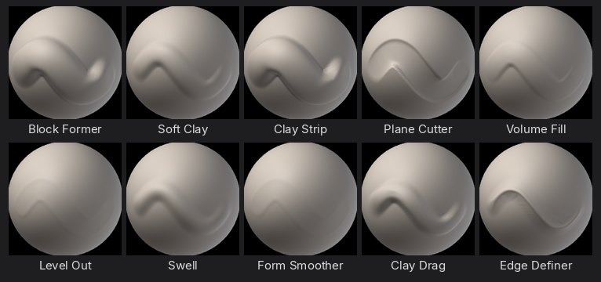
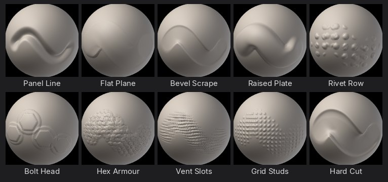
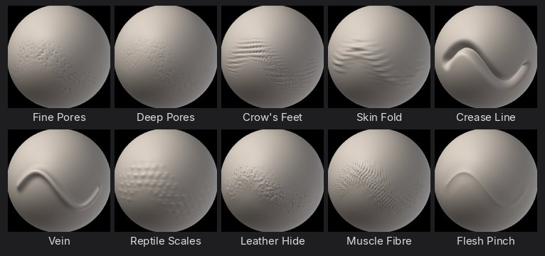
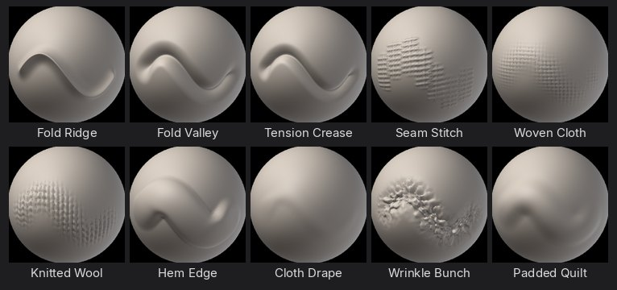
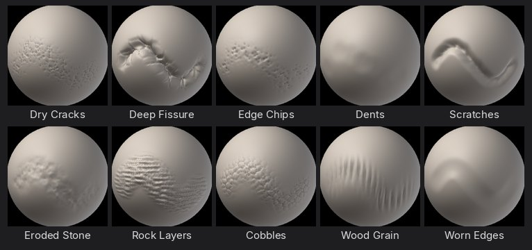
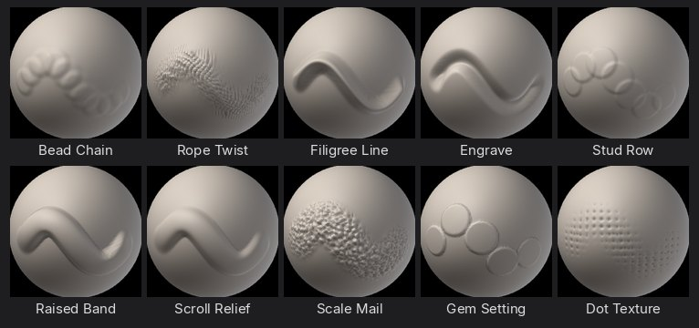

# Brush packs

SculptForge comes with sixty ready-tuned brushes in six packs, on top of the built-in brushes. Each one is a
brush recipe (see [Brush Lab](brush-lab.md)) with its own alpha where it needs one, so you can use them as they are,
or open one in Brush Lab and make your own version. Every brush, alpha and preview here is made by SculptForge itself:
the recipe engine, procedural alphas and the same clay-ball thumbnails as the brush picker.

## Find and pick a pack brush

- **Sculpt > Brush**: the grid shows **Built-in**, **Custom**, then **Brush packs**. **Sort: A-Z > Pack** shows one
  section per pack. The filter field finds a brush by name.
- **B** opens the brush picker: type the first letters of the name, then the orange key.
- **Custom brushes** in **Sculpt > Brush** lists every pack brush with its pack's name beside it.
- Scripts and macros: `brush_use name="Rivet Row"`; `brush_list` shows every brush with its pack.

The first time you pick a pack brush it brings its own alpha (Rivet Row brings **Rivets**, turned along the
stroke); brushes without one go back to the plain round tip. From then on the brush keeps whatever you change, as every
brush does (**Sculpt > Brush > Save Brush Settings** keeps it for good, **Reset Brush to Default** brings back the pack's).

Pack brushes are read-only like the other built-ins: changing one in Brush Lab saves your own copy, which replaces it
in the lists until you delete it.

Textures (pores, stitches, weave, rivets) need enough polygons to show: subdivide, or turn on
[Dynamic topology](dynamic-topology.md), until the brush's detail is several polygons wide.

## Clay & Form

Block in, build up and refine big forms: clay strokes, planes, and smooth blends.

| Brush | What it does | Alpha |
|---|---|---|
| **Block Former** | Big, flat-topped clay strokes that stack fast, for blocking in primary forms. | Square |
| **Soft Clay** | Gentle round clay that builds in thin layers and blends into the surface. |  |
| **Clay Strip** | Narrow, crisp strips of clay with a hard edge, for muscle fibres and planes. | Square |
| **Plane Cutter** | Shaves the surface down to flat planes, for stylised forms and stone. |  |
| **Volume Fill** | Fills low areas up to the stroke's plane and leaves the high points alone. |  |
| **Level Out** | Presses hills and valleys onto one plane and softens the result, to calm busy areas. |  |
| **Swell** | Puffs the surface out along its own normals, for cheeks, bellies and soft volumes. |  |
| **Form Smoother** | Relaxes lumps while keeping the big shape, for a clean pass after blocking. |  |
| **Clay Drag** | Smears soft clay along the stroke like a thumb pushing it, for blending transitions. |  |
| **Edge Definer** | Pinches a crisp edge into the surface where two planes meet. |  |

## Hard Surface

Crisp planes, panel lines, bevels, rivets and bolts for props, armour and machines.

| Brush | What it does | Alpha |
|---|---|---|
| **Panel Line** | Cuts a clean, narrow groove for panel gaps and seams. |  |
| **Flat Plane** | Presses a perfectly flat face with a hard edge, for machined surfaces. | Square |
| **Bevel Scrape** | Scrapes high points into a bevel along an edge, for chamfers. |  |
| **Raised Plate** | Builds a flat, square-edged plate on the surface, for armour and hull panels. | Square |
| **Rivet Row** | Stamps rows of round rivet heads along the stroke. | Rivets |
| **Bolt Head** | Stamps a hexagonal bolt on a washer; space the dabs out or click once. | Bolt |
| **Hex Armour** | Raises a honeycomb of hexagonal plates, for sci-fi armour and shells. | Hex Plates |
| **Vent Slots** | Cuts parallel slots like a vent grille; drag across the slots. | Wrinkles |
| **Grid Studs** | An even grid of small studs, for grip textures and tread plates. | Dot Grid |
| **Hard Cut** | Cuts the surface flat below the stroke, for sharp silhouettes and clean cuts. | Square |

## Organic & Skin

Pores, wrinkles, folds, veins and scales for creatures and portraits.

| Brush | What it does | Alpha |
|---|---|---|
| **Fine Pores** | Small, evenly scattered pores for faces and close-ups. | Pores |
| **Deep Pores** | Bigger, deeper pores for noses, cheeks and rough skin. | Pores |
| **Crow's Feet** | Fine fanned wrinkle lines, for eye corners and knuckles. | Wrinkles |
| **Skin Fold** | Soft rolls of heavy skin, for necks, bellies and brows. | Skin Folds |
| **Crease Line** | A sharp, deep crease with pinched sides, for eyelids, lips and nasal folds. |  |
| **Vein** | Raises thin, soft-edged veins along the stroke. |  |
| **Reptile Scales** | Overlapping rows of rounded scales, for lizards, dragons and fish. | Scales |
| **Leather Hide** | Pebbled grain with fine creases, for leather, elephant and rhino skin. | Leather Grain |
| **Muscle Fibre** | Long soft ridges along the stroke, for muscle striation and sinew. | Hair Strands |
| **Flesh Pinch** | Pulls soft flesh together into a ridge, for lips, knuckles and wrinkles that bunch. |  |

## Cloth & Folds

Folds, seams, stitches, weave and knit for clothing and soft goods.

| Brush | What it does | Alpha |
|---|---|---|
| **Fold Ridge** | Raises a rounded fold of cloth with soft sides. |  |
| **Fold Valley** | Carves the soft valley between two folds. |  |
| **Tension Crease** | A sharp crease where cloth pulls tight, for armpits, elbows and seams under strain. |  |
| **Seam Stitch** | A sewn seam with cross stitches; drag along the seam. | Stitches |
| **Woven Cloth** | Threads woven over and under, for canvas, denim and sacking. | Fabric Weave |
| **Knitted Wool** | Rows of V-shaped loops, for jumpers, scarves and chunky knits. | Knit |
| **Hem Edge** | A flat, square-edged band along the stroke, for hems, cuffs and straps. | Square |
| **Cloth Drape** | Drags the surface along the stroke so folds flow and hang, for drapery. |  |
| **Wrinkle Bunch** | Small compressed wrinkles where cloth gathers, at waists and wrists. |  |
| **Padded Quilt** | Puffs soft panels up between the stroke's edges, for quilting and padding. | Square |

## Damage & Wear

Cracks, chips, dents, scratches and erosion for weathered stone, wood and metal.

| Brush | What it does | Alpha |
|---|---|---|
| **Dry Cracks** | A web of thin cracks, for dry earth, old paint and stone. | Cracks |
| **Deep Fissure** | One deep, jagged split, for broken rock and ice. |  |
| **Edge Chips** | Knocks angular chips out of edges only; flat areas stay whole. | Chips |
| **Dents** | Soft, scattered dents, for beaten metal and hammered surfaces. |  |
| **Scratches** | Thin, sharp scratches along the stroke, for scuffed metal and wood. |  |
| **Eroded Stone** | Breaks the surface up with noise, for weathered rock and sandstone. |  |
| **Rock Layers** | Stepped, broken strata, for cliffs and layered stone. | Rock Strata |
| **Cobbles** | Packed rounded stones with grooves between, for paths and old walls. | Cobblestone |
| **Wood Grain** | Rough furrows and ridges, for bark and weathered planks; drag along the grain. | Bark |
| **Worn Edges** | Softens and rounds only the sharp ridges, as years of handling do. |  |

## Ornament

Beads, ropes, filigree, studs and carved patterns for jewellery, trims and decoration.

| Brush | What it does | Alpha |
|---|---|---|
| **Bead Chain** | A row of round beads along the stroke, for jewellery and trims. |  |
| **Rope Twist** | A twisted rope or cord, for borders and rigging. | Hair Strands |
| **Filigree Line** | A thin, raised wire line, for filigree and engraved borders. |  |
| **Engrave** | Cuts a fine, crisp line, for engraving, runes and lettering. |  |
| **Stud Row** | Rounded studs spaced along the stroke, for belts, doors and armour trims. |  |
| **Raised Band** | A flat, raised band with clean edges, for bezels, rims and mouldings. |  |
| **Scroll Relief** | Soft, rounded relief that builds up slowly, for carved scrolls and leaves. |  |
| **Scale Mail** | Rows of small scales, for armour, roof tiles and feathers. |  |
| **Gem Setting** | A raised round setting with a crisp rim, for cabochons and gem seats. |  |
| **Dot Texture** | Fine even dots, for stippling, punched leather and decorative fields. | Dot Grid |

## New alphas

Six procedural alphas came with the packs and work with any brush (**Sculpt > Alpha**): **Cobblestone**,
**Leather Grain**, **Hex Plates**, **Knit**, **Bolt** and **Chips**. **Sculpt > Alpha** lists every alpha A-Z (Round, the
plain tip, first), has a filter field, and **Sort** for the most recently used first or by pack.
