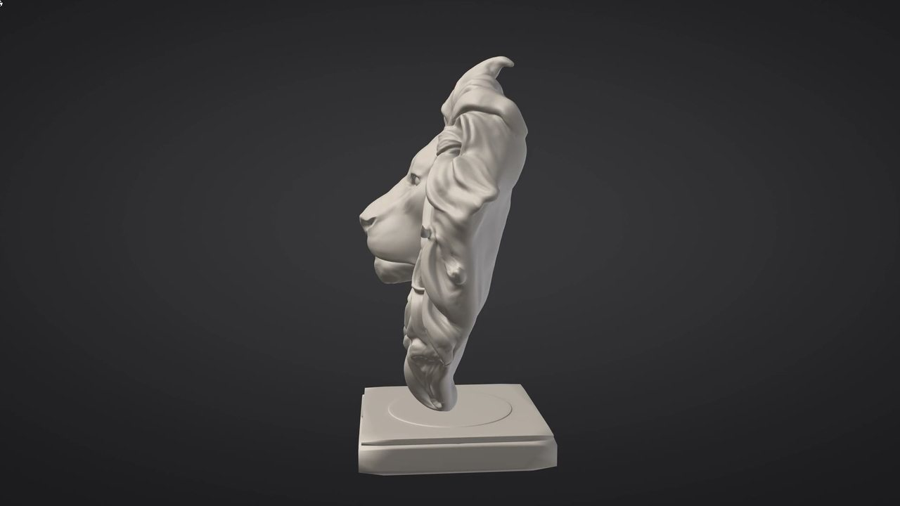

# Show SculptForge on Discord

> **In short:**
> - Shows **SculptForge**, your time in it and one word, **Sculpting**, **Painting** or **Idle**, on your Discord profile.
> - It is off until you switch it on.
> - Nothing else is sent: no file names, folders, Part names, user name or model details.

Let your Discord friends see that you're sculpting. Discord's profile and member list then show **SculptForge**,
its icon, how long you've been at it and one word for what you're doing. It's off until you switch it on.

## Switch it on

1. Open **Edit > Preferences > Integrations**.
2. Check **Show SculptForge on Discord**.
3. Keep the Discord desktop app running on the same computer. Your status appears within a few seconds.

Uncheck **Show SculptForge on Discord** and your status is cleared at once. Quitting SculptForge clears it too, and
so does a crash. If you quit and restart Discord, your status comes back within a minute.

## What is sent, and where

| Sent | When |
|---|---|
| The SculptForge icon (Discord loads it from sculptforge.app) and name | while it's on |
| The time you started (Discord shows the elapsed time) | while it's on |
| One word: **Sculpting**, **Painting** (the Paint brush in hand) or **Idle** (nothing done for five minutes) | while it's on |

Nothing else: no file names, folders or paths, no Part names, no user name, no details about your model, nothing
you type. The three words are fixed; nothing from your scene can get into them. SculptForge passes this to the
Discord app on your own computer only, through Discord's local connection; it opens no network connection and no
port for it, and never asks Discord for anything (no sign-in, no invitations, no account access). Discord then
shows your status to your friends and to the servers you share, as it does for games.

Earlier versions could also show the open file's name or a monthly challenge theme you typed. Both options are
gone, so nothing from your scene or your keyboard leaves the app; if you had one on, **Edit > Preferences >
Integrations** says so once.

> **Note:** Discord shows your status only if **Display current activity as a status message** is on in Discord's
> **User Settings > Activity Privacy**.

## If it doesn't show

- Check that the Discord desktop app is running and you're signed in. The website version of Discord can't show it.
- Discord in a Flatpak or Snap works; a Discord running as another user (or as administrator on Windows while
  SculptForge isn't) is ignored on purpose.
- Started Discord after SculptForge? It connects on its own within a minute.

## See also

- [The interface](interface.md)
- [Troubleshooting](troubleshooting.md)
