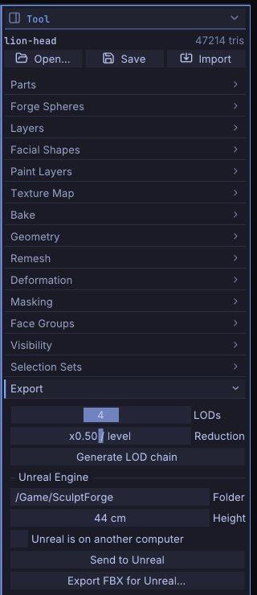

# Exporting, Unreal and ZBrush

This chapter covers getting your sculpt out of SculptForge: the export formats and what each one keeps, LOD
chains for games, sending a mesh straight into a running Unreal Editor, and exchanging models with ZBrush
with Send to ZBrush. To keep everything (Parts, layers, mask, vertex paint, brushes) use a project file instead; see
[Projects, autosave and snapshots](projects.md).

## Export formats at a glance

Exports write every **visible** Part. Hidden Parts are left out. Exporting doesn't rename the document
or mark it saved, so your next <kbd>Ctrl</kbd>+<kbd>S</kbd> still saves the project.

| Format | Where in the app | Keeps | Use it for |
|---|---|---|---|
| glTF binary (`.glb`) | **File > Export GLB...** (<kbd>Ctrl</kbd>+<kbd>E</kbd>) | One node per Part, sculpt layers as morph targets, vertex paint as vertex colour, UVs and the painted texture (embedded) | Games, Blender, three.js, web viewers |
| LOD chain (`.glb` per level) | **File > Export LOD Chain...** | As GLB, one file per level, blend shapes on every level | Game engines |
| OpenUSD (`.usda`, `.usdz`) | **File > Export USD / USDZ...** | One Mesh prim per Part, quads, layers as UsdSkel blend shapes, vertex paint as `displayColor`, UVs (`primvars:st`) and the painted texture through a preview material (inside a USDZ), loaded splats | Film pipelines, Omniverse, Apple AR Quick Look |
| FBX for Unreal (`.fbx`) | **File > Export FBX for Unreal...** | Unreal naming and scale, quads, UVs, LOD group, layers as blend shapes, the painted texture as a PNG beside it | Unreal Engine (by hand) |
| Wavefront OBJ (`.obj`) | **File > Export OBJ...** | One `o` object per Part, quads, face groups as `g` groups, vertex paint as vertex colour, UVs, the painted texture through a `.mtl` (`map_Kd`) and a PNG beside it. Layers are baked into the current blend | Any 3D app, ZBrush |
| ZBrush GoZ-compatible (`.GoZ`) | **File > Send to ZBrush > Export GoZ-compatible file...** | Quads, face groups, mask, vertex paint, UVs, the painted texture as a PNG beside it | ZBrush |
| STL (`.stl`) | **File > Send to ZBrush > Export STL...** | Geometry only (triangles), visible Parts merged, in millimetres with Z up | [3D printing](#3d-printing) |
| PLY (`.ply`) | `export_ply` command | Geometry, quads and vertex paint, visible Parts merged | Scan tools, MeshLab, Blender |
| FBX (general) | `export_fbx` command | One model per Part, quads, UVs, blend shapes, optional LOD groups, the painted texture | Other FBX pipelines |

The GLB, LOD chain and FBX for Unreal exports are also in the **Tool** palette under **Export**, together with
the LOD and Unreal settings.

"Quads" means the quads the model came in with (or got from Plane, Cube, Subdivide or Voxel Remesh) are written
as quads, the rest as triangles; see [Quads and triangles](geometry.md#quads-and-triangles). glTF and STL can
only hold triangles.



UVs are kept through OBJ, FBX, USD, glTF and GoZ-compatible files, in and out. A Part with a painted
[texture](texture-painting.md) is exported with it: the PNG is written next to the file as
`<name>_color.png` (`<name>_<Part>_color.png` with several Parts) and referenced by the model, or embedded
in GLB and USDZ files. Spaces in the file name become `_` in the names of the files written beside it
(`my scene.obj` gets `my_scene.mtl` and `my_scene_color.png`), because OBJ and MTL separate file names with
spaces. **Tool > Texture Map > Auto UV** gives any sculpt UVs before export. Normal, displacement and other maps
come from [Tool > Bake](baking.md) as separate image files.

Textured exports are checked against other tools, not only read back by SculptForge: GLB files pass the Khronos
glTF validator with no errors or warnings; USD and USDZ files pass OpenUSD's validators (the USDZ files are
uncompressed, 64-byte aligned and have the root layer first); FBX files load in ufbx's strict mode with their
textures connected; and in all four formats plus OBJ, the texture is sampled the right way up (each format's
UV convention), checked colour by colour against SculptForge's own sampling. The scripts are in
`tools/export_check/` in the source tree.

### Scale and axes

- glTF, USD and OBJ are written Y-up with 1 unit = 1 metre, the same space you sculpt in.
- FBX uses centimetres: `export_fbx` multiplies positions by 100 by default (`scale=`), so 1 unit = 1 m.
- STL is written in millimetres with Z up, as slicers expect: a 0.3 m sculpt prints 300 mm tall, standing
  upright. `export_stl height_mm=80` scales it to a print height instead (see [3D printing](#3d-printing)).
  Opening an STL converts back, so a downloaded print model comes in upright and at its real size. STL files
  from SculptForge 0.5 and earlier (metres, Y up) are recognised and open as they were saved.
- PLY keeps positions as they are (no unit conversion).
- For Unreal, **Height** sets the real-world size directly (see below).

## Export a model

1. Show the Parts you want to export and hide the others (the eye icon in **Tool > Parts**).
2. Choose the export in the **File** palette and pick a file name.
3. The status line confirms the export ("Exported ...").

A Part with [subdivision levels](subdivision-levels.md) is exported at the level you are on. To write the base
cage (or any other level) without stepping to it, use `subdiv_export path=base.obj level=1`.

From a script, each format is one command:

```sh
sculptforge-cli -c 'open path=bust.sfproj; export_glb path=bust.glb'
sculptforge-cli -c 'open path=bust.sfproj; export_usd path=bust.usdz'
sculptforge-cli -c 'open path=bust.sfproj; save_obj path=bust.obj'
sculptforge-cli -c 'open path=bust.sfproj; export_fbx path=bust.fbx lods=3 ratio=0.5'
sculptforge-cli -c 'open path=bust.sfproj; export_stl path=bust.stl; export_ply path=bust.ply'
```

## 3D printing

**File > Send to ZBrush > Export STL...** writes every visible Part as one binary STL, ready for a slicer
(PrusaSlicer, Cura, Bambu Studio, OrcaSlicer ...). The status line gives the printed size, for example
"Exported lion.stl (47214 triangles, 320.8 x 206.6 x 436.4 mm)": width, depth and height as the slicer shows them.

- **Size:** 1 unit in SculptForge is 1 m, so 1 unit becomes 1000 mm. To print at a given height, use
  `export_stl path=lion.stl height_mm=80`, or scale the model in the slicer.
- **One solid:** overlapping Parts go into the file as they are, which some slicers and print services
  reject. **Merge visible** them ([Parts](parts.md#merge-parts)) and
  [Remesh](geometry.md#voxel-remesh) to turn them into one closed surface first.
- **Detail:** printers resolve about 0.05-0.1 mm, so millions of triangles rarely help.
  [Decimate](geometry.md#decimate) makes the file smaller without visible loss.

```sh
sculptforge-cli -c 'open path=bust.sfproj; export_stl path=bust.stl height_mm=120'
sculptforge-cli -c 'open path=bust.sfproj; export_stl path=bust.stl scale=1 z_up=false'   # sculpt space as it is
```

## LOD chains for games

A LOD (level of detail) chain is the same model at decreasing triangle counts, so an engine can draw distant
objects cheaply. SculptForge builds it with quadric decimation, keeping blend shapes on every level.

1. Open **Tool > Export**.
2. Set **LODs** (2 to 6 levels, including LOD0) and **Reduction** (0.1 to 0.9: the triangle ratio from one
   level to the next, default 0.5).
3. Click **Generate LOD chain**. A table lists each level with its triangle count and its share of LOD0.
4. Click a level (**LOD0**, **LOD1** ...) to inspect it in the viewport; the wireframe turns on. Click
   **Sculpt** to go back to the editable mesh.
5. Export with **LOD chain (GLB per level)**, or send it to Unreal (below). Changing the sliders clears the
   preview; click **Generate LOD chain** to build it again.

The LOD chain export writes `<name>_LOD0.glb`, `<name>_LOD1.glb` and so on next to the path you choose. With
several visible Parts, each Part is decimated on its own.

```sh
sculptforge-cli -c 'open path=rock.obj; export_lods path=out/rock.glb levels=4 ratio=0.5'
```

To reduce the sculpt itself instead of exporting copies, use **Tool > Geometry > Decimate**; see
[Subdivide, Remesh, Decimate and LODs](geometry.md).

## Send to Unreal

**Send to Unreal** exports an Unreal-ready FBX and imports it into a running Unreal Editor (5.x) on this
computer or another one on your network. Nothing is installed into your project: it uses Unreal's built-in
Python remote execution.

| Your sculpt | What arrives in Unreal |
|---|---|
| No sculpt layers | A **static mesh** `SM_<Name>` with the LOD chain from **Tool > Export** |
| Sculpt layers | A **skeletal mesh** `SK_<Name>` with one **morph target** per layer (Unreal adds a single root bone) |
| Several visible Parts | One FBX model per Part, combined into one asset on import |
| Any | A material slot `M_Clay`, and the real-world size from **Height** |
| A baked normal map ([Tool > Bake](baking.md)) | The texture `T_<Name>_N`, set up as a normal map (Unreal on this computer only) |
| A texture with [material channels](pbr-painting.md) | `T_<Name>_BC`, `T_<Name>_N` (DirectX) and `T_<Name>_ORM` (occlusion, roughness, metallic), plus `T_<Name>_E` when emissive is painted, and a material `M_<Name>` built from them and assigned to the mesh (Unreal on this computer only; see [Export presets](export-presets.md)) |

Sending the same asset again updates it in place (same name and folder), so references in your levels stay
intact.

### One-time setup in Unreal

1. **Edit > Plugins**: enable **Python Editor Script Plugin**, then restart the editor.
2. **Edit > Project Settings > Plugins > Python**: tick **Enable Remote Execution?**.

That's all when Unreal runs on the same computer.

### Send

1. Open **Tool > Export** and find the **Unreal Engine** section.
2. Set **Folder** (the content folder, default `/Game/SculptForge`) and **Height** (the model's height in
   Unreal, in centimetres; it starts at the model's current height with 1 unit = 1 m).
3. For a static mesh, set **LODs** and **Reduction** above (default 4 levels).
4. Click **Send to Unreal**, or press <kbd>Ctrl</kbd>+<kbd>U</kbd>. The status line reports the result.

The line under the buttons tells you what will be sent: "Static mesh with 4 LODs" or "Skeletal mesh with 2
morph targets".

### Unreal on another computer

1. On the Unreal machine, in **Project Settings > Plugins > Python**, open **Advanced** and set **Multicast
   Time-To-Live** to `1` and **Multicast Bind Address** to `0.0.0.0`.
2. In SculptForge, tick **Unreal is on another computer**.
3. Both computers must be on the same network, and the SculptForge computer's firewall must allow incoming
   connections from the Unreal machine: the editor connects back to SculptForge to fetch the file.

### Import by hand

**Export FBX for Unreal...** (in the **File** palette and in **Tool > Export**) writes the same file. The file
name becomes the asset name. Drag it into the Content Browser: static meshes pick up their LODs from the
file's LOD group; for skeletal meshes choose **Skeletal Mesh** and tick **Import Morph Targets**.

### From scripts

```sh
sculptforge-cli -c 'open path=statue.obj; unreal_send destination=/Game/Props height_cm=200 lods=4'
sculptforge-cli -c 'unreal_editors network=true'                  # list editors on the network
sculptforge-cli -c 'open path=statue.obj; export_unreal folder=out height_cm=200'
```

`unreal_send` also takes `name=`, `project=` (pick one editor when several are open) and `network=true`.

> **Note:** Layered sculpts are sent as skeletal meshes without the LOD chain, because Unreal's morph targets
> need a skeletal mesh (Unreal can generate skeletal LODs itself). The Unreal link has been tested against a
> stand-in editor that speaks the same protocol but not yet against every Unreal version. If an import fails,
> Unreal's **Output Log** shows the importer's messages.

## Exchange models with ZBrush (Send to ZBrush)

SculptForge reads and writes ZBrush's GoZ format and can talk to a running ZBrush through the **Send to ZBrush** on
Windows and macOS. The commands are in **File > Send to ZBrush**:

| Item | What it does |
|---|---|
| **Send to ZBrush** | Writes every visible Part to the shared bridge folder and tells ZBrush (starting it if needed). Each Part arrives as its own ZBrush SubTool. Turns on **Receive automatically** |
| **Receive from ZBrush** | Loads what ZBrush last sent. Each object updates the Part it was sent from (one undo step), or becomes a new Part |
| **Receive automatically** | Checks once a second for a new send from ZBrush and receives it |
| **Custom bridge folder (optional)** | Use another bridge folder, for example inside a Wine prefix |
| **Import GoZ-compatible file...** | Opens a `.GoZ` file, replacing the scene |
| **Export GoZ-compatible file...** | Writes a `.GoZ` file. With several visible Parts, one file per Part next to the path |
| **Export STL...** | Writes a binary STL of the visible Parts |

The default bridge folder is `C:\Users\Public\Pixologic` on Windows and `/Users/Shared/Pixologic` on macOS.
ZBrush doesn't run on Linux, so there the bridge needs a custom folder; GoZ-compatible files still import and export.

### A round trip

1. In SculptForge, choose **File > Send to ZBrush > Send**. ZBrush starts or comes forward with the
   Parts. If ZBrush was not running and does not import them, press **GoZ** in ZBrush.
2. Work in ZBrush, then press **GoZ** there to send the model back.
3. SculptForge receives it automatically and updates the matching Parts. Each update is an undo step on
   that Part.

The bridge keeps face groups, mask, vertex paint and UVs. Quads from ZBrush stay quads: Wire shows them as quads, and
they go back to ZBrush as the same quads. The format has no hidden-face flag, so hidden faces are sent like
any others.

> **ZBrush:** SculptForge can't read ZBrush's own `.ZTL` and `.ZPR` files (they are proprietary and
> undocumented). Bring models over with Send to ZBrush, export OBJ or FBX from ZBrush, or convert your ZTools once with the
> **SculptForge ZTL Export** plug-in for ZBrush, after which SculptForge opens the `.ZTL` itself (see
> [Coming from ZBrush](coming-from-zbrush.md#bring-your-ztools-over)). Subdivision levels don't come across:
> SculptForge receives the mesh at the level you sent.

> **Note:** Send to ZBrush follows the format of the open-source Blender GoZ add-on (GoB) and is tested with
> files, but has not yet been tested against a live ZBrush. If a send does not arrive, export a `.GoZ` file
> and import it in ZBrush by hand, and please report it (**Help > Report a problem**).

From scripts: `goz_export path=`, `goz_import path=`, `goz_send`, `goz_receive` and `export_stl path=` (see
[3D printing](#3d-printing) for its options).

## Blender

To sculpt Blender objects in SculptForge and send them back into the same objects, use the SculptForge Bridge
add-on and **File > Blender**: see [Working with Blender](blender.md). For a one-off exchange, OBJ, FBX and glTF
all carry Parts, UVs and quads both ways.

## Maya

To sculpt Maya meshes in SculptForge and send them back into the same objects, use the SculptForge shelf for
Maya and **File > Maya**: see [Working with Maya](maya.md).

## See also

- [Working with Blender](blender.md): the Blender add-on
- [Working with Maya](maya.md): the Maya shelf script
- [Projects, autosave and snapshots](projects.md): save everything, not just the mesh
- [Parts](parts.md): which Parts are exported
- [Layers and blend shapes](layers.md): what becomes morph targets
- [Subdivide, Remesh, Decimate and LODs](geometry.md): decimate before exporting
- [Gaussian splats](splats.md): saving splats
- [For studios](studios.md): formats in a pipeline
