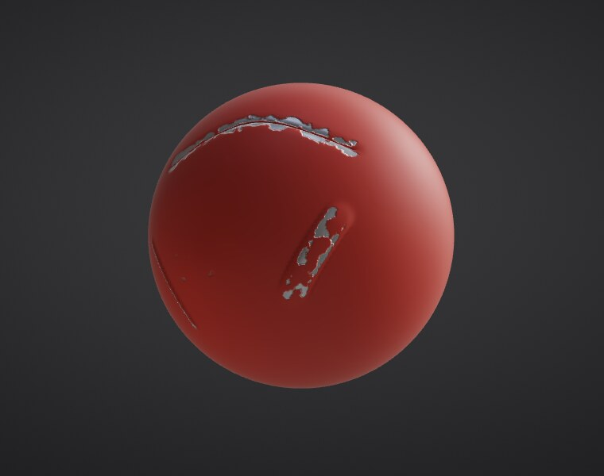
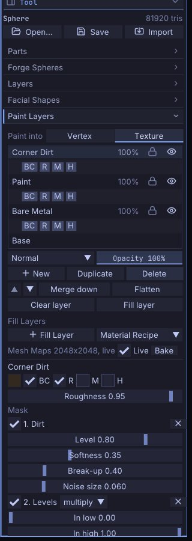

# Fill layers, Mesh Maps and Material Recipes

A **Fill layer** lays a material over the whole Part, through a **mask** that you build from effects instead of
painting it by hand: worn paint on the edges, dirt in the crevices, dust on the surfaces that face up. The mask
reads the Part's **Mesh Maps** (its ambient occlusion, curvature, thickness and more, baked on its UVs), so the
wear lands where the form says it should, and it moves with the form: sculpt a new crease and the paint chips
along it a moment later. **Material Recipes** are ready-made stacks of Fill layers you can lay on any Part.

Fill layers live in **Tool > Paint Layers** next to your paint layers, on a Part with a texture
([Texture painting](texture-painting.md)). Turn on **Render > Materials > Viewport Shading > PBR** to see the metal, the
roughness and the bumps as they will look in a game engine ([Material painting](pbr-painting.md#the-pbr-viewport)).

## Lay a Material Recipe

1. Give the Part UVs and a texture (**Tool > Texture Map > Auto UV**, then **New Texture**).
2. In **Tool > Paint Layers**, open **Material Recipe** and pick one:
   - **Worn Metal**: dull steel, polished bright on the edges, grime in the creases.
   - **Painted Edges**: painted metal with the paint chipped off its edges.
   - **Dirt and Dust**: dirt packed in the crevices and pale dust on top, to lay over any material.
   - **Rusted Iron**: dark iron with rust spreading from the crevices.
3. The recipe adds its Fill layers on top of your layers, turning on the material channels it needs. The first
   time, the Part's Mesh Maps are baked in the background (a progress bar shows); the layers fill in when they
   are ready.

Every layer of the recipe stays editable, and **Undo** removes the whole recipe in one step.

## Make a Fill layer

**+ Fill Layer** adds a Fill layer in the current colour, covering everything. With it active, the panel shows:

- **Colour** and the channels it lays down (**BC** base colour, **R** roughness, **M** metallic, **H** height),
  with a slider for each value.
- **Mask**: the effects, top to bottom. Each one has a switch, a remove button and its own settings; from the
  second one on, a blend mode says how it combines with the effects above it (multiply, add, subtract, min,
  max, screen, replace).
- **Add mask effect** adds one at the bottom.

### Mask effects

| Effect | What it does | Reads |
| --- | --- | --- |
| **Edge Wear** | Convex edges and ridges, where things get rubbed and chipped | Curvature |
| **Dirt** | Crevices, creases and corners, where dirt collects | Ambient occlusion, curvature |
| **Gradient** | Along a direction across the Part (e.g. darker toward the bottom) | Position |
| **Thickness** | Thin parts: ears, fins, edges of a blade | Thickness |
| **Light Direction** | Surfaces facing a direction: dust and snow on top, moss on one side | World normal |
| **Noise** | Fractal noise in 3D, so it has no seams at UV island borders | Position |
| **Paint** | A mask you paint by hand (below) | |
| **Levels** | Input and output range and gamma of the mask so far | |
| **Blur** | Softens the mask so far (within UV islands only) | |
| **Invert** | Flips the mask so far | |
| **Fill** | A constant value | |

The generators (the first five) have the same settings: **Level** (how much of the surface they cover),
**Softness** (how wide the transition is), **Break-up** (how much noise roughens the edge of the mask) and
**Noise size** (as a fraction of the Part's size).

### Paint a mask

Add a **Paint** effect, keep the Fill layer active and paint on the model with the **Paint** brush: you paint
the layer's mask (white adds, <kbd>Alt</kbd> removes), and the layer updates as you paint. Strokes undo like
any stroke. Combine it with generators: for example **Edge Wear**, then **Paint** with **Subtract** to keep an
edge clean by hand.

## Mesh Maps

Mesh Maps are the Part's own surface, baked on its UVs at its texture's size: **ambient occlusion**,
**curvature** (convex edges bright, creases dark), **thickness**, **position** (16-bit), **world normal** and
**ID** (a colour per face group). Fill layers read them; you don't have to look at them.

The line under the Fill buttons says what is baked. **Bake** bakes them again in full (after changing the UVs,
for example: that happens by itself when a Fill layer needs them). Baking runs on every core in the background.

**Live** (on by default): after each stroke, only the tiles of the texture near what you sculpted are baked
again, from the triangles within reach of the change, and the Fill layers re-evaluate those tiles. The result is
the same as baking everything again (it is tested texel for texel), in a fraction of the time: on a test Part
with 82,000 triangles and 2K maps, a full bake takes about 10 seconds and a local change about half a second.
Turn **Live** off to keep the maps as they are while you sculpt.

To bake maps as image files for other programs, use **Tool > Bake** ([Baking](baking.md)): it also bakes from a
Part's top subdivision level onto its lowest, and to UDIM tiles.

## Save your own recipe

A recipe is a small text file (`.sfmaterial`) listing the Fill layers, their materials and masks. Save the
active Part's Fill layers with `material_recipe action=save name="My Rust" path=my_rust.sfmaterial` and lay it on
another Part with `material_recipe path=my_rust.sfmaterial`. The built-in recipes are files of the same kind in
the source code's `assets/materials` folder.

## Projects

Fill layers are saved with the project (format 7): their settings and painted masks, and their last result, so
older versions open the project with the layers showing as ordinary paint layers. Mesh Maps are not saved; they
are baked again when a Fill layer needs them.

## Commands

| Command | What it does |
| --- | --- |
| `material_recipe name=worn_metal` | Lay a recipe on the active Part (`action=list`, `action=save path=...`, `path=file`) |
| `fill_layer generator=edge_wear color=#e0e0e8 metallic=1 level=0.6` | Add a Fill layer (`action=add` is the default) |
| `fill_layer action=effect generator=dirt blend=add` | Add a mask effect to the active Fill layer (`effect=1 level=0.4` edits one) |
| `fill_layer action=remove_effect effect=1` | Remove a mask effect |
| `fill_layer action=set roughness=0.3` | Change the layer's material |
| `mesh_maps` | Bake the Mesh Maps now (`action=info`, `action=clear`, `action=live live=false`) |
