# Your first sculpt in 10 minutes

Never sculpted before? In about ten minutes this lesson turns the default sphere into a little mushroom house: a
glossy red cap with raised white spots, a round cream house under it, a wooden door and glowing windows. It ends
with a render you can share. You only need the built-in brushes, a mouse (a pen tablet is nicer, but not
required) and these twelve steps.

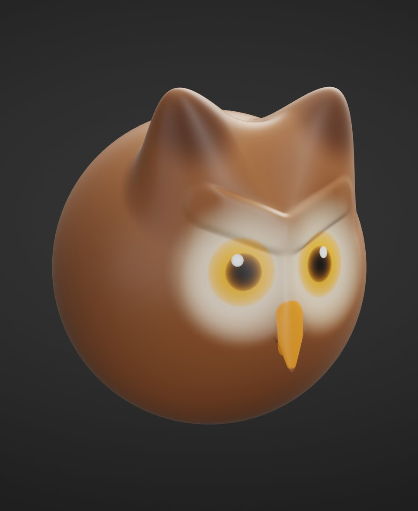

The lesson uses the default look: the **SculptForge layout**, with the menus **File, Edit, Sculpt, Paint, Mesh,
View, Render, Help** along the top, a tool shelf under them, the brushes along the bottom and the **Tool** panel
on the right. If you switched to the **ZBrush-style layout**, the **ZBrush-style layout** notes say where things
are there. Every step can be undone with <kbd>Ctrl</kbd>+<kbd>Z</kbd>, so experiment freely.

> **Tip:** **Help > Your first sculpt (10 min)** opens this lesson inside SculptForge any time;
> <kbd>Shift</kbd>+<kbd>F1</kbd> hides it and shows it again where you left off.

## 1. Start with a sphere

**Goal:** a fresh sphere, seen from the front.

1. Press <kbd>Ctrl</kbd>+<kbd>N</kbd> (**File > New Sphere**).
2. Press <kbd>F</kbd> to frame it. To look around: drag on the empty background to rotate, <kbd>Alt</kbd> + drag
   on the background to move the view, scroll to zoom. Press <kbd>F</kbd> again whenever you lose it.
3. Check that **X** is lit on the tool shelf: symmetry is on, so everything you do on one side happens on the other.

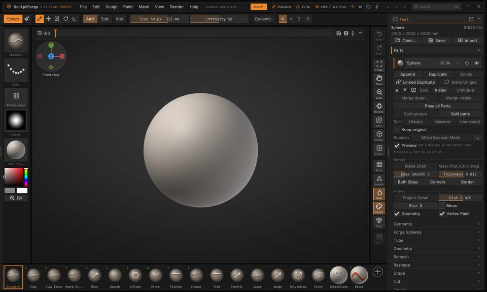

> **Tip:** right-drag anywhere rotates the view too, even over the model. See [Navigating the view](navigation.md).

## 2. Mask the top, pull down the walls

**Goal:** a taller house body under a round top.

1. In the **Tool** panel on the right, open **Masking** and click **Mask Rectangle**.
2. Hold <kbd>Ctrl</kbd> and drag a box from the empty background over the upper half of the sphere. The top turns
   dark: it is masked, and brushes leave it alone.
3. Pick **Move**: press <kbd>4</kbd>, or click **Move** on the bottom shelf. Press <kbd>]</kbd> many times (or drag
   **Draw Size** on the tool shelf) until the brush circle is wider than the sphere.
4. Drag from the bottom of the sphere straight down a little. The lower half stretches into walls.

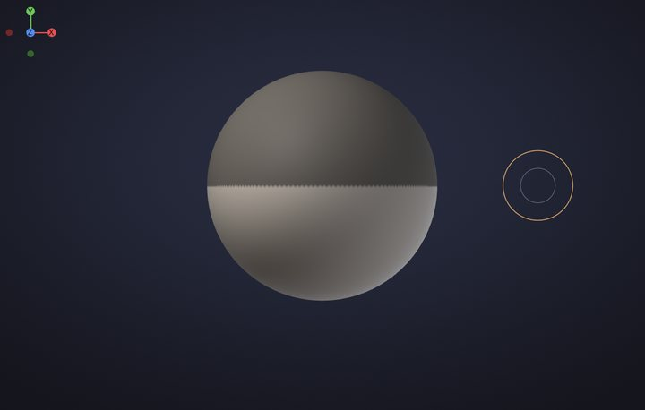

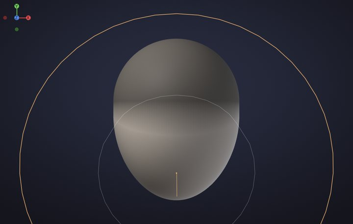

> **Tip:** a big brush moves a big area smoothly; a small one pulls a point. Try both and undo.

## 3. Colour the cap and the walls

**Goal:** a red cap and cream walls, with a clean line between them.

1. Open **Paint**. In **Vertex Paint & Color**, pick a warm cream in the colour wheel and click **Fill**. Fill
   paints what isn't masked: the walls.
2. In **Masking**, click **Invert**: now the walls are masked.
3. Open **Paint** again, click the red swatch, then **Fill**: the cap.

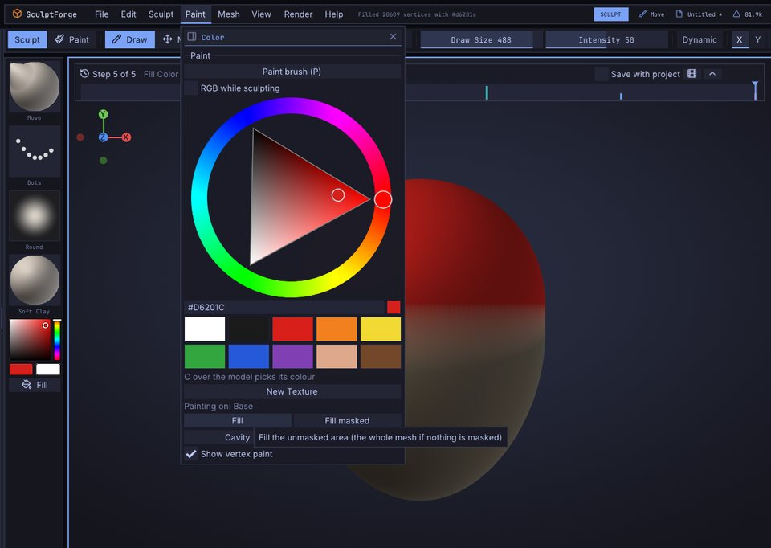

> **Tip:** colour sticks to the surface, so it follows the shape when you sculpt it next.

> **ZBrush-style layout:** the colour controls are in the **Color** palette on the palette bar; **Masking** is in
> the **Tool** palette.

## 4. Pull out the cap

**Goal:** a wide cap that hangs over the walls.

1. In **Masking**, click **Blur** once: the mask's edge gets a little softer, so the cap bends smoothly.
2. Keep **Move** and make the brush smaller with <kbd>[</kbd>, about half the sphere.
3. Start just inside the sphere's left edge, right above the line, and drag out to the left and a little down.
   Symmetry pulls the right side too.
4. Press down a little on the very top of the cap to flatten it.

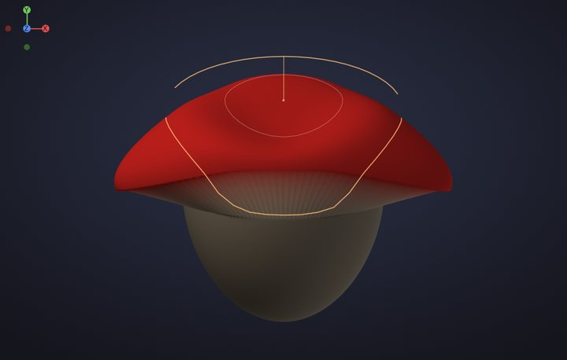

> **Tip:** if the view turns instead, you started on the background. Undo and start the drag a little further
> inside the sphere.

## 5. Round it out with Inflate

**Goal:** a puffy dome and a round little house.

1. Press <kbd>Ctrl</kbd>+<kbd>Shift</kbd>+<kbd>A</kbd> to clear the mask.
2. Pick **Inflate**: press <kbd>5</kbd>. Drag across the top of the cap twice, then across the lower walls twice.

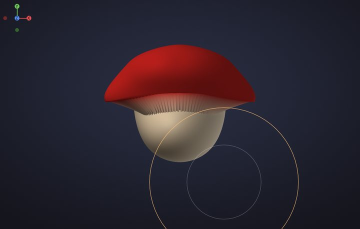

> **Tip:** hold <kbd>Shift</kbd> and drag to smooth with any brush, whenever a stroke leaves a lump.

## 6. Divide twice

**Goal:** enough polygons for crisp details and colours.

1. Press <kbd>Ctrl</kbd>+<kbd>D</kbd> twice (**Tool > Geometry > Divide**). Each Divide makes four polygons out of
   every one and smooths the shape: about 1.3 million triangles now.

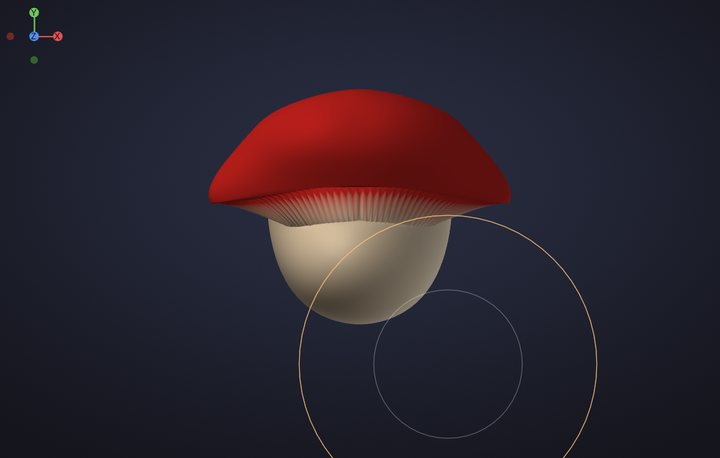

> **Tip:** sculptors block out the big shape on a light mesh, then divide for details. <kbd>Shift</kbd>+<kbd>D</kbd>
> and <kbd>D</kbd> step down and up the levels. See [Subdivision levels](subdivision-levels.md).

## 7. Cut a door

**Goal:** a door with real depth.

1. Pick **Crease**: press <kbd>6</kbd>. Make the brush small with <kbd>[</kbd>.
2. Drag up one side of the door, from the bottom of the wall, twice; symmetry cuts the other side. Then a short
   stroke over the top, towards the middle.
3. Pick **Clay**: press <kbd>2</kbd>. Hold <kbd>Alt</kbd> and drag up inside the door twice: Clay digs in.

> **Tip:** without <kbd>Alt</kbd>, Clay builds up; with it, it carves. **Pinch** (<kbd>8</kbd>) along a crease
> makes it even sharper.

## 8. Make round windows

**Goal:** two framed windows.

1. Keep **Clay**. Click twice (without dragging) beside the door, halfway up the wall: a round frame. Symmetry
   adds the second window.
2. Make the brush smaller with <kbd>[</kbd>, hold <kbd>Alt</kbd> and click twice in the same spot: the glass sinks
   into the frame.

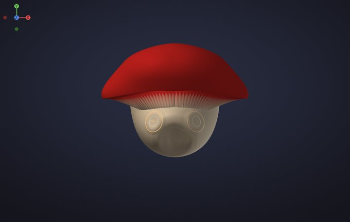

> **Tip:** a click is one dab of the brush: perfect for buttons, eyes and rivets.

## 9. Raise the spots

**Goal:** round bumps on the cap.

1. Pick **Inflate**: press <kbd>5</kbd>.
2. Click three times on each spot: a few on each side of the cap and a couple near the top.

> **Tip:** remember where you put them: the next step paints them white.

## 10. Paint the spots white

**Goal:** crisp white spots.

1. Press <kbd>P</kbd> (or click **Paint** on the tool shelf): the brush now paints colour without changing the
   shape.
2. Give it a hard edge: with the cursor over the canvas press <kbd>O</kbd> (**Falloff**), type `-70` and press
   <kbd>Enter</kbd>.
3. Pick white and click once on every spot.

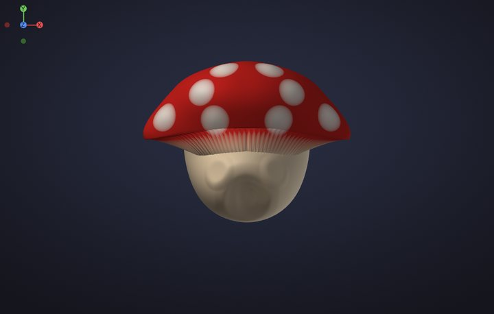

> **Tip:** <kbd>C</kbd> over the model picks up the colour under the cursor, and <kbd>Alt</kbd> paints back
> towards white. See [Vertex Paint](vertex-paint.md).

## 11. Paint the door and windows

**Goal:** a wooden door and glowing windows.

1. Pick a warm brown and paint inside the door.
2. Pick a bright yellow, make the brush a little smaller with <kbd>[</kbd>, and click on the windows.
3. Press <kbd>P</kbd> again to go back to sculpting.

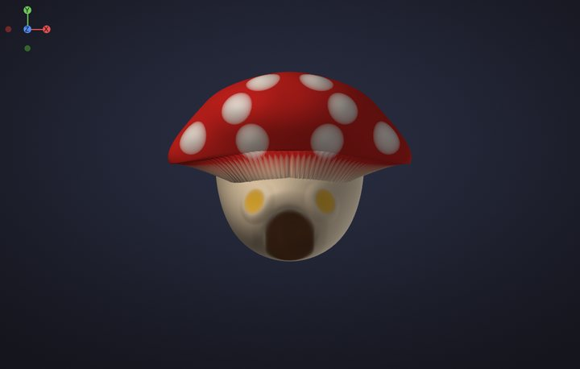

## 12. Shade it and save a render

**Goal:** a picture of your sculpt to share.

1. Press <kbd>M</kbd> over the canvas and click **White**: a clean material that shows your colours.
2. Open **Render > Materials** and click **PBR** under **Viewport Shading**: studio lighting with soft reflections.
3. Turn the view to a three-quarter angle, a little from above, and press <kbd>F</kbd>.
4. Click **Save Render** at the bottom of **Render > Materials**. The status bar names the picture (twice the
   size of the view); find it under **Library > Image**.
5. Press <kbd>Ctrl</kbd>+<kbd>S</kbd> to save the project.

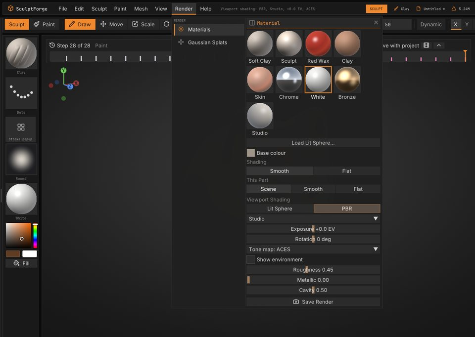

> **ZBrush-style layout:** **PBR** and **Save Render** are in the **Material** palette.

Well done: that's a sculpt, painted and rendered.

## What's next

- Share it in **#show-your-sculpts** on the [SculptForge Discord](https://discord.gg/gWrYkEmQhH). We'd love to see it.
- Try every brush and the keys that change them: [Sculpting and brushes](sculpting.md).
- Masks by lasso, rectangle and cavity: [Masking](masking.md).
- Paint layers, cavity paint and Lit Sphere materials: [Vertex Paint and materials](vertex-paint.md).
- Find your way around the menus and shelves: [The interface](interface.md).
