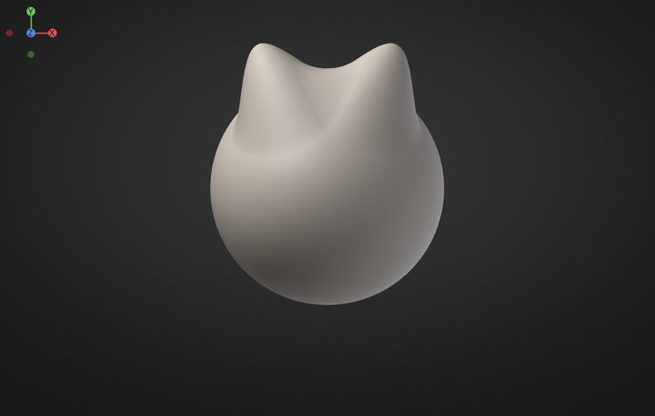
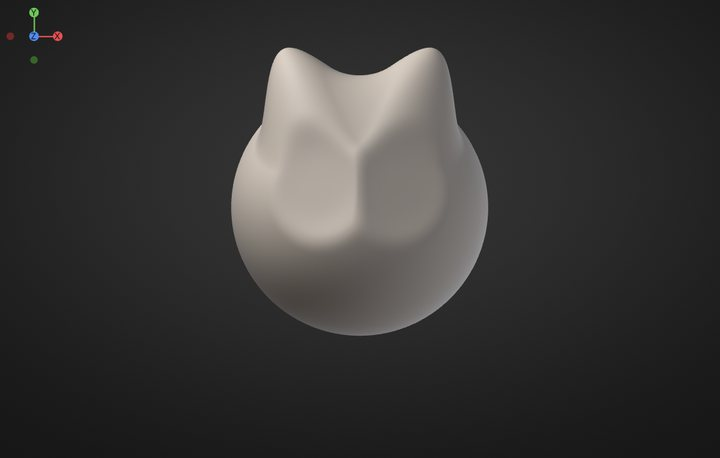
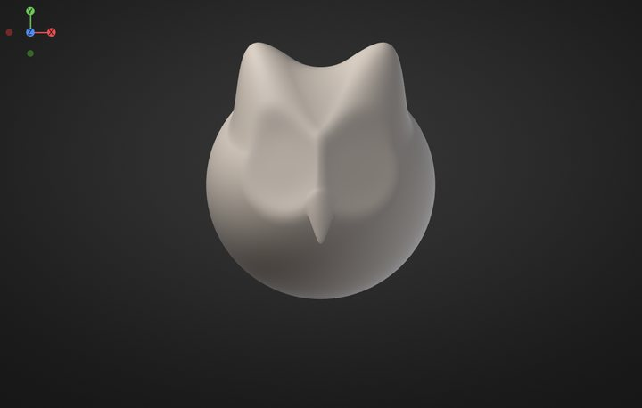
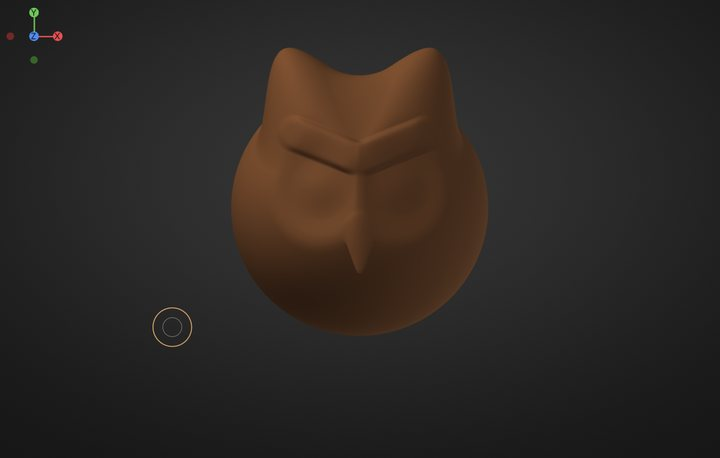
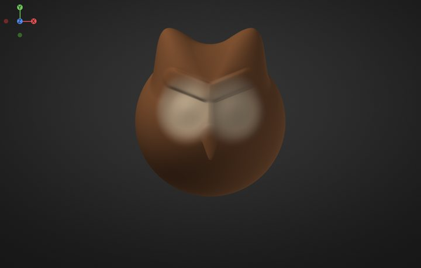

# Your first sculpt in 10 minutes

Never sculpted before? In about ten minutes this lesson turns the default sphere into a cute owl head: ear tufts,
a heart-shaped face, big amber eyes under stern brows and a little orange beak. It ends with a render you can
share. You only need the built-in brushes, a mouse (a pen tablet is nicer, but not required) and these twelve
steps.

The lesson uses the default look: the **SculptForge layout**, with the menus **File, Edit, Sculpt, Paint, Mesh,
View, Render, Help** along the top, a tool shelf under them, the brushes along the bottom and the **Tool** panel
on the right. If you switched to the **ZBrush-style layout**, the **ZBrush-style layout** notes say where things
are there. Every step can be undone with <kbd>Ctrl</kbd>+<kbd>Z</kbd>, so experiment freely.

Each brush remembers its own size. To set it, hold the cursor over the canvas, press <kbd>S</kbd>, type the number
the step gives and press <kbd>Enter</kbd> (or drag the slider that appears). <kbd>[</kbd> and <kbd>]</kbd> make
it smaller and bigger.

> **Tip:** **Help > Your first sculpt (10 min)** opens this lesson inside SculptForge any time;
> <kbd>Shift</kbd>+<kbd>F1</kbd> hides it and shows it again where you left off.

## 1. Start with a sphere

**Goal:** a fresh sphere, seen from the front.

1. Press <kbd>Ctrl</kbd>+<kbd>N</kbd> (**File > New Sphere**).
2. Press <kbd>F</kbd> to frame it. To look around: drag on the empty background to rotate, <kbd>Alt</kbd> + drag
   on the background to move the view, scroll to zoom. Press <kbd>F</kbd> again whenever you lose it.
3. Check that **X** is lit on the tool shelf: symmetry is on, so everything you do on one side happens on the other.

> **Tip:** right-drag anywhere rotates the view too, even over the model. See [Navigating the view](navigation.md).

## 2. Pull up the ear tufts

**Goal:** two pointed tufts on top of the head.

1. Pick **Move**: press <kbd>4</kbd>, or click **Move** on the bottom shelf. Set its size to **110**.
2. Start on the top of the sphere, a little left of the middle, and drag up and out. Symmetry pulls the right tuft.

> **Tip:** if the view turns instead, you started on the background. Undo and start the drag a little further
> inside the sphere.

## 3. Dig the face

**Goal:** two round hollows, the owl's face discs.

1. Pick **Clay**: press <kbd>2</kbd>. Set its size to **120**.
2. Hold <kbd>Alt</kbd> and click four times where the left eye goes, a little left of the middle and halfway down.
   With <kbd>Alt</kbd>, Clay digs in instead of building up.

> **Tip:** a click is one dab of the brush. Several clicks in one place build up (or dig) more.

## 4. Shape the beak

**Goal:** a small pointed beak between the eyes.

1. Pick **Inflate**: press <kbd>5</kbd>. Set its size to **30** and click three times on the middle line, just
   below the face discs: a bump.
2. Pick **Move** (<kbd>4</kbd>), size **30**. Drag from the bump a short way down: it points.
3. Pick **Smooth** (<kbd>3</kbd>), size **24**, and drag once down the beak to tidy it.

> **Tip:** hold <kbd>Shift</kbd> and drag to smooth with any brush, whenever a stroke leaves a lump.

## 5. Divide three times

**Goal:** enough polygons for crisp eyes and colours.

1. Press <kbd>Ctrl</kbd>+<kbd>D</kbd> three times (**Tool > Geometry > Divide**). Each Divide makes four polygons
   out of every one and smooths the shape: about 5 million triangles now.

> **Tip:** sculptors block out the big shapes on a light mesh, then divide for details.
> <kbd>Shift</kbd>+<kbd>D</kbd> and <kbd>D</kbd> step down and up the levels. See
> [Subdivision levels](subdivision-levels.md).

## 6. Add the eyes

**Goal:** big round eyeballs in the face discs.

1. Pick **Inflate** (<kbd>5</kbd>), size **52**.
2. Click three times in the middle of the left face disc. Symmetry adds the right eye.

> **Tip:** Inflate swells the surface along its normals, so dabs make round, even bulges.

## 7. Give it brows

**Goal:** a V of brows that gives the owl its look.

1. Pick **Clay** (<kbd>2</kbd>), size **30**.
2. Drag twice from between the eyes up and out over the left eye.

> **Tip:** the angle of the brows sets the mood: up and out for a stern owl, flatter for a sleepy one.

## 8. Colour it brown

**Goal:** warm brown feathers everywhere.

1. Open **Paint**. In **Vertex Paint & Color**, pick a warm brown in the colour wheel and click **Fill**.

> **ZBrush-style layout:** the colour controls are in the **Color** palette on the palette bar.

## 9. Paint the face

**Goal:** soft cream face discs.

1. Press <kbd>P</kbd> (or click **Paint** on the tool shelf): the brush now paints colour without changing the
   shape. Set its size to **100**.
2. Make the edge soft: with the cursor over the canvas press <kbd>O</kbd> (**Falloff**), type `0` and press
   <kbd>Enter</kbd>.
3. Pick a cream colour and click twice on the left face disc.

> **Tip:** a soft edge blends one colour into the next, like feathers.

## 10. Paint the eyes

**Goal:** amber eyes with black pupils and a glint.

1. Give the brush a hard edge: <kbd>O</kbd>, type `-100`, <kbd>Enter</kbd>.
2. Size **44**, amber: click once in the middle of the left eye.
3. Size **24**, black: click once in the same spot for the pupil.
4. Size **8**, white: click once at the top left of the pupil for the glint.

> **Tip:** <kbd>C</kbd> over the model picks up the colour under the cursor, and <kbd>Alt</kbd> paints back
> towards white. See [Vertex Paint](vertex-paint.md).

## 11. Paint the beak and tufts

**Goal:** an orange beak and darker tuft tips.

1. Size **16**, orange: drag down the beak, twice.
2. Soft edge again (<kbd>O</kbd>, `0`, <kbd>Enter</kbd>), size **70**, dark brown: click twice on the tip of the
   left tuft.
3. Press <kbd>P</kbd> again to go back to sculpting.

## 12. Shade it and save a render

**Goal:** a picture of your sculpt to share.

1. Press <kbd>M</kbd> over the canvas and click **White**: a clean material that shows your colours.
2. Open **Render > Materials** and click **PBR** under **Viewport Shading**: soft studio light with gentle
   reflections.
3. Turn the view to a three-quarter angle, a little from above, and press <kbd>F</kbd>.
4. Click **Save Render** at the bottom of **Render > Materials**. The status bar names the picture (twice the
   size of the view); find it under **Library > Image**.
5. Press <kbd>Ctrl</kbd>+<kbd>S</kbd> to save the project.

> **ZBrush-style layout:** **PBR** and **Save Render** are in the **Material** palette.

Well done: that's a sculpt, painted and rendered.

## What's next

- Share it in **#show-your-sculpts** on the [SculptForge Discord](https://discord.gg/gWrYkEmQhH). We'd love to see it.
- Try every brush and the keys that change them: [Sculpting and brushes](sculpting.md).
- Masks by brush, lasso, rectangle and cavity: [Masking](masking.md).
- Paint layers, cavity paint and Lit Sphere materials: [Vertex Paint and materials](vertex-paint.md).
- Find your way around the menus and shelves: [The interface](interface.md).
