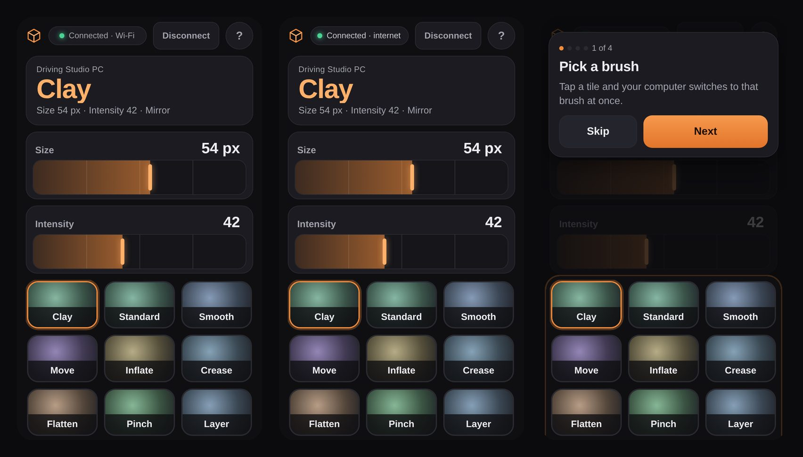
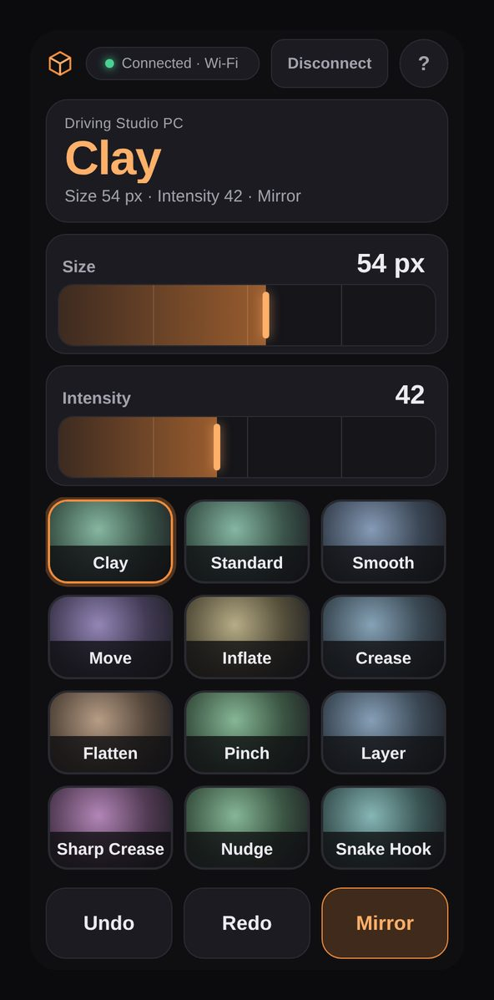
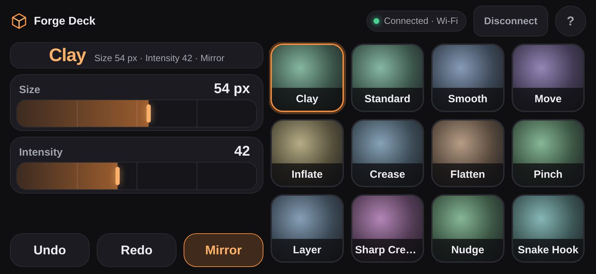
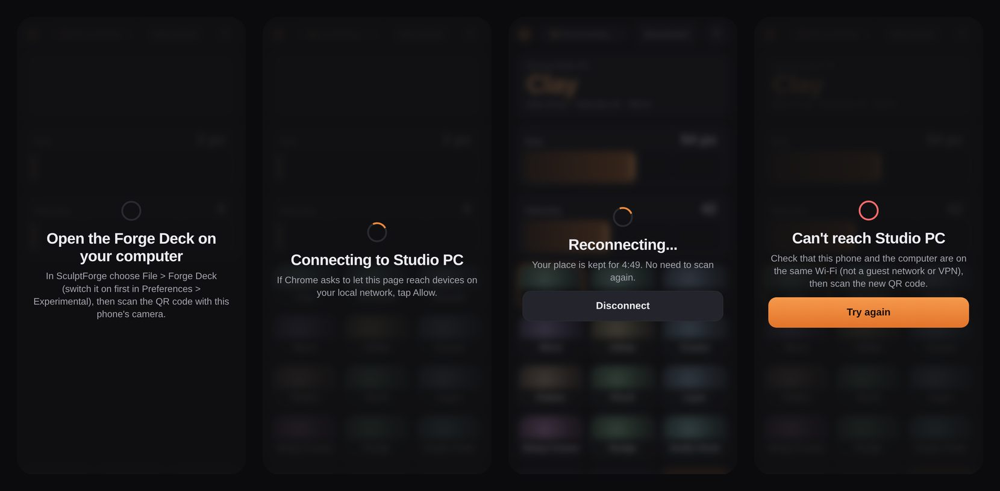

# Forge Deck (prototype)

> **In short:**
> - Your phone becomes a control pad for your sculpting session: brush tiles, Size, Intensity, Undo, Redo and Mirror.
> - No app and no account: scan a QR code and the phone's browser connects to SculptForge.
> - It is a prototype for testers: off until you switch it on in **Edit > Preferences > Experimental**.

Keep your pen on the canvas and your other hand on the phone. Tap a brush tile and SculptForge switches to that
brush. Drag a strip to change the brush size or intensity. Undo and Redo are two big buttons under your thumb.
What you change in SculptForge shows up on the phone too, so the two always agree.

The Forge Deck can do **only** these things (see [What it can and can't do](#what-it-can-and-cant-do)). It cannot
open files, run scripts or see your model.

## Switch it on

1. Open **Edit > Preferences > Experimental** and check **Forge Deck (prototype)**. It is off until you do, and it
   stays off after every restart.
2. Choose **File > Forge Deck (prototype)**. A window opens with a QR code.
3. Point the phone's camera at the QR code and tap the link it shows. The Deck opens in the phone's browser
   (Safari on iPhone, Chrome on Android).
4. Android's Chrome may ask to let the page reach devices on your local network. Tap **Allow**: that is how the
   phone finds your computer.

The phone and the computer should be on the same Wi-Fi. If they aren't, or the Wi-Fi blocks devices from talking
to each other, the Deck still works over the internet (see [Wi-Fi or internet](#wi-fi-or-internet)).

While a phone is paired, a banner over the canvas says which phone is driving the session, with a **Disconnect**
button. Closing the Forge Deck window, or **Disconnect** on either side, ends the link at once and the QR code
stops working. The next time you open the window there is a new code.

## The controls

- **The readout** at the top shows the current brush, its size and intensity, and whether Mirror is on. It follows
  SculptForge: pick a brush on the computer and it changes on the phone.
- **Brush tiles** are the first brushes of your shelf, with the same thumbnails. Tap one to switch. The tile
  lights up at once and your phone gives a short tap of feedback; the readout confirms when SculptForge has
  switched.
- **Size and Intensity** are strips you can drag anywhere: you don't have to hit a handle. The phone ticks at each
  quarter. For fine control, keep dragging while you slide your finger **away** from the strip (up or down): the
  further away, the finer the steps. Tap the number to **type an exact value** (Size in pixels, Intensity from 0 to
  100).
- **Undo** and **Redo** work like the keys on the computer. They wait until a stroke is finished.
- **Mirror** turns mirroring across the X axis on or off.

The Deck follows how you hold the phone or tablet. In landscape the controls sit on the left and the brushes on
the right, so your thumbs reach both.

## First time: the tour

The first time a phone or tablet connects, a four-step tour points at the brush tiles, the strips, the buttons
and the connection. Tap **Next** to go through it or **Skip** to close it. The **?** button in the Deck's top
right corner shows it again whenever you like.

## Wi-Fi or internet

The pill at the top of the Deck shows how the phone is connected.

| It says | What it means |
|---|---|
| **Connected · Wi-Fi** | The phone talks to your computer directly over your local network. This is the fastest, and nothing leaves your network. |
| **Connected · internet** | The phone can't reach the computer directly (for example, a router that keeps devices apart, or Android's Chrome without local-network access), so the commands go through SculptForge's link relay instead. It works the same, with a short delay. |

The relay sees only encrypted data. Every command is locked with a key that is only in the QR code's link and on
the two devices, each one carries a counter so an old or repeated message is thrown away, and the relay deletes
what it holds five minutes after the last message. Only the six commands below are ever accepted, over either path.

## When the connection drops

The Deck reconnects by itself. The phone shows **Reconnecting** and keeps your place for 5 minutes, with a
countdown. You don't scan again. If the Wi-Fi comes back, or the relay can take over, the controls return where you
left them. If the 5 minutes run out, the Deck says so and asks you to scan the new QR code.

A phone that goes to sleep or reloads the page picks up the same way, as long as it is within the 5 minutes.

## What it can and can't do

The phone can send exactly six commands:

| Command | What it does |
|---|---|
| Brush tile | Switches to a brush the Deck itself showed you |
| Size | Sets the brush size (the range shown on the strip) |
| Intensity | Sets the brush intensity |
| Undo, Redo | Steps through your history |
| Mirror | Turns X mirroring on or off |

Anything else is refused, counted and written to the audit log. A phone can send at most 20 commands a second, and
a message that is too long or has anything unexpected in it is dropped. Nothing about your model is sent to the
phone: only the brush names and thumbnails, the size, the intensity and the Mirror setting.

## Troubleshooting

- **The phone says "Can't reach" your computer.** Check that both are on the same Wi-Fi: not a guest network, not
  mobile data, no VPN. Tap **Try again** or scan the new QR code. If the Wi-Fi keeps devices apart, the Deck
  switches to the internet path by itself.
- **Chrome never asked about the local network.** Open the link again from the QR code (not from your browser's
  history) and tap **Allow** when asked. Without it the Deck uses the internet path.
- **It says "Connected · internet" at home.** Some routers keep Wi-Fi devices apart ("client isolation" or a guest
  network). The Deck works, with a short delay. Moving both devices to the main network gives you the direct link.
- **The QR code doesn't work any more.** The code works only while the window is open, and ends when you disconnect. Close
  the Forge Deck window and choose **File > Forge Deck (prototype)** again.
- **Nothing happens when I tap a brush.** Brush, Undo and Redo wait while you are in the middle of a stroke. Lift
  the pen and try again.
- **There's no Forge Deck in the File menu.** Switch it on in **Edit > Preferences > Experimental** first.
- **I want it to stop.** Press **Disconnect** on the banner (or on the phone), or close the Forge Deck window.

> **Tip:** The Deck keeps the phone's screen awake while it is open, and it has nothing to log in to. The phone
> remembers only that you've seen the tour, and, for 5 minutes, the link it needs to reconnect.

Forge Deck is a prototype, and your feedback shapes it. Tell us what you reach for that isn't there, on the
[issue tracker](https://github.com/islandmed/SculptForge/issues) (**Help > Report a problem**).
