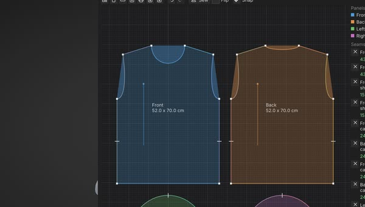

# Garments: sewing patterns at real size

A garment in SculptForge is made the way clothes are made: flat pattern panels at their real size in millimetres,
sewn edge to edge. The same pattern prints on your home printer to cut real fabric, and drapes on your model ([Drape it on a
body](#drape-it-on-a-body)).
Open **Tool > Garments** (the **Pattern** window shows the panels flat): **Templates** starts a garment at your
sizes, **Print** writes the pages. Everything here is also a `garment_*` command for **Scripting** and the AI
assistant ("make me trousers for a 1000 mm hip").



## Your size chart

Templates are drawn from a size chart saved in the project: type your measurements (or your model's) once and every
template uses them. In **Templates > Size chart (mm)**, type a value and press Enter (hover a name to see how to
measure it); **Default sizes** puts them all back. From a script, `garment_size` lists the chart and takes any
measurement in millimetres:

```
garment_size chest_mm=1020 waist_mm=860 hip_mm=1040 inseam_mm=800
```

| Measurement | How to take it | Default |
| --- | --- | --- |
| `chest` | round the fullest part of the chest | 960 |
| `waist` | round the natural waist | 820 |
| `hip` | round the fullest part of the hips | 1000 |
| `neck` | round the base of the neck | 380 |
| `shoulder` | shoulder point to shoulder point, across the back | 440 |
| `arm` | shoulder point to wrist, arm hanging | 600 |
| `upper_arm` | round the fullest part of the upper arm | 320 |
| `wrist` | round the wrist | 170 |
| `back_length` | the bone at the base of the neck down to the waist | 430 |
| `inseam` | crotch to the floor (or to where the trousers should end) | 790 |
| `rise` | sitting on a hard chair: waist down to the seat, at the side | 260 |
| `waist_to_knee` | waist to knee, down the side | 580 |
| `height` | height | 1750 |
| `head` | round the forehead and the back of the head | 570 |
| `hand` | round the knuckles, thumb out | 210 |
| `hand_length` | wrist crease to the tip of the middle finger | 190 |

`garment_size reset=true` puts every value back to the defaults (an adult medium).

## Templates

Pick one in **Templates** (or `garment_new template=<name>`): it replaces the scene's pattern with that garment at
your sizes. Tick **Add beside the pattern** (`add=true`) to put it next to what is there, so one pattern can hold a
whole outfit. Measurements given here go into the chart too, and
`length_mm` sets the template's main length for this garment only.

| Template | Panels | `length_mm` is |
| --- | --- | --- |
| `tshirt` | front, back, two short sleeves | shoulder to hem (700) |
| `trousers` | front and back of each leg | the inseam (shorts: 200 or so) |
| `skirt` | straight front and back, waistband | waist to hem (waist to knee) |
| `skirt_aline` | flared front and back, waistband | waist to hem |
| `hoodie` | front, back, long sleeves, two-piece hood, kangaroo pocket | shoulder to hem |
| `dress` | sleeveless bodice, A-line skirt, joined at the waist | waist to hem |
| `cloak` | half-circle cape in two quarters, hood | neck to hem (0.6 x height) |
| `glove` | a pair: back and palm of each hand | (from the hand) |

Every template comes sewn the way that garment is put together, with notches where pieces meet and the seam lengths
matched (`garment_info` lists every seam with both lengths). The hoodie's pocket is the one loose piece: topstitch
it onto the front where you want it. The proportions (how much ease, how deep the armhole, how the crotch curve is
shaped) are SculptForge's own, chosen to fit an average body without darts; they are a starting point to
adjust, not a tailored block.

```
garment_size hip_mm=1050 inseam_mm=780
garment_new template=hoodie
garment_new template=trousers add=true
garment_info
```

## Drape it on a body

A sewn pattern drapes on any body in the scene and becomes a Part you can sculpt, paint and export. You put each
panel where it goes; SculptForge sews the seams and lets the cloth settle. The **Full Body** starter mesh
(**File > New from starter**) is a good first body.

### 1. Place the panels

Start a garment (**Templates > T-shirt**), then under **Drape on the body** press **Place panels**. The list below
the button shows every panel; the one waiting for a click is highlighted and the text under the button names it.

**Click the body once for each panel, from the view that faces that panel.** The panel appears a little in front
of the click, facing you, its top up the screen. The panel's widest line goes at the click: a shirt's chest line
(just under the armholes), a sleeve's line under its cap, trousers' hip line. So **place each panel slightly in
front of the body at its widest point**:

| Panel | Where to click | From |
| --- | --- | --- |
| Front | the front of the chest | the front |
| Back | the back, at chest height | behind (turn the view round) |
| Sleeve | the top of the upper arm, just below the shoulder | outside and a little above, so the arm runs up the screen toward the shoulder |
| Trouser leg | the side of the hip | the side |

After each click the list ticks the panel off and asks for the next one; when every panel is placed, the button
lets go. Click a panel in the list to place it again. The placed panels show on the body as a preview (seams still
open), and they are saved with the pattern.

### 2. Adjust a panel

The last panel placed (or the one picked in the list) has three sliders:

- **Turn** spins it in the view's plane: a sleeve's top toward the shoulder when the arm slants.
- **Wrap** curls it back round the body: 0 is flat, 360 a closed tube. A panel sewn to itself (a sleeve, a
  trouser leg) starts as a nearly closed tube with its own seam on the far side from your click, so the arm or
  leg sits inside it.
- **Gap** moves it out from the click (30 mm to start). Wherever the preview disappears into the body, raise Gap
  until it clears: the back of a T-shirt usually needs about 70 mm so its hem clears the hips.

### 3. Drape

**Drape** sews every seam shut and lets the garment settle on the visible Parts, live (the body and anything else
shown; hide Parts it shouldn't touch). It sews first with gravity off, then lets the cloth fall and stops on its own
once it is still. **Pause** holds it, **Stop** keeps it as it is now, **Reset** goes back to the placed panels. When
it stops, the view shows the garment as Convert will make it, and the status line says how many frames it took
and the widest seam gap (a few millimetres is normal: Convert closes it).

### 4. Convert to Part

**Convert to Part** keeps it as the Part **Garment**: seams welded, the pattern's thickness (2 mm unless set),
UVs from the flat pattern (each panel where it lies on the sheet, so a texture painted on the pattern lines up),
one face group per panel. It is one undo step, and the body stays the active Part. To drape another garment,
start or load its pattern and place it the same way.

### Size and units

The garment is at the size of its pattern, the size chart's measurements, never stretched to the body: if it is
too loose or too tight, change the chart (or the model) and start the template again. A SculptForge unit is a
metre; a body modelled bigger is read by its size: over 20 units counts as centimetres (the starter meshes are),
over 600 as millimetres.

### When something looks wrong

- **The body shows through the cloth**: the panel started inside the body. Raise its **Gap** and drape again.
- **A sleeve or leg slides off**: look at the limb from outside so it runs up the screen, click its top, and check
  that the preview tube goes round it.
- **Cloth tucked behind the chin or a beard**: cloth dropped from above settles behind overhangs. That is the
  physics, not a bug: place the panel in front of the body instead of above it.
- **A seam gap over 10 mm** in the status line: a panel was placed far from where it is sewn. Place it closer to
  its neighbours and drape again.

### From a script

`garment_place` puts a panel on the body (`point` on the body, `facing` toward the viewer, `up` the panel's top,
optional `turn`, `wrap`, `gap_mm`; `clear=true` takes it off) and `garment_drape` drapes and converts in one step
(`frames`, `fabric`):

```
new_starter_mesh name=full-body
garment_new template=tshirt
garment_place panel=Front point=0,116,5 facing=0,0,1
garment_place panel=Back point=0,116,-15 facing=0,0,-1 gap_mm=70
garment_place panel="Left sleeve" point=27,133,-9.5 facing=0.88,0.47,0 up=-0.47,0.88,0
garment_place panel="Right sleeve" point=-27,133,-9.5 facing=-0.88,0.47,0 up=0.47,0.88,0
garment_drape
```

## Print it at home

**Print** shows how many pages the pattern takes on **A4** or **Letter** (portrait or **Landscape**); **Save PDF...**
writes them all in one PDF, **Save SVG pages...** one SVG per page. From a script: `garment_export
path=trousers.pdf paper=letter landscape=true`.

- **Print at 100%** ("actual size", never "fit to page"), then measure the **50 mm square** on page A1.
- Each page has a name: rows A, B, C down, columns 1, 2, 3 across. Pages with nothing on them are left out.
- Trim each page on its line at the left and the top, lay it over its neighbours' lines and match the black
  triangles (each page prints half of each; the neighbour's name sits next to it). Tape, then cut.
- A panel that is another's mirror image (the other leg, the other sleeve) prints once, named for example
  "Left front: cut 2, 1 reversed (Right front)": fold the fabric right sides together and cut through both layers.
- Solid lines are the sewing lines, dashed lines the cutting lines (seam allowance: 10 mm, 5 mm on gloves).
  Ticks across the allowance are notches; the arrow is the grain line, kept parallel to the fabric's selvedge.

For a print shop or a plotter, **Export SVG** writes the whole pattern as one real-size sheet; **Export DXF** writes
the outlines for a cutting machine.
