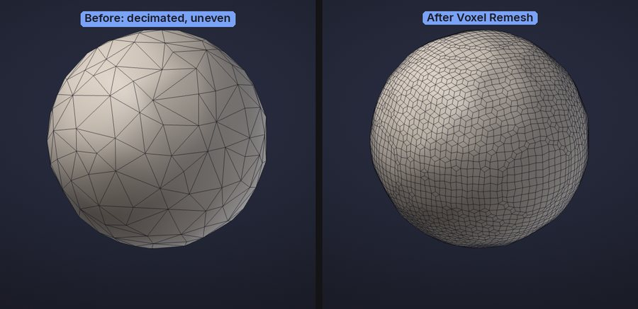
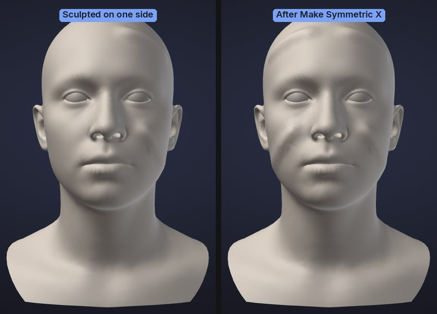
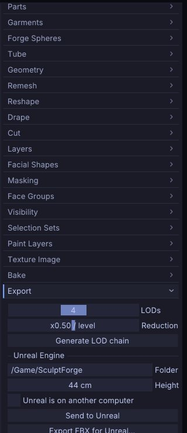

# Subdivide, remesh, decimate and LODs

These tools change the topology of the active Part: add resolution for detail, rebuild an even surface,
reduce the triangle count, make it symmetric, or make a chain of levels of detail for a game engine. This
chapter explains what each one does to your mesh and its attributes, and when to use it.

All of them work on the **active Part** and, except the LOD preview, are undoable with
<kbd>Ctrl</kbd>+<kbd>Z</kbd>.

## At a glance

| Tool | Where | Triangles | Quads | Keeps sculpt layers | Keeps mask and vertex paint | Keeps face groups, hidden faces, UVs |
|---|---|---|---|---|---|---|
| Divide (levels) | **Tool > Geometry > Divide**, <kbd>Ctrl</kbd>+<kbd>D</kbd> | x4 per level, lower levels kept | Each quad becomes four (Catmull-Clark) | Yes | Yes (interpolated) | Yes |
| Subdivide | **Tool > Geometry > Subdivide** | x4 per level | Each quad becomes four | Yes | Yes (interpolated) | Yes |
| Voxel Remesh | **Tool > Remesh > Voxel Remesh** | Set by resolution | All quads (new ones) | Baked in | Yes (transferred) | No (reset); a texture is kept on new UVs with Keep Texture |
| Quad Remesh | **Tool > Geometry > Quad Remesh** | Set by Target Polygons | All quads, with edge loops | Baked in | Yes (transferred) | Face Groups with Keep Groups; no hidden faces; a texture is kept on new UVs with Keep Texture |
| Decimate | **Tool > Geometry > Decimate** | Reduced | No, all triangles | Yes | Yes | Yes |
| Mirror And Weld | **Tool > Geometry > Modify Topology** | Twice the kept side | Yes | Yes | Yes (mirrored) | Yes (mirrored) |
| LOD chain | **Tool > Export** | One level per ratio step | LOD0 keeps them; lower levels are triangles | Yes, on every level | Yes | Yes |

## Quads and triangles

SculptForge sculpts on triangles, but it remembers which pairs of triangles were one quad. A model you open
from the Bridge, Blender or Maya (OBJ, FBX, PLY, USD) keeps its quads: **Wire** draws them as quads, without
the diagonal, and OBJ, FBX, PLY, USD and Bridge exports write them back as quads, corner for corner. Polygons with
more than four sides are split into triangles. The new **Plane** and **Cube** are made of quads, and so is the
result of a voxel remesh.

Sculpting, masking, vertex paint, sculpt layers, undo, Parts and project files all keep the quads. Subdivide
turns every quad into four quads. Two things turn quads into triangles:

- **Decimate** (and the lower levels of a LOD chain) collapses edges, so its result is all triangles.
- When the two halves of a quad end up in different face groups, or one half is deleted, they show and export as
  two triangles.

glTF (`.glb`) and STL only hold triangles, so those exports always write triangles.

## Subdivide

For sculpting at several resolutions use **Divide** (<kbd>Ctrl</kbd>+<kbd>D</kbd>), which keeps the lower levels to
step back to: see [Subdivision levels](subdivision-levels.md). **Subdivide** is the one-way version.

**Tool > Geometry > Subdivide** smooths the mesh with Loop subdivision. Each level
multiplies the triangle count by four and rounds off the shape slightly.

- Sculpt layers are subdivided with the mesh, so blend shapes keep working.
- Mask, vertex paint and UVs are interpolated; face groups and hidden faces carry over.
- Each quad becomes four quads; triangles become four triangles.
- SculptForge refuses to subdivide past 50 million triangles.

> **Note:** Subdivide replaces the mesh with a denser one and drops any [subdivision levels](subdivision-levels.md):
> it subdivides the level you are on, which becomes the new base, and the status line says so (undo brings the
> levels back). Voxel Remesh, Decimate and Quad Remesh do the same. To add triangles only where you sculpt, use
> [Dynamic topology](dynamic-topology.md).

> **Tip:** The bar along the top shows the triangle count of the whole scene. A few million triangles sculpt
> smoothly on a recent GPU; go up a level only when you need finer detail.

## Voxel remesh

**Tool > Remesh > Voxel Remesh** rebuilds the active Part as an even, watertight surface.
Use it to:

- fuse overlapping pieces into one surface (append a sphere, overlap it, merge, remesh);
- even out stretched triangles after heavy Move or Tendril work;
- clean up scans, splat conversions and AI-generated models before sculpting.

The **Resolution** slider next to the button sets how many voxels span the longest side of the model (32 to 512, as
the `remesh` command; default 200). Higher keeps more detail and makes more triangles. 512 is safe on an 8 GB
computer: a 28M-triangle scan remeshes at 512 in about 8 s (14 s on 4 cores) into about 760,000 triangles; a round
2M-triangle sculpt, which fills its box, in about 3 s (5 s on 4 cores) into about 2.5 million triangles, with about
2 GB of memory at its peak.



What happens to your data:

- Sculpt layers are baked into the surface: the result has no layers.
- Mask and vertex paint are transferred from the nearest original vertex.
- Face Groups, hidden faces and UVs are reset (everything becomes visible, one face group). Hidden parts are
  remeshed too.
- A painted texture is kept with **Keep Texture** (on by default, shown next to the button when the Part has a
  texture): the result gets Auto UVs and the texture is projected onto it, every layer included, in the same undo
  step. This runs in the background (Auto UV of a few hundred thousand triangles takes several seconds) with a
  progress bar and **Cancel**. Off: the texture is dropped. See [Texture painting](texture-painting.md#uvs-and-geometry).
- Separate pieces that don't touch stay separate pieces; overlapping ones are merged.
- The new surface is made of even quads (the original's quads are rebuilt, not kept).
- **Keep Masked** (off by default): masked areas keep their triangles exactly, detail included, and only the rest
  is remeshed. The new surface is joined to the masked area along the mask's edge by a narrow strip of triangles,
  so the model stays closed. A triangle counts as masked when all three of its corners are at least half masked.
  A ragged mask edge is tidied by itself (#67): where it touches itself the corner triangles are remeshed, masked
  spots smaller than the new polygons are remeshed with the rest, and narrow gaps between masked areas are kept;
  the status line says when it did. If it still can't be joined, the status line says what to change (blur or grow
  the mask, or unmask where two parts overlap) and nothing changes. Command: `remesh keep_masked=true`.

To remesh several Parts into one, first combine them with **Merge visible...** or **Merge down...** in
[Parts](parts.md#merge-parts).

### Quick Remesh

Remesh as you sculpt, without going to the palette (#121). Turn on **Tool > Remesh > Quick Remesh**, then:

- press <kbd>Shift</kbd>+<kbd>R</kbd>, or
- hold <kbd>N</kbd> and click or drag on the background (anywhere off the model; on the model it stays a brush
  stroke).

Either one remeshes the active Part at the **Resolution** above, with **Keep Masked** and **Keep Texture** as set
there. It runs in the background with the same progress bar and **Cancel**, so you can keep sculpting; the status
bar says when it's done and how many triangles the Part has now. Each remesh is one undo step. If you sculpt or
undo while it runs, it doesn't throw that work away: it remeshes the Part again as it is now.

Both keys change in **Edit > Preferences > Hotkeys** (*Quick Remesh* and *Quick Remesh (hold and drag)*). Neither
<kbd>Shift</kbd>+<kbd>R</kbd> nor <kbd>N</kbd> is used by any key style, and holding <kbd>N</kbd> changes no other
drag on the background: without it, a drag there turns, pans or zooms the view, or draws the mask and hide shapes,
exactly as your key style says. With Quick Remesh off, the keys only tell you where to turn it on.

**Remesh after each stroke** (off by default) does it for you: when you lift the pen after a stroke that stretched
the surface (edges pulled to more than 1.6 times their length, as a long Move or Snake Hook pull does), the active
Part is remeshed in the background. Strokes that don't stretch anything, and masking or painting, never remesh.
Sculpting never waits for it. It skips Parts with subdivision levels, sculpt layers or a painted texture (Keep
Texture), where a remesh would bake or drop them; use the button or <kbd>Shift</kbd>+<kbd>R</kbd> there.

## Quad Remesh

**Tool > Geometry > Quad Remesh** is automatic quad retopology: it rebuilds the Part as
clean quads whose edge loops follow the forms, close to a target polygon count, with Keep Groups, Adaptive Size,
vertex paint density and symmetry. **Project Detail** (**Tool > Parts > Project**) brings the sculpted detail back onto
the new topology after you divide it. Both have their own chapter: [Quad retopology and detail
projection](retopology.md).

## Close Holes

**Tool > Geometry > Close Holes** caps every open boundary of the active Part, such as a hole, an open bottom or the
rim of an extracted shell. The new patch's triangles are sized like the ones around the hole, and the patch follows
the curve of the surface around it, so a hole in a sphere closes round, not flat. The rest of the Part is not changed.
The patches get a [face group](face-groups.md) of their own, so you can mask or hide them in one click. Close Holes
makes an open scan or an extracted part watertight without a remesh. <kbd>Ctrl</kbd>+<kbd>Z</kbd> brings the holes
back.

## Decimate

**Tool > Geometry > Decimate** reduces the triangle count while keeping the shape, using quadric edge collapse. The **Keep** slider next to the button sets the fraction
of triangles to keep (0.05 to 0.95, default 0.50).

Decimation keeps open borders in place, and because it only removes vertices, every remaining vertex keeps its
exact sculpt layer offsets, mask and vertex paint. Face Groups, hidden flags and UVs survive on the remaining
triangles. The result is all triangles: quads are not kept.

With **Keep Masked** (under the button, off by default) masked vertices are never removed, so masked areas keep
their triangles exactly and only the rest is decimated (`decimate keep_masked=true`).

Use it to make a lighter version of a finished sculpt for export, 3D printing or a review, or to bring a dense
scan down to something you can work with.

> **Tip:** Decimate a duplicate Part (**Tool > Parts > Duplicate**) when you want to keep the full-resolution
> sculpt in the same project.

## Mirror And Weld

**Mirror And Weld**, in **Tool > Geometry > Modify Topology**, makes a model symmetric: it keeps the half on the
+ side of the chosen axis (+X is the model's left, your right when you look at its face), mirrors it onto the
other side and welds the two halves along the middle into one watertight mesh. Use it after sculpting one side
without symmetry, to finish a half model, or to repair a model whose sides have drifted apart.



- Pick the axis with **X**, **Y** and **Z** beside the button (X is on by default). With several on, they apply
  one after the other.
- The mirror plane goes through the world's origin, the same plane symmetry uses. Polygons that cross it are cut
  on it, so the seam is clean wherever the model sits. Points on an open edge within 0.1% of the model's size
  from the plane are welded onto it, which closes a half model whose seam isn't exactly at 0.
- Face Groups, vertex paint, the mask, UVs, quads and sculpt layers are kept; the mirrored side takes the kept side's.
  Subdivision levels are removed (undo restores them), as with the other tools on this page.
- To keep the **other** side, flip the model first with **Tool > Deformation > Mirror**, or run
  `mirror_and_weld side=negative`.

## Mirror

**Tool > Deformation > Mirror** flips the Part across the plane through the origin on the chosen axes, with its
surface still facing outward. Face Groups, vertex paint, UVs and layers come along; subdivision levels are removed
(undo restores them). `mirror pivot=center` flips it in place about its own centre instead.

## LOD chains

A level-of-detail chain is a series of lighter copies of the model for game engines: LOD0 is the full sculpt, and
each level after it has a fixed fraction of the triangles of the one before.

1. Open **Tool > Export**.
2. Set **LODs** (2 to 6 levels, including LOD0) and **Reduction** (the triangle ratio from one level to the next,
   0.1 to 0.9, default 0.50).
3. Click **Generate LOD chain**.



A table lists each level with its triangle count and its budget as a percentage of LOD0. Click a level to preview
it on the canvas (wireframe turns on and sculpting pauses); click **Sculpt** in the table to go back to the
editable mesh. The next stroke, or a change to **LODs** or **Reduction**, clears the chain; click
**Generate LOD chain** again to rebuild it.

Blend shapes ([sculpt layers](layers.md)) are kept on every level, so morph targets work at every LOD.

To write the chain to disk:

- **LOD chain (GLB per level)** in the same sub-palette, or **File > Export LOD Chain...**, writes one GLB per level
  named `<name>_LOD0.glb`, `<name>_LOD1.glb` and so on.
- **Send to Unreal** and **Export FBX for Unreal...** pack the LODs into one FBX for Unreal's automatic LOD import.

See [Exporting](exporting.md) for these exports and their options.

> **Note:** The preview in **Tool > Export** is of the active Part. The exports themselves build a chain for
> every visible Part.

## Undo and safety

Subdivide, remesh, Quad Remesh, decimate, Mirror And Weld, Mirror and delete hidden are single undo steps on the
active Part. They can use a lot of memory on dense meshes, and undo keeps a full copy of the previous mesh for
each of them. Before a big change on a heavy sculpt:

- **Snapshot** (**File > Save Snapshot**) keeps a timestamped copy of the scene without touching your project file; see
  [Projects](projects.md#snapshots).
- **Duplicate** the Part to keep the old version side by side.

## Scripting

| Command | Options |
|---|---|
| `subdivide` | `levels` 1-4 (default 1) |
| `remesh` | `resolution` 32-512 voxels across the longest side (default 200); `keep_texture` (default true) |
| `decimate` | `ratio` 0.01-1 of the triangles to keep (default 0.5), or `triangles` for an exact target |
| `qremesh` | `target` quads (default 5000), `adaptive`, `keep_groups`, `detect_edges`, `use_vertexpaint`, `symmetry`, `keep_original`, `keep_texture`; see [Quad retopology](retopology.md#scripting) |
| `close_holes` | `max_edges` closes only holes with at most that many boundary edges (default 0: all); `refine` (default true; false: as few triangles as possible); `new_group` (default true) |
| `mirror_and_weld` | `axis` x, y, z or several, e.g. `xz` (default x); `side` positive (default) or negative |
| `mirror` | `axis` (default x); `pivot` origin (default) or center |
| `export_lods` | `path` (base name), `levels` 1-8 including LOD0 (default 4), `ratio` 0.1-0.9 (default 0.5) |

```sh
sculptforge-cli -c 'open path=scan.obj; remesh resolution=256; decimate triangles=200000; export_lods path=out/rock.glb levels=4 ratio=0.5'
```

The command line accepts a wider remesh range (32-512) than the palette slider.

## See also

- [Quad retopology and detail projection](retopology.md): Quad Remesh and Project Detail
- [Parts](parts.md): merge pieces before a remesh, duplicate before a decimate
- [Sculpt layers and blend shapes](layers.md)
- [Exporting](exporting.md): LOD chains, FBX for Unreal, Send to Unreal
- [Image and text to 3D](generate-3d.md): generated models are voxel-remeshed for sculpting
