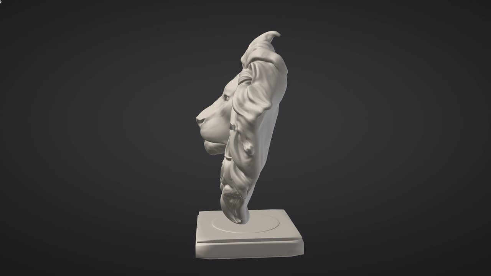

# Glossary

> **In short:**
> - The terms SculptForge uses: Parts, Forge Spheres, Vertex Paint, Library and more.
> - <kbd>F3</kbd> finds a feature by what it does: try "remesh" or "groups".
> - For where each thing lives, see the [Quick tour](quick-tour.md).

This chapter explains the terms SculptForge uses (Parts, Forge Spheres, Vertex Paint, Library...). The command
palette (<kbd>F3</kbd>) also finds a feature by what it does: type "remesh", "groups" or "folders". See also the
[Quick tour for experienced sculptors](quick-tour.md).

## SculptForge terms

| Term | Meaning |
|---|---|
| Brush Lab | The AI brush creator: describe a brush in words and it builds a recipe you can tweak. Opens from **AI Brush**. See [Brush Lab](brush-lab.md) |
| Brush code | One line of text (`sfbrush1:...`) that holds a whole brush, for sharing in chat or a forum. Paste with <kbd>Ctrl</kbd>+<kbd>V</kbd> |
| Brush library | Your saved custom brushes, loaded at every start |
| Brush recipe | The data that defines a custom brush (direction, depth, plane, pinch, pattern and so on): values, never code |
| `.sfbrush` | A file holding one brush recipe |
| `.sfproj` | A SculptForge project file: the whole scene. See [Projects](projects.md) |
| Cross field | The directions Quad Remesh wants quad edges to follow at every point of the surface, smoothed over the whole model. Singularities (where three or five quads meet) appear where the field must turn |
| Command palette | <kbd>F3</kbd>: search every command, brush and setting by name and run it |
| Community gallery | Shared CC0 brushes you can install in one click (**Community brushes**) |
| Console | The script console (backtick key): every action appears as a script line |
| Ctrl help | Hold <kbd>Ctrl</kbd> and point at a control to see what it does, its shortcut and its command |
| Gaussian splat | A 3D capture made of soft coloured blobs (from phone scanning apps). Load one as a reference, make it a sculptable mesh, or turn a sculpt into splats. See [Gaussian splats](splats.md) and [From scan to sculptable mesh](scan-to-sculptable.md) |
| Falloff (Gizmo) | How far a gizmo move eases in from the mask's edge, as a share of the Part's size: a soft joint when posing. See [Gizmo](gizmo.md#posing-a-limb) |
| Generate 3D | Turn an image or a description into a sculptable model. See [Image and text to 3D](generate-3d.md) |
| Gizmo | The Move / Scale / Rotate handles (<kbd>W</kbd> <kbd>E</kbd> <kbd>R</kbd>) for placing and posing a Part or its unmasked part. See [Gizmo](gizmo.md) |
| LOD chain | A series of lighter copies of a model (LOD0, LOD1...) for game engines. See [Geometry](geometry.md#lod-chains) |
| MCP | Model Context Protocol: `sculptforge-cli --mcp` lets AI agents such as Claude run SculptForge commands |
| Pivot | The point the Gizmo turns and scales about. <kbd>Alt</kbd>+click the model to put it there. See [The pivot](gizmo.md#the-pivot) |
| Subdivide | One-way subdivision without levels (**Tool > Geometry > Subdivide**, `subdivide`); **Add Level** keeps the levels |
| Send to Unreal | Export and import a model into a running Unreal Editor in one step (<kbd>Ctrl</kbd>+<kbd>U</kbd>) |
| Shelves, palettes, trays | The interface around the canvas: shelves hold the most-used controls, palettes hold everything, trays hold pinned palettes. See [The interface](interface.md) |
| Studio brush folder | A shared, read-only brush folder for a team (`SCULPTFORGE_BRUSH_PATH`). See [For studios](studios.md) |
| Paint target (Vertex / Texture) | Where painting goes on a Part that has a texture: its vertices (vertex paint) or its texture. Top shelf, next to **Rgb**. See [Texture painting](texture-painting.md#vertex-or-texture) |
| Quad Remesh | SculptForge's automatic quad retopology, in **Tool > Geometry**. See [Quad retopology](retopology.md) |
| Mirror plane (Quad Remesh) | The plane Quad Remesh's **Symmetry** mirrors across: the model's own middle (the world's centre plane when the model is symmetric about it), found from the model. Like local symmetry. See [Quad retopology](retopology.md#quad-remesh) |
| Padding (gutter) | The few texels around each UV island that texture painting and baking also fill, so seams don't show. See [Texture painting](texture-painting.md) and [Baking](baking.md) |
| Bake | Capture a high-poly's detail as images (maps) on a low-poly's UVs. See [Baking](baking.md) |
| Cage (front / rear distance) | How far in front of and behind the low-poly the bake's rays look for the high-poly. See [Baking](baking.md#how-the-bake-works) |
| Displacement map | A map of how far the high-poly lies from the low-poly along its normal; mid-grey = 0. See [Baking](baking.md#displacement-mid-grey-is-zero) |
| Keep Texture | Remesh option (Voxel Remesh, Quad Remesh): give the new surface Auto UVs and project the painted texture onto it, so the paint survives. See [Texture painting](texture-painting.md#uvs-and-geometry) |
| MikkTSpace | The standard way of computing tangents that game engines share, so tangent-space normal maps look the same everywhere. See [Baking](baking.md) |
| Normal map | A map of surface directions that makes a low-poly shade like the high-poly. Tangent-space maps are relative to the surface (for engines), object-space maps to the model. See [Baking](baking.md) |
| Texel | One pixel of a texture. Texture painting paints texels; their 3D position on the model decides the brush falloff |
| UV island | A piece of the surface flattened into the texture square. Unwrap and Auto UV cut the model into islands along seams. See [UV Editor](uv-editor.md) |
| UDIM tile | One unit square of UV space, numbered 1001 (u and v between 0 and 1), 1002 to its right, ten per row: a Part's islands can spread over several, each its own texture. See [UV Editor](uv-editor.md#packing-and-udim-tiles) |
| Texel density | Texels of the texture per unit of surface length: equal density makes detail look the same size everywhere. See [UV Editor](uv-editor.md#texel-density) |
| Trim sheet | A texture of horizontal strips that repeat left to right; islands are laid into a strip. See [UV Editor](uv-editor.md#trim-sheets) |
| Antialiasing (AA) | Smoothing the 3D view's edges with several samples per pixel (Off, 2x, 4x, 8x in **Edit > Preferences > Performance**). See [Performance](performance.md) |
| BVH | Bounding volume hierarchy: the structure SculptForge uses to find the surface under the cursor and the vertices under a brush. Its update time is shown per dab in **Edit > Preferences > Performance** |
| Dab | One step of a brush along a stroke. Its cost per dab decides whether a stroke keeps up with the display (under 16 ms at 60 Hz). See [Performance](performance.md) |
| Fast Navigation | Drawing scenes of 10 million triangles or more without antialiasing while the view moves, so it keeps up. See [Performance](performance.md) |
| Multithreading | Brushes, normal and BVH updates and saving spread over every processor core; same results either way. See [Performance](performance.md) |

## See also

- [Welcome to SculptForge](welcome.md)
- [The interface](interface.md)
- [Keyboard and mouse reference](shortcuts.md)
