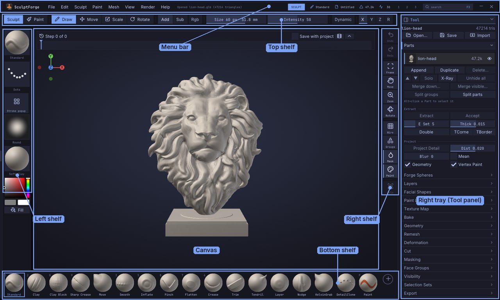

# SculptForge User Guide

This guide explains every part of SculptForge, the free, open-source sculpting app for VFX, animation and games:
how the interface is organised, how to sculpt, mask, paint (on vertices or textures) and manage Parts, how to generate models with AI,
and how to get your work into a game engine, a film pipeline, Blender or ZBrush. It is written for SculptForge
0.4.

You can read it inside SculptForge (**Help > User Guide**, or <kbd>Shift</kbd>+<kbd>F1</kbd>) or on the
[SculptForge website](https://sculptforge.app/guide/). If you're coming from ZBrush, start with
[Coming from ZBrush](coming-from-zbrush.md) and keep the [Glossary](glossary.md) at hand: it has SculptForge's names for ZBrush terms and the ZBrush-style keys.

## Getting started

1. [Welcome to SculptForge](welcome.md)
2. [What's new](whats-new.md)
3. [Coming from ZBrush](coming-from-zbrush.md)
4. [Installing SculptForge](installing.md)
5. [The interface](interface.md)
6. [Navigating the view](navigation.md)

## Sculpting

7. [Sculpting and brushes](sculpting.md)
8. [Brush Lab and sharing brushes](brush-lab.md)
9. [Masking](masking.md)
10. [Face Groups and visibility](face-groups.md)
11. [Parts](parts.md)
12. [Forge Spheres](forge-spheres.md)
13. [Vertex Paint and materials](vertex-paint.md)
14. [Texture painting](texture-painting.md)
15. [Material painting (PBR)](pbr-painting.md)
16. [Sculpt layers and blend shapes](layers.md)
17. [Facial shapes and live face](facial-shapes.md)
18. [Subdivision levels](subdivision-levels.md)
19. [Micro levels: hundreds of millions of polygons](micro-levels.md)
20. [Dynamic topology](dynamic-topology.md)
21. [Sculpt Timeline and timelapse](timeline.md)
22. [Moving, rotating and posing (Gizmo)](gizmo.md)
23. [Subdivide, remesh, decimate and LODs](geometry.md)
24. [Quad retopology and detail projection](retopology.md)

## AI and capture

25. [Image and text to 3D](generate-3d.md)
26. [Gaussian splats](splats.md)
27. [Scan an object into a splat](scan-to-splat.md)
28. [From scan to sculptable mesh](scan-to-sculptable.md)
29. [Phone capture and AR](phone-capture.md)

## Files and pipelines

30. [Baking normal and displacement maps](baking.md)
31. [Exporting, Unreal and ZBrush](exporting.md)
32. [Export presets](export-presets.md)
33. [Working with Blender](blender.md)
34. [Working with Maya](maya.md)
35. [Projects, autosave and snapshots](projects.md)
36. [Scripting and automation](scripting.md)
37. [SculptForge for studios](studios.md)

## Reference

38. [Keyboard and mouse](shortcuts.md)
39. [Performance and big meshes](performance.md)
40. [Troubleshooting and FAQ](troubleshooting.md)
41. [Glossary](glossary.md)

## Getting help

- Hold <kbd>Ctrl</kbd> and point at any button for what it does, its shortcut and its script command.
- Press <kbd>F1</kbd> for every shortcut and mouse gesture, and <kbd>F3</kbd> to find any command by name.
- Ask questions and report problems on the
  [issue tracker](https://github.com/islandmed/SculptForge/issues) (**Help > Report a problem**).

SculptForge is free software under the GNU General Public License v3.0 or later. This guide is part of
SculptForge and is covered by the same licence.
