# The interface

SculptForge's window has the 3D view (the canvas) in the middle, shelves of the most-used controls around it,
menus along the top that hold every function, and trays at the sides where panels can stay open. It comes in two
layouts: the **SculptForge layout** (the default), with menus by task, and the **ZBrush-style layout**, with a bar
of alphabetical palettes. Both hold the same controls; see [Looks and layouts](#looks-and-layouts) to switch. This
chapter walks through each region, the pop-up pickers, the Library, the built-in help, and how to rearrange the
interface and keep your changes. The pictures show the default look and layout.

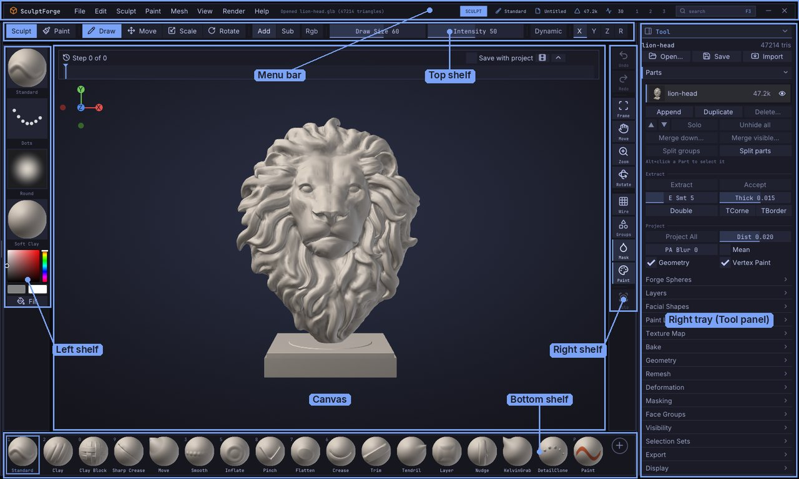

## The regions at a glance

| Region | Where | What it holds |
|---|---|---|
| Menu bar | Top edge | The menus **File, Edit, Sculpt, Paint, Mesh, View, Render, Help**; the status message; mode, brush, file name, triangles and frame rate; layout presets **1 2 3**; **Search** |
| Top shelf | Under the menu bar | Sculpt/Paint, Draw/Move/Scale/Rotate, Add/Sub, Rgb, Draw Size, Intensity, Dynamic, symmetry |
| Left shelf | Left of the canvas | Brush, Stroke, Alpha and Material tiles, the colour picker, Fill |
| Canvas | Centre | The 3D view, with the Sculpt Timeline along its top; strokes and navigation start only here |
| Right shelf | Right of the canvas | Undo and Redo, Frame, Move, Zoom and Rotate, display toggles, Solo |
| Right tray | Far right | The **Tool** panel: the active Part, Parts, Layers, Geometry, Masking and more |
| Bottom shelf | Below the canvas | Your quick brushes |

Press <kbd>Tab</kbd> to hide the shelves and trays for a bigger canvas, and again to bring them back. The
menu bar stays, so every function is still one click away.

The **ZBrush-style layout** has a title strip and a bar of 16 alphabetical palettes instead of the menu bar, and
a two-row top shelf; the rest is the same. See [The title strip](#the-title-strip-zbrush-style-layout) and
[Palettes](#menus-and-palettes).

## Looks and layouts

**Edit > Preferences > Interface > Look** sets how the interface looks and how it is laid out. Neither changes your
models, brushes or shortcuts.

**Layout**:

- **SculptForge** (the default for new installs): a status bar along the top with the task menus **File, Edit,
  Sculpt, Paint, Mesh, View, Render** and **Help**, the document name and scene statistics; a one-row top shelf
  (Sculpt/Paint, Draw, Move, Scale, Rotate, Add/Sub, Rgb, Draw Size, Intensity, Dynamic, symmetry). Every palette
  is a section of one menu: **File** (File, Script), **Edit** (Edit, Preferences), **Sculpt** (Brush, Draw &
  Tablet, Stroke, Alpha, Symmetry & Gizmo), **Paint** (Vertex Paint & Color), **Mesh** (Parts & Geometry, which is
  the Tool palette, and Generate 3D), **View** (Display), **Render** (Materials, Gaussian Splats) and **Help**. Pin
  a section to a tray as you would a palette. Brush Lab, Front and the pressure options are under **Sculpt**, the
  Library and the console under **View > Display**, and <kbd>F3</kbd> finds everything.
- **ZBrush-style**: the alphabetical palette bar under a title strip, and a two-row top shelf (see [The title
  strip](#the-title-strip-zbrush-style-layout) and [Top shelf](#top-shelf)).
  Coming from ZBrush? In the welcome shown at the first start, pick the **ZBrush-style layout** card or **Coming
  from: ZBrush** (which also sets the ZBrush-style keys).

Switching the layout swaps the shelves for that layout's standard ones; the trays and what is in them stay.

**Look** (the colours and style):

- **Forge Terminal** (the default): tiles with small gaps and thin borders, JetBrains Mono for labels and numbers.
  **Colours** picks the scheme: **Neutral** (the default since 0.10.9: pure grey panels and the orange accent, so
  your model's colours read true), Tokyo Night (the default in 0.10.7 and 0.10.8), Catppuccin Mocha, Gruvbox Dark,
  Nord, Rosé Pine, Kanagawa or Everforest. **Match my desktop theme** uses your Omarchy theme's colours when Omarchy
  is installed (Linux; the option shows only then). SculptForge never changes the theme; toggle it again after
  switching themes.
- **Classic**: the dark grey interface with the orange accent that SculptForge had before 0.10.7, now exactly
  neutral grey (red, green and blue equal in every background, panel and frame colour).
- **Phosphor**: green or amber on black, monospace, with optional scanlines and glow on the interface (never on
  the 3D view).
- **Blueprint**: deep blue with cyan and white line work.

**Outlines** (Forge Terminal, Phosphor and Blueprint) sets the panels' borders: **Subtle** (the default: faint
borders, and nothing lights up under the pointer), **Off** (no borders; the gaps alone separate the panels) or
**On** (clear borders, the panel under the pointer a faint step lighter). **Outline opacity** (0-100%, default
100%) fades the borders further into the panels. Hovering a control only gives that control a faint fill, never a
bright border.

**The first start** shows three looks to pick from in the welcome: **Neutral**, **Forge Terminal** (Tokyo Night)
and **ZBrush-style layout** (Classic with the palette bar). **Coming from** sets the keys and the layout together:
ZBrush (ZBrush-style keys and layout), Blender, Maya or New to sculpting (their keys, the SculptForge layout).
Help > Welcome shows it again.

Choosing Forge Terminal, Phosphor or Blueprint also switches to the SculptForge layout; you can pick the
ZBrush-style layout again right after. The look and layout are remembered for the next start without
[Store Config](#store-config-and-friends) (Store Config keeps them in your UI configuration too).

**Updating from an older version** keeps the look and layout you had. A card, **SculptForge has a new look**,
shows once: **Try it** switches to Forge Terminal with the Neutral colours and the SculptForge layout; **Keep my layout**
changes nothing. Either way, Edit > Preferences > Interface > Look changes it later.

In scripts: `ui_look look=forge scheme=neutral outlines=subtle layout=sculptforge` (or `look=classic layout=zbrush`).

## Turning AI off

Your art is never uploaded or used for training. AI features run only when you use them and can be turned off.

**Edit > Preferences > AI > Enable AI features** turns off everything AI: **AI Brush** (Brush Lab, where you describe a
brush in words) and **Generate 3D** (image or text to a model) leave the shelves, menus and the command palette,
their commands leave scripts, `sculptforge-cli` and the MCP tool list, and SculptForge makes no AI network calls.
The offline image tools (**Relief**, **Inflate**, **Stamp**) and the MCP server stay. The first-run welcome asks
the same question. The choice is saved at once; turn it back on the same way, or search the command palette for
"Enable AI".

Studios can turn it off for everyone with the environment variable `SF_AI=off` (or start with `--no-ai`); the
setting is then locked. See [Studios](studios.md#environment-variables).

## The menu bar

From left to right:

- **SculptForge** and the task menus **File, Edit, Sculpt, Paint, Mesh, View, Render, Help**. Click a menu to
  open it: its sections are listed down the left (for example **Sculpt** has Brush, Draw & Tablet, Stroke,
  Alpha and Symmetry & Gizmo) and the chosen one opens beside them. See [Menus and palettes](#menus-and-palettes).
- **The status message**: the result of the last command or action. Errors show in red for a few seconds.
- **Mode** (SCULPT, PAINT, MOVE...), the active **brush**, the **file name** (`*` after it means unsaved
  changes), the **triangle** count of the scene and the **frame rate**. On a narrow window the least important
  of these are left out.
- **1**, **2**, **3**: the layout presets (see [Layout presets](#layout-presets)).
- **Search** (<kbd>F3</kbd>): opens the [command palette](#the-command-palette).
- **Minimize** and **Close** at the far right. Close asks to save changes first, as
  <kbd>Ctrl</kbd>+<kbd>Q</kbd> does.

## The title strip (ZBrush-style layout)

In the ZBrush-style layout the top edge is a title strip instead, with the palette bar under it. From left to
right:

- **SculptForge** and the **document name** ("Untitled" until you save). A `*` after the name means there are
  unsaved changes; click the name to save (<kbd>Ctrl</kbd>+<kbd>S</kbd>).
- **Scene statistics**: vertices and triangles across all Parts, the active Part and its position
  ("Part Body (2/5)"), the active sculpt layer ("Layer Base" when you sculpt the base mesh), the number of
  Gaussian splats when a capture is loaded, and the frame rate.
- **The status message**: the result of the last command or action. Errors show in red for a few seconds.
  Point at a long message to read all of it.
- **Snapshot**: saves a timestamped copy of the whole scene to your library without touching your project
  file (see [Projects, autosave and snapshots](projects.md)).
- **1**, **2**, **3**: the layout presets (see [Layout presets](#layout-presets)).
- **Menus**: shows or hides the palette bar.
- **Search** (<kbd>F3</kbd>): opens the [command palette](#the-command-palette).
- **Minimize** and **Close** at the far right. Close asks to save changes first, as
  <kbd>Ctrl</kbd>+<kbd>Q</kbd> does.

## Menus and palettes

Every function in SculptForge lives in one of 16 palettes. In the SculptForge layout each palette is a section
of one task menu (the table below); in the ZBrush-style layout the palettes sit side by side in the palette bar.
Either way, click the name and the palette drops down under it. Click another name to switch, or press
<kbd>Esc</kbd> or click outside to close it.

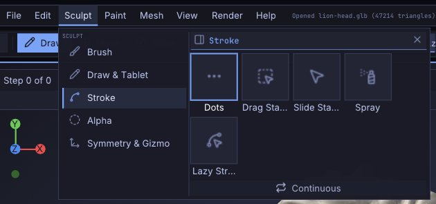

Menu paths in this guide name what you click in the SculptForge layout: **Edit > Preferences > Input** is the
**Edit** menu, its **Preferences** section, then the **Input** sub-palette. **File** and **Edit** have a section
of the same name, which paths leave out (**File > Save**). Paths starting with **Tool** are in the Tool panel in
the right tray, in both layouts (it is also **Mesh > Parts & Geometry**). In the ZBrush-style layout, drop the
menu: **Edit > Preferences > Input** is **Input** in the palette named **Preferences**, and **Sculpt > Stroke**
is the palette named **Stroke**.

In the ZBrush-style layout, the palette bar lists **File** and **Edit** first and **Help** last, where other
desktop applications put them, and the rest in alphabetical order. If you prefer ZBrush's strict A to Z order,
turn on **Edit > Preferences > Interface > Palettes strictly A-Z (ZBrush order)**.

| Palette | In the SculptForge layout | What's in it |
|---|---|---|
| **File** | File | New Sphere, New Plane, Open, Open Recent, Save, Save As, autosave interval, Import and every export (OBJ, GLB, LOD chain, USD/USDZ, FBX for Unreal, Send to Unreal, splats), Send to ZBrush, Quit |
| **Edit** | Edit | Undo and Redo (with the name of the step), Paste brush |
| **Alpha** | Sculpt > Alpha | The brush alphas: Round, Square, Noise and twelve patterns (Pores, Cracks, Scales...), images from your library, Load image, Invert loaded image |
| **Brush** | Sculpt > Brush | AI Brush (Brush Lab), Community brushes, Paste brush, your custom brushes, Front faces only, Invert (Alt), the recipe editor for a custom brush, and every brush as a thumbnail grid with a filter |
| **Color** | Paint | The Paint brush, RGB while sculpting, the paint colour and swatches, Fill, Fill masked, Cavity, Clear, Show vertex paint |
| **Draw** | Sculpt > Draw & Tablet | Draw Size, Intensity, RGB Intensity, Falloff, Sculpt/Paint, Add/Sub, Rgb, Front, and the tablet options (Pressure > strength, Pressure > size) with a pen readout |
| **Generate** | Mesh > Generate 3D | Generate 3D (image or text to 3D), Relief, Inflate and Stamp from an image, and the AI brush provider settings |
| **Material** | Render > Materials | The Lit Sphere materials (Soft Clay, the default, first), your own (**Load Lit Sphere...**) and Studio, Base colour, Smooth / Flat shading for the scene and the active Part |
| **Preferences** | Edit > Preferences | Config, Interface, Input, Hotkeys, Display, Library, Tablet, Performance, Updates and Autosave sub-palettes (see [Customizing the interface](#customizing-the-interface)) |
| **Render** | View | Wireframe, Show Mesh, Show Vertex Paint, Show Mask, Show Face Groups, Show Splats, Background, Frame, Fullscreen |
| **Script** | File > Script | Console, Run script file, Copy session as script, Clear console |
| **Splats** | Render > Gaussian Splats | Gaussian splat tools: show, flip, turn, fit, clean floaters, Make sculptable, sculpt to splats, save, clear |
| **Stroke** | Sculpt > Stroke | The stroke types (Dots, Drag Stamp, Spray, Lazy Stroke) and their settings |
| **Tool** | Mesh > Parts & Geometry, and the right tray | The active Part with Open, Save and Import, and the Part, Layers, Paint Layers, Geometry, Remesh, Deformation, Masking, Face Groups, Visibility, Export and Display sub-palettes |
| **Transform** | Sculpt > Symmetry & Gizmo | Draw, Move, Scale and Rotate (the [Gizmo](gizmo.md) with its pivot, axes, options and numeric entry), Symmetry X, Y and Z, Frame, Solo, Wire |
| **Help** | Help | Controls, User Guide, What's New, Command palette, Website & documentation, Report a problem, Support SculptForge..., About SculptForge |

### Sub-palettes

Large palettes are divided into **sub-palettes**: headers you click to open or close. The Tool palette is the
main example (Part, Layers, Geometry and so on). By default opening one sub-palette closes the others in
the same palette, which keeps the palette short. **Shift**+click a header to open it without closing the
others, or turn off **Edit > Preferences > Interface > One sub-palette open**.

> **ZBrush:** as in ZBrush, Parts (ZBrush's SubTool), Layers, Masking, Face Groups (Polygroups) and Visibility are sub-palettes of the Tool
> palette rather than palettes of their own. SculptForge's Remesh sub-palette is where ZBrush's DynaMesh would be.

## Trays

The trays are columns at the far left and far right of the window where palettes stay open while you work. The
right tray is open by default and holds the **Tool** palette; the left tray starts closed and empty.

- **Put a palette in a tray**: open it from its menu (or the palette bar) and click the tray icon at the left of its header.
  It goes into the right tray; **Shift**+click the icon to put it in the left tray. You can also drag the icon
  onto a tray.
- **Take it out again**: click the tray icon in its header inside the tray. The palette returns to its menu.
- **Collapse it in place**: click its title (or the arrow at the right of the header).
- **Find it**: a palette that is in a tray shows a tray icon beside its name in its menu (in the palette bar of
  the ZBrush-style layout, its name in the accent colour). Clicking the name
  scrolls the tray to the palette and flashes its header.
- **Open or close a tray**: click its divider, the thin strip with a grip between the tray and the shelves.
  **Drag** the divider to make the tray wider or narrower (240 to 480 pixels).

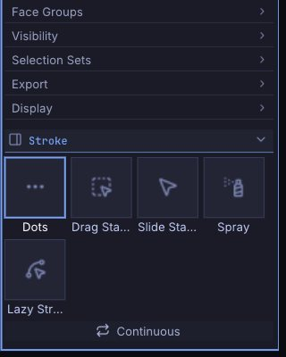

When a tray holds several palettes, **Edit > Preferences > Interface > Auto collapse left tray** (on by default) and
**Auto collapse right tray** (off by default) collapse the other palettes when the one you open would not fit.

When you open a Gaussian splat capture, **Render > Gaussian Splats** moves into the right tray by itself.

> **Note:** on a window narrower than 1280 pixels (at 100% UI scale) the right tray folds away and palettes
> open as drop-downs only. The left-shelf tiles get smaller and the bottom shelf scrolls sideways with the
> mouse wheel.

## The shelves

Shelves surround the canvas and hold the controls you use all the time. Point at anything with <kbd>Ctrl</kbd>
held to see what it does. Right-click an item for **Remove from shelf**; see [Customizing the
interface](#customizing-the-interface) to add items.

### Top shelf

- **Sculpt** / **Paint** (<kbd>P</kbd>): brushes change the shape, or paint colour without sculpting.
- **Draw**, **Move**, **Scale**, **Rotate** (<kbd>Q</kbd> <kbd>W</kbd> <kbd>E</kbd> <kbd>R</kbd>): sculpt, or
  move, scale and rotate the Part with the [Gizmo](gizmo.md).
- **Add** / **Sub**: brushes add to or subtract from the surface. Holding <kbd>Alt</kbd> flips it for one
  stroke.
- **Rgb**: sculpt brushes paint the colour at the same time.
- **Draw Size**: the brush radius in screen pixels (2 to 800).
- **Intensity**: how strongly each dab changes the surface (1 to 100). While <kbd>Shift</kbd> is held it shows
  Smooth's own value.
- **Dynamic**: [dynamic topology](dynamic-topology.md), with its **Detail** slider while it is on.
- **X**, **Y**, **Z**: symmetry across each axis (<kbd>X</kbd> toggles X); **R** is radial symmetry.

The ZBrush-style layout's top shelf has two rows: **Library** (<kbd>,</kbd>), Sculpt/Paint, Add/Sub, Rgb, Draw
Size and Intensity on the first; **AI Brush**, **Front**, symmetry, **Pressure > Strength** and **Pressure >
Size**, and the **ActiveTris / TotalTris** count on the second. In the SculptForge layout these are in the
**Sculpt** menu (AI Brush, Front, pressure) and **View** menu (Library).

Draw Size and Intensity are sliders with the label inside, as in ZBrush: drag along them, or
<kbd>Ctrl</kbd>+click to type a value.

### Left shelf

Four large tiles, each showing the current choice. Click one to open its [pop-up picker](#pop-up-pickers):

- **Brush**: the active brush, with a rendered preview.
- **Stroke**: Dots, Drag Stamp, Spray or Lazy Stroke.
- **Alpha**: the brush's stamp shape.
- **Material**: how the model is shaded in the view.

Under them is the **colour picker** for vertex paint (a saturation/value square and a hue strip), two swatches
(the main and second colour; click either to swap them, like ZBrush's Alternate) and **Fill**, which fills the
unmasked area with the main colour.

### Right shelf

- **Undo** and **Redo** (<kbd>Ctrl</kbd>+<kbd>Z</kbd>, <kbd>Ctrl</kbd>+<kbd>Shift</kbd>+<kbd>Z</kbd>): greyed out when
  there is nothing to undo or redo. A layout you customised before they were added gets them at the top.
- **Frame** (<kbd>F</kbd>): fits the model in the view.
- **Move**, **Zoom**, **Rotate**: drag on these buttons to pan, zoom and orbit the view, as in ZBrush.
- **Wire** (<kbd>Shift</kbd>+<kbd>F</kbd>): shows the mesh's polygons: quads as quads, triangles as triangles.
- **Groups**: colours each face group.
- **Mask** (<kbd>Ctrl</kbd>+<kbd>H</kbd>): shows or hides the mask's darkening (on by default). Hiding it keeps
  the mask, which still protects the surface.
- **Paint**: shows vertex paint colours (on by default).
- **Solo**: shows only the active Part (available with two or more Parts).
- **Splats**: shows or hides a Gaussian splat capture (only shown while one is loaded).

Options that are on are highlighted; a filled button in the accent colour marks only the current tool or mode. See [Navigating the view](navigation.md) for the camera.

### Bottom shelf

A row of quick brushes: Standard, Clay, Clay Block, Sharp Crease, Move, Smooth, Inflate, Pinch, Flatten,
Crease, Trim, Tendril, Layer, Nudge and Paint. The small digit in a tile's corner is its shortcut
(<kbd>1</kbd> to <kbd>9</kbd> and <kbd>0</kbd> select the first ten built-in brushes, <kbd>P</kbd> is Paint).
The active brush is outlined in the accent colour.

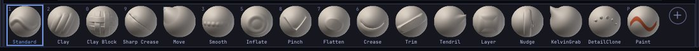

- **Add a brush**: click **+** at the end of the shelf and pick any brush, built-in or one of your own. Or
  right-click a brush in the brush picker and choose **Add to bottom shelf**. Custom brushes show a small
  sparkle in the corner.
- **Remove a brush**: right-click its tile and choose **Remove from shelf**.
- **Bigger or smaller tiles**: right-click any brush on the shelf and choose **Tile size**: Small, Medium (the
  default) or Large. The same setting is in **Edit > Preferences > Interface > Shelf tiles**. Small leaves the most
  room for the model on a laptop screen.

## Pop-up pickers

Pickers are pop-up grids of thumbnails. They open beside the left-shelf tile you click, or under the mouse
when you use a key. They close when you pick something, press <kbd>Esc</kbd> or click elsewhere. Pointing at a
tile for a moment shows **Quick Info**: a large preview and a description.

### Brush picker

Press <kbd>B</kbd> (or click the Brush tile). The picker shows a **Recent** row, then **Built-in**, **Custom**
(your brushes and Brush Lab creations) and **Library** (`.sfbrush` files in your library that aren't loaded
yet; picking one loads it).

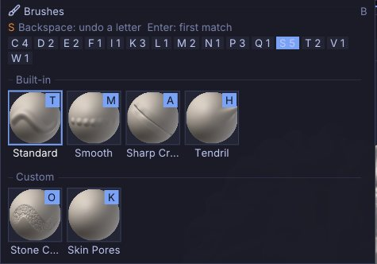

Choose a brush with the keyboard the ZBrush way:

1. Press <kbd>B</kbd>.
2. Type the first letter of the brush. Only the brushes starting with that letter stay, and each shows an
   orange letter: the next key that tells it apart.
3. Press that orange letter to pick the brush. For example <kbd>B</kbd> <kbd>S</kbd> <kbd>T</kbd> picks
   Standard.

<kbd>Backspace</kbd> takes back a letter and <kbd>Enter</kbd> picks the first match. If no name starts with
what you typed, the picker falls back to names that contain it. The letter chips along the top (with a count
for each letter) filter by a click as well.

Right-click a brush for **Add to bottom shelf** and, for custom brushes, **Copy brush code**, **Rename...**,
**Save as .sfbrush...**, **Delete...** and **Reveal in folder** (see [Brush Lab and sharing
brushes](brush-lab.md)).

### Stroke, Alpha and Material pickers

- **Stroke** (click the Stroke tile): Dots, Drag Stamp, Spray and Lazy Stroke, with Scatter for Spray, Steady
  Stroke (and its radius) and Precision Intensity. See [Sculpting and brushes](sculpting.md).
- **Alpha** (click the Alpha tile): Round, Square, Noise and the twelve built-in patterns (Pores, Cracks, Scales,
  Rivets, Stitches, Fabric Weave, Bark, Rock Strata, Wrinkles, Skin Folds, Hair Strands, Dot Grid), the image alpha you loaded, images in your
  library's Alphas folder, **Load image...** and **Invert loaded image**.
- **Material** (<kbd>M</kbd>, or click the Material tile): the Lit Spheres and Studio. Point at a material to
  preview it on the model; click to keep it. Closing the picker without clicking puts the old material back.
  See [Vertex Paint and materials](vertex-paint.md).

### Sliders at the cursor and the Quick Menu

As in ZBrush, press <kbd>S</kbd> for a Draw Size slider under the mouse, <kbd>U</kbd> for Intensity,
<kbd>I</kbd> for RGB Intensity or <kbd>O</kbd> for Falloff. Drag the slider, or type a number and press
<kbd>Enter</kbd> (<kbd>Esc</kbd> cancels). The pop-up closes when you release the slider. <kbd>[</kbd> and
<kbd>]</kbd> make the brush 10% smaller or larger at any time. <kbd>Space</kbd> (or a right click on the canvas) opens the Quick Menu with all of
them and the brush, stroke, alpha and material (see [The Quick Menu](sculpting.md#the-quick-menu)).

## The Library

The Library is a strip of thumbnails across the top of the canvas for browsing everything you can load. Press
<kbd>,</kbd> (comma) or click **Library** on the top shelf to show or hide it. It opens on its own at
start-up (see [Preferences](#interface-preferences)).

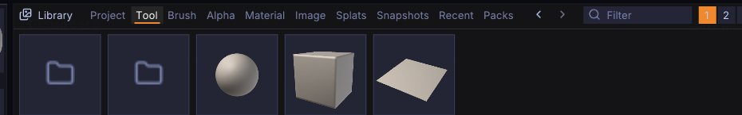

| Tab | Shows | Double-click |
|---|---|---|
| **Project** | Projects (`.sfproj`) in your library and recently opened projects | Open the project |
| **Tool** | Sphere, Plane and Cube, and model files in your library | Open (replaces the scene) |
| **Brush** | Every brush: built-in, custom and `.sfbrush` files, and the VDM brushes (built-in ones too) | Select or load the brush |
| **Alpha** | Round, Square, Noise, the twelve built-in patterns and images in your Alphas folder | Use as the brush alpha |
| **Material** | The Lit Spheres (your own included) and Studio | Use the material |
| **Image** | Reference images in your library | A menu: Generate 3D, relief, inflate, project onto the model, use as alpha |
| **Splats** | Gaussian splat captures (`.ply`, `.splat`) | Open the capture as a reference |
| **Snapshots** | The autosave and your snapshots, newest first | Open it |
| **Recent** | Recently opened files of every kind | Open it |

Working with the strip:

- **Shift+double-click** a model, project or primitive to append it to the scene as a new Part instead of
  replacing the scene.
- Drag sideways (or use the mouse wheel) to scroll through the strip. A drag of more than a few pixels scrubs,
  so a plain click still selects.
- Drag a tile down out of the Library onto the canvas to load it, like a double-click.
- Folders open with a double-click; the first tile inside a folder goes back up. The arrows at the top go back
  and forward through tabs and folders, and the breadcrumb shows where you are.
- Type in **Filter** to show only items whose names contain the text.
- Choose **1** to **4** rows of thumbnails.
- **Open folder...** adds a folder of your own to the root of every tab.
- On the Snapshots tab, **Save now** takes a snapshot.
- The **x** at the right end of the header, or <kbd>Esc</kbd>, closes the Library (while you type in Filter,
  <kbd>Esc</kbd> first leaves the field). The **x** stays on screen on small displays such as 1280x720.
- Right-click a tile for **Open**, **Append as Part**, the image actions, **Show in file manager** and
  **Refresh thumbnail**.

At the root of the Tool and Image tabs is a **Built-in** folder (the models and images that ship with
SculptForge, such as the demo lion head), and the Project, Tool, Brush, Alpha, Image and Splats tabs have a
**User** folder, your library folder (**Documents/SculptForge** by default). To use a different library folder,
choose it in **Edit > Preferences > Library > Library folder**.

> **ZBrush:** the Library works like ZBrush's LightBox: comma toggles it, double-click loads, and Built-in and User
> folders play the part of ZBrush's Maxon and User folders.

## Getting help on anything

### Ctrl-hover help

Hold <kbd>Ctrl</kbd> and point at any button, slider, tile or shelf item. A box shows the item's name, its
shortcut as keycaps, what it does, where it lives (for example "Tool > Geometry") and the script command it
runs.

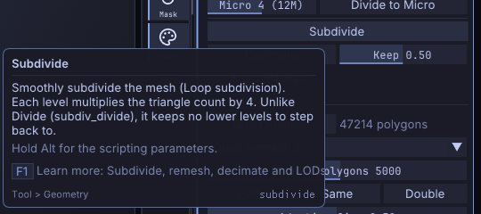

Hold <kbd>Ctrl</kbd>+<kbd>Alt</kbd> instead to see the **scripting reference** for items that run a command:
the command's usage line and each parameter with its type and description. This is the same information the
console, `sculptforge-cli` and AI agents use.

Without <kbd>Ctrl</kbd>, icon-only buttons and labels that don't fit show their name after a short delay
(**Edit > Preferences > Interface > Tooltip delay**). Turn Ctrl-hover help off with **Edit > Preferences > Interface > Popup
Info (Ctrl+hover help)**, and make the box more or less see-through with **Popup Info opacity**.

### The Controls sheet

Press <kbd>F1</kbd> (or **Help > Controls**) for the **Controls** window. The **Keyboard** tab lists every
action that has a shortcut, grouped by palette and generated from the actions themselves, so it always shows
your current keys. The **Mouse & pen** tab lists the gestures. Type in the filter field to search both.
Double-click a row on the Keyboard tab to give that action a new key.

### This guide

**Help > User Guide** (<kbd>Shift</kbd>+<kbd>F1</kbd>) opens this guide in its own window: the contents on
the left (the open chapter lists its sections), the chapter on the right, and links between chapters.

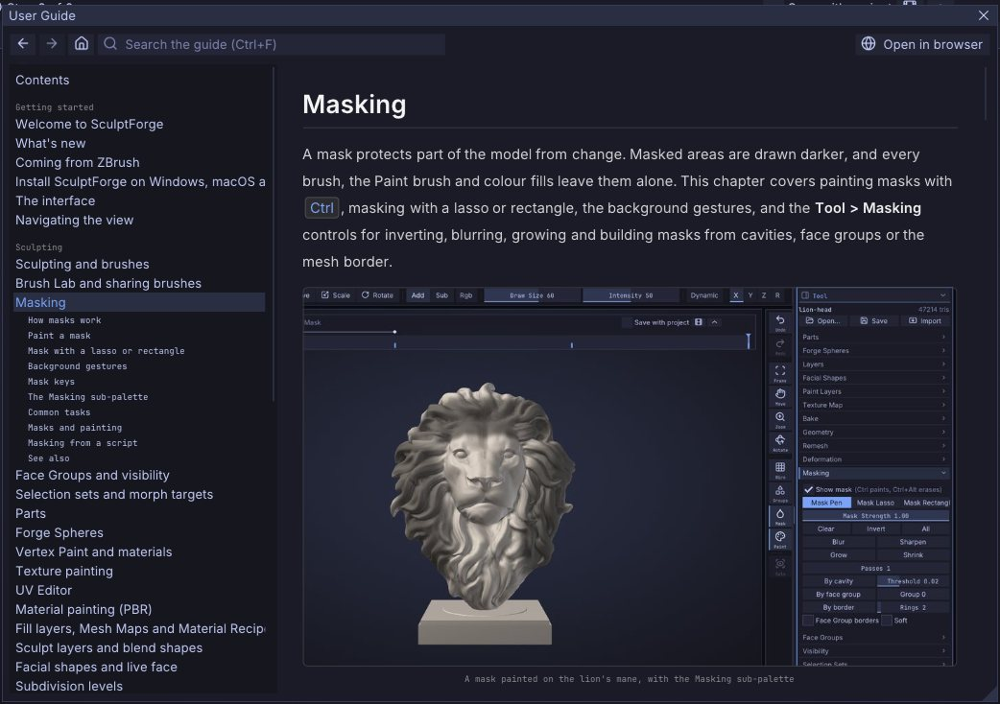

- **Search:** type in the search box (<kbd>Ctrl</kbd>+<kbd>F</kbd>) to find every section that mentions all
  of your words. Click a result to jump there; the words are marked on the page. <kbd>Esc</kbd> clears it.
- **Back and forward:** the arrow buttons, <kbd>Alt</kbd>+<kbd>Left</kbd> / <kbd>Alt</kbd>+<kbd>Right</kbd>,
  or the back and forward buttons of your mouse.
- **From any control:** while Ctrl-hover help is showing, press <kbd>F1</kbd> (keep <kbd>Ctrl</kbd> held) to
  open the chapter about that control. The help box shows which chapter it is ("Learn more: ...").
- **Code blocks** have a **Copy** button, and **Open in browser** shows the same page on the SculptForge
  website.

The guide is built into SculptForge, so it works offline and always matches your version.

## The command palette

Press <kbd>F3</kbd> (or <kbd>Ctrl</kbd>+<kbd>Shift</kbd>+<kbd>P</kbd>, or click **Search** at the top right)
to find any action or command by name and run it. It opens at the top centre of the canvas.

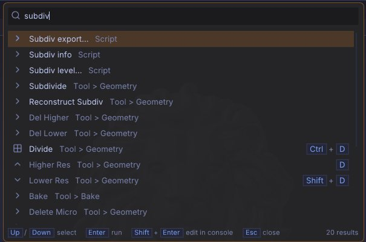

- Type part of a name, a palette or a word from the description. The search is forgiving: letters in order are
  enough ("sbdv" finds Subdivide), and every word you type must match somewhere.
- Each row shows the action, its palette and its shortcut.
- <kbd>Up</kbd> and <kbd>Down</kbd> (or <kbd>Page Up</kbd> and <kbd>Page Down</kbd>) choose a row,
  <kbd>Enter</kbd> runs it and <kbd>Esc</kbd> closes the palette.
- With nothing typed, the palette lists the actions you used most recently.
- Commands with a required parameter (for example `image_relief path=`) open in the console with the name
  already typed. Other commands run with their default values; <kbd>Shift</kbd>+<kbd>Enter</kbd> sends a
  command with parameters to the console instead, so you can set them first.

Everything scriptable is in the command palette, including commands that have no button in the interface.

## The console

Press <kbd>`</kbd> (the backtick key, left of <kbd>1</kbd> on US keyboards) to open the console, a strip
between the canvas and the bottom shelf. It works like ZBrush's ZScript window:

- Every command you run, from a button, a key, the command palette, a script or an AI agent, appears as a
  script line followed by its result. Errors show in red.
- Type a command and press <kbd>Enter</kbd>: for example `remesh resolution=200` or `subdivide; decimate
  ratio=0.5`. <kbd>Tab</kbd> completes command and parameter names, <kbd>Up</kbd> and <kbd>Down</kbd> recall
  earlier lines, and `help` (or `help remesh`) explains commands.
- Drag the console's top edge to make it taller or shorter.
- **File > Script** has **Run script file...**, **Copy session as script** (every command you ran this
  session, ready to replay, which makes it a macro recorder) and **Clear console**.

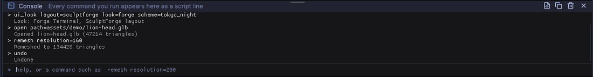

See [Scripting and automation](scripting.md) for the command language, scripts and headless use.

## Customizing the interface

Everything about the layout can change: which palettes sit in the trays, what's on each shelf, and which keys
do what. As in ZBrush, **changes last until you quit** unless you store them with **Store Config**.

### Move, add and remove shelf items

1. Open **Edit > Preferences > Config** and turn on **Enable Customize**. The shelves get a dashed orange outline and
   the status line reads "Customize: Ctrl+Alt+drag to move or remove items".
2. Hold <kbd>Ctrl</kbd>+<kbd>Alt</kbd> and drag any button, slider or tile:
   - onto a shelf to put it there (an orange line shows where it will go), which is how you **add** buttons
     from palettes to a shelf;
   - along its shelf, or to another shelf, to **move** it;
   - off the shelves (onto the canvas, for example) to **remove** it.
3. Turn **Enable Customize** off when you're done, and press <kbd>Ctrl</kbd>+<kbd>Shift</kbd>+<kbd>I</kbd> to
   keep the result.

Right-clicking a shelf item and choosing **Remove from shelf** works without Customize mode.

### Assign shortcuts

- Hold <kbd>Ctrl</kbd>+<kbd>Alt</kbd> and **click** any button (with Customize off), then press the key you
  want. <kbd>Esc</kbd> cancels and <kbd>Backspace</kbd> removes the button's shortcut.
- Or open **Edit > Preferences > Hotkeys**, find the action (there's a filter), click its key button and press the
  new key. Keys you changed show in orange. **Default shortcuts** undoes every change.
- Or double-click a row in the Controls window (<kbd>F1</kbd>).

If the key already belongs to another action, it moves to the new one (as in ZBrush) and the status line says
which action lost it.

### Store Config and friends

All in **Edit > Preferences > Config**:

| Item | What it does |
|---|---|
| **Store Config** (<kbd>Ctrl</kbd>+<kbd>Shift</kbd>+<kbd>I</kbd>) | Keeps the current layout, shortcuts and interface preferences for future sessions |
| **Restore Custom UI** | Goes back to what the last Store Config saved |
| **Restore Standard UI** | Goes back to the built-in layout and default shortcuts (Store Config afterwards to make it stick) |
| **Save UI...** | Saves the layout, shortcuts and preferences to a `.json` file you can share |
| **Load UI...** (<kbd>Ctrl</kbd>+<kbd>L</kbd>) | Loads such a file (Store Config afterwards to keep it) |

The first time you change the layout in a session, the status line reminds you once: "Layout changed -
Ctrl+Shift+I to keep it". What a session changes by itself (the console and Library being open, the Library
tab) doesn't count as a layout change.

> **ZBrush:** Store Config has the same shortcut as in ZBrush, and SculptForge never saves the layout on its
> own either.

### Layout presets

The **1**, **2** and **3** buttons at the top right (also in **Edit > Preferences > Config**) switch between three
arrangements of the current layout:

1. **Standard**: the Tool panel in the right tray and shelves around the canvas.
2. **Sculpt**: both trays closed, for the largest canvas.
3. **Wide**: Brush, Stroke and Alpha in the left tray, Tool and Material in the right tray.

A preset changes the layout only (the console, Library and left-handed setting stay as they are). Store
Config keeps it.

### Interface preferences

**Edit > Preferences > Interface**:

| Setting | Default | What it does |
|---|---|---|
| **Look**, **Outlines** and **Layout** | Forge Terminal, Neutral, Subtle, SculptForge | See [Looks and layouts](#looks-and-layouts) |
| **Language** | English | The interface language: **English** or **Español** (see below) |
| **Popup Info (Ctrl+hover help)** | On | Ctrl-hover help boxes |
| **Popup Info opacity** | 0.97 | How solid the help box is |
| **Tooltip delay** | 0.5 s | How long to point at an icon-only button before its name appears |
| **Reduce motion** | Off | Hover and focus highlights change colour only: no easing, and tiles don't lift |
| **One sub-palette open** | On | Opening a sub-palette closes the others in that palette |
| **Auto collapse left tray** / **right tray** | On / Off | Collapse other palettes in the tray when one wouldn't fit |
| **Palettes strictly A-Z (ZBrush order)** | Off | ZBrush-style layout: strict alphabetical palette bar instead of File and Edit first, Help last |
| **Left-handed layout** | Off | Mirrors the shelves and trays: tools on the right, navigation on the left |
| **UI scale** | Automatic | Size of text and controls (100% to 200%), applied at once; Automatic follows the monitor (see below) |
| **Camera notch** | Automatic | Keeps the interface below a laptop's camera notch in fullscreen (see below) |

**Language** changes the interface at once, without a restart; Store Config keeps it for the next start. In
**Español** the menus, the palettes, the shelves, the Library, the command palette and the Ctrl-help titles
are in Spanish, while the names of tools and brushes stay in English, as Spanish-speaking sculptors use them (Parts,
Quad Remesh, Forge Spheres, Library, Lit Sphere, Clay Block, Add). The command palette finds a command by its Spanish or its
English name. Anything not translated yet (most Ctrl-help descriptions, this guide) shows in English. Scripts and
`sculptforge-cli` commands are the same in every language.

**UI scale** also applies at once: text, buttons, shelves and trays resize on the next frame; Store Config keeps it.
**Automatic** uses the scale of the monitor the window is on (Windows: **Settings > Display > Scale**; macOS and
Wayland: the display's scaling; X11: the desktop's font DPI). Drag the window to a monitor at another scale, or
change the system setting, and the interface follows. A chosen size (100% to 200%) stays the same on every monitor.

**Edit > Preferences > Cursor**:

| Setting | Default | What it does |
|---|---|---|
| **Viewport cursor** | Crosshair | The pointer over the 3D view: a crosshair, or the arrow (#73). The crosshair stays while the view turns, pans or zooms. Panels, menus and popups always show the arrow |
| **Cursor follows surface** | On | The brush ring lies on the model: a true circle at the brush's real size, in the plane of the surface (averaged over the brush, so bumps don't bend it), with a short line along the surface's direction. Symmetry and radial copies show as dots where their dabs land. Off: a flat ring on the screen |
| **Hide ring while stroking** | Off | While a stroke runs, only the dot where the brush touches (and the symmetry dots) shows, not the ring |

**Edit > Preferences > Hints**: **Show hints in the viewport** (on) and one box per hint (Strokes start off the model,
Previewing an LOD, Face landmark steps). Each hint over the 3D view also has its own **Don't show again**; **Show
all hints again** brings them all back. Store Config keeps them.

**Scrolling panels with a pen**: on small screens a palette or tray that doesn't fit scrolls with the mouse wheel,
and also with a **left-drag on empty space** in it (between and beside the controls) or a **middle-drag anywhere**
on it, as you would scroll a list with a finger (#100).

**Edit > Preferences > Input** sets the key **Style** (the first start sets it from your **Coming from** answer):
**SculptForge** (the default for new installs): <kbd>1</kbd> to <kbd>9</kbd> and <kbd>0</kbd> pick the first ten
brushes, <kbd>I</kbd> opens Intensity like <kbd>U</kbd>, and <kbd>Ctrl</kbd>+drag on the background zooms when
nothing is masked; **ZBrush-style**: ZBrush's keys, with the number keys free (<kbd>9</kbd> is Save Snapshot),
<kbd>I</kbd> for RGB Intensity and <kbd>Ctrl</kbd>+drag on the background for a mask rectangle (see
[ZBrush-style keys](shortcuts.md#zbrush-style-keys)); **Maya**: Maya's view controls; or **Blender**: middle-drag navigation,
the numpad views and Blender's sculpt-mode keys (see [Blender keys](shortcuts.md#blender-keys)). In the Blender
style, **Emulate Numpad** makes the number row work as the numpad, and **Import Blender keymap...** takes the keys
from a keymap you exported in Blender. **Right click opens the Quick Menu** (on by default, in every style) opens
the [Quick Menu](sculpting.md#the-quick-menu) with a right click on the canvas; a right drag navigates either
way. **Hold Space and drag to move the camera** (off by default) turns <kbd>Space</kbd> into a camera key: held,
left-drag rotates, right- or middle-drag pans and <kbd>Ctrl</kbd>+drag zooms (see
[Navigation](navigation.md#mouse-and-pen)). **Radial Menus** edits your pie menus and their keys (see [Radial menus](sculpting.md#radial-menus)).
**Cursor follows surface** (on by default) lays the brush rings on the model under the pointer (see
[Draw Size and Falloff](sculpting.md#draw-size-intensity-rgb-intensity-and-falloff)); off, they are flat circles on the screen. **Rotation** chooses free rotation (ZBrush) or a turntable. See
[Coming from ZBrush](coming-from-zbrush.md).

### The background

**Edit > Preferences > Display** (and the **View** menu) sets the view's **Background**: **Gradient**, the
charcoal radial gradient (the default), or **Flat Colour**, one solid colour without the gradient. Click the
**Background colour** swatch to pick the colour; picking one switches to Flat Colour. **Store Config** keeps the
choice for the next session, and each project keeps the background it was saved with. From a script:
`set_background mode=flat`, `set_background color=60,70,80` or `set_background mode=gradient`.

> **ZBrush:** like turning the gradient off in the Document palette (**Range** 0) and choosing the **Back**
> colour.

**Edit > Preferences > Library** has **Show at startup** (on by default), the number of **Rows**, **Placement**
(along the top of the canvas, or at the bottom above the bottom shelf) and the **Library folder**.
**Edit > Preferences > Autosave** sets how often a recovery copy is saved (see [Projects, autosave and snapshots](projects.md)).

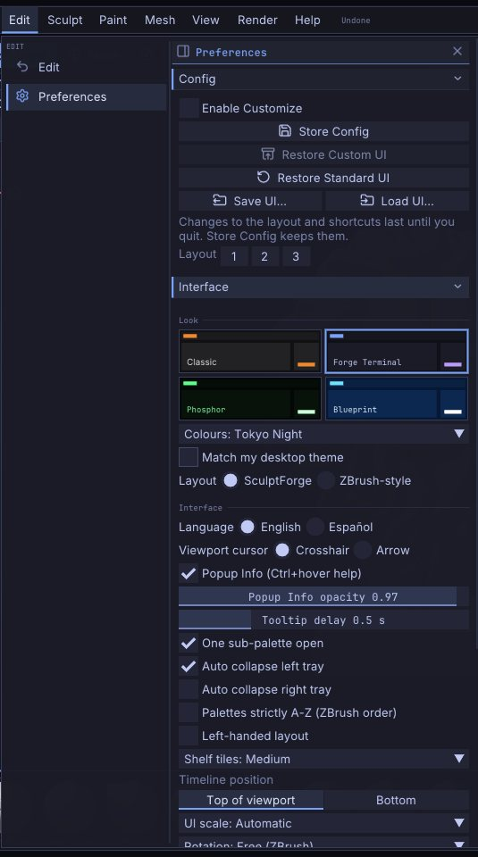

### Fullscreen, hiding panels and the camera notch

- <kbd>F11</kbd> (or **View > Fullscreen**) fills the screen with SculptForge; press it again to go back to
  a window. `sculptforge --fullscreen` starts that way. SculptForge reopens the way you left it; on macOS a window
  closed in full screen reopens maximised instead, so the menu bar and the window buttons stay reachable (press
  <kbd>F11</kbd> or the green button to go full screen again).
- In the ZBrush-style layout, **Menus** in the title strip hides the palette bar; click it again to bring it back.
- <kbd>Tab</kbd> hides the shelves and trays.
- On MacBooks with a camera notch, SculptForge keeps the interface below the notch when it fills the screen
  and fills the band beside the notch with the shell colour. **Automatic** asks macOS for the safe area (on
  Linux it recognises a notched MacBook display); **Always reserve** always keeps a band free at the top,
  whatever the display; **Off** uses the full height.

## See also

- [Navigating the view](navigation.md)
- [Keyboard and mouse](shortcuts.md)
- [Scripting and automation](scripting.md)
- [Troubleshooting and FAQ](troubleshooting.md)
