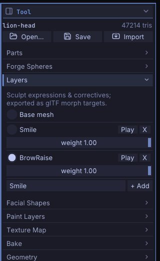

# Sculpt layers and blend shapes

Sculpt layers hold changes on top of the base mesh, each with its own weight: a smile, a blink, a corrective shape
or a variation you want to dial in and out. Because a layer is a set of per-vertex offsets, it exports straight
to game engines and DCC tools as a blend shape (morph target). This chapter covers creating, sculpting into,
weighting, playing and exporting layers.

## How layers work

- Each layer stores how far every vertex moves from the base. The shape you see is the base plus every layer
  times its weight.
- New strokes go into the **active** layer, or into the base mesh when **Base mesh** is selected.
- Layers belong to a [Part](parts.md): each Part has its own list of layers.
- A weight of 0 turns a layer off, 1 shows it as sculpted. Scripts can also set negative weights or weights
  above 1 to exaggerate a shape.
- Layers work on every [subdivision level](subdivision-levels.md), like ZBrush's 3D Layers: see
  [Layers and subdivision levels](#layers-and-subdivision-levels).
- Layers survive [subdividing](geometry.md#subdivide), [decimating](geometry.md#decimate) and
  [LOD chains](geometry.md#lod-chains). A [voxel remesh](geometry.md#voxel-remesh) bakes them into the surface
  (the layers are gone afterwards).

> **Note:** Sculpt layers are not the **Layer** brush. The Layer brush raises the surface to a fixed height; sculpt
> layers are the blend-shape stack described here.

## The Layers sub-palette

Open **Tool > Layers** in the right tray.



From top to bottom:

- **Base mesh**: select it to sculpt the base shape.
- One block per layer: a radio button with the layer's name (select it to sculpt into that layer), **Play**, **X**
  (delete) and a **weight** slider from 0 to 1.
- A name field and **+ Add** at the bottom.

The Layers list highlights the active layer; in the ZBrush-style layout the title strip also shows it (`Layer Smile`,
or `Layer Base`).

## Add a layer and sculpt into it

1. Type a name in the field at the bottom of **Tool > Layers**, for example `Smile` or `BlinkL`.
2. Click **+ Add** (or press <kbd>Enter</kbd> in the field). The new layer becomes the active one.
3. Sculpt. Every stroke goes into the layer until you select another layer or **Base mesh**.

A layer whose weight is 0 can't be sculpted into: SculptForge tells you to raise the weight first.

> **Tip:** Name layers the way your engine or rig expects (`jawOpen`, `BlinkL`): the names become the blend shape
> and morph target names in exported files. For a face, **Tool > Facial Shapes** makes all 52 ARKit shapes for you:
> see [Facial shapes and live face](facial-shapes.md).

## Adjust and preview weights

- Drag a layer's **weight** slider to blend it in and out.
- **Play** animates the layer from 0 to 1 and back, over and over, so you can judge the motion. Click **Stop** to
  end it; the weight returns to 1. Starting a stroke also stops playback.

Weights are saved with the project and used by exports that keep weights (USD writes the current weights).

## Delete a layer

Click **X** next to the layer. Its offsets are removed from the mesh and the base mesh becomes the active target.
Deleting a layer is undoable.

## Layers and subdivision levels

With [subdivision levels](subdivision-levels.md) a layer works the way ZBrush's 3D Layers do: record it at the
top level for the fine detail of an expression, and it stays with the Part whatever level you work on.

- **Each layer has its own detail on every level.** Step down with **Lower Res** (<kbd>Shift</kbd>+<kbd>D</kbd>)
  and a lower level shows the broad part of the layer, exactly as it would show the same strokes made in the base.
  Step back up and the layer is there as you recorded it, to the last vertex.
- **Weights are shared by all levels.** Turn a layer off (weight 0) or blend it at a low level and the top shows
  the same when you go back up; the slider and **Play** work at every level.
- **Sculpt into a layer at any level.** At a low level a stroke into a layer makes a broad change that the
  higher levels follow smoothly; the detail recorded above it stays. A layer added at a low level shows on every
  level above it too.
- **Reshape the base at a low level** (or turn it with the [Gizmo](gizmo.md)) and each layer's detail rides on
  the new shape: its offsets turn with the surface instead of pointing the old way.
- **Divide** carries the layers to the new level. **Reconstruct Subdiv** keeps them, exact at the top. **Del Lower**
  and **Del Higher** keep the current level's layers as they are.
- **Deleting a layer** removes it from every level. Undo steps back through strokes, level changes and divisions
  with their layers.
- **Projects** keep every level's layers. **Exports** write the current level with its layers as blend shapes, so
  export from the top for the game mesh; `subdiv_export path=face_low.glb level=1` writes the base cage with its
  blend shapes instead.

The tools that rebuild the mesh (Voxel Remesh, Quad Remesh, Decimate, Subdivide) work on the current level and drop
the levels, as described in [Subdivision levels](subdivision-levels.md); Voxel Remesh and Quad Remesh bake the layers
into the surface.

## Export blend shapes

| Format | What layers become |
|---|---|
| glTF / GLB (**File > Export GLB...**, <kbd>Ctrl</kbd>+<kbd>E</kbd>) | Morph targets |
| FBX | Blend shapes |
| USD / USDZ | UsdSkel blend shapes, with their current weights |
| Send to Unreal / Export FBX for Unreal | A skeletal mesh with morph targets |
| LOD chain | Blend shapes are kept on every LOD |
| Project (`.sfproj`) | Everything: layers, weights and the active layer |
| OBJ, PLY, STL | The current blended shape only |

Importing works the other way: glTF morph targets and FBX or USD blend shapes open as sculpt layers. See
[Exporting](exporting.md).

> **ZBrush:** Layers here are close to ZBrush's 3D Layers with the slider used as a morph, and they follow
> subdivision levels the same way. Selecting a layer is its REC; a weight of 0 is its eye. There are no layer
> folders and no per-layer mask yet.

## Scripting

| Command | What it does |
|---|---|
| `layer_add name=Smile` | Add a layer and make it active |
| `layer_set_active index=0` | Choose the layer strokes go into (`-1` = base mesh) |
| `layer_set_weight index=0 weight=0.5` | Set a layer's weight (negative or above 1 exaggerates) |
| `layer_remove index=0` | Delete a layer |

Layers are addressed by index, starting at 0 for the top layer.

```text
layer_add name=jawOpen; stroke points="0,-0.3,1 0,-0.5,1" brush=Inflate; export_glb path=head.glb
```

## See also

- [Parts](parts.md)
- [Subdivide, remesh, decimate and LODs](geometry.md)
- [Exporting](exporting.md): glTF morph targets, FBX blend shapes, Send to Unreal
