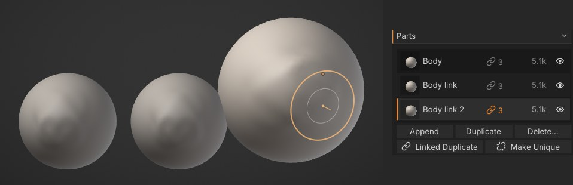

# Linked Duplicates

A **Linked Duplicate** is a Part that shares its mesh with another Part but sits in its own place: rivets on a
belt, the four legs of a table, the teeth of a gear, a row of columns. Sculpt, paint or mask any one of them and
every linked copy changes with it; move, turn or scale each one on its own. A hundred linked copies cost about as
much memory as one mesh, on the graphics card too.



## Make a linked copy

1. Select the Part in **Tool > Parts**.
2. Click **Linked Duplicate** (or right-click its row > **Linked Duplicate**).

The copy is named `<name> link`, goes right under the original in the list and appears beside it on +X. It becomes
the active Part. Each linked Part shows a link and the number of Parts sharing the mesh at the end of its row; point
at the row to see the count in the tooltip too.

Making a linked copy is undoable: <kbd>Ctrl</kbd>+<kbd>Z</kbd> takes it away again.

## Sculpt any of them

- Brushes, masking, Vertex Paint, texture painting, face groups and whole-mesh tools (remesh, subdivide,
  decimate, layers) work on the shared mesh: every linked copy shows the change at once.
- Strokes land where you see them on whichever copy is active, even when it is turned or scaled. **Symmetry**
  mirrors across the copy's own axes, so a turned copy still sculpts symmetrically.
- Linked copies share one undo history: undo on any of them steps back the shared mesh.
- The copies that aren't active are drawn slightly darker, like other Parts. The mask shows on the active one.

## Move, turn and scale a copy

Use the [Gizmo](gizmo.md) on the active linked Part: it moves, turns or scales that copy as a whole and leaves the
others where they are. Each move is one undo step. Scaling a linked copy is always even (the same along every
axis), so it stays a copy of the same shape; uneven scaling takes the mean.

With a mask (and the Gizmo's **Mask** option on), the Gizmo poses the shared mesh instead: the unmasked part
moves, in every copy, along the active copy's own axes.

`transform` does the same from the [console](scripting.md): `transform translate=0,1,0 rotate=0,90,0`.

## Make Unique

**Make Unique** (in **Tool > Parts**, or right-click the row) gives the active linked Part its own copy of the
mesh. It stays where it is and no longer changes with the others. Its undo history starts fresh.

Deleting a linked Part never touches the others: the mesh stays as long as one Part uses it.

## Linked copies in files

| Format | What happens |
|---|---|
| Project (`.sfproj`) | The links and each copy's place are kept; the mesh is saved once |
| glTF / GLB | One mesh, one node per copy with its own matrix |
| USD (`.usda`, `.usdz`) | The first copy holds the mesh; each other copy is an `instanceable` prim that references it, with its own transform |
| OBJ, STL, PLY, FBX, Bridge | Every copy is written as its own mesh, where it is |

**Merge down** and **Merge visible** put every Part where it is in the scene, so merged linked copies end up as
separate pieces of one mesh. Projects with linked copies need SculptForge 0.12 or later to open.

## Scripting

| Command | What it does |
|---|---|
| `part_duplicate_linked` | A linked copy of the active Part (or `index=` / `name=`); `offset=x,y,z` places it (default: beside it on +X) |
| `part_make_unique` | Give a linked Part its own mesh |
| `part_list` | Linked Parts show `linked xN` |

```text
part_duplicate_linked offset=0,0,2; part_duplicate_linked offset=0,0,2; part_duplicate_linked offset=0,0,2
```

## See also

- [Parts](parts.md): the Parts list, merging and splitting
- [Moving, rotating and posing (Gizmo)](gizmo.md)
- [Exporting](exporting.md)
