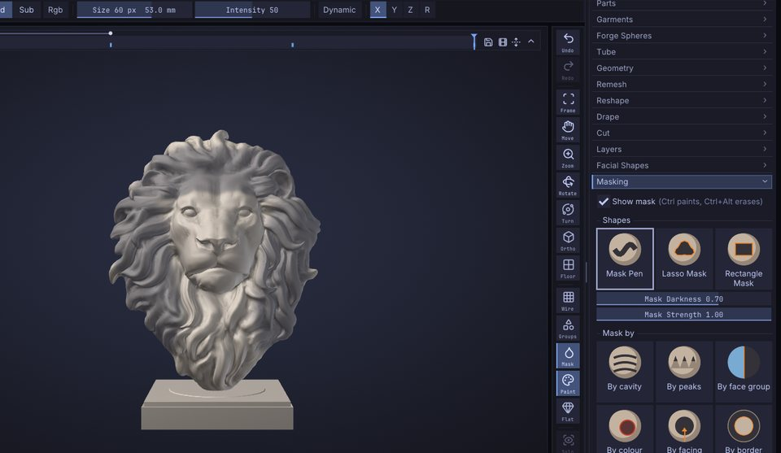
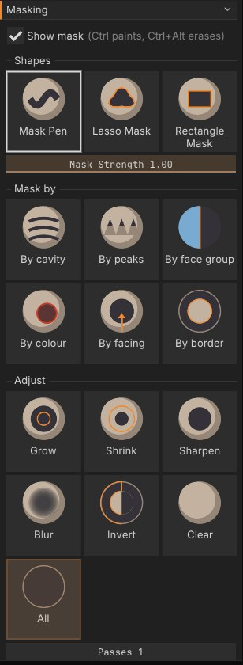

# Masking

A mask protects part of the model from change. Masked areas are drawn darker, and every brush, the Paint
brush and colour fills leave them alone. This chapter covers painting masks with <kbd>Ctrl</kbd>, masking
with a lasso or rectangle, the background gestures, and the **Tool > Masking** panel for inverting, blurring, growing and building masks
from cavities, peaks, face groups, vertex paint, the direction the surface faces or the mesh border.



## How masks work

- A mask is a value per vertex from 0 (free) to 1 (fully masked). Values in between give partial protection,
  so a soft mask edge blends sculpting into the protected area.
- Masks belong to a Part: each Part has its own mask.
- Masks are saved in projects (`.sfproj`) and in Bridge files, so they survive a round trip through the Bridge.
- Masking is not a layer and isn't affected by sculpt layers: a mask stroke always works on the model itself.
- Mask strokes and mask commands are undoable like any other change.

To see the mask, keep **Mask** on in the right shelf. The same toggle is **Show mask** in **Tool > Masking**, and **Show Mask** in the **Render**
palette. Turning it off hides the darkening without clearing the mask: it still protects the surface, the status
bar says so, and turning it on again shows the same mask. **Clear Mask** (<kbd>Ctrl</kbd>+<kbd>Shift</kbd>+<kbd>A</kbd>)
is what removes it.

## Paint a mask

1. Hold <kbd>Ctrl</kbd> and drag on the model. The area under the brush becomes masked.
2. Hold <kbd>Ctrl</kbd>+<kbd>Alt</kbd> and drag to erase the mask.

Mask strokes use the current **Size**, symmetry and, with a pen, pressure (when **Pressure > Strength**
is on). How much each stroke masks is set by **Mask Strength** in **Tool > Masking** (0.01 to 1, default 1):
lower values build up a soft, partial mask over several strokes. Mask strokes always use a round tip, whatever
alpha you have selected, and a **Drag Stamp** stroke masks with dabs along the path instead of one stamp.

On macOS, <kbd>Cmd</kbd> works wherever this guide says <kbd>Ctrl</kbd>.

## Mask with a lasso or rectangle

To mask a large or sharply outlined area in one go, pick a mask selection shape. Holding
<kbd>Ctrl</kbd> turns the brush on the left shelf into the mask brush: with <kbd>Ctrl</kbd> held, click the brush
tile (or press <kbd>B</kbd>) to pick **Mask Pen**, **Lasso Mask** or **Rectangle Mask**, or click the stroke tile to pick
the stroke (**Dots**, **Lasso** or **Rect**). The same shapes sit at the top of **Tool > Masking**:

| Shape | <kbd>Ctrl</kbd> + drag |
|---|---|
| **Mask Pen** (default) | Paints the mask with the brush, as described above. |
| **Lasso Mask** | Draws a free-hand outline that closes back to where you started. Everything inside is masked. |
| **Rectangle Mask** | Draws a rectangle. Everything inside is masked. |

With **Lasso Mask** or **Rectangle Mask**:

1. Hold <kbd>Ctrl</kbd> and drag around the area. The drag can start on the model or on the background. The
   shape is drawn as you drag, white with a dark veil.
2. Let go to mask what's inside. Hold <kbd>Ctrl</kbd>+<kbd>Alt</kbd> instead to unmask what's inside (the shape
   is drawn blue). You can press or release <kbd>Alt</kbd> while dragging; what counts is whether it is held when
   you let go.

The selection works in screen space, like the visibility rectangle: a vertex counts as inside when it falls
inside the shape as you see it, including vertices on the far side of the model. Hidden parts are left alone.
With symmetry on (**X**, **Y**, **Z** on the top shelf), the mirror image of what's inside is masked too, as a
mask stroke mirrors. A shape that covers none of the model clears the mask instead.
**Mask Strength** sets how much a selection masks or unmasks, and each selection is one undo step. A lasso that
crosses itself leaves out the areas it encloses twice.

Turn on **Front faces only** (under the shape buttons, shown for Lasso Mask and Rectangle Mask) to mask only what
faces you: the far side of the model and folds turned away from you are left as they are. It follows the mirror
image too when symmetry is on.

The cursor turns into a small cross while <kbd>Ctrl</kbd> is held, since the brush size doesn't matter for a
selection.

## Background gestures

With <kbd>Ctrl</kbd> held, clicks and drags on the empty background act on the whole mask:

| Gesture | Effect |
|---|---|
| <kbd>Ctrl</kbd> + click the background | Invert the mask |
| <kbd>Ctrl</kbd> + drag on the background | Draw a mask rectangle (Mask Pen; Lasso Mask draws a lasso): what it covers is masked, mirrored by the symmetry. A shape that covers none of the model clears the mask. |
| <kbd>Ctrl</kbd> + drag on the background, with nothing masked | Zoom the view in the SculptForge style (the default); with the Classic sculpting keys it draws the mask rectangle above (see [Keyboard and mouse](shortcuts.md#classic-sculpting-keys)) |

On the model, a <kbd>Ctrl</kbd> + click that doesn't drag works on the mask's edges, whichever
mask shape is picked:

| Gesture | Effect |
|---|---|
| <kbd>Ctrl</kbd> + click the model | Blur the mask (once per click; same as **Blur**) |
| <kbd>Ctrl</kbd>+<kbd>Alt</kbd> + click the model | Sharpen the mask (same as **Sharpen**) |

## Mask keys

| Key | Effect |
|---|---|
| <kbd>Ctrl</kbd>+<kbd>A</kbd> | Mask All |
| <kbd>Ctrl</kbd>+<kbd>Shift</kbd>+<kbd>A</kbd> | Clear Mask |
| <kbd>Ctrl</kbd>+<kbd>I</kbd> | Invert Mask |
| <kbd>Ctrl</kbd>+<kbd>H</kbd> | Show or hide the mask's shading (View Mask) |
| <kbd>Ctrl</kbd>+<kbd>W</kbd> | Group from Mask: the masked part becomes a new face group and the mask is cleared (see [Face Groups](face-groups.md)) |

A drag starts after the cursor moves a few pixels, so a slightly shaky click still inverts. With **Lasso Mask**
or **Rectangle Mask**, a <kbd>Ctrl</kbd> + drag on the background draws that shape; to clear the mask, draw it away
from the model, or use **Clear**.

## The Masking panel

Open **Tool > Masking** (the Tool palette is in the right tray by default). It has three rows of buttons, each
with a picture of what it does (the masked part dark, as in the viewport); hold <kbd>Ctrl</kbd> over a button for
its hint. Every button is one undo step.



**Shapes**: what <kbd>Ctrl</kbd> + drag does.

| Button | What it does | Command |
|---|---|---|
| **Mask Pen** | Paint the mask with the brush; <kbd>Ctrl</kbd>+<kbd>Alt</kbd> erases. | |
| **Lasso Mask** | Mask what is inside a free shape you draw. | `mask_lasso` |
| **Rectangle Mask** | Mask what is inside a rectangle. | `mask_rect` |

**Front faces only** (lasso and rectangle) masks only what faces you. **Mask Strength** is how much each stroke,
shape or **Mask by** button masks (0.01 to 1).

**Mask by**: build a whole mask at once. Each one replaces the current mask.

| Button | What it masks | Command |
|---|---|---|
| **By cavity** | Concave areas: creases, folds, pores. | `mask_by_cavity` |
| **By peaks** | Convex areas: ridges, peaks and sharp edges (the opposite of By cavity). | `mask_by_peaks` |
| **By face group** | One face group (the number under **Mask by options**). | `mask_by_facegroup` |
| **By colour** | Vertex paint close to the main colour (the left shelf's swatch); unpainted clay counts as white. | `mask_by_color` |
| **By facing** | Surface that faces the camera (or up, or down) within an angle: the front of a face, the top of a rock. | `mask_by_facing` |
| **By border** | The open edges of the mesh and the rings of edges inside them, so sculpting keeps the border in place. A closed mesh has no open edges, and the status bar says so. | `mask_border` |

**Adjust**: change the mask there is.

| Button | What it does | Command |
|---|---|---|
| **Grow** / **Shrink** | Expand or contract the masked region by one ring of edges per pass. | `mask_grow` / `mask_shrink` |
| **Sharpen** / **Blur** | Tighten or soften the mask's edges. | `mask_sharpen` / `mask_blur` |
| **Invert** | Masked becomes free and free becomes masked. | `mask_invert` |
| **Clear** | Unmask everything. | `mask_clear` |
| **All** | Mask every visible vertex. | `mask_all` |

**Passes** sets how many times Grow, Shrink, Sharpen and Blur run (1 to 20). **Mask by options** holds the rest:

| Option | For | |
|---|---|---|
| **Cavity / peaks threshold** | How deep a crease (By cavity) or sharp a ridge (By peaks) must be (-0.2 to 0.5, default 0.02). 0 takes anything; higher keeps only the strongest. | `threshold=` |
| **Face group** | The face group id By face group masks. | `group=` |
| **Colour tolerance** | How different a colour may be and still count for By colour (0.01 to 1, default 0.15). | `tolerance=` |
| **Faces the camera / up / down** and **Angle** | The direction By facing compares with, and how far the surface may turn from it (default 60 degrees). | `x= y= z= angle=` |
| **Border rings** | How wide By border masks, in rings of edges (1 to 20, default 2). | `rings=` |
| **Face Group borders** | By border also masks where face groups meet. | `facegroups=true` |
| **Soft** | By border fades the mask from the border towards the innermost ring. | `soft=true` |

Mask operations only change visible parts of the model; hidden parts keep their mask. **Clear** is the
exception and frees everything.

## Common tasks

### Protect detail while smoothing

1. Click **By cavity** to mask the creases and pores.
2. Smooth with <kbd>Shift</kbd>. The cavities keep their sharpness while the surface between them relaxes.
3. <kbd>Ctrl</kbd> + drag on the background to clear the mask when you're done.

Raise **threshold** if too much is masked; lower **Mask Strength** for partial protection.

### Sculpt one part only

1. Paint a mask over the part you want to work on with <kbd>Ctrl</kbd>.
2. <kbd>Ctrl</kbd> + click the background to invert it. Now everything *except* that part is protected.
3. Sculpt freely; strokes that cross the edge stop at the mask.

### Mask a whole face group

The quickest way works without knowing the group's number:

1. <kbd>Ctrl</kbd>+<kbd>Shift</kbd> + click the group to isolate it (see
   [Face Groups and visibility](face-groups.md)).
2. Click **All**: only visible vertices are masked.
3. <kbd>Ctrl</kbd>+<kbd>Shift</kbd> + click the background to show everything again. The mask stays.

**By face group** masks a group by its id. The viewport doesn't show ids, but the console does: isolate the
group, then open the console (<kbd>`</kbd>) and read the `isolate_face group group=N` line. Enter that number in
**Mask by options > Face group** and click **By face group**.

### Sculpt without breaking the border

A plane, a cloth panel or a part cut from a larger model has an open border that should stay where it is, for
example to keep it lined up with the piece it joins:

1. Set **Rings** to how wide the protected strip should be.
2. Click **By border**. The open edges and the rings inside them are masked.
3. Sculpt freely; the border doesn't move. Tick **Soft** first for a gradual transition into the sculpted area.

Tick **Face Group borders** to also protect the seams between face groups. This is Blender's *Mask from mesh
boundary* (and, with face sets, *Mask from face set boundary*).

### A soft-edged mask

Paint the mask, then click **Blur** a few times (or set **passes** to 3-5 first). **Sharpen** does the
opposite.

### Turn a mask into a face group

Click **From mask** in **Tool > Face Groups**: the masked triangles become a new face group. See
[Face Groups and visibility](face-groups.md).

## Masks and painting

Vertex Paint respects the mask too: the Paint brush, **Rgb** strokes and **Fill** leave masked areas alone, so
you can mask an area and fill the rest with a colour. See [Vertex Paint and materials](vertex-paint.md).

## Masking from a script

| Command | Options |
|---|---|
| `mask_clear`, `mask_all`, `mask_invert` | |
| `mask_blur`, `mask_sharpen`, `mask_grow`, `mask_shrink` | `iterations` (1-100, default 1) |
| `mask_by_cavity` | `strength` (0-1, default 1), `threshold` (-1 to 1, default 0.02) |
| `mask_by_facegroup` | `group` (required), `add=true` to add to the current mask instead of replacing it |
| `mask_border` | `rings` (1-20, default 1), `facegroups=true` to also mask face group borders, `soft=true` to fade inwards, `strength` (0-1, default 1), `add=true` to add to the current mask |
| `mask_rect` | `x0 y0 x1 y1` (-1 to 1, y up), `unmask`, `strength` (0-1, default 1), optional `view_proj` matrix; without a view the rectangle spans the mesh seen from the front |
| `mask_lasso` | `points` (required): the outline as `"x0 y0 x1 y1 ..."`, at least 3 points in the same -1 to 1 space; `unmask`, `strength`, `view_proj` as for `mask_rect` |

```sh
sculptforge-cli -c 'open path=head.obj; mask_by_cavity threshold=0.05; mask_blur iterations=2; save_project path=head.sfproj'
```

> **Not yet:** masking by topology, by normals or by alpha, Mask By Smoothness, and MaskCurve are not
> available yet.

## See also

- [Face Groups and visibility](face-groups.md): groups, isolating and hiding parts
- [Sculpting and brushes](sculpting.md): modifier keys and brush settings
- [Vertex Paint and materials](vertex-paint.md): fills that respect the mask
