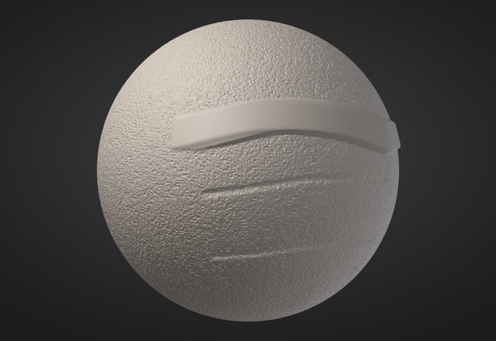

# Micro levels: hundreds of millions of polygons

Subdivision levels store every vertex of every level. That is what lets you step down and reshape, but it costs
about 90 bytes per triangle: a 300 million triangle model would need 27 GB. **Micro levels** go past the highest
subdivision level without a mesh: each triangle of that level carries a regular grid of heights, one 16-bit number
per point, and the micro triangles are worked out on the fly by the brushes and by the graphics card. 300 million
micro triangles take about 0.4 GB, sculpt in real time and draw at 60+ frames per second.

> **ZBrush:** HD Geometry also goes past the subdivision levels, but you sculpt it one small region at a time.
> A micro level is the whole model, all the time: every brush stroke, every view, every Part at once.

## Making a micro level

1. Divide the Part to a comfortable highest level (0.3 to 2 million triangles is the sweet spot).
2. In **Tool > Geometry**, set the **Micro** slider. Each step is four times the triangles: the label shows the
   total (Micro 4 on a 1.2 million triangle level is 300 million micro triangles).
3. Click **Divide to Micro**. The surface stays exactly as smooth as before; the micro level starts flat on it.

The micro level sits on the highest subdivision level, so step up to it first. While a micro level exists you
can't change subdivision levels (Bake it or delete it first).

| Micro level | Micro triangles per triangle | Memory per micro triangle |
|---|---|---|
| 3 | 64 | 1.4 bytes |
| 4 | 256 | 1.2 bytes |
| 5 | 1,024 | 1.1 bytes |
| 6, 7 | 4,096, 16,384 | 1.05 bytes |

For the smoothest view, prefer a higher micro level on fewer base triangles: 300 million as Micro 5 on 300,000
triangles draws faster than Micro 4 on 1.2 million.

## Sculpting

These brushes work on micro levels: **Standard**, **Clay**, **Clay Block**, **Smooth**, **Inflate**,
**Flatten**, **Trim**, **Layer**, **Pinch**, **Crease**, **Sharp Crease** and **Mask** (with
<kbd>Ctrl</kbd>). Symmetry, Falloff, pressure, alphas (Drag Stamp included) and the mask work as usual, and every
stroke is one undo step.

- A micro level stores one height per point, so it moves the surface in and out, never sideways. **Pinch**,
  **Crease** and **Sharp Crease** sharpen the height profile instead of pulling points together (the result
  looks the same for creases and folds).
- **Move** reshapes the level below the micro level (the base) and the micro detail rides along on it, in its own
  frame: drag an ear back without smearing the pores. To move the micro surface itself along its normals, tick
  **Move along normals**.
- Big brushes are evaluated on a coarser grid (about 50 points across the brush) and the change is spread
  smoothly over the points in between, so a brush that covers half the model costs about as much as a small one.
  The detail under it is kept.
- Brushes that slide the surface (Tendril, Nudge, VDM stamps) and custom recipe brushes don't apply to micro
  levels; recipe brushes act as Standard.

Vertex Paint, sculpt layers, face group colours and the wireframe aren't shown on micro levels yet.

## Baking down and exporting

- **Bake Micro** makes a regular mesh of the micro level in a new Part (the micro level stays). `micro_bake
  level=3` bakes a coarser micro level; `replace=true` replaces this Part instead. UVs, face groups, hidden faces
  and the micro mask carry over.
- **Export Displacement** writes a 32-bit EXR displacement map over the base UVs (needs UVs) next to the project:
  the height of the micro surface above the flat base triangles, along the interpolated normal. `micro_export_displacement
  path=detail.png type=vector` writes a vector map (object space) or a 16-bit PNG (mid-grey = 0; the message says
  the scale).

Projects keep micro levels (project format 7; projects without one are still written as format 6, so older
versions open them). Untouched areas take almost no room in the file.

## Very large levels and laptops

A micro level larger than the resident cache your hardware profile allows (a quarter of
the memory when there is no profile yet) is kept **out of core**: in a file in
the cache folder (`~/.cache/sculptforge`), of which only the parts you sculpt or look at stay in memory. A
billion micro triangles then fit on a 16 GB machine. The status line under the slider says when a level is out
of core. `SF_MICRO_OUT_OF_CORE=1` forces it (for testing); `SF_MICRO_SWAP_DIR` picks the folder.

How many triangles a frame draws for micro levels follows the machine: the view lowers the detail of far and
small areas until a frame fits the budget (2 million on a laptop profile, 8 million on a workstation).

## Scripting

| Command | What it does |
|---|---|
| `micro_divide level=4` or `micro_divide triangles=300` | Add a micro level (by level, or about this many million micro triangles) |
| `micro_delete` | Remove it (undoable) |
| `micro_info` | Level, micro triangles, memory, displacement range |
| `micro_bake level=4 replace=false` | Bake down to a mesh |
| `micro_export_displacement path=disp.exr size=4096 type=scalar` | Displacement map over the base UVs |
| `micro_noise amplitude=0.0015 scale=120` | Procedural surface noise over the whole micro level |

`sculptforge --bench-micro --bench-sizes 33,100,300` measures memory, brush and frame times on your computer.

## See also

- [Subdivision levels](subdivision-levels.md)
- [Performance](performance.md)
- [Baking normal and displacement maps](baking.md)
