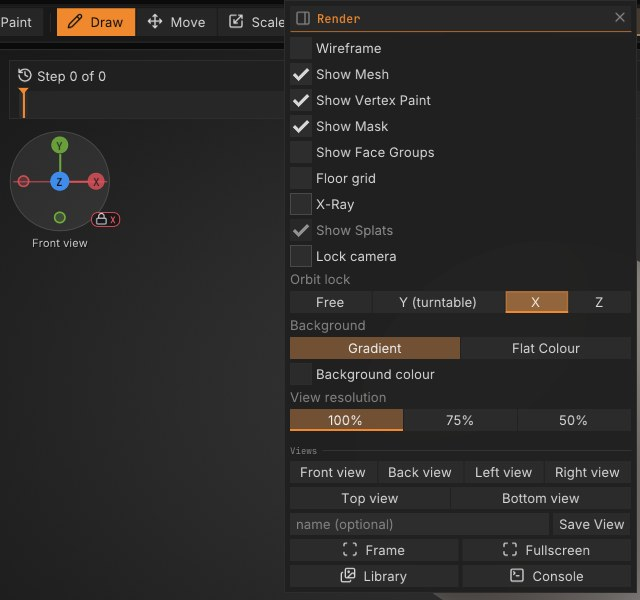

# Navigating the view

This chapter explains how to rotate, pan and zoom the camera with a mouse, a pen, the right-shelf buttons or a
3Dconnexion SpaceMouse, how to frame the model, and which display toggles help while you sculpt.

## How the camera works

The camera orbits around a target point. By default rotation is **free**: dragging turns the
model about the screen's own axes, so it follows the cursor and can roll right over the top. Hold
<kbd>Shift</kbd> while rotating to snap to the nearest front, back, side, top or bottom view; let go of
<kbd>Shift</kbd> and the drag carries on from where the cursor is. If you prefer the model to stay upright, as
in Blender or Maya, set **Edit > Preferences > Interface > Rotation** to **Turntable**: sideways drags then turn the
model around its vertical axis and up-down drags tilt it, stopping just short of looking straight down or up.

### Orbit lock

**View > Orbit lock** picks how a rotation drag turns the view, one key each:

| Lock | Key | A rotation drag |
|---|---|---|
| **Free** | <kbd>Alt</kbd>+<kbd>Shift</kbd>+<kbd>F</kbd> | turns about the screen's axes (the default, as above) |
| **Y (turntable)** | <kbd>Alt</kbd>+<kbd>Shift</kbd>+<kbd>Y</kbd> | keeps the model upright: the **Turntable** rotation above |
| **X** | <kbd>Alt</kbd>+<kbd>Shift</kbd>+<kbd>X</kbd> | turns about the world X axis only: from the front, an up or down drag tips the model towards you or away, and sideways drags do nothing |
| **Z** | <kbd>Alt</kbd>+<kbd>Shift</kbd>+<kbd>Z</kbd> | turns about the world Z axis only: from the front, a drag around the middle of the view turns the model like a wheel; from the side, an up or down drag tips it |

With X or Z locked, only the part of the drag that moves across the axis on screen counts, so the axis itself never
moves: nothing drifts, however long you drag. <kbd>Shift</kbd> still snaps to the nearest side view. The axis
gizmo shows the lock: the locked axis runs through its disc in its colour, and a small lock with the axis letter sits
at the disc's lower right. The lock is the same setting as **Edit > Preferences > Interface > Rotation**, saved
with your preferences; scripts and the console use `orbit_lock axis=free|y|x|z`.

Panning moves the target; zooming moves the camera closer to it or further away. The view is a perspective
view with a 35 degree field of view, or orthographic (<kbd>Numpad 5</kbd>): no foreshortening, so sizes don't
shrink with depth. The front, side and top views (<kbd>Numpad 1</kbd>, <kbd>3</kbd>, <kbd>7</kbd>) switch to
orthographic until you rotate again, as in Blender.

The X / Y / Z gizmo in the top left of the canvas (**Sculpt > Draw & Tablet > Camera > Axes**) shows the world axes as the camera
sees them, on a soft disc that keeps them readable on dark and light backgrounds. The positive ends are filled
circles with their letter, the negative ends smaller rings; the ends pointing away from you are smaller and fainter,
and the nearest is drawn on top. Click an end to look from that side, as in Blender: **X** the right view, **Y** the
top, **Z** the front, and the ring at the other end of each axis the left, bottom or back view. Click the same end
again for the opposite view (Front, then Back). These are orthographic like the numpad views. The end under the
pointer gets a ring (a negative end shows its letter), and on an exact side view its name shows under the axes.
Drag on the disc between the ends to orbit.

**Sculpt > Draw & Tablet > Camera > Gizmo size** makes the axes **Small**, **Medium** (the default) or **Large**; they grow with the
UI scale too, and clicking an end works at every size. **View Figure** (beside **Axes**, off until you turn it on)
adds a small shaded head in the corner that turns with the camera, so you can tell front from back at a glance.
Click it to look from the nearest side: the front, back, left, right, top or bottom view, orthographic like the
axes.

Navigation starts only on the canvas. A drag that begins on a shelf, a tray or a palette never moves the
camera.

> **Blender:** with **Edit > Preferences > Input > Style** on **Blender**, middle-drag rotates, <kbd>Shift</kbd>+middle-drag
> pans and <kbd>Ctrl</kbd>+middle-drag zooms. With a pen or a trackpad, <kbd>Alt</kbd>+left-drag beside the model
> does the same (add <kbd>Shift</kbd> to pan, anywhere; <kbd>Ctrl</kbd> to zoom); on the model it masks, as in
> Blender 5.1 and later. Turn on **Edit > Preferences > Input > Emulate 3 Button Mouse** to make <kbd>Alt</kbd>+left-drag
> turn the view everywhere, as that Blender preference does. The numpad views, <kbd>Numpad .</kbd> and <kbd>Home</kbd> frame as in Blender. See
> [Blender keys](shortcuts.md#blender-keys).

## Mouse and pen

| To | Do this |
|---|---|
| Rotate | Left-drag on the background, or right-drag anywhere on the canvas; add <kbd>Shift</kbd> to snap to an axis view |
| Roll (turn about the view axis) | <kbd>Shift</kbd>+click the background, let go of <kbd>Shift</kbd>, then drag (Maya style: hold <kbd>Alt</kbd>, add <kbd>Ctrl</kbd>, left-drag sideways) |
| Pan | <kbd>Alt</kbd>+left-drag on the background, <kbd>Alt</kbd>+right-drag, or middle-drag |
| Zoom | Mouse wheel (toward the middle of the view, or toward the pointer with **Edit > Preferences > Input > Wheel zooms toward the pointer**, on in the Maya style); <kbd>Alt</kbd>+left-drag on the background, then let go of <kbd>Alt</kbd> and keep dragging; <kbd>Ctrl</kbd>+right-drag; <kbd>Ctrl</kbd>+middle-drag; <kbd>Ctrl</kbd>+left-drag on the background when nothing is masked (not with the Classic sculpting keys) |
| Frame the model | <kbd>F</kbd> (Blender style: <kbd>Home</kbd>), or **Frame** on the right shelf |
| Front, right, top view | <kbd>Numpad 1</kbd>, <kbd>Numpad 3</kbd>, <kbd>Numpad 7</kbd>; <kbd>Ctrl</kbd> for the back, left and bottom |
| Front, side, top or bottom view with the mouse | Click an end of the axis gizmo in the canvas corner |
| Orthographic on or off | <kbd>Numpad 5</kbd> |
| Turn in 15 degree steps | <kbd>Numpad 4</kbd> / <kbd>Numpad 6</kbd> (around), <kbd>Numpad 8</kbd> / <kbd>Numpad 2</kbd> (over); <kbd>Numpad 9</kbd>: the other side |
| Frame the active Part | <kbd>Numpad .</kbd> (Maya style: also <kbd>Alt</kbd>+<kbd>F</kbd>) |
| Reset the view | Maya style: <kbd>Alt</kbd>+<kbd>H</kbd> (front, upright, everything in view); any style: **Reset view** in the Controls window (<kbd>F1</kbd>), where you can give it a key |
| Frame one Part | <kbd>Shift</kbd>+<kbd>Alt</kbd>+click it, or triple-click another Part (it becomes the active Part) |
| Sculpt from the background | Turn on **Edit > Preferences > Input > Start strokes off the model**, **View > Lock camera**, or press <kbd>Shift</kbd>+<kbd>L</kbd>: a left-drag that starts beside the model sculpts once it reaches the surface |
| Move the camera with Space held | Turn on **Edit > Preferences > Input > Hold Space and drag to move the camera**, then hold <kbd>Space</kbd>: left-drag rotates, right- or middle-drag pans, <kbd>Ctrl</kbd>+drag zooms, anywhere on the canvas (on the model too) |

Zoom drags: drag up to come closer, down to back away. With the Classic sculpting keys (**Edit > Preferences > Input**)
they go: drag up to zoom out, down to zoom in.

**Hold Space and drag to move the camera** is off by default, because with the Classic sculpting keys <kbd>Space</kbd> opens the
Quick Menu. With it on, <kbd>Space</kbd> no longer opens the Quick Menu (a right click still does), and a space typed in
a text field is never taken.

On Windows, pressing <kbd>Shift</kbd> five times (smoothing, the camera keys) used to open the Sticky Keys prompt.
**Edit > Preferences > Input > Stop the Sticky Keys prompt while SculptForge has focus** (on by default) turns off only
that shortcut, and Filter Keys' and Toggle Keys', while SculptForge has focus, full screen or windowed. Nothing is
saved: switch to another app, minimise or quit and the shortcuts are back. If you use Sticky, Filter or Toggle Keys,
they are left alone.

**Start strokes off the model** (also **View > Lock camera**) is off by default. With it on (a label at the top of
the canvas says so, and in the SculptForge layout the status bar shows **CAMERA LOCKED**), a
left-drag on the background no longer rotates: it waits, and the brush starts where the cursor first reaches the
model, so strokes that begin at the silhouette never turn the view by accident. <kbd>Ctrl</kbd> (mask) and
<kbd>Shift</kbd> (smooth) strokes start the same way, and a <kbd>Ctrl</kbd>+click on the background still inverts
the mask. To move the view, right-drag (a pen's lower button is a right click by default), <kbd>Alt</kbd>+drag to pan,
middle-drag, or hold <kbd>Space</kbd> if **Hold Space and drag to move the camera** is on; with the Blender or Maya
style, <kbd>Alt</kbd>+left-drag rotates as before. With a pen that has no buttons and the Classic or SculptForge style,
press <kbd>Shift</kbd>+<kbd>L</kbd> to turn it off while you rotate, or turn on Hold Space. Lasso Mask, Rectangle Mask and the
<kbd>Ctrl</kbd>+<kbd>Shift</kbd> hide and show shapes work as before.

**Floor grid** (**View > Floor grid**, also **Tool > Display**; off by default, remembered) draws a faint grid on
the floor the model stands on: its lowest point, with the up axis (Y) standing on it. It helps judge perspective and
tilt and line up Parts; the red line is the X axis, the blue one Z. The floor moves when a stroke or a move ends (not
during it). The squares step up by ten as you zoom out, and the grid fades into the distance; it never draws over
the model, even seen from below.

"Background" means any part of the canvas where the cursor isn't over the model. A left-drag that starts on
the model sculpts instead, so with a pen or a one-button mouse, start rotations beside the model. When the
model fills the view, zoom out a little or use the right-shelf buttons.

> **Note:** <kbd>Ctrl</kbd>+left-drag on the background clears the mask when something is masked (and
> <kbd>Ctrl</kbd>+click there inverts it); while nothing is masked it zooms (with the Classic sculpting keys it draws a mask rectangle instead). Use the wheel or
> <kbd>Ctrl</kbd>+middle-drag to zoom on a masked model. See [Masking](masking.md).

On macOS, <kbd>Cmd</kbd> works wherever this guide says <kbd>Ctrl</kbd> for these gestures, except
<kbd>Ctrl</kbd>+middle-drag, which needs <kbd>Ctrl</kbd> itself.

## Touch screens and trackpads

Two fingers on the model navigate; they never sculpt.

| Gesture | Touch screen | Trackpad |
|---|---|---|
| Spread or pinch two fingers | Zoom in or out | Zoom in or out |
| Twist two fingers | Roll the view with them | Roll the view with them |
| Slide two fingers | Pan | Zoom (as the scroll wheel) |
| One finger | Sculpt, as with the mouse | Moves the pointer |

A twist starts rolling once the fingers have turned about 10 degrees, so a pinch doesn't tilt the view by accident.
On a touch screen a single finger waits a moment for a second one before it sculpts; if the second finger lands
after a stroke has started, the stroke ends there and the fingers take over the view (one undo removes the stroke).

## The right-shelf navigation buttons

The right shelf has three buttons you **drag on** rather than click. They are handy with a pen,
on a laptop trackpad, or when the model fills the canvas and there is no background to drag on.

| Button | Drag on it to |
|---|---|
| **Frame** | (click) Fit the whole scene in the view (<kbd>F</kbd>) |
| **Move** | Pan the view |
| **Zoom** | Zoom: drag up to come closer, down to move away |
| **Rotate** | Orbit the view |

The button stays orange while you drag. **Frame** is also in the **View** menu and **Sculpt > Symmetry & Gizmo**.

## SpaceMouse (experimental)

A 3Dconnexion SpaceMouse lets one hand move the view while the other holds the pen. SculptForge reads it
directly as a USB device, without 3Dconnexion's driver or SDK, so this is **experimental**: it has been tested
with simulated input only, not yet with a real SpaceMouse. Tell us how it works with yours
([GitHub issue #6](https://github.com/islandmed/SculptForge/issues/6)).

Plug it in and it works: **Edit > Preferences > Input** shows its name under **SpaceMouse (experimental)**, with live
bars for its six axes. The model moves the way you move the cap, and turns about the same point the mouse
orbits around (the camera's target: **Frame** sets it to the scene's centre, and panning moves it).

| Move the cap | The view |
|---|---|
| Push left / right | Pans left / right |
| Pull up / push down | Pans up / down |
| Pull towards you / push away | Zooms in / out |
| Twist | Turns the model around |
| Tilt towards you / away | Tips the model's top towards you / away |
| Roll left / right | Rolls the model on screen (not with **Lock rotation to turntable**) |
| Left side button | **Frame** |
| Right side button | **Front view** |

The speed is the same whatever the frame rate: holding the cap for a second turns the model just as far on a slow
machine as on a fast one. It works in every input style (SculptForge, classic, Blender, Maya) and while a stroke is
held: the stroke keeps going, sculpting wherever the pen points on the turned model. Many people stop moving the
pen while they turn the view, and that works best, but you don't have to.

**Edit > Preferences > Input > SpaceMouse:**

- **Use SpaceMouse**: off ignores it completely, buttons too.
- **Speed**: how fast the view moves for the same push.
- **Dead zone**: how far the cap must move before anything happens (8% by default), so a hand resting on it
  doesn't drift the view. The live bars turn orange once an axis is past it.
- **Lock rotation to turntable**: the model stays upright; twisting turns it about the world's up axis and
  rolling the cap does nothing.
- **Hold during strokes** (on by default): while you sculpt, paint or mask, the SpaceMouse leaves the view alone and
  its buttons do nothing, so a hand resting on the cap never moves the model under the pen. Turn it off to turn
  the view mid-stroke.
- **Dominant axis**: only the direction you push the most moves the view, so a twist doesn't also pan a little.
- **Invert**: reverse any of the six moves (Pan X, Zoom, Pan Y, Tilt, Roll, Spin). If a direction feels wrong on
  your model of SpaceMouse, flip it here.
- **Left button**, **Right button** (and **Button 3** onwards on models with more): Frame, Frame Part, the
  axis views, Orthographic, Undo, Redo or Nothing.
- **SpaceMouse defaults** puts everything back.

These settings save themselves.

**If SculptForge doesn't see it** (Preferences says "No SpaceMouse found"):

- **Windows:** 3Dconnexion's driver, 3DxWare, can keep the device to itself, and may also move the view on its
  own as it does in other programs. Quit 3DxWare (its tray icon, or stop the **3DxService** service in Task
  Manager > Services), unplug the SpaceMouse and plug it back in. Without 3DxWare, Windows treats the SpaceMouse as
  a game controller, which is how SculptForge reads it. If SculptForge sees the SpaceMouse with 3DxWare running,
  give the buttons a job in only one of the two places, or one press does two things.
- **macOS:** the same applies to 3DxWare for Mac: quit it (or uninstall it) and plug the SpaceMouse in again.
  Suspending it isn't enough: suspended, it can still move the pointer and scroll while you push the cap.
- **Linux:** if **spacenavd** is running, it normally opens the device exclusively. SculptForge may still list
  the SpaceMouse but get no motion from it. Stop it while you sculpt (`sudo systemctl stop spacenavd`). SculptForge
  reads the device through `/dev/input` as a joystick: that works when the kernel reports the cap's axes as
  absolute axes, which is how joysticks work. If the kernel reports them as relative motion, as it does for some
  older models, the SpaceMouse doesn't show up at all. Reading it through spacenavd isn't supported yet.

**If it shows up but the view doesn't move** (the live bars stay still when you push the cap), another program
holds the device: quit 3DxWare (or spacenavd on Linux) as above, then unplug and plug the SpaceMouse back in.

**If the cursor jumps or the model flies off while you turn the cap** (the pen hovering or resting on the model,
whatever the speed and dead zone): 3DxWare is probably also driving SculptForge as it would a program it doesn't
know, moving the pointer and scrolling the wheel. SculptForge ignores the pointer and the wheel while it reads the
cap moving itself; if Preferences doesn't show the SpaceMouse moving, quit 3DxWare as above.

**To report a problem**, open **Edit > Preferences > Input > SpaceMouse** and click **Copy device report** (shown until the cap has moved the view): it puts
every joystick SculptForge sees on the clipboard, with its USB ids and why it was or wasn't used. Paste it into
your issue.

SculptForge recognises 3Dconnexion devices by their USB ids: everything under 3Dconnexion's own vendor id
(SpaceMouse Compact, Wireless, Pro, Enterprise, Module, the Universal Receiver) except the CadMouse and the
keyboards, and the older models sold under Logitech's id (SpaceNavigator, SpacePilot, SpaceExplorer, SpaceMouse
Pro, SpaceBall 5000). A device that names itself 3Dconnexion counts whatever its ids, as does one whose system
reports no vendor id (seen over Bluetooth) when its name says SpaceMouse or SpaceNavigator.

## Framing

**Frame** (<kbd>F</kbd>) points the camera at the centre of the scene and moves it back until everything fits:
every visible Part, plus the Gaussian splats when they are shown. SculptForge frames the scene for you when
you open a file or start from a new primitive. Use it after panning far away, or when a model comes in at an
unusual scale.

## Saved views

**View > Views** has a button for each axis view (Front, Back,
Left, Right, Top, Bottom) and your own saved cameras. Type a name (or leave it empty for "View 1", "View 2" ...)
and click **Save View** (<kbd>Ctrl</kbd>+<kbd>Alt</kbd>+<kbd>Numpad 0</kbd>); saving under a name that exists
replaces it. Click a name to go back to that view, or press <kbd>Numpad 0</kbd> for the one used last; **x** forgets
it. Saved views are kept in the project.

## Display toggles that help navigation

These live on the right shelf and in the **View** menu:

- **Wire** (<kbd>Shift</kbd>+<kbd>F</kbd>): shows the polygons of the active Part over
  the surface as a wireframe. Quads show as quads (see [Quads and triangles](geometry.md#quads-and-triangles)).
  Useful for judging mesh density before you subdivide or remesh.
- **Groups**: colours each face group.
- **Mask**: tints masked areas dark (how dark: **Mask darkness** in Edit > Preferences > Interface).
- **Paint**: shows vertex paint colours (off shows the plain material).
- **Solo**: shows only the active Part, to get at parts hidden behind others.
- **Show Mesh** (**View** menu): hides the sculpt, for example to look at a splat capture on its own.

**Fullscreen** (<kbd>F11</kbd>) and hiding the shelves (<kbd>Tab</kbd>) give the canvas the most room. See
[The interface](interface.md).

## Not yet

> **Not yet:** SculptForge has no rotation around the point under the cursor (the
> camera always orbits its target, which Frame sets to the scene centre) and no floor grid. Pan the target onto
> the area you're working on to orbit around it, or zoom there with the wheel and **Wheel zooms toward the pointer**
> on: that moves the target toward the point under the pointer too.

## See also

- [The interface](interface.md)
- [Keyboard and mouse](shortcuts.md)
- [Sculpting and brushes](sculpting.md)
