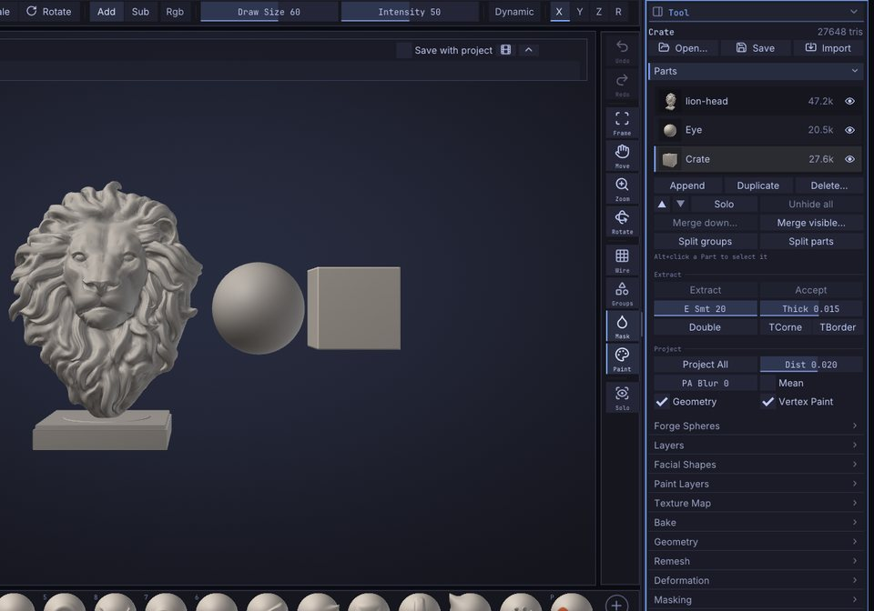
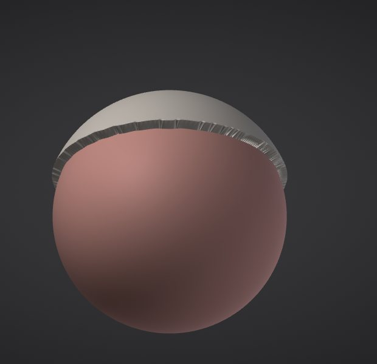

# Parts

A scene in SculptForge can hold several separate meshes, called Parts (ZBrush users: SubTools): a body, eyes, teeth,
a helmet and a sword can each live in their own Part. This chapter covers the Parts list, selecting, adding,
hiding, reordering, merging and splitting Parts, and how they travel through files.

## How Parts work

- Only the **active** Part is sculpted, painted, masked or changed by a command. The others are drawn slightly
  darker and greyer so you can see which one you are working on.
- Each Part keeps its own mesh, mask, vertex paint, face groups, hidden faces, UVs and
  [sculpt layers](layers.md).
- Each Part has its own undo history. <kbd>Ctrl</kbd>+<kbd>Z</kbd> undoes the last change in the active
  Part, and switching Parts doesn't lose the history of the others.
- Adding, deleting, reordering, merging and splitting Parts are **not undoable**, as in ZBrush. Merges and
  deletes ask for confirmation first.
- The Parts list highlights the active Part. In the ZBrush-style layout the title strip also shows it and its place
  in the list, for example `Part Helmet (2/5)`.

> **ZBrush:** Parts work the way you expect: one active Part, the rest dimmed, Alt+click in the viewport to
> switch. There is no folder grouping of Parts yet.

## The Parts list

The list is in **Tool > Parts**, which is open in the right tray by default.



Each row shows a small picture of the Part, its name, its triangle count and an eye. The pictures are drawn from
the model the viewport already has on the graphics card, so they cost almost nothing even on very dense Parts,
and they catch up a moment after you stop changing a Part (not during a stroke).

| To | Do this |
|---|---|
| Select a Part | Click its row, or <kbd>Alt</kbd>+click it in the viewport; triple-click another Part in the viewport to select it and frame it |
| Rename it | Double-click the row (or right-click > **Rename**), type, press <kbd>Enter</kbd> |
| Hide or show it | Click the eye at the end of the row |
| Duplicate or delete it | Right-click the row > **Duplicate** (<kbd>Ctrl</kbd>+<kbd>Shift</kbd>+<kbd>D</kbd>) or **Delete...** |
| See its vertex and triangle counts | Point at the row for a moment |

The list shows six rows and scrolls when there are more. Names are kept unique: renaming a Part to a name that
is already taken adds a number.

Selecting a hidden Part shows it again, because you can't sculpt what you can't see.

### Select a Part in the viewport

Hold <kbd>Alt</kbd> and click another Part on the canvas. It becomes the active one and the list scrolls to it.

<kbd>Alt</kbd>+click only selects when you click a Part other than the active one and release without moving.
If you drag instead, <kbd>Alt</kbd> keeps its usual meaning: an inverted stroke on the active Part, or a pan when
you start off the model.

## Add a Part

Click **Append** and choose:

- **Sphere**, **Cube** or **Plane**: a new primitive placed beside the visible model (to the right, on +X), sized
  to about a third of the largest visible Part.
- **Insert on the model**: choose a shape, then drag on the active Part's surface to add it there as a new
  face group (the drag sets its size and turns it). With **Symmetry** X, Y or Z on, a mirrored copy goes on the other
  side too, in the same undo step; a shape inserted right on a mirror plane isn't doubled.
  To insert your own mesh, choose **Active Part's copy...** and pick another Part (it stays as it is), or
  **From file...** and pick an `.obj`, `.ply` or `.glb` file; then drag as with the shapes. The mesh is centred,
  scaled so its largest side matches the drag, and stood on the surface along its own up (+Y) axis. Esc stops
  inserting. (Command: `insert_mesh subtool=<name>` or `insert_mesh file=<path>`.)
- **From file...**: a model (`.obj`, `.fbx`, `.glb`, `.gltf`, `.ply`, `.stl`, `.GoZ`, `.usda`, `.usd`, `.usdz`) or
  a project (`.sfproj`). A file with several objects adds one Part per object.

The new Part becomes the active one.

You can also add files as Parts from elsewhere:

- **Import** in the Tool palette header (or **File > Import**) adds a model file as a new Part.
- In the [Library](interface.md) **Tool** tab, <kbd>Shift</kbd>+double-click a model, or right-click it
  and choose **Append as Part**.

> **Tip:** **Duplicate** (<kbd>Ctrl</kbd>+<kbd>Shift</kbd>+<kbd>D</kbd>, also in the command palette as
> **Duplicate Part**) copies the active Part with its layers and attributes, names it `<name> copy` and puts it
> right under the original. Use it to keep a safe copy before a destructive step such as a remesh.

## Show, hide and solo

- The eye on each row shows or hides that Part.
- **Solo** shows only the active Part. Click it again to bring the others back. The **Solo** button on the right
  shelf does the same.
- **Unhide all** shows every Part.

Hidden Parts aren't drawn, can't be selected with <kbd>Alt</kbd>+click, and are left out of exports.

> **Note:** Part visibility is different from hiding part of a mesh with face groups or a rectangle. That hides
> faces inside one Part; see [Face Groups and visibility](face-groups.md).

## Reorder Parts

The up and down arrow buttons under the list move the active Part one place up or down. The order matters for
**Merge down** and is the order objects are written to files.

## Merge Parts

- **Merge down...** merges the active Part with the one below it.
- **Merge visible...** merges every visible Part into one new Part called `Merged`. Hidden Parts stay as
  they are.

Merging keeps every attribute, gives each original mesh its own face groups (so you can split them again later) and
matches sculpt layers by name. The merged Part starts with an empty undo history. A Part with
[subdivision levels](subdivision-levels.md) is merged (or split) at the level it is on, which becomes the base of
the result; the status line names the Parts that lost their levels.

Painted textures are kept too: the merged Part gets new Auto UVs and one texture, the size of the largest,
holding each part's paint exactly (texture layers are flattened; parts without a texture are white). On big
meshes the Auto UV takes a while. Scripts can skip it with `keep_texture=false`, which drops the textures.

> **Tip:** Merge first when you want one [voxel remesh](geometry.md#voxel-remesh) to fuse several pieces into a
> single watertight surface.

## Split a Part

- **Split groups** makes one Part per face group. It is available when the active Part has more than one
  face group.
- **Split parts** makes one Part per disconnected piece, largest first.

Both replace the active Part with the pieces. Because a merge keeps each original mesh in its own face group,
**Split groups** undoes a merge.

## Extract a shell

**Extract**, in **Tool > Parts**, makes a new Part from the masked part of the active one: a helmet from the
top of a head, a strap, a sleeve, a piece of armour that fits the surface exactly. It works as in ZBrush:

1. Mask the part (hold <kbd>Ctrl</kbd> and paint, or use **Mask Rectangle** / **Mask Lasso**; see [Masking](masking.md)).
2. Click **Extract**. The shell appears as a preview, a Part just below the active one.
3. Change **Thick**, **E Smt**, **Double**, **TCorne** or **TBorder** and the preview follows. Click **Accept** to keep it.

| Setting | What it does |
|---|---|
| **Thick** | The shell's thickness as a share of the Part's size: 0.015 (the default) is 1.5%. Negative grows it inward; 0 makes a single-sided surface |
| **E Smt** | Smooths the extracted edge, which otherwise follows the mask's triangles in steps. 0 keeps it as masked |
| **Double** | Grows the shell both inward and outward from the surface |
| **TCorne** | Triangles instead of quads in the rim where the edge turns sharply (over 50 degrees), so tight corners don't get twisted quads |
| **TBorder** | The whole rim is triangles instead of quads |



The new Part has three face groups, the outer surface, the inner one and the rim between them (a band of quads),
so you can mask, hide or [split](#split-a-part) them apart. Vertex Paint comes with it; hidden faces are left out.
Accept is one undo step: <kbd>Ctrl</kbd>+<kbd>Z</kbd> on the source Part takes the extracted one away again,
and redo brings it back. A preview you don't accept goes away as soon as you change the source Part or pick
another one, and it is never saved.

> **ZBrush:** the same Extract, E Smt, Thick, Double, TCorne, TBorder and Accept.

## Delete a Part

Click **Delete...** (or right-click a row > **Delete...**) and confirm. The last Part can't be deleted, and a
delete can't be undone.

## Parts in files

| Format | What happens to Parts |
|---|---|
| Project (`.sfproj`) | Every Part is saved with its name, visibility, attributes, layers and active layer |
| OBJ | Each visible Part is an `o` object; on import, `o` objects become Parts and `g` groups become face groups |
| glTF / GLB | One node and mesh per visible Part, both ways |
| FBX | One model per visible Part (with LODs, an LOD group each), both ways |
| USD | One Mesh prim per visible Part, both ways |
| Send to ZBrush (GoZ-compatible exchange) | Each visible Part is sent to ZBrush as its own SubTool |
| PLY, STL, splat conversion | The visible Parts are merged into one mesh |

Opening a multi-object file replaces the scene with one Part per object. See [Exporting](exporting.md) for the
details of each format.

## Scripting

Every Part action is a command, so you can use them in the [console](scripting.md), scripts, Python and MCP
agents. Parts are addressed by `index` (0 is the top of the list) or `name`; without either, the active one is
used.

| Command | What it does |
|---|---|
| `subtool_list` | List the Parts |
| `subtool_select index=1` | Make a Part active |
| `subtool_append type=cube` | Add a primitive (`sphere`, `cube`, `plane`); `path=` adds a file; `size=` (0.05-2, default 0.35) |
| `subtool_duplicate` | Copy a Part |
| `subtool_delete name=Helmet` | Delete a Part |
| `subtool_rename to=Body` | Rename a Part |
| `subtool_visibility visible=false` | Show or hide (toggles when `visible` is left out) |
| `subtool_solo` / `subtool_show_all` | Solo the active Part / show every Part |
| `subtool_move direction=up` | Move a Part up or down the list |
| `subtool_merge_down` / `subtool_merge_visible` | Merge |
| `subtool_split_groups` / `subtool_split_parts` | Split |
| `extract thickness=0.02 smooth=5 double=false` | Preview an Extract shell from the mask; `tcorne` / `tborder` for a triangle rim; `accept=true` keeps it at once |
| `extract_accept` / `extract_cancel` | Keep or remove the Extract preview |

```text
subtool_append type=sphere name=EyeL size=0.12; subtool_duplicate; subtool_rename to=EyeR
```

## See also

- [Face Groups and visibility](face-groups.md): hide parts of one Part
- [Sculpt layers and blend shapes](layers.md): layers belong to each Part
- [Exporting](exporting.md): how Parts reach other applications
- [Projects, autosave and snapshots](projects.md)
