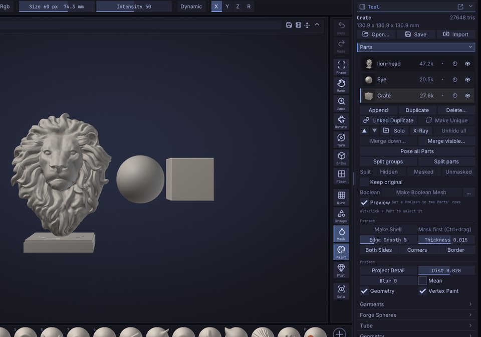
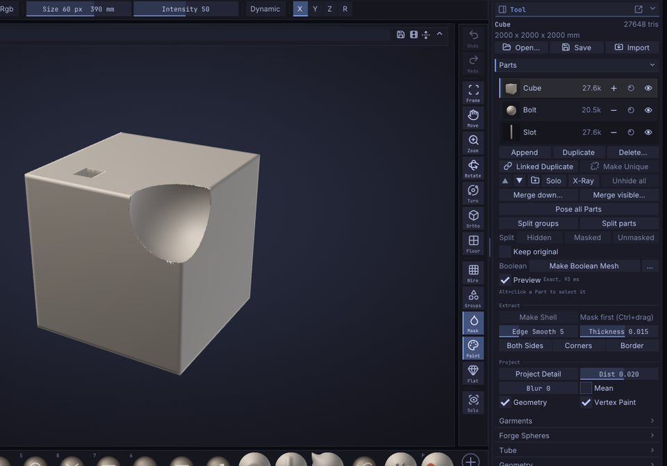

# Parts

A scene in SculptForge can hold several separate meshes, called Parts (experienced sculptors: Parts): a body, eyes, teeth,
a helmet and a sword can each live in their own Part. This chapter covers the Parts list, selecting, adding,
hiding, reordering, merging, combining with Booleans and splitting Parts, and how they travel through files.

## How Parts work

- Only the **active** Part is sculpted, painted, masked or changed by a command. The others are drawn slightly
  darker and greyer so you can see which one you are working on.
- Each Part keeps its own mesh, mask, vertex paint, face groups, hidden faces, UVs and
  [sculpt layers](layers.md).
- Each Part has its own undo history. <kbd>Ctrl</kbd>+<kbd>Z</kbd> undoes the last change in the active
  Part, and switching Parts doesn't lose the history of the others.
- Adding, deleting, reordering, merging and splitting Parts are **not undoable**, except **Split hidden**,
  **Split masked**, **Split unmasked** and **Make Boolean Mesh** (one undo step each). Merges and deletes ask for confirmation first.
- The Parts list highlights the active Part. In the Classic layout the title strip also shows it and its place
  in the list, for example `Part Helmet (2/5)`.

## The Parts list

The list is in **Tool > Parts**, which is open in the right tray by default.



Each row shows a small picture of the Part, its name, its triangle count, its [Boolean](#booleans), its shading and an eye. The pictures are drawn from
the model the viewport already has on the graphics card, so they cost almost nothing even on very dense Parts,
and they catch up a moment after you stop changing a Part (not during a stroke).

| To | Do this |
|---|---|
| Select a Part | Click its row, or <kbd>Alt</kbd>+click it in the viewport; triple-click another Part in the viewport to select it and frame it |
| Sculpt the Part under the cursor | Point at it and press <kbd>Alt</kbd>+<kbd>Q</kbd> (every input style, as in Blender): it becomes the active Part, the view stays put and each Part keeps its mask |
| Rename it | Double-click the row (or right-click > **Rename**), type, press <kbd>Enter</kbd> |
| Hide or show it | Click the eye at the end of the row |
| Combine it with other Parts | Click the mark after the triangle count and pick **Add**, **Subtract** or **Intersect**; see [Booleans](#booleans) |
| Shade it smooth or flat | Click the mark left of the eye: it goes from **as the scene** (dim) to **Smooth** (a disc) to **Flat** (a faceted hexagon) and back. Only this Part changes; the scene's own setting is **Render > Materials > Shading** |
| Duplicate or delete it | Right-click the row > **Duplicate** (<kbd>Ctrl</kbd>+<kbd>Shift</kbd>+<kbd>D</kbd>) or **Delete...** |
| Make a copy that shares the mesh | Right-click the row > **Linked Duplicate**, or the **Linked Duplicate** button; see [Linked Duplicates](linked-duplicates.md) |
| See its vertex and triangle counts | Point at the row for a moment |

The list shows six rows and scrolls when there are more. Names are kept unique: renaming a Part to a name that
is already taken adds a number.

Selecting a hidden Part shows it again, because you can't sculpt what you can't see.

### Select a Part in the viewport

Hold <kbd>Alt</kbd> and click another Part on the canvas. It becomes the active one and the list scrolls to it.

<kbd>Alt</kbd>+click only selects when you click a Part other than the active one and release without moving.
If you drag instead, <kbd>Alt</kbd> keeps its usual meaning: an inverted stroke on the active Part, or a pan when
you start off the model.

## Add a Part

Click **Append** and choose:

- **Sphere**, **Cube** or **Plane**: a new primitive placed beside the visible model (to the right, on +X), sized
  to about a third of the largest visible Part.
- **Insert on the model**: choose a shape, then drag on the active Part's surface to add it there as a new
  face group (the drag sets its size and turns it). With **Symmetry** X, Y or Z on, a mirrored copy goes on the other
  side too, in the same undo step; a shape inserted right on a mirror plane isn't doubled.
  To insert your own mesh, choose **Active Part's copy...** and pick another Part (it stays as it is), or
  **From file...** and pick an `.obj`, `.ply` or `.glb` file; then drag as with the shapes. The mesh is centred,
  scaled so its largest side matches the drag, and stood on the surface along its own up (+Y) axis. Esc, any
  brush, or Draw / Move stops inserting. (Command: `insert_mesh part=<name>` or `insert_mesh file=<path>`.)
  To insert from a **kitbash set**, choose **Insert set from file...** (one `.obj` or `.glb` with several objects)
  or **Insert set from folder...** (its `.obj`, `.ply` and `.glb` files, by name; not its subfolders). The **Insert set**
  window shows a thumbnail of each item: click one, then drag on the model as above. While inserting, `]` steps to
  the next item and `[` to the previous one (around the set; brush size keys come back once you stop). Esc or the
  window's close button stops. (Commands: `insert_set_items set=<path>` lists them;
  `insert_mesh set=<path> index=<n>` inserts item `n`, 0 being the first.)
  **Creature bones**, at the end of the same menu, is a set that comes with SculptForge: no file to pick (see below).
- **From file...**: a model (`.obj`, `.fbx`, `.glb`, `.gltf`, `.ply`, `.stl`, Bridge files, `.usda`, `.usd`, `.usdz`) or
  a project (`.sfproj`). A file with several objects adds one Part per object.

The new Part becomes the active one.

### Creature bones

**Append > Insert on the model > Creature bones** opens a built-in insert set of original fantasy creature bones to
start from: Skull, Jaw, Fang, Blade tooth, Swept horn, Spiral horn, Claw, Vertebra, Tail vertebrae, Rib,
Limb bone, Wing bone and Wing finger. Click one in the **Insert set** window and drag on the model, as with any set;
horns, claws and teeth grow from where you drag. With **Symmetry** X on, a horn or a claw gets its mirrored twin.

Each piece is a clean, closed quad mesh of 500 to 4,200 faces, so it takes **Add Level** and sculpting well: insert, then
sculpt the joins smooth, or **Voxel Remesh** to fuse the piece into the model. Drag pieces onto an empty **Plane** or **Sphere**
Part to build a skeleton of their own Part. The pieces were designed for SculptForge (tools/creature-bones in the
source) and come under the app's licence, GPL-3.0. (Commands: `insert_set_items set=builtin:creature-bones`;
`insert_mesh set=builtin:creature-bones index=<n>`.)

You can also add files as Parts from elsewhere:

- **Import** in the Tool palette header (or **File > Import**) adds a model file as a new Part.
- In the [Library](interface.md) **Tool** tab, <kbd>Shift</kbd>+double-click a model, or right-click it
  and choose **Append as Part**.

> **Tip:** **Duplicate** (<kbd>Ctrl</kbd>+<kbd>Shift</kbd>+<kbd>D</kbd>, also in the command palette as
> **Duplicate Part**) copies the active Part with its layers and attributes, names it `<name> copy` and puts it
> right under the original. Use it to keep a safe copy before a destructive step such as a remesh.
> **Linked Duplicate** instead makes a copy that shares the mesh and changes with it (rivets, legs, columns); see
> [Linked Duplicates](linked-duplicates.md).

## Show, hide and solo

- The eye on each row shows or hides that Part.
- **Solo** shows only the active Part. Click it again to bring the others back. The **Solo** button on the right
  shelf does the same.
- **X-Ray**, next to **Solo**, shows the active Part through the others: the other Parts turn see-through and only
  their nearest surface shows. When only the active Part is shown, it is see-through itself. Click **X-Ray** again
  to make them solid. **View > X-Ray** does the same.
- **Unhide all** shows every Part.

Hidden Parts aren't drawn, can't be selected with <kbd>Alt</kbd>+click, and are left out of exports.

> **Note:** Part visibility is different from hiding part of a mesh with face groups or a rectangle. That hides
> faces inside one Part; see [Face Groups and visibility](face-groups.md).

## Folders

Folders group Parts in the list, for example the eyes and teeth of a head, so you can hide, show and move them
together.

| To | Do this |
|---|---|
| Make a folder | Click the folder button under the list: a new folder holds the active Part; type its name and press <kbd>Enter</kbd> |
| Put a Part in a folder | Drag its row onto the folder's header (or onto a Part already in it), or right-click the row > **Folder** > the folder's name |
| Take a Part out | Drag it onto a Part outside folders, or right-click it > **Folder** > **Out of the folder** |
| Fold or open a folder | Click its header |
| Rename it | Double-click the header (or right-click > **Rename**) |
| Hide or show all its Parts | Click the eye on the header |
| Move, turn or scale it | Right-click the header > **Move with the gizmo** |
| Remove it | Right-click the header > **Remove folder (keep its Parts)** |

A Part that joins a folder moves to just below the folder's last Part, so a folder's Parts stay together. When the
folder holding the active Part is folded, its header shows the accent bar. **Move with the gizmo** makes one of
the folder's Parts active and turns on the gizmo's **Folder** option, so every visible Part in the folder moves
together; see [All Parts and Folder](gizmo.md#all-parts). Duplicates and the pieces of a split stay in their
Part's folder. Folders are saved in the project; older versions of SculptForge open the file and simply show no
folders.

## Reorder Parts

The up and down arrow buttons under the list move the active Part one place up or down. The order matters for
**Merge down** and is the order objects are written to files.

## Merge Parts

- **Merge down...** merges the active Part with the one below it.
- **Merge visible...** merges every visible Part into one new Part called `Merged`. Hidden Parts stay as
  they are.

Merging keeps every attribute, gives each original mesh its own face groups (so you can split them again later) and
matches sculpt layers by name. The merged Part starts with an empty undo history. A Part with
[subdivision levels](subdivision-levels.md) is merged (or split) at the level it is on, which becomes the base of
the result; the status line names the Parts that lost their levels.

Painted textures are kept too: the merged Part gets new Auto UVs and one texture, the size of the largest,
holding each part's paint exactly (texture layers are flattened; parts without a texture are white). On big
meshes the Auto UV takes a while. Scripts can skip it with `keep_texture=false`, which drops the textures.

> **Tip:** Merge first when you want one [voxel remesh](geometry.md#voxel-remesh) to fuse several pieces into a
> single watertight surface.

## Booleans

Booleans combine Parts the way hard-surface and kitbash work does: add one shape to another, cut one out of another,
or keep only where they overlap.

1. Give each Part that takes part a **Boolean**: click the mark after its triangle count (or right-click the row >
   **Boolean**) and pick **Add**, **Subtract** or **Intersect**. The mark shows it: a plus, a bar or two overlapping
   rings; a small ring is **None**.
2. The shown Parts with a Boolean combine **in list order**. The first one is the base; each one below it is added to,
   subtracted from or intersected with what the ones above it made. Move a Part up or down to change the order.
3. While **Preview** is on (in the **Boolean** row under the list), the view shows the result in place of those Parts.
   Sculpt or move a Part and the result follows: as you go on lighter meshes, when you release on heavy ones (the
   Parts show as they are during the stroke). The text beside **Preview** says how long the last result took, or that
   it can't be shown (point at it for why).
4. Click **Make Boolean Mesh** (also in the command search, F3) to turn the result into a new Part called `Boolean`,
   below the last source, and make it active. The sources stay as they are, hidden: show one, change it and make the
   mesh again. <kbd>Ctrl</kbd>+<kbd>Z</kbd> takes the new Part away and shows the sources again.



The **...** button beside **Make Boolean Mesh** holds its options:

| Option | What it does |
|---|---|
| **Weld seams** (on) | The result is one closed surface. Off: each source keeps its own vertices along the cut, so the seam is a hard edge in the shading (and the surface is open there) |
| **Keep face groups** (on) | Each source keeps its face groups, apart from the others'. Off: one face group per source |
| **New face group on cut faces** (on) | The faces a Subtract or Intersect Part leaves on the result get a face group of their own, ready to mask, hide or polish |

Good to know:

- The Boolean is exact: the surfaces are cut along the curves where they cross, and away from the cut the result is
  the Parts' own faces, with their face groups, vertex paint and UVs. It is watertight when the Parts are. Sculpt
  layers are baked in; the mask, hidden faces and subdivision levels don't carry over (each Part takes part at the
  level it is on).
- Faces lying exactly on each other are fine: a cutter flush with the surface opens a clean pocket, and boxes side
  by side merge into one.
- Parts need to be closed: no holes, every edge shared by two faces. A Part with holes, or one that runs through
  itself, makes the Boolean fall back to voxels: the result is closed but remeshed into even quads, without face groups
  or UVs, and the status line says so. A flat sheet has no inside, so it can't take part. To stay exact, close the
  holes first (**Tool > Geometry > Fill Holes**).
- Where a cut meets a face at a sharp angle, smooth shading softens the edge as it does any hard edge. For crisp
  hard-surface edges, shade the result **Flat** (the shading mark in its row), or turn **Weld seams** off.
- A moved [linked copy](linked-duplicates.md) takes part where it is in the scene. A duplicate keeps its Part's Boolean,
  so copies of a cutter cut too.
- Each Part's Boolean is saved in the project.

## Pose all Parts

A character made of many Parts (body, eyes, teeth, armour plates, belts) can be posed in one go instead of Part by
Part:

1. Click **Pose all Parts** under the Parts list. The visible Parts are merged into one light grey **Pose Mesh**
   (300,000 triangles in all, shared by size, so small Parts such as eyes keep their shape) and hidden while you
   pose. Each Part is one [face group](masking.md) on it, so Mask by Face group picks whole Parts. A Part with
   [subdivision levels](subdivision-levels.md) joins from a lower level, so even a heavy figure is ready in
   seconds.
2. Pose it with the [Gizmo](gizmo.md) (W move, E scale, R rotate) and masks: mask the body, rotate an arm
   about the shoulder with a falloff for a soft joint. Symmetry poses both sides. The Pose Mesh is small, so every
   drag is instant, and Ctrl+Z steps back through the pose.
3. Click **Apply Pose**. Every Part takes the same moves at full resolution, its sculpt layers, subdivision levels
   and micro level following; the Pose Mesh goes away. The whole pose is **one undo step** across every Part.
   **Cancel Pose** removes the Pose Mesh and changes nothing.

Only Gizmo moves carry over for now: a brush stroke on the Pose Mesh stops Apply until you undo it. A Part you
edit while posing (by selecting it in the list) keeps your edit and is left out of the pose; the status line says
which. A [linked copy](linked-duplicates.md) is left out too (shown, not posed): posing it would pose every copy; Make Unique
first. Scripts: `figure_pose_begin triangles=300000`, `figure_pose_apply`, `figure_pose_cancel`,
`figure_pose_info`.

## Split a Part

- **Split groups** makes one Part per face group. It is available when the active Part has more than one
  face group.
- **Split parts** makes one Part per disconnected piece, largest first.

Both replace the active Part with the pieces. Because a merge keeps each original mesh in its own face group,
**Split groups** undoes a merge.

### Split hidden, masked or unmasked

The **Split** row (**Hidden**, **Masked**, **Unmasked**) takes part of the active Part out into a **new Part just below it**, in the same folder, shown
as the source is and shaded the same way. Each is **one undo step**: <kbd>Ctrl</kbd>+<kbd>Z</kbd> puts the
triangles back and removes the new Part.

| Button | Moves into the new Part | Command |
|---|---|---|
| **Split > Hidden** | the hidden triangles; they are shown in the new Part | `part_split_hidden` |
| **Split > Masked** | the masked triangles; the new Part starts unmasked | `part_split_masked` |
| **Split > Unmasked** | the triangles that are not masked; the masked ones stay | `part_split_unmasked` |
| **Keep original** (checkbox below) | a **copy** of those triangles; the source Part stays as it is, levels and all, and undo just removes the copy | `keep=true` on any of the three |

A triangle counts as **masked when the average mask of its three corners is above 50%**, so a soft mask edge
splits along its middle and a single masked corner doesn't take its neighbours. UVs, face groups, vertex paint and
sculpt layers carry over to both sides. [Subdivision levels](subdivision-levels.md) can't be cut: the split is
made at the level the Part is on, which becomes its base (undo brings the levels back). To delete instead of
split, use **Remove Hidden** or **Delete masked** in **Tool > Visibility**.

## Extract a shell

**Make Shell**, in **Tool > Parts > Extract**, makes a new Part from the masked part of the active one: a helmet from the
top of a head, a strap, a sleeve, a piece of armour that fits the surface exactly. It works:

1. Mask the part (hold <kbd>Ctrl</kbd> and paint, or use **Rectangle Mask** / **Lasso Mask**; see [Masking](masking.md)).
2. Click **Make Shell**. The shell appears as a preview, a Part just below the active one.
3. Change **Thickness**, **Edge Smooth**, **Both Sides**, **Corners** or **Border** and the preview follows. Click **Accept** to keep it.

| Setting | What it does |
|---|---|
| **Thickness** | The shell's thickness as a share of the Part's size: 0.015 (the default) is 1.5%. Negative grows it inward; 0 makes a single-sided surface |
| **Edge Smooth** | Smooths the extracted edge, which otherwise follows the mask's triangles in steps. 0 keeps it as masked |
| **Both Sides** | Grows the shell both inward and outward from the surface |
| **Corners** | Triangles instead of quads in the rim where the edge turns sharply (over 50 degrees), so tight corners don't get twisted quads |
| **Border** | The whole rim is triangles instead of quads |


The new Part has three face groups, the outer surface, the inner one and the rim between them (a band of quads),
so you can mask, hide or [split](#split-a-part) them apart. Vertex Paint comes with it; hidden faces are left out.
Accept is one undo step: <kbd>Ctrl</kbd>+<kbd>Z</kbd> on the source Part takes the extracted one away again,
and redo brings it back. A preview you don't accept goes away as soon as you change the source Part or pick
another one, and it is never saved.

## Delete a Part

Click **Delete...** (or right-click a row > **Delete...**) and confirm. The last Part can't be deleted, and a
delete can't be undone.

## Parts in files

| Format | What happens to Parts |
|---|---|
| Project (`.sfproj`) | Every Part is saved with its name, visibility, folder, attributes, layers and active layer; [linked copies](linked-duplicates.md) keep their link |
| OBJ | Each visible Part is an `o` object; on import, `o` objects become Parts and `g` groups become face groups |
| glTF / GLB | One node and mesh per visible Part, both ways |
| FBX | One model per visible Part (with LODs, an LOD group each), both ways |
| USD | One Mesh prim per visible Part, both ways |
| Bridge | Each visible Part is sent as its own object |
| PLY, STL, splat conversion | The visible Parts are merged into one mesh |

Opening a multi-object file replaces the scene with one Part per object. See [Exporting](exporting.md) for the
details of each format.

## Scripting

Every Part action is a command, so you can use them in the [console](scripting.md), scripts, Python and MCP
agents. Parts are addressed by `index` (0 is the top of the list) or `name`; without either, the active one is
used.

| Command | What it does |
|---|---|
| `part_list` | List the Parts |
| `part_select index=1` | Make a Part active |
| `part_append type=cube` | Add a primitive (`sphere`, `cube`, `plane`); `path=` adds a file; `size=` (0.05-2, default 0.35) |
| `part_duplicate` | Copy a Part |
| `part_duplicate_linked` / `part_make_unique` | A [linked copy](linked-duplicates.md) sharing the mesh / break the link |
| `part_delete name=Helmet` | Delete a Part |
| `part_rename to=Body` | Rename a Part |
| `part_visibility visible=false` | Show or hide (toggles when `visible` is left out) |
| `part_solo` / `part_show_all` | Solo the active Part / show every Part |
| `part_move direction=up` | Move a Part up or down the list |
| `part_folder_new folder=Eyes` | Make a folder holding a Part (`empty=true`: an empty one) |
| `part_set_folder name=EyeL folder=Eyes` | Put a Part into a folder (`folder=` empty: out of its folder) |
| `part_folder_visibility folder=Eyes` | Hide or show a folder's Parts (toggles when `visible` is left out) |
| `part_folder_collapse` / `part_folder_rename` / `part_folder_delete` | Fold or open, rename, remove a folder (`folder=`) |
| `transform translate=0,0.1,0 folder=true` | Transform the visible Parts in the active Part's folder |
| `part_merge_down` / `part_merge_visible` | Merge |
| `part_split_groups` / `part_split_parts` | Split |
| `part_split_hidden` / `part_split_masked` / `part_split_unmasked` | Split off into a new Part (undoable; `keep=true` copies and leaves the source as it is) |
| `part_shading mode=flat` | Shade a Part `default` (as the scene), `smooth` or `flat` |
| `part_boolean name=Bolt mode=subtract` | Set a Part's Boolean: `none`, `add`, `subtract` or `intersect` |
| `make_boolean_mesh` | Make Boolean Mesh; `weld=`, `keep_groups=`, `cut_group=` (all `true` by default); `voxel_fallback=false` fails instead of using voxels; `resolution=` (32-512, default 256) for the voxels |
| `boolean_parts op=subtract a=Body b=Bolt` | The Boolean of two Parts into a new Part, whatever their marks (`union`, `subtract`, `intersect`; `a` and `b` are names or list indices); the same options |
| `extract thickness=0.02 smooth=5 double=false` | Preview an Extract shell from the mask; `triangle_corners` / `triangle_border` for a triangle rim; `accept=true` keeps it at once |
| `extract_accept` / `extract_cancel` | Keep or remove the Extract preview |

```text
part_append type=sphere name=EyeL size=0.12; part_duplicate; part_rename to=EyeR
```

## See also

- [Linked Duplicates](linked-duplicates.md): copies that share one mesh
- [Face Groups and visibility](face-groups.md): hide parts of one Part
- [Sculpt layers and blend shapes](layers.md): layers belong to each Part
- [Exporting](exporting.md): how Parts reach other applications
- [Projects, autosave and snapshots](projects.md)
