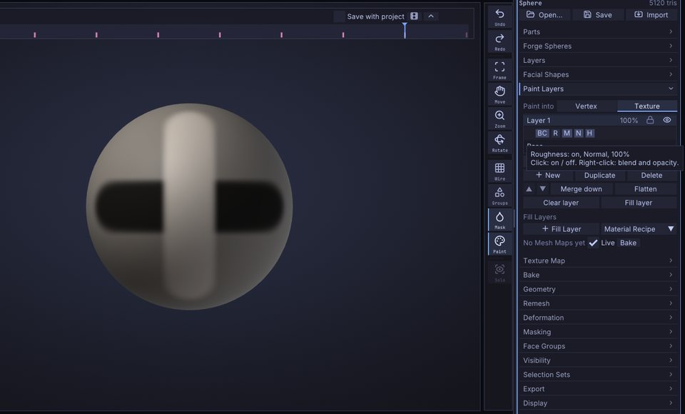
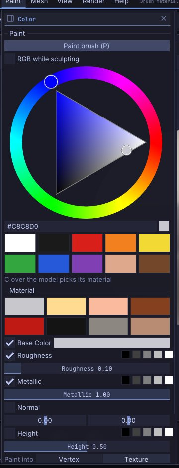
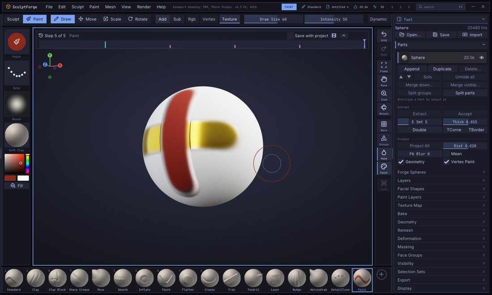
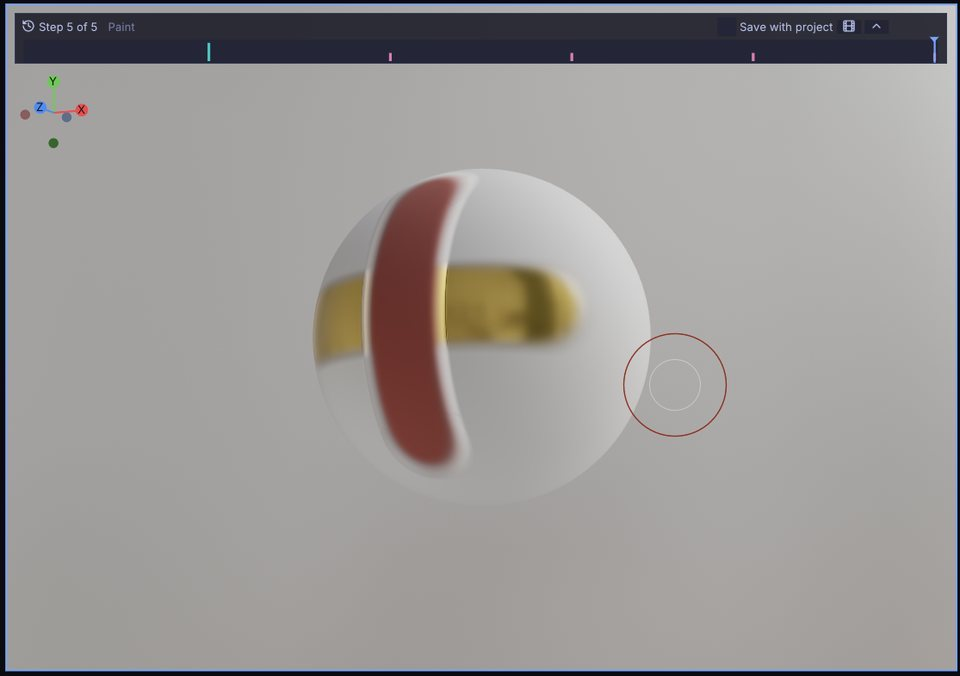

# Material painting (PBR)

A painted texture can carry more than colour. Turn on **material channels** and the Paint brush paints how rough,
how metallic, how bumpy and how bright the surface is, all in one stroke, the way game engines and renderers
describe materials (physically based rendering, PBR). Every channel lives on the same UVs and paint layers as the
colour from [Texture painting](texture-painting.md), and goes out to Unreal, Unity, Godot, Blender, glTF and USD
with [Export presets](export-presets.md).

## The channels

| Channel | What it holds | Stored as |
| --- | --- | --- |
| Base Color | The surface colour. Always there. | 8-bit sRGB (the texture you already paint) |
| Roughness | 0 is mirror-like, 1 fully matte. Starts at 0.65. | 8-bit |
| Metallic | 0 for paint, stone, skin, plastic; 1 for bare metal. Starts at 0. | 8-bit |
| Normal | Fine surface direction, a tangent-space normal map (OpenGL, green up). Starts flat. | 8-bit RGB |
| Height | Painted relief, 0.5 = none. Also adds to the normal ("height to normal"). | 16-bit |
| Ambient Occlusion | How much light reaches crevices, 1 = open. | 8-bit |
| Emissive | Light the surface gives off, black = none. | 8-bit sRGB |
| Opacity | 1 = opaque. Exported in the base colour's alpha. | 8-bit |

A channel you turn on costs no memory until you paint it: channels are stored as 64 x 64 tiles, and a tile nobody
painted is not stored at all (a tile of one value is stored as that one value). Turning a channel off discards
what was painted in it; **Undo** brings it back.

## Turn channels on

1. Give the Part a texture ([Texture painting](texture-painting.md)).
2. Open **Tool > Texture Map**. Under **Material Channels**, tick the channels you want (for a typical game asset:
   Roughness, Metallic and Normal; add Height to paint relief, Ambient Occlusion to paint dirt into crevices).
3. **Channel memory** below the ticks shows what the painted tiles use; the same number, for every Part, is in
   **Edit > Preferences > Performance** under Memory.

## Paint a material

Open the **Paint** menu. With a material texture, a **Material** section appears under the swatches:

- **Material swatches** set the colour, roughness and metallic at once (bare metal, gold, copper, rust, gloss
  paint, rubber, stone, clay) and make the brush paint those channels.
- One row per channel: the tick says whether the brush paints that channel; the five grey squares pick 0, 25,
  50, 75 or 100%; the slider sets any value. Normal has two tilt sliders (0, 0 paints a flat normal). Emissive
  has a colour.

Untick Base Color to paint only roughness (a wet patch, a polished edge) without touching the colour. Every
stroke is one undo step for all the channels it painted. The brush's falloff, alpha, pen pressure, symmetry and
mask apply to every channel alike; erasing (<kbd>Alt</kbd>) paints Base back to each channel's default and makes
layers transparent.

**C over the model picks the whole material**: the colour and every channel under the cursor become the brush
material, and the brush then paints all of the texture's channels.

## Layers and channels

Paint layers ([Texture painting](texture-painting.md#paint-layers-on-a-texture)) hold every channel. In **Tool >
Paint Layers**, each layer row gets a row of **channel chips** (BC, R, M, N, H, AO, E, Op):

- **Click** a chip to turn that channel of the layer on or off. A rust layer can carry colour and roughness but
  leave metallic alone; a scratches layer can affect only the normal.
- **Right-click** a chip for the channel's **blend mode** and **opacity**. The ten paint-layer blend modes work
  per channel (Multiply on roughness halves it where you paint, Screen brightens AO...). The Normal channel adds
  **Normal Combine**, which lays the layer's normal detail onto the normals below instead of replacing them.
  A chip with a `*` uses a blend mode other than Normal or less than full opacity.
- The layer's own opacity, visibility and lock apply to all its channels.

Merge down and Flatten keep the look of every channel. Duplicate copies a layer with its channels.

## The PBR viewport

**Render > Materials > Viewport Shading** switches the view between **Lit Sphere** (the default, made for reading forms
while sculpting) and **PBR**, which lights the material channels the way game engines and renderers do: rough
surfaces spread the light, metals reflect the environment in their own colour, painted height and normals catch
the light, emissive glows.

- **Environment**: **Studio** (made by SculptForge), **Photo Studio**, **Small Studio** and **Outdoor Sky** (free
  CC0 photographs from Poly Haven). HDR images (`.hdr`, `.exr`) in the folders listed in the
  `SCULPTFORGE_HDRI_PATH` environment variable are added to the list.
- **Exposure** in stops, **Rotation** of the environment, and the **Tone map**: ACES (filmic contrast), AgX
  (softer, keeps bright colours from going flat), Reinhard or None.
- **Show environment** puts the environment behind the model, with a **Blur**.
- **Roughness** and **Metallic** apply to Parts without a material texture (their colour comes from vertex paint
  or the base colour), so you can judge a sculpt as metal or clay too.
- **Cavity** darkens the sculpt's creases a little so fine detail reads under even light; 0 is plain PBR.

The view stays as fast as Lit Sphere: lighting is precomputed per environment (on a worker thread when you
switch), and only the pixels on screen pay for it. A 20.9-million-triangle Part draws in about 8 ms in PBR next
to about 6 ms with Lit Sphere on an Apple M1 Pro. The settings are saved with the project
(`viewport_shading mode=pbr environment=outdoor_sky exposure=0.5 tone_map=agx`).

## See one channel on its own

**Tool > Texture Map > Normal view** opens a list: pick **Solo Roughness** (or any enabled channel) and the model
shows just that channel, in grey for roughness, metallic, height, AO and opacity, as colours for the normal (with
the height's normal in it) and in colour for emissive. Painting updates it live. Pick **Normal view** to go back.
The viewport doesn't yet render the channels together as a lit PBR material; the solo view is how you check
them for now.

## Height and normals

Height is stored with 16 bits, so slow ramps don't band. Its slope becomes a normal that is combined onto the
Normal channel (Normal Combine) wherever a normal is shown or exported, so painting height also gives the shading
detail. `texture_channels height_normal_strength=4` sets how steep that normal is (0: height adds no normal).

## Carrying channels through geometry changes

Auto UV, Voxel Remesh, Quad Remesh and merging Parts move every channel and every layer's channels onto the new
UVs, as they do the colour. A part without a channel takes that channel's default when Parts merge.

## Projects

Projects with material channels are saved as format 7 (SculptForge 0.10 and later opens them). A project without
material channels is still saved as format 6, so older versions keep opening it. Older projects open as they did.

## Commands

| Command | What it does |
| --- | --- |
| `texture_channels enable=roughness,metallic,normal` | Turn channels on (`disable=...` off; no arguments lists them) |
| `paint_material roughness=0.2 metallic=1 color=c0c0c8` | Set the brush material; `channels=all` / `channels=roughness` say exactly what it paints |
| `texture_layer_channel channel=normal blend=normal_combine` | A layer's channel settings (`enabled`, `blend`, `opacity`; `layer` or `index`) |
| `channel_view channel=roughness` | Solo a channel in the viewport (`off` to go back) |
| `export_maps preset=unreal folder=...` | Write the maps ([Export presets](export-presets.md)) |
| `viewport_shading mode=pbr environment=photo_studio exposure=0.3` | The PBR viewport (`mode=lit_sphere` to go back; `rotation`, `tone_map`, `background`, `blur`, `roughness`, `metallic`, `cavity`) |

## Limitations

- Fill layers, their mask generators, Mesh Maps and Material Recipes have their own chapter:
  [Fill layers, Mesh Maps and Material Recipes](fill-layers.md).
- One texture per Part (UDIM tiles bake as files, [Baking](baking.md), but paint goes into one texture).
- Memory: colour, roughness, metallic, height and AO on Base plus three layers, each with a few big strokes,
  take about 370 MB at 4K and 1.5 GB at 8K (most of it the colour layers); a layer painted everywhere adds about
  200 MB of channels at 4K and 800 MB at 8K. Edit > Preferences > Performance shows the numbers for your scene. Paint at
  4K unless you need 8K.
- Export Maps takes a few seconds at 4K and about ten at 8K (PNG compression).
