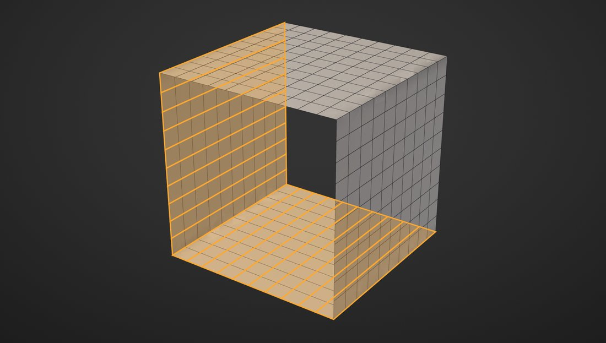

# Polygon mode: modelling with points, edges and faces

> **In short:**
> - **Tool > Polygon > Polygon mode** turns a Part into a cage you edit polygon by polygon.
> - Pick **Points**, **Edges** or **Faces**, select them on the model, and move them with the Gizmo.
> - **Extrude**, **Inset**, **Bevel**, **Edge loop** and **Span** build on the selection, each as one undo step.

Sculpting shapes a surface; Polygon mode builds one. It is for low and medium-density meshes: a box, a cylinder, a
Quad Remesh result, an imported cage. It suits hard-surface blocking, where you want flat sides, clean edges and
openings in exact places, and then you sculpt the result like any other Part. You select a polygon's points, edges or
faces on the model, move them with the Transform gizmo, and run an operation on them. Everything is undoable, and
any brush takes you back to sculpting.

## Where to find it

Open **Tool > Polygon**. The panel has, from the top:

- **Polygon mode**, the button that turns the mode on and off.
- **Points**, **Edges** and **Faces**: what a click selects.
- **All**, **None**, **Invert**, **Grow**, **Shrink**, **Loop**, **Ring** and **By Group**: selection helpers.
- A line that counts the selection (*12 faces selected of 600*).
- **Operations**: one button per operation, each with its settings underneath.

Every button is an action you can put on a key or a shelf (**Edit > Preferences > Input**).

## Turning it on

Click **Polygon mode** (the button again, <kbd>Esc</kbd> or any brush goes back to sculpting). While the mode is on,
the Part is drawn with its wireframe and with flat faces, so the polygons, hard edges and bevels read as built; both go
back to how they were when you leave (the Part's own shading setting is untouched).

Polygon mode works on a plain mesh. When a Part can't enter it, the status line says why and what to do:

| Part | What to do first |
| --- | --- |
| With subdivision levels | **Tool > Geometry > Remove Above**: the operations rebuild the cage the levels are made from |
| With a Micro level | Remove the Micro level (**Tool > Geometry > Micro Detail**) |
| A Forge Sphere or Tube Part | **Make Mesh** or **Bake** it first: Polygon mode needs a mesh |
| Over 2 million triangles | Quad Remesh it (**Tool > Remesh**) or Decimate it (**Tool > Geometry**) first |

## Selecting

**Points**, **Edges** and **Faces** pick what a click selects. A quad is one face; a quad's diagonal is no edge.

| On the model | Does |
| --- | --- |
| Click | Select the point, edge or face under the cursor (only that one). The one a click would take lights up as you move. |
| <kbd>Shift</kbd>+click | Add it. |
| <kbd>Ctrl</kbd>+click | Remove it (it lights up red). |
| Drag | Select everything inside the box that faces you. <kbd>Shift</kbd> adds the box, <kbd>Ctrl</kbd> removes it. |
| Double-click an edge | Select its edge loop: across the quads, on through every vertex with four edges, until it comes back round or meets a pole or a border. |
| Double-click a face | Select its whole face group. |
| Click the background | Deselect everything. |
| <kbd>Alt</kbd>, right-drag | Navigate as usual. |

Switching between Points, Edges and Faces converts the selection: a face's points, a face's edges, or the faces
whose points (or edges) are all selected.

- **All**, **None** and **Invert** do what they say.
- **Grow** adds every point, edge or face touching a selected one; **Shrink** takes the selection's border back
  (a closed edge loop keeps every edge).
- **Loop** extends each selected edge to its edge loop; **Ring** to its edge ring, the edges across the quads
  beside it (what an added edge loop would cut through).
- **By Group** extends the selection to the whole face groups the selected faces are in.

Selected faces are drawn in orange over the model, on the side facing you, edges as orange lines and points as orange
dots. The selection belongs to the active Part. Picking another Part, or changing the mesh's polygons (remeshing,
Dynamic topology, an operation that adds faces), drops it. It isn't part of undo, and it stays while you move it.

## Moving the selection

The [Transform gizmo](gizmo.md) works inside Polygon mode: <kbd>W</kbd> Move, <kbd>E</kbd> Scale and <kbd>R</kbd>
Rotate move **only the selection**, and the gizmo sits at its centre. Each drag is one undo step and the selection
stays selected, so you can push a face out, scale it down and push again. Off the handles a drag still box-selects.
<kbd>Q</kbd> (Draw) is back to sculpting: it puts the gizmo away and leaves Polygon mode too.

## Operations

Every operation runs on the selection and is one undo step. **Delete** removes the selected faces (points and edges
delete the faces they fully cover). **Flip** turns the selected faces inside out. The modelling operations below each
have their settings under their button. Drag a slider and the result previews on the model as an outline; let go and
nothing has changed until you click the operation's button.

An operation that needs whole faces tells you so when only some of a face's points are selected: switch to Faces, or
select whole faces. One that needs something else (edges for **Edge loop**, two borders for **Span**) says so in the
status line and leaves the Part as it was.

<!-- BEGIN op: extrude -->
### Extrude

**Extrude** pushes the selected faces out along their normals and joins them to the surface with new side walls
(quads, in a face group of their own, so one double-click selects them afterwards). The cap keeps its face group,
UVs and paint. With a negative **Distance** the faces sink in instead.

| Setting | Does |
| --- | --- |
| **Distance** | How far out (negative: in), as a fraction of the Part's size, so the same slider position means the same on a small and a big Part. 0 builds the walls flat, ready for the gizmo. |
| **Inset** | Narrows the cap first, so the walls slant inward (a boss, a tapered plate). Too deep an inset is scaled back rather than folding the cap. |
| **Individual** | Each face on its own: every face gets its own walls, with a groove down to the surface between neighbours. Off: the connected selection moves as one region, with walls only on its border. |
| **Even thickness** | Where the selection bends (two sides of a box), every face still moves the full distance along its own normal. Off: the shared edge moves along the averaged normal and comes out less. |
| **Keep shape** | The whole region moves along one direction (its average normal) and keeps its shape, instead of inflating along each point's normal. |
| **Edges along normals** | In **Edges**: the strip stands on the surface instead of extending it. |

In **Edges**, Extrude takes the selected open border edges (a plane's rim, the edge of a hole) and extends the surface
with a strip of quads; corners go out diagonally so the strip is as wide at a corner as along an edge.

**Tip:** the cap stays selected, so set **Distance** to 0, click Extrude, then drag the cap with the gizmo
(<kbd>W</kbd>): the shape follows your hand instead of a number, and the walls follow it.

**Limit:** edges with a face on both sides are left alone, so a closed mesh has no border to wall: select a whole closed
mesh and the surface just moves out (an exact offset). Extrude does not work on Points.
<!-- END op: extrude -->

<!-- BEGIN op: inset -->
### Inset

**Inset** shrinks the selected faces inward and fills the gap with a rim of quads: the way to cut a panel line, a
frame or a sunken button into a flat side.

| Setting | Does |
| --- | --- |
| **Thickness** | How far the border moves in, as a fraction of the Part's size. Held below the point where a face would turn inside out (the status line says so). |
| **Depth** | How far the inner faces move along their normal: negative sinks them into the surface, positive raises them. |
| **Each face** | Every selected face is inset by itself instead of the selection as one shape. |
| **Rim group** | The rim joins one new face group instead of its faces' groups, so a double-click selects the rim alone afterwards. |

The inner faces stay selected, so a second Inset, an Extrude or a gizmo move continues from them. The rim keeps the
face group of the face it came from, UVs stay continuous (a painted texture follows), and a crease or UV seam on the
old border stays on it.

**Tip:** select a side with a double-click, Inset with a small Thickness and a negative Depth for a sunken panel, then
Inset again for a second frame inside the first.

**Limit:** a selection that is a whole closed Part has no border to inset from; turn on **Each face** there.
<!-- END op: inset -->

<!-- BEGIN op: bevel -->
### Bevel

**Bevel** rounds or chamfers the selected edges: each edge becomes a strip of faces across, and the faces on either side
are cut back. With Faces picked, the faces' edges are bevelled; with Points picked, the points are cut off instead (a
corner of a box becomes a triangle, or a rounded cap).

| Setting | Does |
| --- | --- |
| **Width** | How far each face is cut back, as a fraction of the Part's size. |
| **Segments** | Faces across the strip. 1 is a flat chamfer; 3 or more reads as a rounded edge. |
| **Profile** | The strip's shape. 0.25 is flat whatever the segments, 0.5 is round (a quarter circle on a square edge), 1 is nearly square, below 0.25 bends inward. |
| **Limit width** | Holds the width back so no two cuts meet or cross on an edge. Leave it on unless you want cuts to overlap on purpose. |
| **New face group** | The bevel's faces get a face group of their own, so one double-click selects them again. |

Where bevelled edges meet, two join in a mitre and three or more in a rounded corner (a box corner becomes a piece of
a sphere). A bevel that ends in the middle of a surface keeps the vertex there; one that ends at a face cuts that
face's corner round. Faces keep their face groups, UVs, mask and paint, and the bevel's faces are selected afterwards.

**Tip:** bevel with 3 or more Segments for a rounded edge that still catches light when you sculpt on it, or with 1
Segment for a flat chamfer; drag **Width** with one edge selected to see the choice before you commit.

**Limit:** open (border) edges and edges shared by more than two faces are left alone, and the status line counts them.
<!-- END op: bevel -->

<!-- BEGIN op: edge-loop -->
### Edge loops

**Edge loop** adds new loops of edges across the ring of quads through the selected edge: the quickest way to put more
polygons where a model needs them (a knuckle, a neck, an edge about to be rounded). In **Edges**, click one edge
(**Ring** shows the ring it would cut through) and click **Edge loop**: every quad of the ring is split and the new
loop is selected, so a <kbd>W</kbd> drag moves it at once.

| Setting | Does |
| --- | --- |
| **Loops** | How many loops go into each quad of the ring, evenly spaced. |
| **Position** | Where across the quads they go: 0.5 is centred, towards 0 or 1 they move close to either side of the ring. |

Face groups, UVs, seams, creases, vertex paint and the mask carry over to the new polygons. Edges on several rings cut
every one of them in one step.

**Tip:** to tighten a hard edge, put loops close beside it (Loops 2, Position near 0 on a ring across the edge); the
new loops stay selected, so a <kbd>W</kbd> drag or a Scale (<kbd>E</kbd>) adjusts them at once.

**Limit:** the loop runs round the model, or stops where the ring ends: at an open border (that edge is split too), at a
triangle (it is split in two, so a cylinder's cap stays closed) or at a quad the ring already crossed. A Faces or Points
selection is refused with a pointer to Edges.
<!-- END op: edge-loop -->

<!-- BEGIN op: span -->
### Span

**Span** joins two edge loops or two face selections with new faces. Select the border edges of two openings
(double-click an edge on each border; <kbd>Shift</kbd> for the second) and Span fills the gap between them with a
band of quads, wound with the surface on both sides. Select faces on two sides instead and Span removes them and joins
the two openings: a tunnel through a block, a handle between two shells. Select one whole border loop and Span closes
it across its width (a slot gets a grid, not a fan).

| Setting | Does |
| --- | --- |
| **Segments** | Rings of faces across the gap. |
| **Twist** | Turns which vertex pairs with which on two loops. |
| **Reverse** | Pairs the second border the other way round, for a piece that is wound inside out. |

Borders with different numbers of edges pair by distance along each border, and the odd triangles are spread evenly
round the band. The band is a face group of its own and stays selected afterwards, ready to move or smooth.

**Tip:** if the preview shows a crossed or pinched band, drag **Twist** until it runs straight, or turn on **Reverse**.

**Limit:** Span needs exactly two borders (or one closed one): with a different number the status line says so and
nothing changes.
<!-- END op: span -->

## Block out, then sculpt

1. Start from a simple Part: **Tool > Parts > Append** a cube or a cylinder, or Quad Remesh a rough form so it is
   made of quads.
2. Turn on **Polygon mode** and block out in big moves: Extrude a side, drag it with the gizmo, Inset a panel, Span two
   faces into a handle.
3. Add polygons only where you need them with **Edge loop**, and round the hard edges with **Bevel**.
4. Leave the mode (<kbd>Esc</kbd>) and sculpt: add subdivision levels (**Add Level**, <kbd>Ctrl</kbd>+<kbd>D</kbd>) or
   remesh, then use the brushes as usual.

Polygon mode needs a Part without subdivision levels, so model first, sculpt after. To come back to the cage later,
remove the levels above it (**Remove Above**); the detail sculpted on them goes with them.

## Undo

Each operation, and each gizmo drag, is one undo step, and <kbd>Ctrl</kbd>+<kbd>Z</kbd> puts the Part back exactly. The
selection itself is not part of undo.

## Scripting

Polygon mode is driven by three commands (the console shows every click as one of them):

| Command | Does |
| --- | --- |
| `poly_mode` | whether the active Part can enter Polygon mode and its counts; `element=points` / `edges` / `faces` picks what is selected |
| `poly_select` | `op=point` / `edge` / `face` with `index=N`; `loop` / `ring` with an edge's index; `group` with `group=N`; `rect` with `x0 y0 x1 y1`; `grow`, `shrink`, `all`, `none`, `invert`, `info`; `add` / `remove` instead of replacing |
| `poly_op` | `op=list` names the operations and their parameters; `op=delete`, `op=flip`, `op=extrude distance=0.1`, `op=inset thickness=0.1 depth=-0.05`, `op=bevel width=0.02 segments=3`, `op=edge_loop count=2 position=0.3`, `op=span segments=2`; parameters as `name=value` |
| `transform` | `selection=true` moves only the selection (what a gizmo drag runs) |
