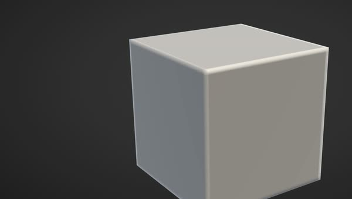

# Polygon mode: modelling with points, edges and faces

> **In short:**
> - **Tool > Polygon > Polygon mode** turns a Part into a cage you edit polygon by polygon.
> - Pick **Points**, **Edges** or **Faces**, select them on the model, and move them with the Gizmo.
> - The operations under the selection (Extrude, Edge loop, Delete, Flip, and the other modelling ones as they land) run on what is selected, each as one undo step.

Sculpting shapes a surface; Polygon mode builds one. It is for the low and medium-density meshes hard-surface
work starts from: a box, a cylinder, a Quad Remesh result, an imported cage. You select the polygons' points,
edges or faces on the model, move them with the Transform gizmo, and run the operations on them. Everything
stays undoable, and any brush takes you back to sculpting the result.

## Turning it on

Click **Polygon mode** in **Tool > Polygon** (the button again, <kbd>Esc</kbd> or any brush goes back to
sculpting). The wireframe comes on while the mode is on, so the polygons show, and goes back to how it was when you
leave.

Polygon mode works on a plain mesh. It says why when a Part can't enter it, and what to do:

| Part | Status line says |
| --- | --- |
| With subdivision levels | Remove Above first (**Tool > Geometry**): the operations rebuild the cage the levels are made from |
| With a Micro level | Remove the Micro level first (**Tool > Geometry > Micro Detail**) |
| A Forge Sphere or Tube Part | Make Mesh or Bake first: Polygon mode needs a mesh |
| Over 2 million triangles | Decimate or Quad Remesh first (**Tool > Remesh**) |

## Selecting

**Points**, **Edges** and **Faces** pick what a click selects. A quad is one face; a quad's diagonal is no edge.

| On the model | Does |
| --- | --- |
| Click | Select the point, edge or face under the cursor (only that one). The one a click would take lights up as you move. |
| <kbd>Shift</kbd>+click | Add it. |
| <kbd>Ctrl</kbd>+click | Remove it (it lights up red). |
| Drag | Select everything inside the box that faces you. <kbd>Shift</kbd> adds the box, <kbd>Ctrl</kbd> removes it. |
| Double-click an edge | Select its edge loop: across the quads, on through every vertex with four edges, until it comes back round or meets a pole or a border. |
| Double-click a face | Select its whole face group. |
| Click the background | Deselect everything. |
| <kbd>Alt</kbd>, right-drag | Navigate as usual. |

Switching between Points, Edges and Faces converts the selection: a face's points, a face's edges, or the faces
whose points (or edges) are all selected.

- **All**, **None** and **Invert** do what they say.
- **Grow** adds every point, edge or face touching a selected one; **Shrink** takes the selection's border back
  (a closed edge loop keeps every edge).
- **Loop** extends each selected edge to its edge loop; **Ring** to its edge ring, the edges across the quads
  beside it (what an added edge loop would cut through).
- **By Group** extends the selection to the whole face groups the selected faces are in.

The line under the buttons counts the selection: *12 faces selected of 600*. Selected faces are drawn in orange
over the model, on the side facing you, edges as orange lines and points as orange dots.

The selection belongs to the active Part. Picking another Part, or changing the mesh's polygons (remeshing, Dynamic
topology, an operation that adds faces), drops it. It isn't part of undo; it stays while you move the selection.

## Moving the selection

The [Transform gizmo](gizmo.md) works inside Polygon mode: <kbd>W</kbd> Move, <kbd>E</kbd> Scale, <kbd>R</kbd>
Rotate move **only the selection**, and the gizmo sits at its centre. Each drag is one undo step, and the selection
stays selected afterwards, so you can push a face out, scale it down, and push again. Off the handles a drag still
box-selects. <kbd>Q</kbd> (Draw) is back to sculpting: it puts the gizmo away and leaves Polygon mode too.

## Operations

Every operation runs on the selection and is one undo step. **Delete** removes the selected faces (points and edges
delete the faces they fully cover). **Flip** turns the selected faces inside out. The modelling operations
(Extrude below; Inset, Bevel, Edge loop, Span) land here as they ship; each has its settings under its button, and a
slider you drag shows a live preview of the result on the model.

**Span** joins two edge loops or face selections with new faces. Select the border edges of two openings (double-click
an edge on each border; <kbd>Shift</kbd> for the second) and Span fills the gap between them with a band of quads,
wound with the surface on both sides. Select faces on two sides instead and Span removes them and joins the two
openings: a tunnel through a block, a handle between two shells. Select one whole border loop and Span closes it
across its width (a slot gets a grid, not a fan). **Segments** adds rings across the gap, **Twist** turns which vertex
pairs with which on two loops, **Flip** pairs the second border the other way round when a piece is wound inside out.
Borders with different numbers of edges pair by distance along each border, and the odd triangles are spread evenly
round the band; the band is a face group of its own and stays selected afterwards, ready to move or smooth.

An operation that needs whole faces tells you so when only some of a face's points are selected: switch to Faces, or
select whole faces.

### Extrude

**Extrude** pushes the selected faces out along their normals and joins them to the surface with new side walls
(quads, in a face group of their own, so one click selects them afterwards). The cap keeps its face group, UVs and
paint. With a negative **Distance** the faces sink in instead. Distances are a fraction of the Part's size, so the
same slider position means the same thing on a 2 cm bolt and a 2 m wall; pull the result further with the gizmo.

| Setting | Does |
| --- | --- |
| **Distance** | How far out (negative: in). 0 builds the walls flat, ready for the gizmo. |
| **Inset** | Narrows the cap first, so the walls slant inward (a boss, a tapered plate). Too deep an inset is scaled back rather than folding the cap. |
| **Individual** | Each face on its own: every face gets its own walls, with a groove down to the surface between neighbours. Off: the connected selection moves as one region, walls only on its border. |
| **Even thickness** | Where the selection bends (two sides of a box), every face still moves the full distance along its own normal, so the thickness is even. Off: the shared edge moves along the averaged normal and comes out less. |
| **Keep shape** | The whole region moves along one direction (its average normal), keeping its shape, instead of inflating along each point's normal. |
| **Edges along normals** | In **Edges**: the strip stands on the surface instead of extending it. |

In **Edges**, Extrude takes the selected open border edges (a plane's rim, the edge of a hole) and extends the
surface with a strip of quads; corners go out diagonally so the strip is as wide at a corner as along an edge. Edges
with a face on both sides are left alone. Selecting a whole closed mesh and extruding it has no border to wall, so
the surface just moves out: an exact offset.

The slider shows a live outline of the result on the model while you drag.

### Edge loop

**Edge loop** adds new loops of edges across the ring of quads through the selected edge, the quickest way to put more
polygons where a model needs them (a knuckle, a neck, a hard edge about to be rounded). In **Edges**, click one edge
(**Ring** shows the ring it would cut through) and click **Edge loop**: every quad of the ring is split and the new
loop is selected, so a <kbd>W</kbd> drag moves it at once.

- **Loops** is how many loops go into each quad of the ring, evenly spaced.
- **Position** is where across the quads they go: 0.5 is centred, towards 0 or 1 they move close to either side of the
  ring. Dragging the slider previews the loops on the model.
- The loop runs round the model, or stops where the ring ends: at an open border (that edge is split too), at a triangle
  (it is split in two, so a cylinder's cap stays closed) or at a quad the ring already crossed.
- Face groups, UVs, seams, creases, vertex paint and the mask carry over to the new polygons.
- Edges on several rings cut every one of them in one step; a face or point selection is refused with a pointer to Edges.

## Scripting

Polygon mode is driven by three commands (the console shows every click as one of them):

| Command | Does |
| --- | --- |
| `poly_mode` | whether the active Part can enter Polygon mode and its counts; `element=points` / `edges` / `faces` picks what is selected |
| `poly_select` | `op=point` / `edge` / `face` with `index=N`; `loop` / `ring` with an edge's index; `group` with `group=N`; `rect` with `x0 y0 x1 y1` (-1..1 under `view_proj`, `eye` for the facing side); `grow`, `shrink`, `all`, `none`, `invert`, `info`; `add` / `remove` instead of replacing |
| `poly_op` | `op=list` names the operations and their parameters; `op=delete`, `op=flip`, `op=edge_loop count=2 position=0.3`, ...; parameters as `name=value` |
| `transform` | `selection=true` moves only the selection (what a gizmo drag runs) |
