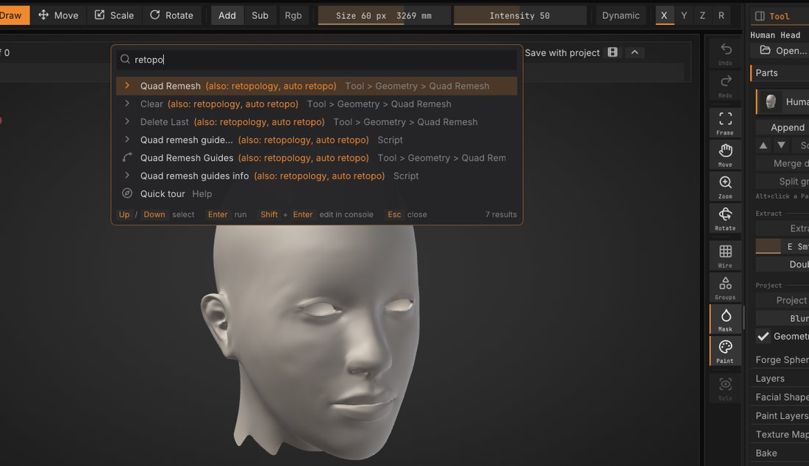
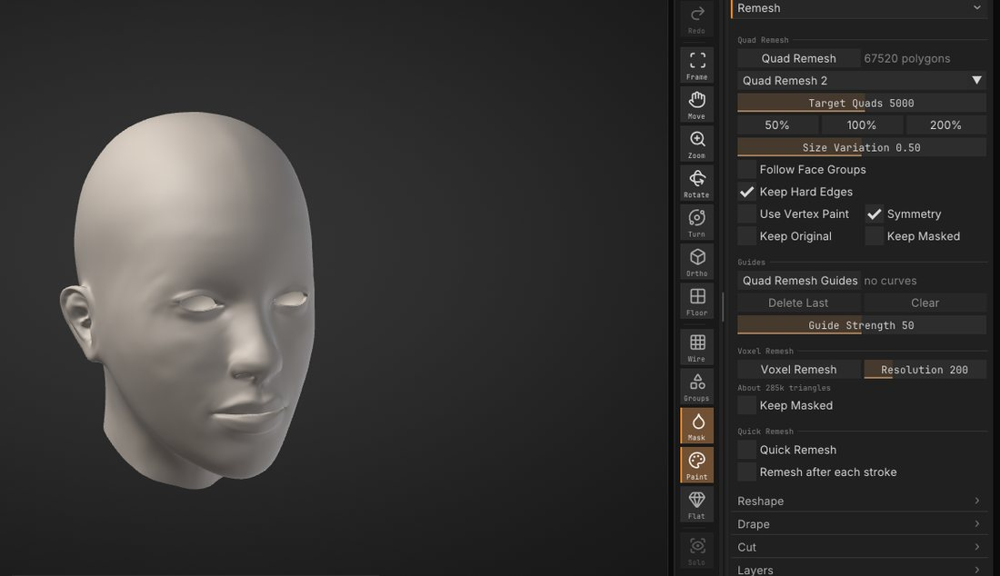
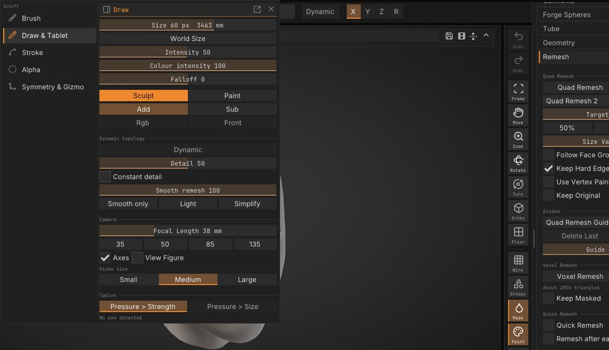
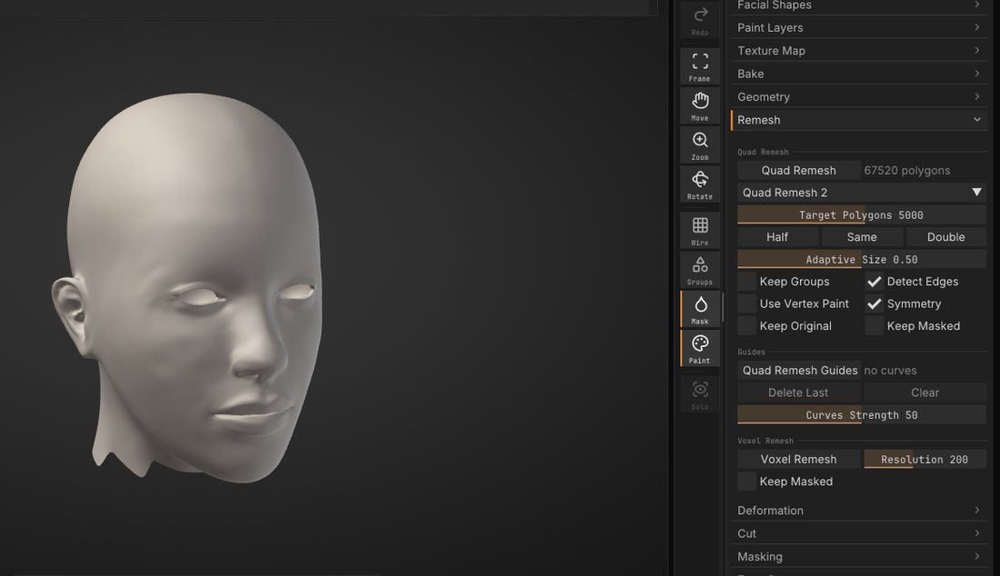
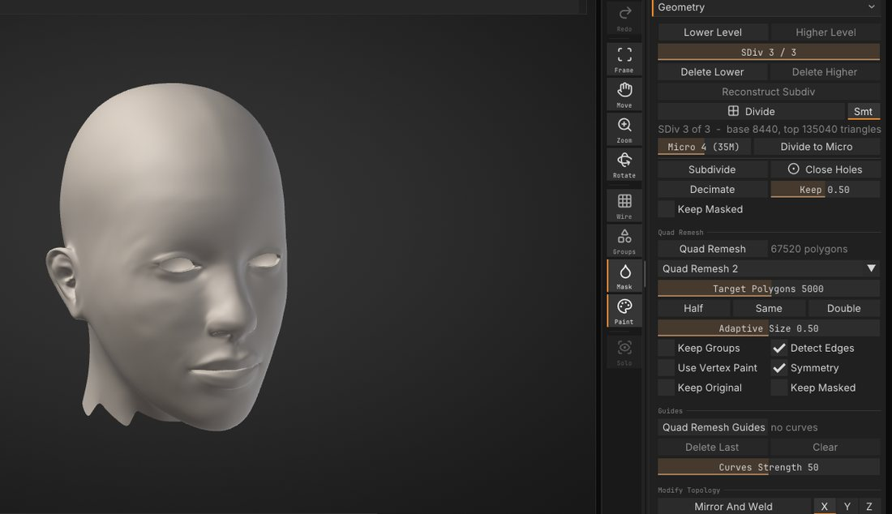
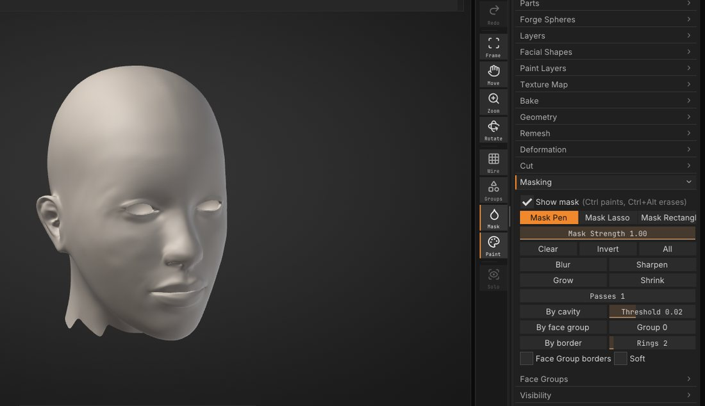
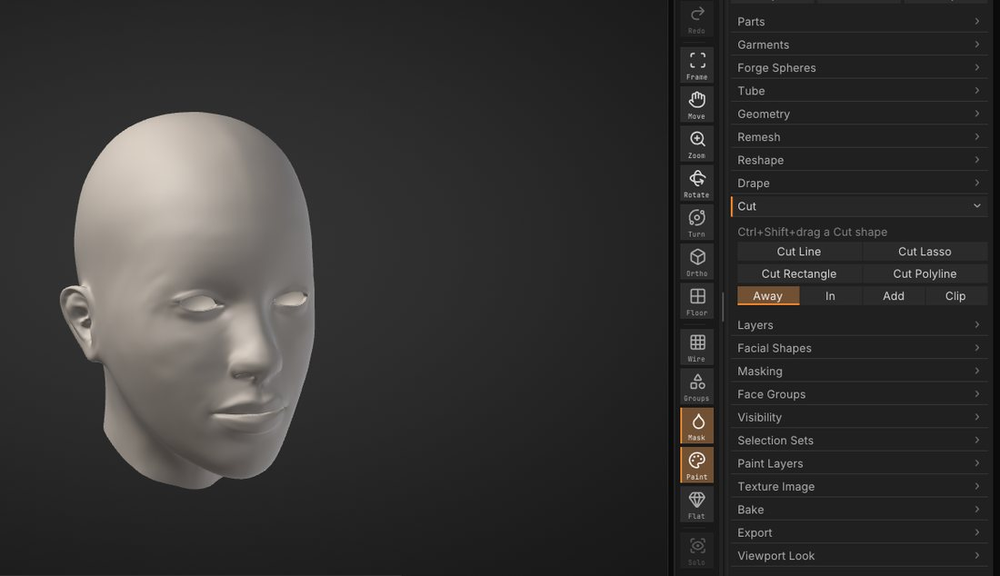
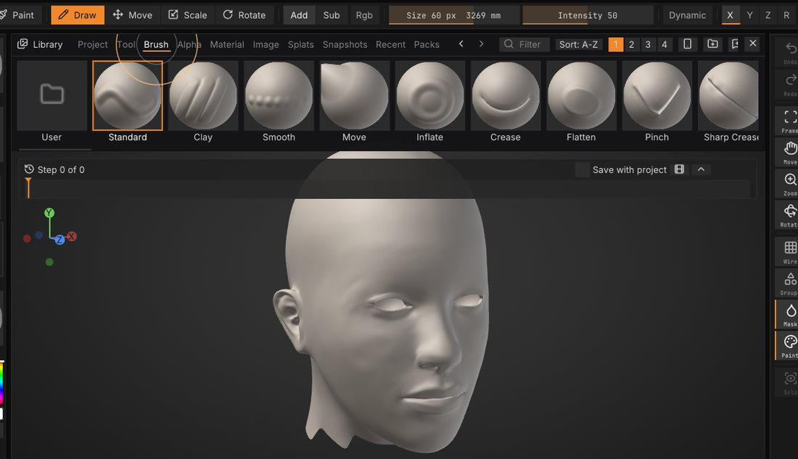
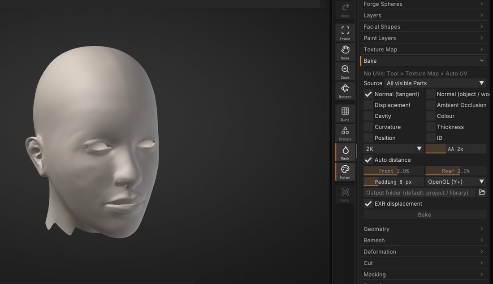

# Quick tour for experienced sculptors

You know how to sculpt; you just need to know where SculptForge keeps things. This chapter is the same ten stops
as the in-app tour: **Help > Quick tour**, or **Sculpted before? Take the quick tour** in the welcome. Each slide
there has a **Show me** button that opens the panel it talks about and flashes it, while the tour waits in a small
bar at the bottom of the view (**Back to the tour** brings it back).

The pictures are SculptForge in its default look and layout.

## Where things are

The menus along the top are sorted by task: **Sculpt** (brushes, strokes, alphas, symmetry), **Paint**, **Mesh**,
**View** and **Render**. The right tray holds the **Tool** palette: Parts, Geometry, Remesh, Masking, Cut, Bake and
more. The shelves around the view hold the brush, its size and strength, and the brush, stroke, alpha and material
tiles. See [The interface](interface.md).

Lost? Press <kbd>F3</kbd> and type what you are after in your own words. The search knows the usual sculpting
words too, and says which one it matched:

| Type | Finds |
|---|---|
| `remesh`, `voxel`, `block out` | **Voxel Remesh** |
| `retopo`, `retopology`, `quads` | **Quad Remesh** |
| `subdivide`, `multires`, `levels` | **Add Level**, **Lower Level**, **Higher Level** |
| `groups` | **Face Groups** |
| `clip`, `trim`, `slice` | **Tool > Cut** |
| `folders`, `objects` | **Tool > Parts** |
| `insert`, `kitbash` | **Append** (a mesh as a new Part) |
| `vertex color` | **Vertex Paint** |
| `armature` | **Forge Spheres** |

## Voxel Remesh

A fast remesh for blocking out. Pull shapes far out or merge pieces, then rebuild one even surface: open
**Tool > Remesh** in the right tray, set **Resolution** and click **Voxel Remesh**. A higher resolution keeps more
detail. The mask and vertex paint carry over, so you can keep going. See
[Geometry](geometry.md#voxel-remesh).

## Dynamic topology

Dynamic topology adds detail where you sculpt. Turn on **Dynamic** on the top shelf and the brush adds triangles
where it needs them and removes them where it doesn't; **Detail** sets how small they get. Pull horns, ears or
fingers out of a ball without remeshing. **Wire** (<kbd>Shift</kbd>+<kbd>F</kbd>) shows the new triangles. See
[Dynamic topology](dynamic-topology.md).

## Quad Remesh

Automatic quad retopology: **Tool > Remesh > Quad Remesh** rebuilds a sculpt as clean quads whose edge loops follow
the forms. Set **Target Quads** and leave **Keep Original** on. Add levels to the result, then **Project Detail**
(**Tool > Parts**) brings the detail back. Draw **Quad Remesh Guides** to steer the loops. See
[Quad retopology](retopology.md).

## Levels, Parts and Face Groups

<kbd>Ctrl</kbd>+<kbd>D</kbd> divides and keeps the lower levels: <kbd>Shift</kbd>+<kbd>D</kbd> steps down,
<kbd>D</kbd> steps up, and you can sculpt at any level (**Tool > Geometry**). A scene holds several
[Parts](parts.md) (**Tool > Parts**); <kbd>Alt</kbd>+click one in the view to work on it.
[Face Groups](face-groups.md) split a Part into coloured regions to hide, isolate or mask (**Tool > Face Groups**).
See [Subdivision levels](subdivision-levels.md).

## Masking

Hold <kbd>Ctrl</kbd> and paint to mask, <kbd>Ctrl</kbd>+<kbd>Alt</kbd> to unmask. **Tool > Masking** inverts,
blurs and grows the mask, and builds one **By cavity**, **By face group** or along the border. Press <kbd>G</kbd>
for the stroke popup: its **Shapes** row picks **Mask Pen**, **Lasso Mask** or **Rectangle Mask** for the next
<kbd>Ctrl</kbd> stroke. See [Masking](masking.md).

## Cut, Clip and Fill Holes

Pick a shape in **Tool > Cut** and draw it with <kbd>Ctrl</kbd>+<kbd>Shift</kbd>: a line, lasso, rectangle or
polyline goes straight through the whole Part, and a closed Part stays closed. Cut it away, cut in, add, or
**Clip**: press everything outside the shape flat onto its outline. **Fill Holes** (**Tool > Geometry**) caps every
open boundary. See [Cut](cut.md) and [Fill Holes](geometry.md#fill-holes).

## Brushes, alphas and the Library

<kbd>B</kbd> opens the brush picker; type the first letters of a name to pick one. The **Alpha** tile picks the
stamp shape. The **Library** (<kbd>,</kbd>) holds starter meshes, brushes, alphas, Lit Spheres and snapshots. A
pack (`.sfpack`) brings brushes, alphas and Lit Spheres in one file; **File > Install Pack** shows what is inside
before anything is installed. See [Sculpting and brushes](sculpting.md) and [Packs and macros](packs-and-macros.md).

## Baking and texturing

**Tool > Bake** makes normal, displacement, ambient occlusion, cavity and colour maps from your sculpt onto a
low-poly Part with UVs, in the background. <kbd>P</kbd> picks the Paint brush for vertex paint; **New Texture** on
the top shelf paints into a texture instead (Auto UV runs first), with paint layers and material channels. See
[Baking](baking.md), [Texture painting](texture-painting.md) and [Material painting](pbr-painting.md).

## SculptForge stays free

Everything in this tour is free, and stays free. If SculptForge helps your work, a membership keeps it moving:
members get betas and early builds, vote on what we build next and ask for the brushes and alphas they want.
See [sculptforge.app/support.html](https://sculptforge.app/support.html). **Maybe later** on the tour's last slide
closes it, and it doesn't come back by itself.

## Keys

**Edit > Preferences > Input > Style** picks the keys: **SculptForge** (the default), **Classic sculpting keys**,
Blender or Maya. Picking the Classic sculpting keys offers this tour once. See
[Keyboard and mouse](shortcuts.md).

> **Classic layout:** Preferences is not under **Edit** there but its own **Preferences** palette in the palette
> bar (**Edit > Preferences...** opens it too). In both layouts <kbd>Ctrl</kbd>+<kbd>,</kbd> (<kbd>Cmd</kbd>+<kbd>,</kbd>
> on macOS) or <kbd>F3</kbd> > **Preferences** opens it.

## See also

- [Your first sculpt in 10 minutes](first-sculpt.md)
- [The interface](interface.md)
- [Glossary](glossary.md)
