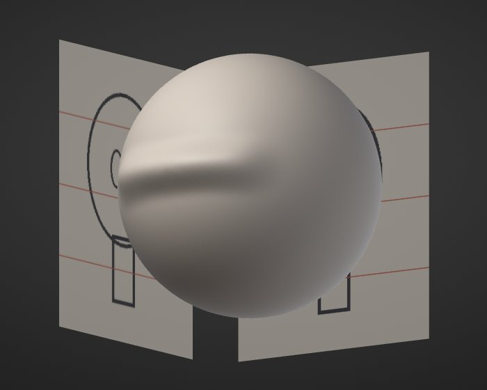

# Reference images


> **In short:**
> - Pictures that stay in the view while you sculpt: sketches, front and side views, photos.
> - Add them in **View > Reference images**.
> - They never take strokes or clicks.

**Reference images** are pictures that stay in the view while you sculpt: a concept sketch, a front and a side
drawing of a character, a photo of the real object. Match your proportions against them as you work. They never
take strokes or clicks, so you sculpt, paint and turn the view exactly as without them.



## Add one

Open **View > Reference images** and click **Add images...**. Pick one or more PNG or JPEG files. While the
section shows, you can also drop image files on the window.

Each image comes in **Behind the model**, centred and 80% of the view's height. Choose where it lives:

- **Behind the model**: a backdrop fixed to the view. It stays put while you turn the model in front of it.
- **In the scene**: a plane beside the model that turns with the view. Pick its side: **Front** (behind the
  model as the Front view sees it), **Side** (as the Right view sees it) or **Top** (under the model). It fades
  out when you see it edge-on, so it never gets in the way from other angles. The model hides the parts of it
  that are behind the model.

### A front and a side view in one go

Click **Front + side...** and pick the front image, then the side image. Both become planes in the scene, as
tall as each other and just behind the model: press <kbd>Numpad 1</kbd> for the Front view and <kbd>Numpad 3</kbd>
for the Right view, and each drawing lines up behind the model.
In the Right view the model's front is on the left: if your side drawing faces the other way,
select it and tick **Flip across**.

## Set it up

Click an image's name in the list to select it. Then:

| Option | What it does |
|---|---|
| Opacity | How strongly the image shows. |
| Flip across / Flip up/down | Mirror the image. |
| Show in renders | Off (the default), the image shows only while you work: renders, exports, project thumbnails and the timelapse leave it out. On, they include it. |
| Embed | On (the default), the project keeps the image inside it, so it opens anywhere. Off, the project keeps only the file's path: a smaller project, but the image must stay where it is. Such an image shows as *linked: file name* in the list (point at it for the full path); a missing file shows as *(missing)*, a file that isn't a usable image as *(invalid image)*. An image a project names by path, rather than carrying it, always opens with Embed off, so saving never copies a picture from your computer into it unless you tick Embed. |
| Reset placement | Back to where it came in, with the image's own proportions. |

The eye button on each row shows or hides that image; the lock keeps it where it is; the cross removes it.
**Show Reference Images** (in the command palette, and bindable to a key) hides them all at once and brings them
back.

## Move and scale it

Turn on **Adjust** for the selected image. It gets handles:

- Drag inside it to move it (a plane in the scene moves within its plane).
- Drag a corner to scale it. Each direction scales on its own; hold <kbd>Shift</kbd> to keep the image's
  proportions.
- The arrow keys move it (<kbd>Shift</kbd>: finely); <kbd>-</kbd> and <kbd>=</kbd> scale it.
- Click another image to adjust that one. Locked images keep still.

Press <kbd>Enter</kbd> or <kbd>Esc</kbd> to go back to sculpting. While Adjust is on, clicks on the images move them
instead of sculpting; with it off, they never take a click.

## Sizes and memory

Images larger than 4096 pixels on their longer side are scaled down when they load; files over 64 MB and images
over 64 megapixels or 8192 pixels on a side aren't loaded. A project holds up to 8 reference images. The section shows how much graphics memory they take (a 4096 x
4096 image about 85 MB, a 2048 x 2048 one about 21 MB).

## From a script

Every option is a command (see [Scripting](scripting.md)):

```
reference_add path=front.png mode=scene plane=front opacity=0.6
reference_pair front=front.png side=side.png
reference_set index=0 flip_x=true in_renders=true
reference_set index=1 mode=behind x=0.3 height=0.5
reference_remove all=true
```

*Thanks to Oslen on Discord for the idea.*
