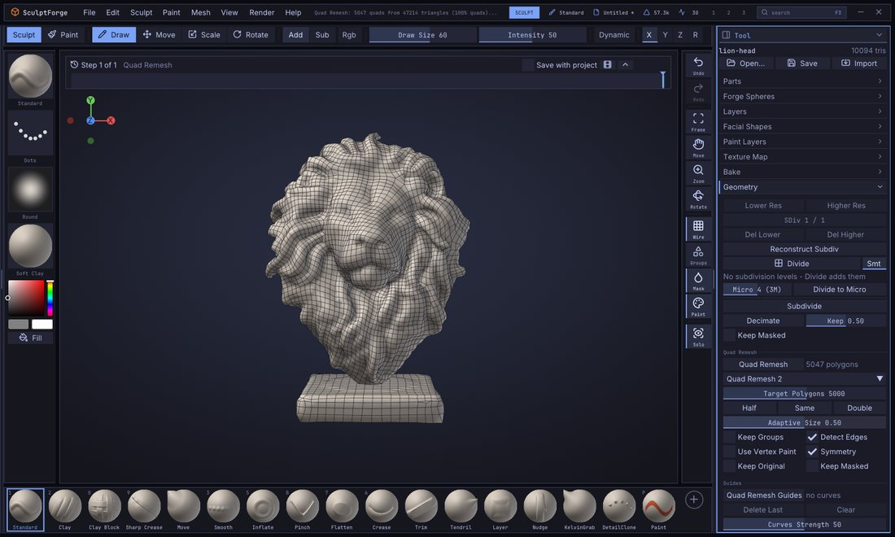
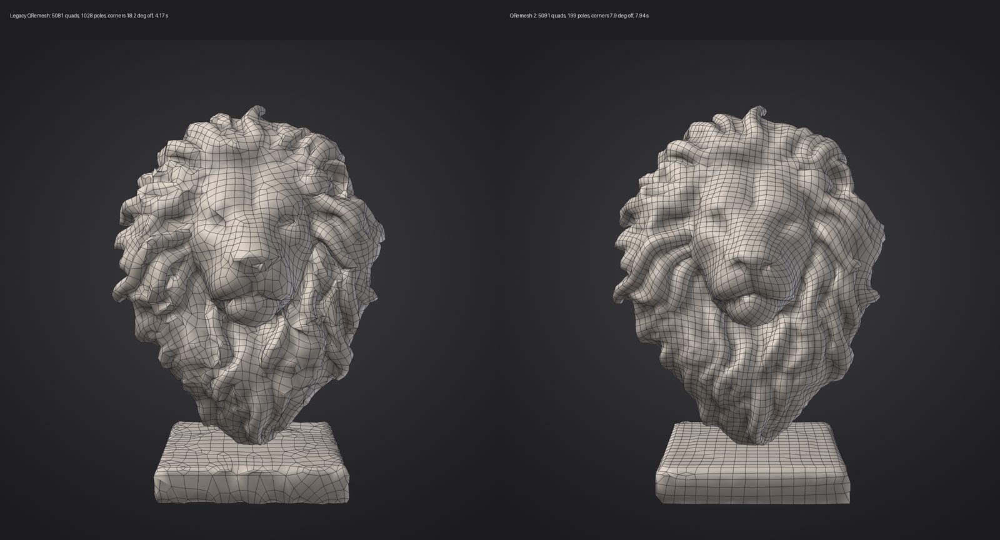
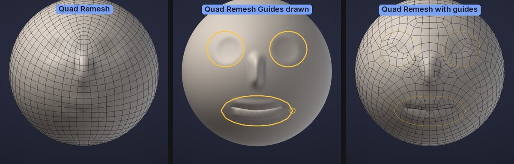

# Quad retopology and detail projection

**Quad Remesh** rebuilds a sculpt as clean, all-quad topology whose edge loops follow the forms, like ZBrush's
ZRemesher. **Project All** then moves a mesh onto the surface of other Parts, so the detail of the original
sculpt comes back onto the new topology, like ZBrush's Project All. Together they turn a dense, messy sculpt
(a voxel remesh, a scan, an AI-generated model) into a light quad mesh you can divide, sculpt on, unwrap and
animate.



## The usual workflow

1. Select the sculpt and open **Tool > Remesh** (the same Quad Remesh controls are also under **Tool > Geometry**).
   Under **Quad Remesh**, turn on **Keep Original**.
2. Set **Target Polygons** (for example 5000) and click **Quad Remesh**. It runs in the background: a progress bar
   replaces the button, and **Cancel** stops it. The result replaces the Part, and the sculpt as it was is
   kept as a hidden Part called "*name* Original" right below it.
3. Divide the new mesh two or three times (**Tool > Geometry > Subdivide**, <kbd>Ctrl</kbd>+<kbd>D</kbd>).
4. Show the original again (the eye in **Tool > Parts**) and click **Project All** under **Tool > Parts >
   Project**. The divided quads snap onto the sculpt and take its vertex paint.
5. Hide or delete the original. You now have the same sculpt on clean quads.


Both steps are single undo steps (<kbd>Ctrl</kbd>+<kbd>Z</kbd>).

## Quad Remesh

**Tool > Remesh > Quad Remesh** (also under **Tool > Geometry**) works on the active Part.

| Control | What it does |
|---|---|
| **Quad Remesh** | Starts the retopology. The status line reports the result and its quality, e.g. "Quad Remesh: 5072 quads from 47214 triangles (100% quads) in 6.5 s. Quality: 260 poles (141 x3, 113 x5, 6 other), corners 8.5 deg off square, distance to the sculpt 0.106% mean / 1.27% max of its size" |
| **Method** | **Quad Remesh 2** (the default): the whole layout is solved at once as an integer grid, so poles appear only where the form needs them and loops run unbroken. **Legacy**: the method of SculptForge 0.9, kept for comparison and for closed guide loops |
| **Target Polygons** | About how many quads to make (100 to 200,000 on the slider, more from scripts). The result is usually within 5% of it |
| **Half / Same / Double** | Set the target to half, the same as or twice the Part's current polygon count |
| **Adaptive Size** | 0 makes quads all about the same size. Higher values make smaller quads where the surface curves and bigger ones on flat areas, for the same total |
| **Keep Groups** | Edge loops run exactly along the face group borders, and the result keeps the face groups |
| **Detect Edges** | Hard edges get an edge loop, so boxes and bevels stay crisp (on by default). Quad Remesh 2 takes faces meeting at more than about 60 degrees along a line at least a few quads long (a scan's or a sculpt's deep creases are left to the flow); the legacy method any edge over 50 degrees |
| **Use Vertex Paint** | Paint where you want density: red areas get up to four times the quads, blue areas down to a quarter, white areas are unchanged |
| **Symmetry** | Remesh one half and mirror it, welded on the seam, for exactly symmetric topology (on by default). It mirrors on the axis chosen in **Sculpt > Symmetry & Gizmo** (X if none), across the model's own middle plane: the world's centre plane when the model is symmetric about it, otherwise the plane through the model's middle, so a model moved away from the centre works too. A model that isn't mirror-symmetric is remeshed whole instead, and the status line says "Symmetry off: the model isn't mirror-symmetric"; one that is nearly symmetric (a bump on one side) gets mirrored topology that follows each side's own surface |
| **Keep Original** | Keep the Part as it was, hidden, below the new one, ready for Project All. Off: the Part is replaced, as in ZBrush (undo brings it back) |
| **Keep Masked** | Masked areas keep their triangles exactly, as a fixed piece: only the unmasked part is remeshed (the target counts its quads), and it's joined to the masked part along the mask's edge with a strip of triangles, so the model stays closed. If the mask's edge can't be joined up, the status line says so and nothing changes (off by default; `qremesh keep_masked=true`) |
| **Keep Texture** | Shown when the Part has a painted texture (on by default): Auto UV the result and project the texture onto it. Off: the texture is dropped |
| **Quad Remesh Guides** | Picks the guides brush: draw curves on the model for the edge loops to follow. See [Quad Remesh Guides](#quad-remesh-guides) |
| **Delete Last** / **Clear** | Delete the last guide curve drawn (with its mirror copies), or all of them |
| **Curves Strength** | How far around each guide the edge flow follows it: 0 = only the loop on the curve, 100 = about six quads to each side (default 50) |
| **Quality Report** | Shown after a Quad Remesh of the active Part: the poles (vertices with other than four edges, by how many edges), how far quad corners are from square (mean and worst 1%), and how far the new surface is from the sculpt (mean and maximum, in % of its size) |

What happens to your data:

- The result is all quads (stored as pairs of triangles, so **Wire** draws quads and OBJ, FBX, PLY, USD and GoZ-compatible
  export them as quads), closed wherever the sculpt is closed. Open edges of the sculpt stay open, along the
  same outline.
- Sculpt layers are baked into the surface: the result has no layers.
- Mask and vertex paint are interpolated from the closest point of the sculpt (vertex paint is blurred to the new
  resolution until you project it back onto a divided copy).
- Face Groups are kept with **Keep Groups**; otherwise the result is one face group. The old UVs are dropped. A
  painted texture is kept with **Keep Texture** (on by default): the result gets Auto UVs and the texture, every
  layer of it, is projected onto them from the old surface, in the same undo step. See
  [Texture painting](texture-painting.md#uvs-and-geometry).
- Hidden parts are remeshed too.
- Separate pieces stay separate and none is dropped: small ones (eyes, teeth, rivets, anything that would get
  fewer than about 100 quads) are remeshed on their own with at least 32 quads, more for small round pieces
  with Adaptive Size. A piece the grid can't cover at all is kept as it was (as triangles).
- Thin parts (a blade, a fin, a slab thinner than a quad) keep both their sides, and with **Detect Edges** their
  hard edges keep a loop each and their corners stay put. Their corners can still be cut a little when the
  part is much thinner than a quad: raise the target, or use vertex paint density there.

### Guiding the edge flow

- **Quad Remesh Guides** put an edge loop exactly where you draw: around the eyes, the mouth, a joint. See below.
- **Face Groups** are as strong a guide. Paint a group around an eye, the mouth or a muscle, turn on **Keep
  Groups**, and loops will circle it. See [Face Groups](face-groups.md).
- **Vertex Paint** sets the density with **Use Vertex Paint**: paint the face red and the back of the head blue to
  spend the quads where they matter.
- **Adaptive Size** around 0.5 gives detailed areas more quads without your help; use 0 for an even mesh, for
  example before more sculpting.

### How it works

Quad Remesh 2 builds the layout the way recent research quad remeshers do (integer-grid maps, as in *Mixed-Integer
Quadrangulation*, Bommes, Zimmer and Kobbelt 2009, and *Integer-Grid Maps for Reliable Quad Meshing*, Bommes et
al. 2013), in its own implementation:

1. **A working surface.** The sculpt is brought to about three triangle edges per quad edge with even
   triangles (dense sculpts are first decimated in parallel blocks), keeping open edges, face group borders
   (**Keep Groups**) and real hard edges (**Detect Edges**; creases shorter than two quads or softer than about 55
   degrees at the quad scale are sculpt detail, not hard edges) on their exact place.
2. **Curvature and directions.** The principal curvature directions, smoothed over about one quad, and a
   smooth cross field (the directions the edges take) solved over the whole surface at once: it follows the
   curvature where the surface clearly bends one way (limbs, lips, brows, ridges), the feature lines exactly,
   and is as smooth as possible elsewhere. It is solved on a copy of the surface smoothed at the quad scale, so
   pores and scratches don't add poles. Vertex Paint density turns it the way a change of density needs.
3. **The grid.** A seamless parametrization whose integer lines are the edge loops: feature lines and guides lie
   exactly on grid lines, singularities (the poles) exactly on grid points, and across the seams the grid only
   turns by quarter turns. Its integer unknowns are rounded nearest-first, each round followed by a re-solve.
4. **Extraction** of that grid at the target density (not split from a coarser one), every face a quad; the
   rare places where the grid folds are repaired locally and stay all quads.
5. **Loop-aware relaxation**: smoothing on the sculpt in which a vertex can slide along a loop that runs over a
   ridge but not off it, then projection onto the sculpt.

With **Symmetry** one half is remeshed with the mirror plane as a feature line and mirrored, so the field and
the result are exactly symmetric. The result is the same every time for the same settings.



Compared with the legacy method on the same models and targets, Quad Remesh 2 has a quarter to a fiftieth of the
poles at the same distance to the sculpt (poles, then the mean angle of quad corners off 90 degrees, then the mean
distance in % of the model's size; legacy first):

| Model | Target | Poles | Corners off square | Distance |
|---|---|---|---|---|
| Lion scan (47k triangles) | 2,000 | 433 to 116 | 22.7° to 7.8° | 0.295% to 0.290% |
| | 5,000 | 1,028 to 199 | 18.2° to 7.9° | 0.125% to 0.120% |
| | 10,000 | 1,665 to 398 | 14.5° to 8.3° | 0.059% to 0.060% |
| ICT head (28k, symmetry) | 2,000 | 269 to 91 | 12.6° to 8.9° | 0.108% to 0.101% |
| | 5,000 | 511 to 114 | 8.8° to 8.0° | 0.039% to 0.040% |
| | 10,000 | 727 to 214 | 6.6° to 7.7° | 0.015% to 0.018% |
| Creature from a sphere (82k, symmetry) | 2,000 | 96 to 22 | 4.6° to 8.5° | 0.035% to 0.037% |
| | 10,000 | 308 to 37 | 3.4° to 6.8° | 0.007% to 0.007% |
| Hard-surface part (3 boxes) | 2,000 | 56 to 24 | 2.0° to 0.7° | 0.082% to 0.000% |
| | 10,000 | 24 to 28 | 0.3° to 0.7° | 0.000% to 0.000% |
| Sculpted sphere (1.3M) | 2,000 | 84 to 8 | 4.3° to 3.9° | 0.037% to 0.035% |
| | 10,000 | 401 to 8 | 4.3° to 5.2° | 0.008% to 0.007% |

On smooth sculpts with Adaptive Size the corners are a few degrees further from square than the legacy method's:
the grid bends to vary the quad size instead of adding poles. Set Adaptive Size to 0 for the squarest grid.

A 1.3-million-triangle sculpt takes about 4 seconds to 5,000 quads on a 10-core M1 Pro; denser sculpts are first
decimated in parallel blocks to a working resolution: 5.2 million triangles take 7 to 9 seconds (1.3 GB at most)
and 21 million about 20 seconds (4.7 GB), at 2,000 to 10,000 quads.

The legacy method (**Method > Legacy**, `method=legacy`) is the Instant Meshes style field-aligned method of
SculptForge 0.9 (Jakob, Tarini, Panozzo and Sorkine-Hornung, 2015): faster on small models but with many more
poles, and its result is extracted at twice the spacing and split, which shows as paired loops.

> **ZBrush:** Quad Remesh Guides work like ZBrush's ZRemesher Guides brush, and Curves Strength like its slider of that name.
> Keep Groups, Use Vertex Paint, Adaptive Size, Half / Same / Double and symmetry work as you know them. There is no
> Freeze Border / Freeze Groups yet, and the mask doesn't steer Quad Remesh: use vertex paint for density.

## Quad Remesh Guides

Draw curves on the sculpt and Quad Remesh puts an edge loop along each one, and turns the flow around it to follow,
like ZBrush's ZRemesher Guides brush. With Quad Remesh 2 an open curve is an exact edge loop: the grid line lies on it.
Closed loops (round an eye) and loops across the symmetry plane are, for now, done by the legacy method for that
piece (the status line says so). Use them where the topology has to work for animation: rings around the
eyes and the mouth, loops around the shoulders, elbows and knees, a line down the middle of a muscle.



1. Click **Quad Remesh Guides** under **Tool > Geometry > Quad Remesh** (or pick it in the brush picker, <kbd>B</kbd>).
   The cursor becomes a small ring.
2. Drag on the model to draw a curve. It is drawn on the surface and snapped to it. A curve that ends near where
   it started is closed into a loop: draw round an eye and let go where you began.
3. With symmetry on (<kbd>X</kbd> in the top shelf), each curve is mirrored to the other side as you draw. A
   curve that is its own mirror image, a loop round the mouth across the middle, is kept once.
4. Click **Quad Remesh**. The status line says how many guides it followed.

Editing the curves:

- **Alt**+click a curve to delete it (it turns red under the cursor while <kbd>Alt</kbd> is held), with its
  mirror copy.
- **Delete Last** removes the last curve drawn; **Clear** removes them all.
- <kbd>Ctrl</kbd> still masks and <kbd>Shift</kbd> still smooths while the guides brush is picked, and dragging
  the background still turns the view. Pick any brush to sculpt again.

The guides belong to the Part: each Part has its own, they are saved in the project, and **Keep Original**
gives the kept original a copy, so you can change them and remesh again. They show over the model, solid while
the guides brush is picked and thin otherwise, so you can see the loop Quad Remesh put on them. Drawing and deleting
guides isn't part of undo (<kbd>Ctrl</kbd>+<kbd>Z</kbd> undoes your sculpting as before).

Good to know:

- Quad Remesh snaps the guides onto the sculpt as it is when you run it, so sculpting after drawing them is fine. A
  guide left far from the surface, for example after moving the Part with the Gizmo, is ignored and the
  status line says so: draw it again.
- A loop gets an even number of quads around it, so it closes cleanly. Two guides closer together than about a
  quad compete for the same loop; draw them further apart or raise **Target Polygons**. A very small loop, about
  25 quads round or fewer, may not close, and the edges just outside it bend to fit the extra quads the next
  ring needs: raise **Target Polygons**.
- **Curves Strength** doesn't change the loop on the curve, only how far around it the other edges turn to
  follow. Lower it when guides are close to each other or to the symmetry plane.

### How the guides work

Each curve constrains Quad Remesh's cross field (the directions the edges take) to run along it, falling off over a
few quads (**Curves Strength**), and adds a lattice line on the curve, so one edge loop lies on it. Along a closed
curve the lattice corners are placed at even steps, an even number of them (a ring of quads round a disk always
has an even number of sides), so the loop meets itself without a kink. With symmetry Quad Remesh remeshes one half,
so a loop across the middle is cut there: its corners start on the seam, where it meets its mirror image.
Quad Remesh then checks the loops and the quads near the guides; if a loop came out broken or a fan of seven or
more edges sits by a guide, it tries again with a different start for the field and keeps the best. Measured on
a sphere with a circular guide around an "eye", the edges near the curve are within about 2 to 8 degrees of its
direction (about 22 degrees without the guide), and the loop closes.

## Project All

**Tool > Parts > Project > Project All** projects every other *visible* Part onto the active one. Each vertex
looks along its normal, both ways, and moves to the nearest surface it finds within **Dist**; if there is none
straight along the normal, it takes the closest point within **Dist**.

| Control | What it does |
|---|---|
| **Project All** | Projects the visible Parts onto the active one (one undo step) |
| **Dist** | How far to search, as a fraction of the Part's size (bounding-box diagonal). Default 0.02. Raise it if parts don't pick up the detail; lower it where two surfaces are close together (lips, eyelids, fingers) |
| **PA Blur** | Smooths the projected result this many times, to soften noise from the source |
| **Mean** | Where there is surface on both sides of a vertex, settle halfway between them instead of on the nearest |
| **Geometry** | Project the shape (into the active sculpt layer, if you have layers) |
| **Vertex Paint** | Project the vertex paint (into the active paint layer) when a source has any |

- **The mask protects:** fully masked vertices don't move; partly masked ones move part of the way. Mask the
  areas you have already fixed and project again with a different **Dist**.
- Hidden faces of the source are ignored, and hidden parts of the target don't move.
- Project All is fast enough to use on dense meshes: about 0.6 seconds to project 1.25 million vertices from a
  1.3-million-triangle sculpt.

> **Tip:** Project after each division, not only at the end: divide once, Project All, divide again, Project All.
> Each pass starts closer to the sculpt, so a small **Dist** is enough and thin parts don't jump to the wrong
> surface.

## Scripting

| Command | Options |
|---|---|
| `qremesh` | `method` (`v2`, the default, or `legacy`), `quality` (report poles, corner angles and the distance to the sculpt, default true), `target` (16 to 2,000,000, default 5000), `adaptive` (0-1, default 0.5), `keep_groups`, `detect_edges` (default true), `use_polypaint`, `symmetry` (`x`, `y` or `z`; off by default in scripts; the mirror plane is found from the model), `symmetry_center` (use this plane instead, e.g. `0` for the world's centre), `keep_original`, `smooth` (relaxation passes, default 6), `seed` (legacy method only; Quad Remesh 2 has no random start), `keep_texture` (default true), `guides` (follow the Part's Quad Remesh Guides, default true), `curves_strength` (0-100, default 50) |
| `qremesh_guide` | `points` (the curve, `"x,y,z x,y,z ..."`), `view` (project the points onto the surface along this direction, as a stroke from the camera; default: each point to the closest surface point), `symmetry` (`x`, `xz`...; mirror the curve) |
| `qremesh_guide_delete_last`, `qremesh_guides_clear`, `qremesh_guides_info` | Delete the last curve, delete all, list them |
| `project_all` | `distance` (0.001-1, default 0.02), `mean`, `blur` (0-20), `geometry` (default true), `polypaint` (default true), `source` (one Part's name instead of all visible ones) |

```sh
sculptforge-cli -c 'open path=scan.glb; qremesh target=8000 adaptive=0.3 keep_original=true; subdivide levels=2; subtool_visibility index=1 visible=true; project_all distance=0.02; export_fbx path=retopo.fbx'
```

```sh
sculptforge-cli -c 'open path=head.glb; qremesh_guide points="0.2,0.3,2 0.3,0.4,2 0.4,0.3,2 0.3,0.2,2 0.2,0.3,2" view=0,0,-1 symmetry=x; qremesh target=4000 symmetry=x curves_strength=70'
```

From scripts `qremesh` runs straight away (it doesn't return until it's done); in the app the button runs it in
the background.

## See also

- [Subdivide, remesh, decimate and LODs](geometry.md): voxel remesh first to fuse pieces, subdivide after Quad Remesh
- [Parts](parts.md): show, hide and duplicate the original
- [Face Groups and visibility](face-groups.md): guides for Keep Groups
- [Projects](projects.md): Quad Remesh Guides are saved with each Part
- [Texture painting](texture-painting.md): Auto UV on the new topology
