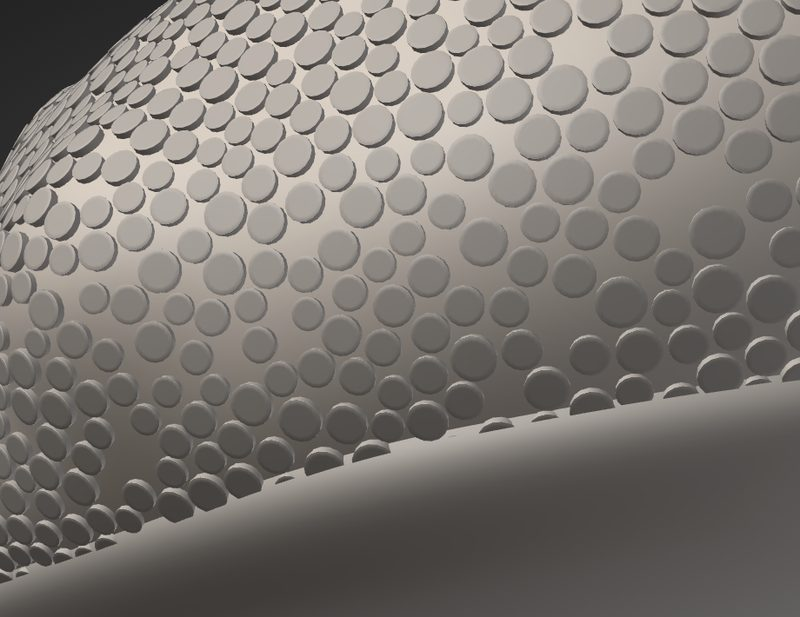

# Scatter: copies over a surface

> **In short:**
> - **Scatter** lays many copies of a piece over a Part: scales on a creature, pebbles on a path, studs, rivets, leaves.
> - Each copy gets a random size and turn; a seed repeats the same scatter.
> - **Keep apart** slides the copies over the surface until no two overlap or touch.

**Scatter** covers the active Part, or only its masked area, with copies of a piece. The piece is a built-in shape (a
pebble, a disc, a hexagonal plate, a cube...) or any other Part you made: a scale, a rivet, a leaf. The copies sit on the surface and
follow it, each at its own random size and turn.

## Scatter copies

1. Select the Part to cover (it is the surface), then open **Tool > Scatter**.
2. Pick the **Piece**: a built-in shape (set its **Shape size**) or another Part.
3. Set **Count** and press **Scatter**. The copies become a new Part, "<piece> Scatter", right below the surface.
4. <kbd>Ctrl</kbd>+<kbd>Z</kbd> takes them away again.

Until you do something else, changing a setting scatters again in the same place, so you can try counts, sizes and
spacing on the model and still undo it all in one step. **Keep it** leaves this one as it is; **Scatter** again adds
another beside it.

- **Size from / to**: each copy gets a random size between the two (1 is the piece's own size).
- **Turn**: a random turn about the copy's up side, up to this many degrees either way (180: any way round).
- **Tilt**: a random lean off the surface, up to this many degrees.
- **Height**: where the copies sit, in their own heights: 0 is half sunk in the surface, 0.5 resting on it.
- **Seed**: another seed gives another random scatter with the same settings.
- **Follow the surface**: each copy stands along the surface where it sits. Off: every copy stays upright.
- **Lie flat**: the piece's thinnest side faces out, so scales, coins and leaves lie flat on the surface.
- **Only the masked area**: scatter only where the Part is masked (mask it first: <kbd>Ctrl</kbd>+drag).

## Keep apart

**Keep apart** (on by default) slides the copies over the surface, and keeps them on it, until no two overlap or
touch. **Spacing** is the gap it keeps between them, in copy sizes: 0 lets them just touch.

- **Tight fit** keeps the copies' boxes apart, so long or flat pieces pack close together. Off, each copy keeps a
  round space around it: looser, with more even gaps.
- When the surface (or the masked area) has no room for all of them, the copies that are left over are taken out,
  so the rest never overlap. The status line says how many: fewer or smaller copies, or less spacing, fit more.

## The result

The copies are one Part, each copy its own face group, so you can hide, mask or split them by group. With
**Separate Parts** every copy becomes its own Part instead (up to 500 copies). Either way it is one undo step, and
the surface and the piece are left as they were.

A scatter goes up to 20,000 copies and 4 million triangles: use a lighter piece for very many copies. Scripts and
assistants use the `scatter` command, with the same settings.
