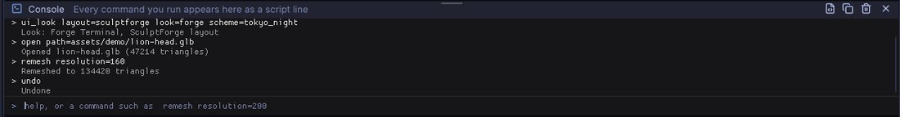
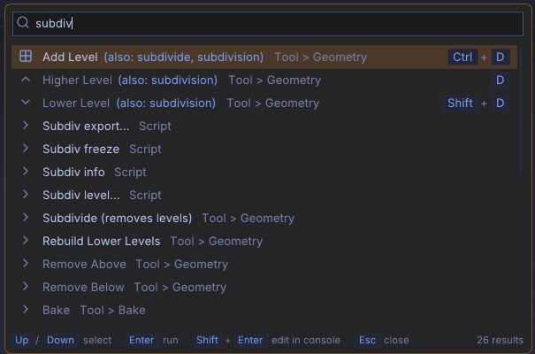

# Scripting and automation

Every operation in SculptForge is a named command with parameters. The same commands run from the console
inside the app, from script files, from the `sculptforge-cli` tool on a build farm, from Python, and from AI
agents through the Model Context Protocol (MCP). This chapter explains the script language, the console, both
command-line programs, the Python module and connecting AI tools.

## The script language

A script is a list of statements. Each statement is a command name followed by `name=value` parameters:

```text
new_sphere subdivisions=5
subdivide levels=1
remesh resolution=256; decimate ratio=0.5      # two statements on one line
export_glb path="My Sculpts/bust.glb"
```

The rules:

- Statements are separated by new lines or by `;`.
- `#` starts a comment that runs to the end of the line (outside quotes).
- Parameters are `name=value` with no spaces around `=`.
- `true` and `false` are booleans; numbers are numbers; anything else is text.
- Put text in double quotes when it contains spaces, `;`, `#` or `"`, or when it must stay text even though it
  looks like a number. Inside quotes only `\"` and `\\` are escapes, so Windows paths such as
  `"C:\Users\me\head.obj"` work as written.
- Colours with a `#` must be quoted: `set_color color="#d9a07a"`.
- Paths are UTF-8. Relative paths are relative to the current folder of the program running the script.

Scripts stop at the first command that fails.

## The console

Press the backtick key (left of <kbd>1</kbd>), or choose **File > Script > Console**, to open the console strip above
the bottom shelf. Drag its top edge to resize it.



- **Every command you run appears in the console as a script line**, whether it came from a button, a
  shortcut, the command palette or the console itself, followed by its result. Failures show in red with the
  reason.
- Type a statement and press <kbd>Enter</kbd> to run it. Several statements separated by `;` run in order and
  stop at the first failure.
- <kbd>Tab</kbd> completes command names, then parameter names. Press <kbd>Tab</kbd> again to list the
  candidates.
- <kbd>Up</kbd> and <kbd>Down</kbd> walk through the last 200 lines you typed. The history is kept between
  sessions.
- `help` (or `?`) lists every command; `help remesh` explains one command and its parameters.
- `clear` empties the log.

The console buttons (also in **File > Script**):

| Button | What it does |
|---|---|
| **Run script file...** | Runs a text file of statements (`.sfscript` or `.txt`), stopping at the first failure |
| **Copy session as script** | Puts every command run this session on the clipboard as a script you can save and run again |
| **Clear console** | Empties the log. The session script is kept |

> **Tip:** To record a macro, work normally, then click **Copy session as script**, paste it into a text file
> and edit out what you don't need. Run it later with **Run script file...** or `sculptforge-cli -f`.

## The command palette

Press <kbd>F3</kbd> (or <kbd>Ctrl</kbd>+<kbd>Shift</kbd>+<kbd>P</kbd>, or click **Search** at the top right of the window)
to search every command, brush and setting by name. <kbd>Enter</kbd> runs the highlighted entry;
<kbd>Shift</kbd>+<kbd>Enter</kbd> opens it in the console so you can add parameters first. Commands that need
parameters always open in the console. With an empty search, the palette lists what you used recently. See
[The interface](interface.md).



> **Tip:** Hold <kbd>Ctrl</kbd>+<kbd>Alt</kbd> and point at a button to see the scripting parameters of the
> command behind it.

## Commonly used commands

`sculptforge-cli --list` (or `help` in the console) prints every command with all its parameters. These are
the ones you will use most:

| Area | Command | Key parameters |
|---|---|---|
| Scene | `new_sphere` | `subdivisions` (0 to 8, default 6) |
| Scene | `new_plane` | `resolution` (cells per side, default 128) |
| Files | `open` | `path`: models, projects, splats, Bridge files |
| Files | `save_project` | `path` (default: the current project) |
| Files | `open_project` | `path` |
| Geometry | `subdivide` | `levels` (1 to 4, default 1) |
| Geometry | `remesh` | `resolution` (32 to 512, default 200) |
| Geometry | `decimate` | `ratio` (default 0.5) or `triangles` |
| Geometry | `qremesh` | `target` (default 5000), `adaptive`, `keep_groups`, `detect_edges`, `use_vertexpaint`, `symmetry`, `keep_original` |
| Parts | `project_all` | `distance` (default 0.02), `mean`, `blur`, `geometry`, `vertexpaint`, `source` |
| Geometry | `mesh_info` | |
| Sculpting | `stroke` | `points` (required), `brush`, `radius`, `strength`, `invert`, `symmetry`, `radial`, `radial_axis`, `local` |
| Brushes | `brush_set_alpha` | `name` (round, square, noise) or `path`, `invert` |
| Brushes | `brush_ai` | `prompt` (required), `provider`, `model`, `endpoint` |
| Brushes | `brush_install` | `path`, `code` or `json` |
| Brushes | `brush_save` | `path` (required), `name` |
| Layers | `layer_add` | `name` |
| Layers | `layer_set_weight` | `index`, `weight` (both required) |
| Masking | `mask_by_cavity` | `strength`, `threshold` |
| Masking | `mask_invert`, `mask_clear`, `mask_blur`, `mask_grow` | `iterations` where it applies |
| Face Groups | `facegroup_auto_by_normals` | `angle` (default 30) |
| Visibility | `isolate_facegroup`, `hide_facegroup` | `group` (required) |
| Visibility | `show_all`, `delete_hidden` | |
| Transform | `transform` | `translate`, `rotate`, `scale`, `pivot`, `orient`, `masked`, `falloff`, `symmetry`, `all` ([Gizmo](gizmo.md#scripting)) |
| Parts | `part_append` | `type` (sphere, cube, plane) or `path`, `name`, `size` |
| Parts | `part_select` | `index` or `name` |
| Vertex Paint | `set_color`, `paint_fill` | `color`, `area` (unmasked, masked, all) |
| Vertex Paint | `paint_from_cavity` | `color`, `strength`, `smoothing` |
| AI | `image_to_3d` | `path` (required), `service`, `model`, `remesh`, `resolution` |
| AI | `text_to_3d` | `prompt` (required), `service`, `model` |
| Export | `export_glb`, `export_usd`, `export_stl`, `export_ply` | `path` (required); `export_stl` also `height_mm`, `scale`, `z_up` |
| Export | `export_fbx` | `path` (required), `lods`, `ratio`, `scale` |
| Export | `export_lods` | `path` (required), `levels`, `ratio` |
| Unreal | `unreal_send` | `destination`, `height_cm`, `lods`, `network` |
| Splats | `splat_to_mesh` (Make sculptable) | `detail`, `preset`, `color`, `crop`, `face_guides`, `stage` |
| Splats | `face_guides` | `landmarks`, `front`, `up`, `target` |
| Edit | `undo`, `redo` | |

A few commands exist only inside the app, because they change the view rather than the model: `set_material`
(`name=` a Lit Sphere such as Sculpt, or Studio) and `new_cube`.

## sculptforge-cli

`sculptforge-cli` runs commands without a window: on a server, a render farm node or in a build pipeline. It
keeps one scene for the whole run, loads your brush library (and studio brushes), and uses the same `ai.json`
settings as the app.

```text
sculptforge-cli [options]

  -c, --command "<script>"   Run commands, separated by ';' (can be given several times)
  -f, --file <script.txt>    Run commands from a file ('-' reads standard input)
      --set NAME=VALUE       Define a variable; script values written $NAME are replaced
  -l, --list                 List every command and its parameters
      --schema               Print the commands as LLM tool definitions (JSON)
      --mcp                  Run as an MCP server on standard input and output
  -q, --quiet                Only print errors
  -h, --help                 Show this help
```

Each command prints its result on one line (`export_glb: Exported out/rock.glb`). The exit status is 0 when
everything succeeded, 1 for a usage or script syntax error, and 2 when a command failed (the error names the
line and the command).

Variables make one script reusable. A value written `$NAME` (the whole value) is replaced with the `--set`
value, so paths with spaces stay intact:

```sh
cat > lods.sfscript <<'EOF'
open path=$in
remesh resolution=256
export_lods path=$out levels=4 ratio=0.5
EOF
for f in rocks/*.obj; do
  sculptforge-cli --set in="$f" --set out="lods/$(basename "$f" .obj).glb" -f lods.sfscript
done
```

More examples:

```sh
# Concept art -> sculptable model -> USDZ (free, via Hugging Face)
sculptforge-cli -c 'image_to_3d path=hero.png; export_usd path=hero.usdz'

# Design a brush (free, no key) and save it for the team
sculptforge-cli -c 'brush_ai prompt="weathered stone edges"; brush_save path=stone.sfbrush'

# Cavity dirt on a sculpt, then a coloured PLY
sculptforge-cli -c 'open path=bust.sfproj; paint_from_cavity color="#3a2a20" strength=0.8; export_ply path=bust.ply'
```

> **Warning:** Without the quotes, `#3a2a20` would start a comment. In a shell, put the whole script in single
> quotes so the double quotes reach SculptForge.

## The SculptForge app on the command line

The desktop app takes a few options too, for renders and start-up scripts:

| Option | What it does |
|---|---|
| `sculptforge FILE` | Opens a model, project, splat capture or image at start-up |
| `--run "<commands>"` | Runs commands at start-up |
| `--render out.png` | Renders the scene to an image and exits |
| `--turntable N` | With `--render`: N frames around the model (`out_000.png` ...) |
| `--size WxH` | Render size (default 1024x1024) |
| `--view YAW,PITCH` | Camera angles in degrees (default -30,-15) |
| `--zoom F` | Move the camera F times closer than the framed view |
| `--wireframe`, `--facegroups` | Render with the wireframe or face group colours |
| `--hide-mesh` | Render only the Gaussian splats |
| `--fullscreen` | Start filling the screen (<kbd>F11</kbd> toggles) |
| `--demo NAME`, `--record out.mp4` | Play a scripted demo, and record it to a video (needs ffmpeg) |
| `--ui-test FILE.sfui`, `--ui-out DIR` | Run an interface test script (for developers) |

A review sheet for a model, eight frames around it:

```sh
sculptforge model.glb --render review/model.png --turntable 8 --size 1024x1024
```

Rendering needs an OpenGL 3.3 capable GPU or software renderer and a display. On a headless Linux node, run it
under a virtual display such as Xvfb (`xvfb-run sculptforge ...`).

## Python

SculptForge has a Python module, `sculptforge`, with the same commands plus NumPy access to the mesh. It is
included in the VFX Reference Platform builds and the Rez package (see [For studios](studios.md)); when
building from source, configure CMake with `-DSCULPTFORGE_BUILD_PYTHON=ON`.

```python
import sculptforge as sf

doc = sf.Document()                                  # loads your brush library, like the app
sf.run(doc, "open", path="/show/troll/troll_base.fbx")
sf.run(doc, "remesh", resolution=320)
sf.run_script(doc, "decimate ratio=0.25; export_lods path=/out/troll.glb levels=4")

verts, tris = doc.vertices, doc.triangles            # NumPy (N, 3) float32 and (M, 3) uint32
doc.set_mesh(verts * 1.1, tris)                      # bring in a mesh from your own tools (clears undo)

print(doc.parts)                                  # [{'name': ..., 'visible': ..., 'triangles': ...}]
doc.active_part = "Helmet"                        # select by index or name
for name, weight in doc.layers:                      # sculpt layers (blend shapes)
    print(name, weight)

print([c["name"] for c in sf.commands()])            # every command with its parameters
```

| Function or property | What it does |
|---|---|
| `sf.run(doc, command, **params)` | Runs one command and returns its message |
| `sf.run_script(doc, script)` | Runs a script in the syntax above and returns the messages |
| `sf.commands()` | Lists every command with its parameters |
| `sf.tool_schema()` | The commands as LLM tool definitions (JSON) |
| `doc.vertices`, `doc.base_vertices`, `doc.normals`, `doc.triangles` | Mesh arrays of the active Part (copies) |
| `doc.mask`, `doc.colors`, `doc.facegroups`, `doc.hidden` | Attribute arrays you can read and assign (`None` if absent) |
| `doc.layers`, `doc.layer_delta(i)` | Sculpt layers as `(name, weight)` and their per-vertex offsets |
| `doc.parts`, `doc.active_part` | The Parts list and the active Part |
| `doc.splat_count` | Number of loaded Gaussian splats |

Failures raise `sculptforge.CommandError`. Long operations release the GIL, so you can run them on worker
threads.

## AI agents (MCP)

`sculptforge-cli --mcp` runs SculptForge as an MCP server. An AI tool (Claude, Codex, Gemini, Grok, Cursor, VS Code
and others) gets every command as a tool and works on one scene for the session: it can open files, generate
models, sculpt strokes, remesh, paint and export. The AI tool starts `sculptforge-cli` on your computer and talks to
it over standard input and output. Nothing listens on the network, and nothing is installed into the AI tool.

The easy way: **Help > Connect an AI tool...** shows, for your install, the exact command or settings for each tool
below, with Copy buttons. It is there while AI features are on (**Edit > Preferences > AI**).

### I have a subscription

| Subscription | Use | Set up |
|---|---|---|
| Claude (Pro, Max, Ultra) | Claude Desktop or Claude Code | Claude Desktop: install the bundle (below). Claude Code: `claude mcp add --scope user sculptforge -- /path/to/sculptforge-cli --mcp` |
| ChatGPT (Plus, Pro, Business, Edu, Enterprise) | Codex CLI | `codex mcp add sculptforge -- /path/to/sculptforge-cli --mcp`, then **Sign in with ChatGPT** |
| Google (free, Google AI Pro, Google AI Ultra) | Antigravity CLI | add SculptForge to `~/.gemini/config/mcp_config.json` (below), then sign in with Google |
| Grok / xAI | Grok Build | `grok mcp add sculptforge -- /path/to/sculptforge-cli --mcp` |

- **Claude**: Claude Code uses your plan when you sign in with your Claude account; if `ANTHROPIC_API_KEY` is set
  it uses that key and API billing instead. Claude on the web and on phones can't start programs on your computer.
- **ChatGPT**: the ChatGPT app only connects to remote (HTTPS) MCP servers. SculptForge doesn't run one, on purpose:
  nothing of yours listens on the network. Use Codex CLI, or the OpenAI Agents SDK or API below.
- **Gemini**: since June 2026 personal Google accounts use Antigravity CLI; Gemini CLI is for Gemini Code Assist
  Standard and Enterprise and for API keys.
- **Grok**: the Grok app (web, phone, X) can't reach programs on your computer, only public HTTPS servers. Grok Build
  signs in with your xAI account in the browser (xAI's documentation doesn't say which plans that includes) or takes
  an xAI API key. The xAI API's own MCP tool is remote-only too; your own code can use the function calling example
  below (API usage is billed by xAI).

### Where sculptforge-cli is

| Install | Command |
|---|---|
| Windows | `C:\Program Files\SculptForge\bin\sculptforge-cli.exe --mcp` |
| macOS | `/Applications/SculptForge.app/Contents/MacOS/sculptforge-cli --mcp` |
| Linux .deb, .rpm, AUR | `/usr/bin/sculptforge-cli --mcp` |
| AppImage | `/path/to/SculptForge.AppImage --cli --mcp` (`--cli` runs the CLI inside the AppImage) |
| Flatpak | `flatpak run --command=sculptforge-cli org.sculptforge.SculptForge --mcp` |

In JSON and TOML files a Windows path is written with doubled backslashes
(`"C:\\Program Files\\SculptForge\\bin\\sculptforge-cli.exe"`). The window does that for you.

### Claude Desktop bundle

Download the bundle for your system, then install it in Claude Desktop under **Settings > Extensions > Advanced
settings** ([Anthropic's guide](https://support.claude.com/en/articles/10949351-getting-started-with-local-mcp-servers-on-claude-desktop)):
[Windows](https://github.com/islandmed/SculptForge/releases/latest/download/SculptForge-windows-x86_64.mcpb),
[macOS](https://github.com/islandmed/SculptForge/releases/latest/download/SculptForge-macos.mcpb),
[Linux x86_64](https://github.com/islandmed/SculptForge/releases/latest/download/SculptForge-linux-x86_64.mcpb),
[Linux ARM64](https://github.com/islandmed/SculptForge/releases/latest/download/SculptForge-linux-arm64.mcpb).
It carries its own copy of `sculptforge-cli`. Or add SculptForge to `claude_desktop_config.json`
(Windows `%APPDATA%\Claude\`, macOS `~/Library/Application Support/Claude/`, Linux `~/.config/Claude/`) and restart:

```text
{
  "mcpServers": {
    "sculptforge": { "command": "/path/to/sculptforge-cli", "args": ["--mcp"] }
  }
}
```

### Every other tool

Most tools take the same `mcpServers` entry as Claude Desktop above. Each row links the vendor's page the format is
from.

| Tool | Set up |
|---|---|
| [Cursor](https://cursor.com/docs/context/mcp) | the `mcpServers` entry in `~/.cursor/mcp.json` (or `.cursor/mcp.json` in a project) |
| [VS Code (Copilot agent mode)](https://code.visualstudio.com/docs/agent-customization/mcp-servers) | `code --add-mcp '{"name":"sculptforge","type":"stdio","command":"/path/to/sculptforge-cli","args":["--mcp"]}'`, or **MCP: Open User Configuration** and add `"servers": {"sculptforge": {"type": "stdio", "command": "...", "args": ["--mcp"]}}` |
| [Visual Studio](https://learn.microsoft.com/en-us/visualstudio/ide/mcp-servers) | the same `servers` entry in `%USERPROFILE%\.mcp.json`; Copilot Chat in Agent mode |
| [JetBrains AI Assistant](https://www.jetbrains.com/help/ai-assistant/mcp.html) | **Settings > Tools > AI Assistant > Model Context Protocol (MCP)**: Add, STDIO, paste the `mcpServers` entry |
| [Zed](https://zed.dev/docs/ai/mcp) | in its settings file (`zed: open settings file`): `"context_servers": {"sculptforge": {"command": "...", "args": ["--mcp"]}}` |
| [Windsurf (Devin Local)](https://docs.devin.ai/cli/extensibility/mcp/configuration) | `devin mcp add -s user sculptforge -- /path/to/sculptforge-cli --mcp`, or the `mcpServers` entry in `~/.config/devin/mcp_config.json` (Windows `%APPDATA%\devin\`) |
| [Gemini CLI](https://github.com/google-gemini/gemini-cli/blob/main/docs/tools/mcp-server.md) | `gemini mcp add --scope user sculptforge /path/to/sculptforge-cli --mcp` |
| [Antigravity CLI](https://antigravity.google/docs/mcp/) | the `mcpServers` entry in `~/.gemini/config/mcp_config.json` |
| [Codex CLI](https://learn.chatgpt.com/docs/extend/mcp) | `codex mcp add ...` as above, or in `~/.codex/config.toml`: `[mcp_servers.sculptforge]`, `command = "/path/to/sculptforge-cli"`, `args = ["--mcp"]` |
| [Grok Build](https://docs.x.ai/build/features/mcp-servers) | `grok mcp add ...` as above, or the same TOML table in `~/.grok/config.toml` |
| [GitHub Copilot CLI](https://docs.github.com/en/copilot/how-tos/copilot-cli/customize-copilot/add-mcp-servers) | `copilot mcp add sculptforge -- /path/to/sculptforge-cli --mcp` |
| [Cline](https://docs.cline.bot/mcp/configuring-mcp-servers) | `cline mcp add sculptforge --yes -- /path/to/sculptforge-cli --mcp`, or the `mcpServers` entry under **MCP Servers > Configure** |
| [Continue](https://docs.continue.dev/customize/deep-dives/mcp) | a file in `.continue/mcpServers/` with `mcpServers:` `- name: SculptForge`, `type: stdio`, `command: ...`, `args: ["--mcp"]` (agent mode) |
| [Kiro](https://kiro.dev/docs/mcp/configuration/) | the `mcpServers` entry in `~/.kiro/settings/mcp.json` |
| [Amazon Q Developer CLI](https://docs.aws.amazon.com/amazonq/latest/qdeveloper-ug/command-line-mcp-config-CLI.html) | `q mcp add --name sculptforge --command /path/to/sculptforge-cli --args '["--mcp"]'` |
| [Warp](https://docs.warp.dev/knowledge-and-collaboration/mcp) | **Settings > Agents > MCP servers > Add**, paste the `mcpServers` entry |
| [Goose](https://goose-docs.ai/docs/getting-started/using-extensions) | `goose configure` > Add Extension > Command-Line Extension, or in `~/.config/goose/config.yaml` under `extensions:` an entry with `type: stdio`, `cmd: ...`, `args: ["--mcp"]` |
| [opencode](https://opencode.ai/docs/mcp-servers/) | in `opencode.json`: `"mcp": {"sculptforge": {"type": "local", "command": ["/path/to/sculptforge-cli", "--mcp"]}}` |
| [Rovo Dev CLI](https://support.atlassian.com/rovo/docs/connect-to-an-mcp-server-in-rovo-dev-cli/) | the `mcpServers` entry plus `"transport": "stdio"` in `~/.rovodev/mcp.json` (`acli rovodev mcp` opens it) |
| [LM Studio](https://lmstudio.ai/docs/app/mcp) | **Program** tab > **Install > Edit mcp.json**, paste the `mcpServers` entry |
| [Jan](https://docs.jan.ai/desktop/mcp) | **Settings > MCP Servers > +**: command `/path/to/sculptforge-cli`, arguments `--mcp` |

Remote only, so not for SculptForge: the ChatGPT app, the Grok app, and Rovo in Atlassian's web apps (public HTTPS
servers added by an admin; use Rovo Dev CLI). The OpenAI and xAI APIs' built-in MCP tools also reach only remote
servers: use the Agents SDK or plain function calling below.

### Using it

Ask for something like "make a sphere, remesh it at 128 and export it to ~/Desktop/ball.glb". File paths are on your
machine. The agent works headless on its own scene; to see the result, open the exported file in SculptForge.

- **viewport_image** gives the agent a picture of the scene (a clay-shaded view of the visible Parts, any angle) to
  check each step by eye. Every tool call is one undo step, so the agent can take back what went wrong.
- **Recipes**: the server offers ready-made prompts that walk an agent through a whole job. In Claude Desktop and
  other tools that show MCP prompts, pick one from the prompt menu: a creature head from a description, a stylised
  bust from a reference image, a game-ready asset (retopology, UVs, baked maps and LODs for Unreal or Godot),
  rock variations, and a step-by-step lesson.

### Your own agent

The [OpenAI Agents SDK](https://openai.github.io/openai-agents-python/mcp/) starts the server itself:

```python
import asyncio
from agents import Agent, Runner
from agents.mcp import MCPServerStdio

async def main():
    async with MCPServerStdio(name="SculptForge", client_session_timeout_seconds=60,
                              params={"command": "/path/to/sculptforge-cli", "args": ["--mcp"]}) as sf:
        agent = Agent(name="Sculptor", instructions="Use SculptForge's tools.", mcp_servers=[sf])
        print((await Runner.run(agent, "Make a sphere, remesh it at 128 and export ball.glb")).final_output)

asyncio.run(main())
```

For plain function calling with any model API, `sculptforge-cli --schema` prints every tool as JSON
(`name`, `description`, `input_schema`: the Claude API takes it as it is). APIs limit how many tools one request
may carry, so pick the ones the job needs. This helper turns them into function definitions and runs each call in
one SculptForge session (through `--mcp`, so the scene is kept between calls):

```python
# sf_tools.py
import json, subprocess
CLI = "/path/to/sculptforge-cli"
WANTED = {"new_sphere", "remesh", "subdivide", "stroke", "decimate", "mesh_info", "export_glb", "undo"}
TOOLS = [{"type": "function", "name": t["name"], "description": t["description"], "parameters": t["input_schema"]}
         for t in json.loads(subprocess.run([CLI, "--schema"], capture_output=True, text=True).stdout)
         if t["name"] in WANTED]
_sf = subprocess.Popen([CLI, "--mcp"], stdin=subprocess.PIPE, stdout=subprocess.PIPE, text=True)
def call(name, arguments):
    _sf.stdin.write(json.dumps({"jsonrpc": "2.0", "id": 1, "method": "tools/call",
                                "params": {"name": name, "arguments": arguments}}) + "\n")
    _sf.stdin.flush()
    return json.loads(_sf.stdout.readline())["result"]["content"][0]["text"]
```

[OpenAI API](https://developers.openai.com/api/docs/guides/function-calling) (Responses API). For the
[xAI API](https://docs.x.ai/docs/guides/function-calling) use the same code with
`OpenAI(api_key=os.environ["XAI_API_KEY"], base_url="https://api.x.ai/v1")` and a Grok model:

```python
import json
from openai import OpenAI
from sf_tools import TOOLS, call
client = OpenAI()
items = [{"role": "user", "content": "Make a sphere, remesh it at 128 and export it to ball.glb"}]
while True:
    r = client.responses.create(model="gpt-6-astra", tools=TOOLS, input=items)
    items += r.output
    calls = [i for i in r.output if i.type == "function_call"]
    if not calls: break
    items += [{"type": "function_call_output", "call_id": c.call_id,
               "output": call(c.name, json.loads(c.arguments))} for c in calls]
print(r.output_text)
```

[Gemini API](https://aistudio.google.com/docs/function-calling) (the `google-genai` package):

```python
from google import genai
from sf_tools import TOOLS, call
client = genai.Client()
interaction = client.interactions.create(model="gemini-3.8-flash", tools=TOOLS,
                                         input="Make a sphere, remesh it at 128 and export it to ball.glb")
for step in interaction.steps:
    if step.type == "function_call":
        print(step.name, call(step.name, step.arguments))
# Send each result back as Google's guide shows to let the model continue.
```

Never point a tool at a web app's session or cookies: use each vendor's own app, CLI or API as above.

### Live mode: an AI tool sculpts in the open window

Turn on **Edit > Preferences > AI > Let AI tools control this window** (off by default, and gone while AI features
are off), then add the attach server to your AI tool:

```sh
claude mcp add sculptforge-live -- /path/to/sculptforge-cli --mcp --attach
```

Ask it to connect ("connect to SculptForge and block out a dragon head"). SculptForge shows **Let an AI tool control
this window?** with a 6-digit code: click **Approve**, or read the code to the AI tool. The approval lasts until it
disconnects. While it works:

- an **AI connected** badge sits at the bottom right of the canvas, with **Disconnect** (also in the command palette:
  *Disconnect AI tool*). Turning the switch or AI features off disconnects it too;
- every step it takes is in the undo history, labelled **AI:**, so you can step back through its work;
- it asks first (**Allow this AI step?**) before reading or writing files outside the project folder and the files
  you picked, overwriting a file, saving over the project, deleting library files, running a macro or script, or
  anything that uses the network (Generate 3D, AI Brush, the brush gallery). Deny and it is told not to retry.
  Installing or switching packs and the AI switch itself are never offered;
- it can see: `viewport_image` returns the viewport as you see it, `view_turntable` the model from 4 to 8 sides in one
  picture, `view_set` turns and frames your camera, and `stroke_screen` draws a brush stroke in screen space. With
  `blockout` (a Forge Sphere armature in one call), `measure` and `scene_overview` it can look, think and correct.
  What it sees goes to that tool's AI service, as anything you show it does.

The recipes your AI tool lists as prompts (creature head, stylised bust, game-ready, rock variations, teach me) work
in live mode too.

How it is kept safe: the connection is a Unix socket (owner-only, in your runtime folder) or, on Windows, a named
pipe only your user account can open; there is no network port. Only one AI tool can be connected at a time,
requests are rate limited, and what the tool sends is data: tool names and values, never code to run.

## See also

- [The interface](interface.md): the command palette and Ctrl-hover help
- [For studios](studios.md): Rez, the VFX builds and farm rendering
- [Image and text to 3D](generate-3d.md) and [Exporting](exporting.md): the commands in context
- [Keyboard and mouse reference](shortcuts.md)
