# Sculpting and brushes

This chapter covers everything that happens when you drag a brush across a model: the built-in brushes and
the custom brushes that ship with SculptForge, brush size and strength, modifier keys, stroke types, alphas,
symmetry and pen pressure. To design your own brushes, see [Brush Lab and sharing brushes](brush-lab.md).

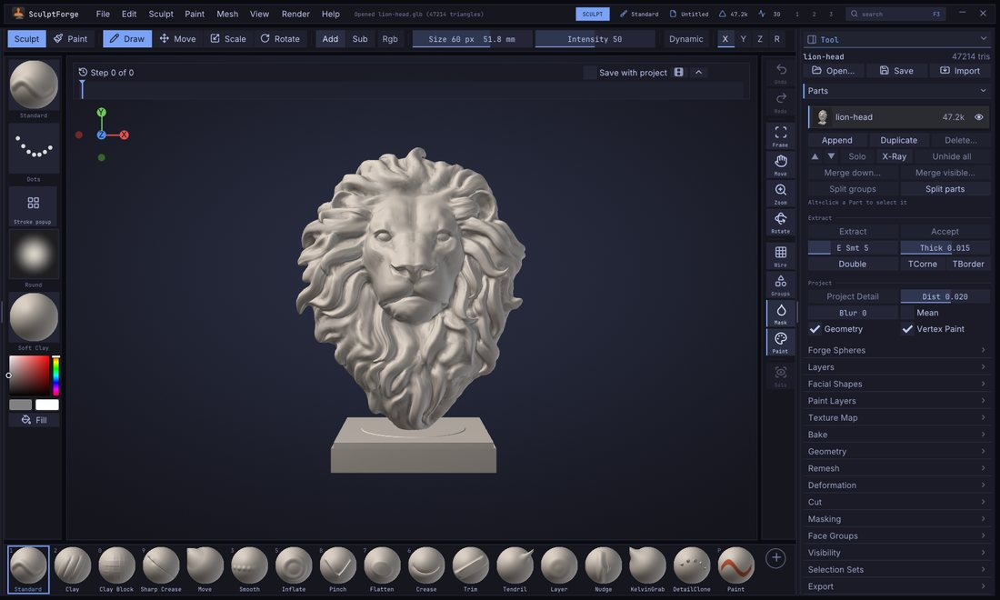

## Your first stroke

1. Pick a brush: click it on the **bottom shelf**, press its number key, or press <kbd>B</kbd> to open the
   brush picker.
2. Left-drag on the model. The brush works on the surface under the cursor.
3. Hold <kbd>Alt</kbd> while dragging to invert the brush (dig in instead of building up), or hold
   <kbd>Shift</kbd> to smooth.
4. Press <kbd>Ctrl</kbd>+<kbd>Z</kbd> to undo a stroke, <kbd>Ctrl</kbd>+<kbd>Shift</kbd>+<kbd>Z</kbd> (or
   <kbd>Ctrl</kbd>+<kbd>Y</kbd>) to redo it. Each Part keeps its own history of up to about 1 GB; the
   oldest steps are dropped beyond that.

Dragging on the background never sculpts: it rotates the view (see [Navigation](navigation.md)). The brush only
works on the active Part, and only on parts that are visible and not masked. A stroke that started on the model
keeps sculpting when it slides past the edge of a form seen in profile, as long as the brush circle still covers
the model: the brush holds on to the silhouette (#84).

## Built-in brushes

SculptForge has nineteen sculpting brushes plus the Paint brush. The first ten have number keys; all of them
are on the bottom shelf by default and in the brush picker.

| Brush | Key | What it does | With <kbd>Alt</kbd> |
|---|---|---|---|
| **Standard** | <kbd>1</kbd> | Raises the surface along the stroke, the all-purpose brush. | Digs in |
| **Clay** | <kbd>2</kbd> | Builds up clay that fills the hollows first, with a slightly flat top. Intensity and pen pressure set how fast it builds. | Carves away |
| **Smooth** | <kbd>3</kbd> | Relaxes the surface, evening out bumps. The same brush <kbd>Shift</kbd> gives you. | No change |
| **Move** | <kbd>4</kbd> | Grabs the surface under the cursor and pulls it along, parallel to the screen. | No change |
| **Inflate** | <kbd>5</kbd> | Swells the surface outward along its normals. | Deflates |
| **Crease** | <kbd>6</kbd> | Cuts a sharp crease and pinches its sides in. | Raises a ridge |
| **Flatten** | <kbd>7</kbd> | Presses the surface toward a plane through the brush area. | Pushes away from the plane |
| **Pinch** | <kbd>8</kbd> | Pulls the surface toward the stroke to tighten edges. | Spreads it apart |
| **Sharp Crease** | <kbd>9</kbd> | A narrow, deep V-shaped crease with the sides pinched in. | A sharp ridge |
| **Clay Block** | <kbd>0</kbd> | Square, flat-topped clay strokes for blocking in forms. | Carves flat-bottomed |
| **Tendril** | | Pulls the surface out into horns and tendrils that taper as you drag. | No change |
| **Trim** | | Trim: shaves away everything above a plane for hard surfaces. | Fills up to the plane |
| **Layer** | | Raises the surface to one fixed height per stroke; overlapping passes never stack. | Lowers to a fixed depth |
| **Nudge** | | Slides the surface sideways along the stroke without lifting it. | No change |
| **VDM** | | Stamps a vector displacement map, overhangs and all (see [below](#vector-displacement-brushes)). | Digs the shape in |
| **KelvinGrab** | | Elastic move: drags the surface like real clay, with no falloff edge (see [Kelvinlet brushes](#kelvinlet-brushes)). | No change |
| **KelvinTwist** | | Press and drag right to turn the surface clockwise around that point, left to turn it back. | Turns the other way |
| **KelvinScale** | | Press and drag left to pinch the surface toward that point, right to swell it. | The other way |
| **Elastic Tendril** | | An elastic Tendril: smooth horns and tendrils that taper as they stretch. | No change |
| **DetailClone** | | Paints copies of a captured detail (the VDM brush's map) along the stroke, each turned to follow it. | Digs them in |
| **Morph** | | Pulls the surface back toward the morph target, a selection set with its shape ([Selection sets](selection-sets.md#morph-targets)). Does nothing until you pick one. | Pushes away from it |
| **Cloth** | | Moves the surface like fabric: drag it and it folds where it bunches up (see [Cloth brush](#cloth-brush)). | Push mode: pulls out |
| **Paint** | <kbd>P</kbd> | Paints colour without sculpting. See [Vertex Paint and materials](vertex-paint.md). | Paints back to white |

Notes on particular brushes:

- **Move**, **Tendril** and the Kelvinlet brushes (except Detail Clone) move the surface with the cursor
  instead of placing dabs, so stroke types (Dots, Spray and so on) don't apply to them.
- **Layer** sets its height from the brush size and **Intensity**. Pen pressure lowers the height when
  **Pressure > Strength** is on, so you can feather the edge of a layer.
- **Trim** gives crisp planes on cylinders and edges. Use it with **Front** on when you work on thin shapes.

## Custom brushes that ship with SculptForge

Besides the built-in brushes, SculptForge ships seven custom brushes. They are *recipes*: data that you can
open and change in [Brush Lab](brush-lab.md). They appear in the **Custom** section of the brush picker and
in **Sculpt > Brush > Custom brushes**.

| Brush | What it does |
|---|---|
| **Wrinkle** | Fine, sharp creases for skin folds and fabric wrinkles. |
| **Palette Knife** | Flattens and drags clay sideways like a sculptor's knife. |
| **Dragon Scales** | Stamps rounded overlapping scales along the stroke. |
| **Stone Carve** | Scrapes hard planes and breaks them up with cracks for rocks and ruins. |
| **Skin Pores** | Sprinkles tiny pores for close-up skin detail. |
| **Clay Slab** | Builds up flat-topped strokes of clay for blocking in forms. |
| **Edge Wear** | Chips and softens only the sharp edges and ridges, for weathered props. |

Custom brushes respond to <kbd>Alt</kbd>, <kbd>Shift</kbd>, the mask, symmetry and the stroke settings just
like built-in ones. Their thumbnails carry a small sparkle when you put them on the bottom shelf.

## Pick a brush

You can choose a brush in several places:

- **Bottom shelf**: click a tile. The active brush is outlined in the accent colour and the number key is shown in the
  corner of each tile.
- **Number keys**: <kbd>1</kbd> to <kbd>9</kbd> and <kbd>0</kbd> pick the first ten built-in brushes (see the
  table above); <kbd>P</kbd> toggles the Paint brush.
- **Brush tile** at the top of the left shelf: click it to open the brush picker beside it.
- **Sculpt > Brush**: the same grid of thumbnails, with a filter field, plus your custom brush list.
- **Command palette** (<kbd>F3</kbd>): type the brush name and press <kbd>Enter</kbd>.

### The brush picker

Press <kbd>B</kbd> to open the brush picker under the mouse. It shows a **Recent** row (once you have picked
brushes), then **Built-in**, **Custom** and **Library** sections. The Library section lists `.sfbrush` files in
the `Brushes` folder of your Library library that aren't loaded yet; picking one loads it.

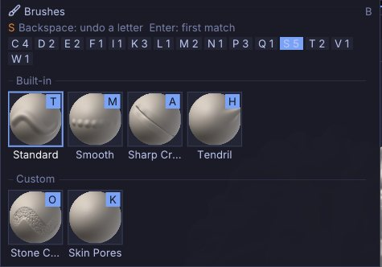

The picker works, by typing letters:

1. Press <kbd>B</kbd>.
2. Type the first letter of the brush. Only brushes starting with that letter stay, and each shows a highlighted
   key badge: the next letter that tells it apart from the others.
3. Press the letter on the badge to pick that brush. For example <kbd>B</kbd>, <kbd>S</kbd>, <kbd>T</kbd>
   picks Standard, and with the brushes that ship, <kbd>B</kbd>, <kbd>C</kbd>, <kbd>L</kbd>
   picks Clay.

If no brush name starts with what you typed, the picker falls back to names that *contain* it.
<kbd>Backspace</kbd> removes the last letter, <kbd>Enter</kbd> picks the first match, and <kbd>Esc</kbd> or a
click outside closes the picker. The letter chips along the top (A 2, C 4 ...) show how many brushes start
with each letter; click one to filter by it.

Hover a tile for a large preview and the brush's description. Right-click a tile for **Add to bottom shelf**,
and on custom brushes also **Copy brush code**, **Rename...**, **Save as .sfbrush...**, **Delete...** and
**Reveal in folder** (see [Brush Lab and sharing brushes](brush-lab.md)).

## Size, Intensity, Colour intensity and Falloff

These values control every brush. Size and Intensity are on the top shelf;
all four are in **Sculpt > Draw & Tablet** and the [Quick Menu](#the-quick-menu).

| Setting | Range | Default | How to change it |
|---|---|---|---|
| **Size** | 2 to 800 | 60 | Brush radius in screen pixels. <kbd>[</kbd> and <kbd>]</kbd> make it 10% smaller or larger (hold to repeat). <kbd>S</kbd> opens a slider at the cursor. |
| **Intensity** | 1 to 100 | 50 | How strongly each dab changes the surface. <kbd>U</kbd> opens a slider at the cursor. |
| **Colour intensity** | 1 to 100 | 100 | How strongly painting colours the surface (the Paint brush, and sculpting with Rgb on). <kbd>I</kbd> opens a slider at the cursor. |
| **Falloff** | -100 to 100 | 0 | The brush falloff. Below 0 the full-strength centre widens into a broad, hard tip; above 0 it narrows to a soft point. <kbd>O</kbd> opens a slider at the cursor. |

Because **Size** is measured on screen, the brush covers less of the model as you zoom in, which is what
you want for detail work.

The brush cursor shows two rings: the outer one is the Size, the inner one is Falloff
(where the brush works at half strength). Masking, painting, Move and Tendril follow Falloff too. Custom
brushes made in Brush Lab and Clay Block's square tip keep their own tip shape at 0 and shift it like the others.

With an [alpha](#alphas), Falloff works: the alpha is multiplied by the round falloff. At -100
the whole alpha shows, hard to its edges (a Square alpha stamps the full square); at 0 the falloff softens it and
rounds a square's corners; at +100 only a soft point in the middle is left.

Over the model, the rings lie on the surface: true circles in the plane of the surface under the pointer, at the
brush's real size there, with a short line pointing out of the surface. The plane follows the form averaged over
the whole brush, so the rings stay round and steady over fine bumps and detail. With symmetry on (mirror or
radial), a dot shows where each copy of the brush lands. Off the model the rings are flat circles.
**Edit > Preferences > Cursor**: **Cursor follows surface** (on by default) switches back to flat rings everywhere, and
**Hide ring while stroking** (off by default) shows only the dot while a stroke runs. The crosshair pointer stays
while you turn the view.

The <kbd>S</kbd>, <kbd>U</kbd>, <kbd>I</kbd> and <kbd>O</kbd> pop-ups take the mouse or the keyboard: drag the
slider and release to close it, or type a number and press <kbd>Enter</kbd> (a minus first for a negative Falloff). <kbd>Esc</kbd> closes the pop-up without typing anything new.

### Each brush keeps its own settings

Every brush remembers its own **Size**, **Intensity**, **Falloff**, **Colour intensity**, [stroke](#strokes)
and [alpha](#alphas). That includes custom and Community brushes. Set up a small, sharp crease brush and a big
Clay brush, and each one comes back the way you left it when you switch between them. A brush you haven't used
yet in the session starts from the values you have now, so nothing jumps.

- **Sculpt > Brush > Save Brush Settings** keeps the current brush's values for every new session (in
  `brush-settings.json`, in SculptForge's user data folder).
- **Sculpt > Brush > Reset Brush to Default** puts the current brush back to the values SculptForge ships with and
  forgets what you saved for it.
- **Edit > Preferences > Input > Share size and intensity across brushes** (off by default) keeps Size and
  Intensity the same for every brush, as before 0.10.8. Falloff, Colour intensity, the stroke and the alpha still
  follow each brush.

### Smooth's own Intensity

Smooth keeps an Intensity of its own, so a gentle Standard stroke at 10 still smooths at full
speed. Hold <kbd>Shift</kbd> (or pick the Smooth brush) and the Intensity slider shows **Smooth Intensity**:
change it there, or hold <kbd>Shift</kbd> and press <kbd>U</kbd>. It starts at 50.

### Smooth that keeps the volume

The plain smooth evens out bumps by pulling each point towards its neighbours, so with every pass the form
shrinks a little too: a cheek flattens, a sphere gets smaller. The other smooth keeps the volume: it removes the
bumps but leaves the form where it is (a Taubin smooth, one step in and a slightly larger one back out).

- **Alternate smooth**: start a stroke with <kbd>Shift</kbd> held, then let go of <kbd>Shift</kbd>
  while still pressing. The rest of the stroke uses the other smooth, and the status line says which.
- **Smooth keeps volume** in **Sculpt > Brush** makes the volume-keeping smooth the one <kbd>Shift</kbd> and
  the Smooth brush use; letting go of <kbd>Shift</kbd> mid-stroke then switches to the plain one. Saved with the
  project.

### Smooth face group borders

**Smooth face group borders only** in **Sculpt > Brush** turns Smooth (and <kbd>Shift</kbd>) into a border
straightener: only the points on a border between [face groups](face-groups.md) move, each along the surface
toward its neighbours on the border, so a jagged edge (a cuff, a collar, the hem of a shirt, a panel line) becomes
a clean line while the rest of the model stays where it is. Corners where three or more groups meet stay put.
Group the clothing first (for example **Group from Mask** after masking it), then brush over the edge. Saved with the
project (#81).

On a micro level (see [Micro levels](micro-levels.md)) Smooth is always the plain one for now. On a quad mesh
(after Quad Remesh, or an imported quad model) Smooth follows the quads' own edges, never their diagonals, so the
quads keep their shape (#69).

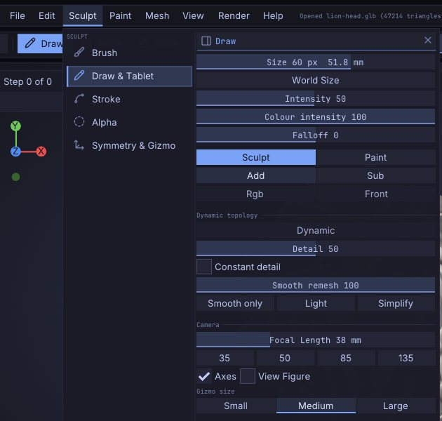

## Sculpt, Paint, Add, Sub, Rgb and Front

These toggles sit on the top shelf and in **Sculpt > Draw & Tablet**:

| Control | What it does |
|---|---|
| **Sculpt** / **Paint** | **Sculpt** makes brushes change the shape. **Paint** (<kbd>P</kbd>) paints colour only. |
| **Add** / **Sub** | **Add** makes brushes add (the default), **Sub** makes them subtract. <kbd>Alt</kbd> flips the current choice for one stroke. |
| **Rgb** | Sculpt brushes also paint the current colour as they sculpt. |
| **Front** | Front faces only: brushes leave the far side of thin parts alone, such as the back of an ear or a cape. |

**Sculpt > Brush** has the same Front and invert settings as the checkboxes **Front faces only** and
**Invert (Alt)**.

### Falloff options

Two more checkboxes in **Sculpt > Brush** change what a brush reaches, as Blender's proportional editing
does (from the discussions). Both work with every sculpt brush, recipes, VDM stamps, masking and vertex paint, and
are saved with the preferences and the project (custom brushes can turn them on for themselves in the Brush Lab):

| Option | What it does |
|---|---|
| **Connected only** | The brush only moves the surface joined to the point under the cursor, within the brush size. Inflate a finger and the next finger stays as it is; Move one leg and the other doesn't follow, however close they are. |
| **View falloff** | The falloff is measured on screen, across the view: everything inside the brush circle is reached, through the model and out the back, as a cylinder along the view. Add **Connected only** to keep it to the piece under the cursor. |

Kelvinlet brushes keep their own elastic falloff, and the Gizmo's falloff eases in from the mask's edge rather
than from a brush centre, so these options don't apply to them. On a 10-million-vertex Part a dab that moves half
a million vertices takes about 10 ms, and about 16 ms with Connected only.

## Modifier keys while sculpting

| Hold | Effect |
|---|---|
| <kbd>Alt</kbd> | Inverts the brush for this stroke (see the table of brushes). For Move, Tendril, Elastic Tendril and KelvinGrab, which have nothing to invert, it moves the surface along the normal instead (below). |
| <kbd>Shift</kbd> (before the stroke) | Smooths with the Smooth brush, whatever brush is active, at Smooth's own Intensity. With the Paint brush active, <kbd>Shift</kbd> still smooths the shape. |
| <kbd>Shift</kbd> (after the stroke started) | Draws a straight line from where you pressed <kbd>Shift</kbd>, snapped to 45 degree steps on screen. Let go of <kbd>Shift</kbd> to carry on freehand. |
| <kbd>Ctrl</kbd> | Paints a mask instead of sculpting; <kbd>Ctrl</kbd>+<kbd>Alt</kbd> erases it. A <kbd>Ctrl</kbd>+click without dragging blurs the mask (<kbd>Ctrl</kbd>+<kbd>Alt</kbd>+click sharpens it). See [Masking](masking.md). |
| <kbd>Ctrl</kbd>+<kbd>Shift</kbd> | Visibility gestures: isolate, hide and show face groups. See [Face Groups and visibility](face-groups.md). |

### Along the normal

Move, Tendril, Elastic Tendril and KelvinGrab normally move the surface across the screen. Hold <kbd>Alt</kbd> as
you start the stroke (<kbd>Ctrl</kbd> in the Blender and Maya styles, where that key inverts) and the surface moves
along the average normal under the brush where you pressed instead (from the discussions): drag out and it pulls
straight out of the surface, drag back and it pushes straight in, however the view is turned. When the normal
points right at you, drag up to pull it out. **Edit > Preferences > Input > Along the normal** can make it **Always**
(no key needed, handy with a pen) or **Never**.

## The Quick Menu

Press <kbd>Space</kbd> for the Quick Menu under the cursor: the Brush, Stroke, Alpha and Material tiles,
Size, Falloff, Intensity and Colour intensity, Add / Sub, Sculpt / Paint, Rgb and X symmetry. Hold
<kbd>Space</kbd> and let go to close it again (it stays while the pointer is on it), or tap <kbd>Space</kbd> to
keep it open until you click elsewhere or press <kbd>Esc</kbd>. Clicking a tile opens its picker.

A right click on the canvas opens it too: press the right button and let go without moving, beside
the model or on it, and the Quick Menu stays open at the cursor. A right drag still turns the view (and pans or
zooms with <kbd>Alt</kbd> or <kbd>Ctrl</kbd>), and a pen button set to **Right click** (Edit > Preferences > Tablet)
works the same way. Turn it off with **Edit > Preferences > Input > Right click opens the Quick Menu**.

## Radial menus

Radial (pie) menus put the tools you use most around the cursor. Hold a menu's key, flick the pointer toward an
item and let go: it runs. Let go in the middle and nothing happens. Tap the key instead and the pie stays open:
click an item, or click in the middle or press <kbd>Esc</kbd> to close it. Three menus are built in:

| Key | Menu | Items |
|---|---|---|
| <kbd>T</kbd> | **Brushes** | Standard, Clay Block, Move, Sharp Crease, Inflate, Pinch, Flatten, Tendril |
| <kbd>Y</kbd> | **Masking** | Invert Mask, Lasso Mask, Clear Mask, Rectangle Mask, Mask All, Mask Pen, View Mask, Group from Mask |
| <kbd>J</kbd> | **Strokes** | Dots, Drag Stamp, Slide Stamp, Spray, Lazy Stroke (see [Strokes](#strokes)) |

All three keys are free in every input style. Installs that stored their radial menus before 0.10.9 get the
Strokes menu from **Restore default menus** in Edit > Preferences > Input > Radial Menus.

Make your own in **Edit > Preferences > Input > Radial Menus** (up to 8 menus of 8 items each):

- **+** adds a menu and opens a search for its first item. An item can be anything the command palette
  (<kbd>F3</kbd>) finds: a brush, a tool, a command or a toggle.
- Click an item to give it your own **label** and **icon**, or **Change action**. The arrows reorder items (the
  first points up, the rest go clockwise); the cross removes one.
- **Key** sets the key that opens the menu (it is an ordinary shortcut, so **Edit > Preferences > Hotkeys** lists it
  too). The button next to it can also open the menu while held: the middle, right, back or forward mouse button,
  or one of the pen's side buttons. That button then stops doing what it did before (a pen button's
  Edit > Preferences > Tablet mapping, the middle button's pan, the right button's turn). A mouse button opens the menu
  only with no modifier key held (#74): <kbd>Alt</kbd>+middle still pans, <kbd>Alt</kbd>+right still zooms in the
  Maya style, and <kbd>Shift</kbd>+right-drag still turns the view, so a menu on the right button never leaves you
  without a way to turn it (the panel says how).
- **Export...** saves the menu as a small `.json` file to share; **Import...** loads one. A menu file holds only
  action names, never anything that runs: names this version doesn't know are left out.
- **Restore default menus** brings back Brushes and Masking.

Your menus save themselves.

## Whole-Part deformations

**Tool > Reshape** reads top to bottom: **Size**, then the **Stack**, the one place for every whole-Part operation
(**Mirror** is in **Tool > Geometry > Symmetry**). Four of its steps (the **Surface** group) work on the surface
itself (from the discussions). The mask holds what it covers (partly masked areas move partly), hidden faces and
open borders stay where they are:

| Operation | What it does |
|---|---|
| **Smooth** | Smooths everything; with the step's **Keep volume** it doesn't shrink the form. |
| **Relax** | Evens out the spacing of the vertices along the surface without changing its shape, for areas a big Move or Tendril stretched. |
| **Polish** | Flattens fine noise and small bumps while flat areas and sharp edges stay sharp: a scan's grain, or the ripples a voxel remesh leaves on a hard-surface piece. |
| **Balloon** | Fills the form out toward a rounder volume, like blowing into it. A negative amount lets the air out. |

Add one with **Add step > Surface** and set its amount on the step. They are commands too: `deform_smooth amount=30
keep_volume=true`, `deform_relax`, `deform_polish amount=60`, `deform_balloon amount=-20` (add `masked=false` to
ignore the mask); from a menu, a key or the command palette, **Smooth**, **Relax**, **Polish** and **Balloon** run
once at amount 50. On a 10-million-vertex Part at amount 50,
Smooth takes about 0.5 s, Balloon 0.7 s, Relax 0.9 s and Polish 2 s (Apple M1 Pro).

### Size

**Tool > Reshape > Size** shows the active Part's width (**X**), height (**Y**) and depth (**Z**) in scene
units (requested by foirgairwolf on Discord). Drag one, or double-click it and type an exact value: the Part resizes about its
centre as one undo step. With **Uniform** on (the default) the other sides follow in proportion; off, only that side
changes. The mask holds what it covers. Command: `deform_size x=2.5` (any of `x`, `y`, `z`), or `deform_size
uniform=10` for the largest side.

### Deformation stack

**Tool > Reshape > Stack** shapes the whole Part with a list of steps (requested by foirgairwolf on Discord). **Add step**
picks one; click a step to set its amount, its axes (**X Y Z**, any mix) and, where it applies, **Direction** and
**Soft**. With **Preview** on, the Part follows each change (on very heavy Parts, when you let go of the slider).

| Group | Step | What it does along the chosen axis |
|---|---|---|
| Transform | **Move** | Moves the Part by a percent of its half-size. |
| | **Turn** | Turns it by degrees about the axis (several axes: X, then Y, then Z). |
| | **Scale** | 100 doubles it, -100 halves it, on the chosen axes only. |
| | **Squash** | Shorter along the axis and wider across it, keeping the volume (negative: taller and thinner). |
| Bend & Twist | **Bend** | Curves it end to end by degrees toward **Direction** (0 = toward +Y, +X for the Y axis). |
| | **Twist** | Turns one end against the other by degrees. |
| | **Taper** | The + end wider and the - end narrower (negative: the other way). |
| | **Shear** | Leans it toward **Direction**; 100 is 45 degrees. |
| Shape | **Round** | Toward a sphere; with one axis left out, toward a cylinder about it. |
| | **Box** | Toward a cube (or a square bar). |
| | **Flatten** | Cuts the + side flat by a percent of the depth (negative: the - side). |
| | **Sag** | Parts far from the axis droop down it, like a weight on outstretched arms (negative lifts). |
| | **Depth** | A perspective: the + end wider, the - end narrower, more toward the ends. |
| Surface | **Polish**, **Relax**, **Smooth** (**Keep volume**), **Balloon** | See [Whole-Part deformations](#whole-part-deformations). |

**Soft** eases Bend, Twist, Taper and Shear toward the ends (a bend that curves most in the middle) and rounds
Flatten's cut. Steps work about the Part's centre, or about the gizmo's pivot when you placed it.

The checkbox beside a step switches it off without losing it; **Repeat** adds the selected step again; **Remove**
takes it out. **Apply** keeps the result (one undo step) and starts a new stack, **Apply Selected** keeps only
the selected step, and **Reset** takes the preview back off. The mask holds what it covers and hidden faces stay.
For scripts and the AI: `deform_stack ops="bend 45 y soft; twist 90 y; taper -30 y"`, or one step at a time with
`deform_bend amount=45 axes=y soft=true direction=90`.

## Strokes

The stroke type decides how cursor movement becomes brush dabs. Choose it from the **Stroke** tile on the left
shelf, which opens the stroke picker, or from **Sculpt > Stroke**.

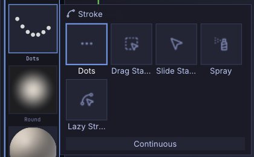

| Stroke | What it does | Setting |
|---|---|---|
| **Dots** | Even dabs along the path: the classic brush stroke (default). | None; spacing comes from the brush. |
| **Drag Stamp** | Click and drag one stamp: the drag length sets its size and its direction the rotation. Great with alphas. | None |
| **Slide Stamp** | Click and drag one stamp of the brush's Size: it slides over the surface under the cursor and lands where you let go. Great for VDMs. | None |
| **Spray** | Scattered dabs of random size, strength and rotation, for organic texture. | **Scatter** (0 to 2, default 1): how far dabs land from the cursor, as a fraction of the brush size. |
| **Lazy Stroke** | Dots with **Steady Stroke** on: the brush trails the cursor on a string, for smooth, steady lines. | **Steady radius** (1 to 300 px, default 40): longer is steadier. |

**Scatter** appears under the stroke tiles when **Spray** is selected. **Steady Stroke** works with every stroke
type; see [Precision work](#precision-work).

**Continuous**, under the stroke tiles in the stroke picker and in **Sculpt > Stroke**, keeps the brush working
while you hold it still on the model (30 dabs a second), with any stroke type.

Notes:

- With **Drag Stamp**, the stamp is placed where you first click. While you drag, it is redrawn at the new size
  and angle, and it is committed when you release.
- With **Slide Stamp**, the stamp appears under the cursor at once and follows it while you drag; the mesh under it
  goes back to how it was as it moves on. Hold <kbd>Shift</kbd> after the drag has begun and the stamp stays put while
  its alpha turns toward the cursor; let go and it slides on with that turn. The turn belongs to that stroke and
  leaves the brush's **Angle** alone. Held at the press, <kbd>Shift</kbd> still smooths. The key is
  **Edit > Preferences > Input > Slide Stamp rotates with** (Shift, Ctrl, Alt or Off).
- Mask strokes (<kbd>Ctrl</kbd>) always use dots, even when Drag Stamp or Slide Stamp is selected.
- Custom brushes set their own dab spacing and can add jitter (see [Brush Lab](brush-lab.md)).

### The stroke popup

Press <kbd>G</kbd> (<kbd>Z</kbd> in the Blender style) for a grid under the cursor, or click the grid button under
the **Stroke** tile on the left shelf. The top row holds the stroke types, then come the modifiers and the shapes:

| Modifier | What it does | Instead of holding |
|---|---|---|
| **Add** / **Sub** | Brushes add to or subtract from the surface (the same switch as Add / Sub on the top shelf). | <kbd>Alt</kbd> |
| **Smooth** | Strokes smooth. | <kbd>Shift</kbd> |
| **Mask** | Strokes paint the mask (<kbd>Alt</kbd> or <kbd>Ctrl</kbd> unmasks). | <kbd>Ctrl</kbd> |
| **Select** | Strokes draw the selection (hide) shape. | <kbd>Ctrl</kbd>+<kbd>Shift</kbd> |

**Shapes** pick how Mask and Select draw: **Mask Pen**, **Lasso Mask** and **Rectangle Mask** turn Mask on with that
shape, **Cut Line**, **Cut Lasso**, **Cut Rect** and **Cut Polyline** turn Select on with that Cut shape. A plain drag
then masks or cuts with it, no keys held (with a mask shape, <kbd>Ctrl</kbd>+drag unmasks; **Tool > Cut** still sets
Away, In, Add or Clip). The label next to the brush cursor names the shape. Pick it again to go back to sculpting.

- **Hold and let go**: hold <kbd>G</kbd>, move over an item and let go. It opens with your current stroke under the
  pointer, so letting go without moving changes nothing. A pen hovering over the tablet works the same.
- **Tap and click**: tap <kbd>G</kbd> and the grid stays open. Click a stroke to pick it (the grid closes); click a
  modifier to switch it (the grid stays open, so you can set a stroke too). <kbd>Esc</kbd> or a click beside the
  grid closes it. The click never touches the model.
- **Smooth, Mask and Select stay on** until you pick the same one again or pick another brush. A small label next
  to the brush cursor shows which one is on. Dragging beside the model still turns the view.
- The **Strokes** radial menu (<kbd>J</kbd>, see [Radial menus](#radial-menus)) picks a stroke type too; the popup
  adds the modifiers and shows every choice at once.
- Change the key in **Edit > Preferences > Hotkeys** (*Stroke popup*), or hold <kbd>Ctrl</kbd>+<kbd>Alt</kbd> and click the shelf button, then press the new key.

## Precision work

Pores, wrinkles, jewellery and hard-surface trims need a brush that goes exactly where you mean, at exactly the
size you mean. These tools work with every brush and every stroke type.

**Steady Stroke** (<kbd>L</kbd>, or the checkbox in the stroke picker). The brush trails the cursor on a string
and only moves once the string is taut, so hand shake never reaches the surface. It works with Dots, Drag Stamp,
Slide Stamp and Spray. The viewport draws the string and a faint circle of its length. **Steady radius** sets the
length (longer is steadier). **Catch up on release** (on by default) finishes the line to where the cursor is when
you let go; turn it off to end the line a string's length behind.

**World Size** (**Sculpt > Draw & Tablet**). Size is normally in screen pixels, so the brush gets smaller on the model
as you zoom in. With World Size on, the size is kept in model units instead: a 0.4 mm pore brush stays 0.4 mm
whether you are looking at the whole head or one eyelid. Every Size slider shows both numbers, for example
**Size 12 px 0.40 mm**; the mm figure is the brush radius on the surface under the cursor (a model unit is a
metre, as when exporting for 3D printing).

**Finer size control.**

| Do this | Change |
|---|---|
| <kbd>[</kbd> / <kbd>]</kbd> | 10% smaller / larger |
| <kbd>Shift</kbd>+<kbd>[</kbd> / <kbd>Shift</kbd>+<kbd>]</kbd> | 1 px smaller / larger (0.5 px below 2 px) |
| <kbd>Ctrl</kbd>+<kbd>Shift</kbd>+right-drag | Scrub the size finely: 100 px to the right is about 1.5 times larger |

Size goes down to 0.5 px. Small brushes space their dabs closer together, so a 1 px stroke is still one
continuous line, and the cursor adds a small cross so you can see where a tiny brush is. The size, in px and mm,
shows next to the cursor for a moment after it changes (all the time with World Size on).

**Precision drag** (<kbd>Shift</kbd>+<kbd>Alt</kbd>, held while drawing). Start the stroke, then hold
<kbd>Shift</kbd>+<kbd>Alt</kbd>: the brush moves at a quarter of the pen's speed, drawn as a blue ring with a line
back to the pen, and works at **Precision Intensity** (stroke picker, default 10). Let go and the brush glides back
under the pen as you keep moving; it never jumps. Hold the keys after the stroke has started: at the press,
<kbd>Shift</kbd>+<kbd>Alt</kbd> still selects and frames a Part, and in the Blender
style <kbd>Alt</kbd>+click still navigates. The same works in every input style.

**A pressure curve for each brush.** Every brush keeps its own pen pressure curve, applied after the tablet's
curve. Edit it in **Brush Lab** (under the recipe sliders) or in **Edit > Preferences > Tablet** (under the tablet's
curve); both edit the brush you are holding. Drag a point, double-click the curve to add one (up to 5), right-click
a point to remove it. The presets are **Soft**, **Linear**, **Firm** and **Fine detail**: Fine detail keeps light
pressure very light and tops out below full strength, for pores and fine lines. Curves are saved as you change
them.

**Accuracy.** The brush centre sits exactly under the cursor at any zoom and on HiDPI screens (to a fraction of a
pixel), and the surface point under the brush is lightly filtered, so strokes on very dense meshes don't wobble
with every tiny bump. A real step in the surface is followed at once.

## Alphas

An alpha is a grayscale stamp that shapes the brush tip: white is full effect, black is none. It affects every
brush, built-in or custom. Choose one from the **Alpha** tile on the left shelf (the alpha picker) or the
**Sculpt > Alpha**, which also shows a large preview of the current alpha.
[Falloff](#size-intensity-colour-intensity-and-falloff) fades it: set it to -100 to
stamp the whole alpha (a crisp square, or a pattern out to its edges), 0 for a soft round fade, +100 for a soft
point. Alphas work on [micro levels](micro-levels.md) too, with every stroke type including Drag Stamp.

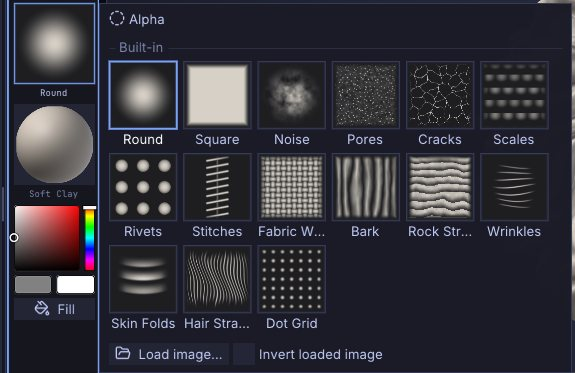

| Alpha | What it does |
|---|---|
| **Round** | The plain round falloff (no alpha). The default. |
| **Square** | A square stamp with soft edges. |
| **Noise** | A noisy stamp for rough, organic texture. |
| **Pores** | Scattered skin pores of mixed sizes (use with Sub to press them in). |
| **Cracks** | A web of thin cracks, as in dry earth, old paint or stone. |
| **Scales** | Overlapping rounded scales in offset rows, for reptiles and fish. |
| **Rivets** | A three by three grid of round rivet heads, for armour and machines. |
| **Stitches** | A seam with cross stitches along it (drag along the seam with Drag Stamp or a stroke). |
| **Fabric Weave** | Threads woven over and under, for cloth and canvas. |
| **Bark** | Rough vertical ridges and furrows, as on tree bark. |
| **Rock Strata** | Stepped layers of rock, wavy and broken, for cliffs and stone. |
| **Wrinkles** | Fine parallel wrinkle lines, for skin around eyes, knuckles and necks. |
| **Skin Folds** | Soft, broad folds of skin, for bellies, elbows and heavy brows. |
| **Hair Strands** | Long flowing strands, for hair, fur and feathers (drag along the flow). |
| **Dot Grid** | An even grid of soft dots, for studs, textures and patterns. |

All of them are made by SculptForge itself the first time they're needed (no image files are downloaded or
shipped). They show in the alpha picker and in the Library's **Alpha** tab (`brush_set_alpha name=cracks`).

To use your own image:

1. Click **Load image...** in the alpha picker or **Sculpt > Alpha**.
2. Choose a PNG, JPG, BMP, TGA, PSD or GIF. Colour images are converted to grayscale.
3. Turn on **Invert loaded image** *before* loading if your image is white where it should have no effect.

Images you keep in the `Alphas` folder of your Library library (Documents/SculptForge/Alphas by default)
appear in the picker's **Images** section, so you can switch between them with one click. The alpha's top edge
points up the screen; with **Drag Stamp** it follows the drag direction instead.

From a script: `brush_set_alpha name=square`, or `brush_set_alpha path=bark.png invert=true`.

### Alpha options

Under the preview in **Sculpt > Alpha**:

| Option | What it does |
|---|---|
| **Follow stroke direction** | The alpha turns with the stroke, its top pointing the way you draw: scales, stitches and hair line up along the stroke. Small wobbles are smoothed out, as with Blender's Rake: the direction is taken again each time the cursor has gone 20 pixels. |
| **Angle** | Turns the alpha by a fixed angle (-180 to 180 degrees, counter-clockwise), on its own or on top of the stroke's direction. |
| **Angle jitter** | Turns each dab by a random angle, up to this many degrees either way, to break up repeats. |
| **Scale jitter** | Makes each dab bigger or smaller by a random amount, up to this many percent either way (0 to 90). |
| **Position jitter** | Moves each dab off the cursor by a random amount, up to this many percent of the brush radius (0 to 100), along the surface. |
| **Tile across** / **Tile down** | Repeats the alpha 1 to 8 times across and down inside the brush; the preview shows the result. |

They work with every brush, custom and Community brushes included, and each brush keeps its own (see
[Each brush keeps its own settings](#each-brush-keeps-its-own-settings)). **Save Brush Settings** on a custom brush
also writes Follow stroke direction, Angle and Angle jitter into its brush file, so a brush you share (a brush code,
a .sfpack) turns its alpha the same way for everyone. Vector displacement stamps have the same options: see
[Stamp rotation](#stamp-rotation). From a script:
`brush_alpha_options follow_stroke=true angle=30 angle_jitter=10 scale_jitter=20 position_jitter=30 tile_x=2 tile_y=2`.
Scale and Position jitter are for the dots strokes; a Drag Stamp keeps the size and place you give it.

### Alpha pool

An **alpha pool** makes each dab draw with a different alpha, picked at random from a set: planks, pores or chips
that never repeat. Together with Angle, Scale and Position jitter, a long stroke looks like many separate stamps.

1. Put your images in a sub-folder of the Library's `Alphas` folder (for example `Alphas/Planks`); any PNG, JPG, BMP or
   TGA works, and the **Alpha** tab shows the sub-folder as its own tile.
2. In **Library > Alpha**, right-click the folder and choose **Use folder as alpha pool** (up to 32 images, taken
   A-Z). Or right-click single alphas, in the Library or the alpha list, and choose **Add to alpha pool**.
3. **Sculpt > Alpha** shows *Alpha pool: N* with a **Clear** button. Stroke as usual; a **Drag Stamp** takes one alpha
   per stamp.

A stroke repeats the same way when it is played back, and each new stroke picks a different order. The pool is kept
until you quit and is not part of a brush or a project; Tile does not apply to pool alphas. Images are used at up to
512 px. From a script: `brush_alpha_pool folder=...`, `brush_alpha_pool name=...`, `brush_alpha_pool path=...`,
`brush_alpha_pool clear=true`.

**Procedural wood grains.** Three alphas made in code come with the app: **Procedural Wood Straight**, **Procedural
Wood Cathedral** and **Procedural Wood Weathered**. They are not scans and say so; they stand in until you have real
scans of your own planks (scan or photograph boards you own, or use images you have the licence to use).

### Stencil

A **Stencil** is an image laid over the view that you sculpt and paint *through*: wherever it covers the model, a
stroke takes its detail (the sculpt brushes its brightness, white = full effect, as an alpha; Vertex Paint its
colours). Off the image nothing happens. It stays put on the screen while the model turns under it, so you place it,
stroke over it, turn the model or move the stencil, and stroke again.

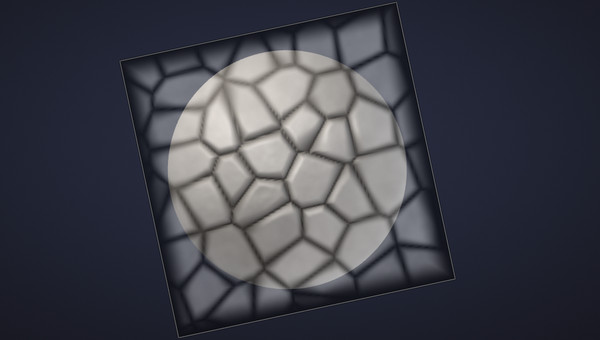

1. In **Sculpt > Alpha**, under **Stencil**, click **Load image...** (any PNG, JPG, BMP, TGA, PSD or GIF), or
   **Use alpha** to make the brush's alpha (a built-in pattern or one from your Library) the stencil.
2. Turn on **Adjust**: drag inside the stencil to move it, a corner to scale it, the round handle above it to turn it
   (<kbd>Shift</kbd>: 15 degree steps). The arrow keys move it, <kbd>-</kbd> and <kbd>=</kbd> scale it,
   <kbd>,</kbd> and <kbd>.</kbd> turn it (<kbd>Shift</kbd>: finely). <kbd>Enter</kbd> or <kbd>Esc</kbd> goes back to
   sculpting.
3. Stroke over it with any brush that takes an alpha: the built-in sculpt brushes, custom and Community brushes and
   the Paint brush. The brush's own falloff, Intensity, mask and alpha still apply on top.

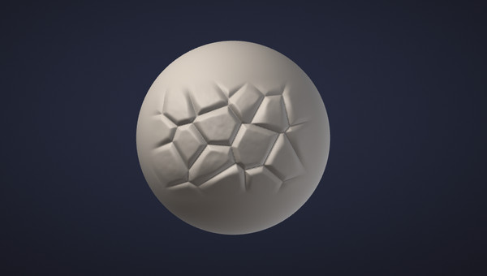

| Option | What it does |
|---|---|
| **Show** | Hidden, the stencil is off and brushes work as if it weren't there. |
| **Invert** | Uses the image's negative: black works, white leaves the surface alone. |
| **Tile** | Repeats the image across the whole view, for skin, fabric and other patterns. |
| **Paint its colours** | Vertex Paint lays the image's own colours; off, its brightness masks the paint colour. |
| **Hide while navigating** | Fades the stencil while the view turns, moves or zooms, so you see the model under it. |
| **Opacity** | How strongly the overlay shows. The brushes always take the whole image (use Intensity to go lighter). |
| **Size** / **Angle** | Its height in percent of the view's, and its turn; **Reset placement** centres it again. |

With symmetry on, the mirrored side gets the stencil mirrored, as the stroke is. Stencils work on
[micro levels](micro-levels.md) too. Move, the Kelvinlet brushes, vector displacement stamps and the mask brush don't
use it. Texture painting doesn't take it yet (Vertex Paint does). The stencil isn't saved with the project. From a
script: `stencil_load path=skin.png`, `stencil_set x=0.5 y=0.5 size=0.8 angle=30 tile=true`, `stencil_clear`.

## Vector displacement brushes

A vector displacement brush stamps a whole 3D shape in one
click: a horn, an ear, a cluster of scales, a nostril. An alpha can only push the surface up or down; a vector
displacement map (VDM) moves every point of the stamp in any direction, so the shape can lean over, curl and
overhang, as nothing made with a height ever can.

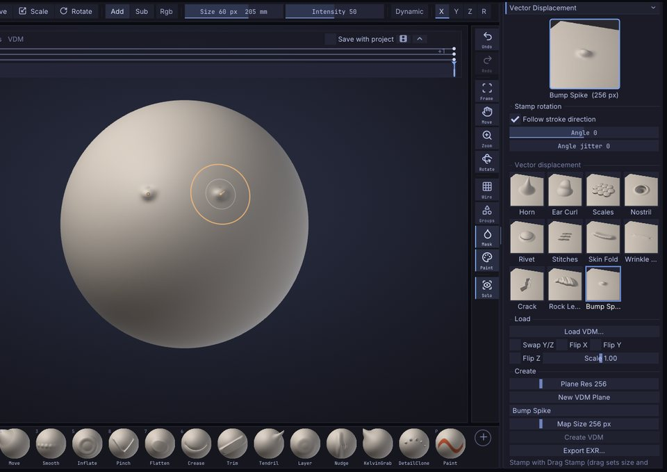

### Stamp a VDM

1. Open **Sculpt > Brush** and its **Vector Displacement** section, and click a map: **Horn**, **Ear Curl**,
   **Scales**, **Nostril**, **Rivet** (a domed head whose rim overhangs), **Stitches** (thread bars across a seam,
   drawing it together), **Skin Fold** (a roll of skin hanging over a crease), **Wrinkle Line** (a fine pinched
   crease), **Crack** (a jagged split whose sides part) or **Rock Ledge** (a stepped shelf jutting out over the
   layer below). They're also in the Library's **Brush** tab. The **VDM** brush becomes the brush and the stroke becomes **Drag Stamp**. (While the
   VDM brush is the brush, the Alpha tile on the left shelf shows its map, and the alpha picker lists the maps
   first. The VDM brush is also in the brush picker: <kbd>B</kbd> <kbd>V</kbd> <kbd>D</kbd>.)
2. Click on the model where the stamp should sit and drag: the drag's length sets the size and its direction
   points the top of the map, so a horn leans the way you drag. Let go to keep it.

- **Slide Stamp** stamps at the brush size instead and slides the stamp under the cursor until you let go.
- **Intensity 50** (the default) presses the map at its own shape; 100 doubles it, lower values flatten it.
- **Alt** digs the shape in: the sideways motion stays and the height flips (a horn becomes a curved hole, a
  nostril a bump). Blender's VDM brushes invert the same way.
- **Symmetry** mirrors the stamp exactly (the mirrored horn leans the mirrored way), the **mask** holds it back,
  and each stamp is one undo step. Sculpt layers record it like any stroke.
- The **Dots** stroke works too: each dab adds the shape again, for rows of studs or scales.

### Stamp rotation

While the VDM brush is the brush, **Stamp rotation** sits under the map's preview, with the same three options as
[Alpha options](#alpha-options):

| Option | What it does |
|---|---|
| **Follow stroke direction** | On (the default): Drag Stamp turns the stamp with the drag, and a Dots stroke turns it along the stroke. Off: the drag only sets the size, and every stamp keeps Angle's turn (horns that all stand the same way however you drag). |
| **Angle** | A fixed turn, -180 to 180 degrees counter-clockwise, on its own or on top of the drag's direction. Slide Stamp takes it too (it slides the stamp without turning it). |
| **Angle jitter** | Each stamp turns by a random angle, up to this many degrees either way: scattered horns, rivets or scales that don't all face the same way. |

The VDM brush keeps its own, separate from the alpha brushes'; **Save Brush Settings** keeps them for next time,
and a custom brush saves them in its brush file, so they travel in brush codes and [packs](packs-and-macros.md). From a
script: `brush_alpha_options follow_stroke=false angle=45 angle_jitter=20`.

> **Tip:** a VDM moves points sideways, so it needs points to move: on a coarse mesh the shape breaks up into
> spikes. Add levels first (the model above has 330 000 triangles), and stamp at the highest
> [subdivision level](subdivision-levels.md); stepping down and back up keeps the stamp. Use Front faces only
> on thin parts so the stamp doesn't reach through to the other side.

### Make your own VDM

1. In **Sculpt > Brush > Vector Displacement**, click **New VDM Plane**. A flat 2 x 2 grid appears as a new Part,
   seen from the top, with its border masked (so the stamp blends into any surface); the other Parts are
   hidden. **Plane Res** sets how many quads it has (256 by default).
2. Sculpt the shape with any brush: overhangs are welcome (Move, Tendril, Inflate). Add levels to the plane for finer
   detail. Keep the border flat.
3. Type a name, choose the **Map Size** (256 pixels holds most shapes, 512 fine detail) and click **Create VDM**.
   The new map is saved in your brush library, shows in the list and becomes the VDM brush's map.
4. Show your model again in the [Part](parts.md) palette (its eye) and stamp away.

The top of the screen when you look at the plane from the top is the top of the map: the side a Drag Stamp drag
points to. The plane's UVs record where each point started, so what Create VDM captures is how far each point
moved, sideways and up.

### Load and export maps

**Load VDM...** reads an OpenEXR (16- or 32-bit, any compression) or a `.sfvdm`; dropping an `.exr` on the window
does the same. A loaded EXR is kept in your brush library as a `.sfvdm`, so it's there next time. **Export
EXR...** writes the brush's map as a 32-bit float EXR. Right-click a map you made or loaded to delete it.

Maps use the convention of Blender's **VDM Brush Baker** and its Draw brush with *Vector Displacement*:

| Channel | Means |
|---|---|
| R | X: toward the stamp's right |
| G | Y: toward the stamp's top (the image's top row; the drag direction of Drag Stamp) |
| B | Z: out of the surface |
| Units | brush radii: (0, 0, 0.5) lifts the surface by half the radius; the map covers the brush's square |

So maps from Blender's VDM Brush Baker load as they are, and exported maps work in Blender: add an image texture
with the EXR (Color Space: Non-Color) to a Draw brush, set the texture's **Mapping** to **Area Plane**, turn on
**Vector Displacement** in the brush's Texture panel, and use the **Anchored** stroke at Strength 1 (see
[Working with Blender](blender.md#vector-displacement-maps)). Blender's brush touches only the round area of the
brush, so the corners of a map are cut off there; in SculptForge the whole square stamps.

Maps made in other applications may use other axes. If a map stamps lying on its side, load it again with **Swap Y/Z**; if it is mirrored or leans
the wrong way, with **Flip X** or **Flip Y** (**Flip Z** for a map that digs in where it should rise). **Scale**
multiplies a map made in other units.

From a script: `vdm_set name=horn` or `vdm_set path=ear.exr swap_yz=true`, `vdm_stamp point=0,0.5,0 radius=0.3
angle=30`, `vdm_new_plane`, `vdm_capture name="My horn" exr=horn.exr`, `vdm_export path=horn.exr`, `vdm_list`,
`vdm_delete name="My horn"`.

## Kelvinlet brushes

**KelvinGrab**, **KelvinTwist**, **KelvinScale** and **Elastic Tendril** move the surface the way an elastic solid
moves when you push, twist or squeeze it. Each is the exact solution of the equations of elasticity for a
softened point load (the "regularized Kelvinlets" of de Goes and James, SIGGRAPH 2017), so the surface follows
your hand like clay: there is no falloff edge to see, the deformation fades smoothly over about twice the brush
radius, and the material around it reacts the way real material does.

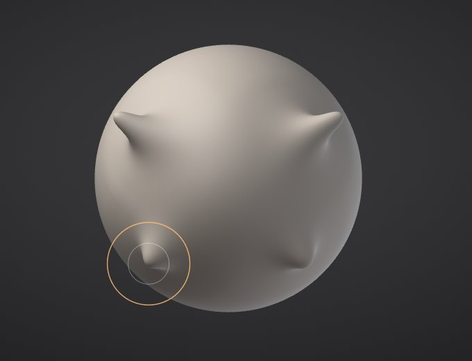

- **KelvinGrab** works like Move: press on the model and drag; the point under the cursor goes where the cursor
  goes and the surface around it follows elastically.
- **KelvinTwist** turns the surface around where you pressed, about the view direction. Drag right to turn
  clockwise, left to turn back; the turn is strongest at the centre and fades out, and every ring keeps its
  shape (a true rotation), so twisted shapes keep their volume. Good for twisting horns, tentacles, folds of cloth
  and spiral shells.
- **KelvinScale** pinches (drag left) or swells (drag right) the surface toward or away from where you pressed.
  It never folds the surface through the centre, however hard you pinch.
- **Elastic Tendril** pulls horns, tentacles and spikes out along the stroke like Tendril, but its pull narrows as it
  travels, so shapes taper to a tip by themselves.

Their settings are in **Sculpt > Brush > Kelvinlet & Capture**:

- **Squash** (0-100) is how the material keeps its volume (its Poisson's ratio). At 0 it's rubbery: pulling it
  just stretches it. At 100 it's incompressible clay: pressing in makes the surface bulge up around your thumb and
  pulling out draws the sides in, as clay does. 50 is the default.
- **Sharpness** gives the brush a tighter, more pointed peak at its centre while keeping its soft reach, for
  pulling out points and tips.

**Intensity** sets how strongly the surface follows (50 and above: the grabbed point follows the cursor
exactly), pen pressure scales it, and like every brush they respect symmetry, the mask, hidden parts and sculpt
layers, and each stroke is one undo step. They don't remesh with dynamic topology on (like Move).

> **How it stays fast:** a Kelvinlet's influence never quite reaches zero, so each move works out how far its
> effect is still more than 4% of its largest (about twice the brush radius) and only touches the points inside
> that distance, fading the last part smoothly to nothing. A fast drag between two frames is worked out in small
> pieces in one pass. Because it reaches further than Move, it costs more: on models of 20 million triangles and
> up, keep the brush small or step down a subdivision level for big elastic moves (see
> [Performance](performance.md)).

## Cloth brush

The **Cloth** brush treats the surface near the stroke as fabric. Drag across a sleeve or a sheet and the
cloth follows the brush, bunching into folds on the side you push toward; the folds keep the fabric's length
instead of stretching it like rubber. Only the surface within a few brush radii of the stroke moves, and masked
areas hold still like pins, so mask a seam or a cuff to keep it in place.

Set it up in **Sculpt > Brush > Cloth**:

- **Mode**: **Drag** (the cloth follows the stroke), **Push** (presses it in along the surface; <kbd>Alt</kbd>
  pulls it out, and the cloth around follows), **Settle** (only gravity: the cloth under the brush sags and drapes
  over what's below), **Grab** (the cloth where the stroke starts is held and follows the brush; the cloth around it
  trails and folds), **Expand** and **Pinch** (spread the cloth out from the brush centre or gather it in;
  <kbd>Alt</kbd> swaps them), **Inflate** (adds fabric under the brush, so it balloons out and wrinkles where it
  can't; <kbd>Alt</kbd> takes fabric away).
- **Fabric**: **Silk** makes many fine folds, **Cotton** medium ones, **Denim** broad ones, **Leather** a few wide,
  stiff ones.
- **Gravity**: pulls the cloth down while you drag, so folds hang (0 keeps it in place).
- **Reach**: how far around the brush the cloth is simulated, in brush radii. More lets folds travel further.
- **Steps**: simulation steps per dab. More is softer and settles further, but slower.
- **Soft body**: 0 leaves the cloth where the brush puts it. Higher values make it spring back toward its shape
  at the start of the stroke, like a stuffed or elastic surface.
- **Self-collision** (on by default): folds push against each other instead of passing through.
- **Collide with other Parts**: the cloth rests on the other visible Parts instead of passing through them, so a
  shirt Part settles onto the body Part under it.

The Cloth brush works with symmetry and sculpt layers, and one stroke is one undo step. It doesn't apply to micro
levels.

## Drape

**Drape** drops a whole Part as cloth: it falls under gravity onto the other visible Parts and settles there, the
way a sheet settles over a chair or a shirt over a body. Make the cloth Part (a plane, an extracted shell, a
garment you sculpted roughly), place it above the body, and with it active open **Tool > Drape**:

- **Fabric**: **Silk** flows into many fine folds, **Cotton** medium ones, **Denim** holds broad folds,
  **Leather** barely folds.
- **Units per metre**: how big the sculpt is in real life. Cloth falls by real size, so a sculpt modelled at real
  size (a SculptForge unit is a metre) uses 1; a body 2 units tall that should be a 1.8 m person uses 1.11.
- **Pins from mask**: masked areas hold still, like pins: mask a waistband or a collar to hang the cloth from it.
- **Collide with other Parts**: the cloth rests on the other visible Parts (hide a Part to let the cloth fall
  through it).

**Simulate** shows the cloth moving live. When it comes to rest the result is kept as one undo step;
**Pause** / **Resume** stop and continue, **Keep** stops and keeps where it got to, **Reset** puts the Part back.
Sculpting or running a command while it moves keeps where it got to first. The result is a normal Part: sculpt it,
or give it thickness with Extract. From a script: `cloth_drape fabric=denim`.

## Capture an alpha or a VDM from the model

Any detail you have sculpted can become a brush in two seconds: **Capture from view**
(<kbd>Ctrl</kbd>+<kbd>Alt</kbd>+<kbd>C</kbd>, or the button in **Sculpt > Brush > Kelvinlet & Capture**).

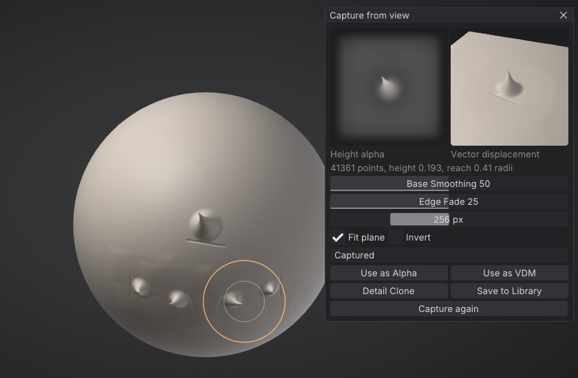

1. Press <kbd>Ctrl</kbd>+<kbd>Alt</kbd>+<kbd>C</kbd> and drag a square over the detail, corner to corner (hold
   <kbd>Shift</kbd> as you press to drag a circle from its centre instead). <kbd>Esc</kbd> cancels.
2. The **Capture from view** window shows two results, side by side:
   - a **height alpha**: the surface's height toward you, measured from a plane fitted to the surface and
     scaled to black-to-white;
   - a **vector displacement map**: the true 3D offset of every point from a smooth base surface, in that base's
     own frame, so overhangs and sideways leans come along.
3. Adjust if needed: **Base Smoothing** decides what counts as detail (0 measures from a flat plane, the whole
   shape; higher takes more of the broad form away, so a wrinkle captured on a curved forehead stamps flat),
   **Edge Fade** blends the border out, **Resolution** sets the pixels, **Fit plane** and **Invert** apply to the
   alpha. Changes capture again from the same square.
4. Use it: **Use as Alpha** (it shapes every brush), **Use as VDM** (the VDM brush stamps it with Drag Stamp),
   **Detail Clone** (paint copies along strokes) or **Save to Library**: the alpha goes to your Library
   **Alphas** folder as a PNG and the VDM to your brush library, both with thumbnails (the VDM also shows in the
   Library **Brush** tab, the alpha picker and Sculpt > Brush > Vector Displacement).

The square is captured along your view, so look at the detail straight on. The capture takes about a tenth of a
second for a small detail and a second or so for a large patch of a 20-million-triangle model.

### Detail Clone

**DetailClone** stamps the VDM brush's map (a captured one or any other) along your stroke, one copy every stamp
width, each turned so its top points the way the stroke goes: rows of scales, rivets, stitches or warts that
follow a curve. **Clone Spacing** sets the distance between copies (1 = edge to edge) and **Clone follows
stroke** can keep every copy upright instead. Size sets their size and Intensity their depth; a click
without moving stamps one. Each copy is shaped to the surface under it.

## Symmetry

Symmetry mirrors every stroke, including mask and paint strokes.

- **X** mirrors left and right. It is **on by default**; press <kbd>X</kbd> to toggle it.
- **Y** mirrors top and bottom, and **Z** mirrors front and back. They have no default key (you can assign one;
  see [The interface](interface.md)).

The **X**, **Y** and **Z** buttons are on the top shelf and in **Sculpt > Symmetry & Gizmo**. You can combine them:
X and Z together give four-way symmetry.

Symmetry mirrors across the scene's axes through the origin. Models that are centred on the origin, such as
SculptForge's primitives and most character exports, mirror correctly. If a stroke lands in the wrong place on
the other side, the model is off-centre: turn on **Local** (below).

### Radial symmetry

Radial symmetry repeats every stroke around an axis, for wheels, flowers, columns, crowns and other round
ornaments. Turn it on with **R** on the top shelf or in **Sculpt > Symmetry & Gizmo > Symmetry**, then set:

- **Radial Copies**: how many copies, evenly spaced around the axis (2 to 64; 8 to start with).
- **X axis**, **Y axis** or **Z axis**: the axis the copies turn around (Y, up, by default).

Radial symmetry works with the mirror axes: with **X** on as well, each copy is also mirrored, so 8 radial copies
make 16. It applies wherever symmetry does: every brush and stroke type, mask and smooth strokes, vertex paint and
texture painting, Rectangle Mask / Lasso Mask and Select Rectangle / Select Lasso, Dynamic Topology (new triangles
appear on every copy) and Insert on the model. The brush cursor shows on every copy, so you can see where each
one lands.

### Local symmetry

**Local** (next to **R** in **Sculpt > Symmetry & Gizmo > Symmetry**) puts the mirror planes and the radial axis through the
middle of the active Part (the centre of its bounding box) instead of the world origin. Use it for a Part that
isn't centred on the origin, such as a button on a jacket or a wheel on a car. The centre follows the Part: it is
worked out again when you switch Parts or after an edit.

**R** and **Local** have no default key; you can assign one (see [The interface](interface.md)). Projects save
the symmetry settings, radial and local included. Scripts and `sculptforge-cli` use the same settings: commands
that take `symmetry` (`stroke`, `vdm_stamp`, `mask_rect`, `mask_lasso`, `hide_rect`, `hide_lasso`,
`insert_primitive`, `insert_mesh`) also take `radial` (the count), `radial_axis` (`x`, `y` or `z`) and `local`
(`true` for the Part's centre), for example `stroke points=... symmetry=x radial=8 radial_axis=y`.

## Pen pressure and tablets

SculptForge reads pen pressure from graphics tablets and pen displays through the operating system. When it
receives pen input, **Sculpt > Draw & Tablet** shows **Pen pressure** with the current value; before that it says
**No pen detected**.

Two toggles decide what pressure does. They are on the top shelf and in **Sculpt > Draw & Tablet > Tablet**:

| Toggle | Default | Effect |
|---|---|---|
| **Pressure > Strength** | On | Pen pressure scales the brush strength. |
| **Pressure > Size** | Off | Pen pressure scales the brush size (down to 5% at the lightest touch). Move, KelvinGrab, KelvinTwist and KelvinScale always grab with the full size. |

**Each brush can override them.** **Sculpt > Brush > Pen pressure** (and the same switches in [Brush
Lab](brush-lab.md) and **Edit > Preferences > Tablet**) sets **Size** and **Strength** for the brush you are holding
to **Use global**, **On** or **Off**. **Use global** follows the toggles above; **On** and **Off** apply to that
brush whatever the toggles say, so you can keep Pressure > Size on for Clay and off for Standard. Grab brushes
(Move, KelvinGrab, KelvinTwist, KelvinScale, Tendril and Elastic Tendril) start with **Size: Off**, every other
brush with **Use global**. The switches are kept per brush like its size and alpha: **Sculpt > Brush > Save Brush
Settings** keeps them for the next start, **Reset Brush to Default** puts back the brush's default, and a custom
brush also keeps them in its `.sfbrush` file. Brush settings saved before 0.11.1 load as **Use global** (grab
brushes: **Size: Off**).

Pressure applies only to strokes made with the pen; mouse strokes always use full pressure. Custom brushes
also have a **Pressure curve** setting that makes them respond to a light or a firm touch (see
[Brush Lab](brush-lab.md)). If the pen moves the cursor but pressure does nothing, see
[Troubleshooting](troubleshooting.md).

**Edit > Preferences > Tablet** checks and tunes the pen:

- a pressure meter and a draw-test area, to see what the tablet reports at a light touch and a full press;
- a pressure curve for all brushes (Soft, Linear or Firm, or set **Curve**, **Minimum**, **Maximum**, **Threshold**
  and **Full pressure at** yourself), applied before each brush's own curve;
- the eraser end (default **Invert**, like holding <kbd>Alt</kbd>) and the side buttons (default:
  lower button right-click to rotate the view, upper button **Invert**, third button **Pan view**). A side button
  can open a [radial menu](#radial-menus) instead (Edit > Preferences > Input > Radial Menus).
- **Mouse mode (relative)**: the pen moves the cursor by how far it moves, like a mouse, and putting it down
  elsewhere on the tablet leaves the cursor where it was, with the driver in pen mode or in its own mouse mode.
  While the pen is in range the arrow is drawn at the brush (the system's is hidden), so brush, arrow and clicks
  always agree (#72).

These settings save themselves. Setup notes for Windows
Ink, macOS and Linux are in
[docs/tablet.md](https://github.com/islandmed/SculptForge/blob/main/docs/tablet.md).

## Customize the bottom shelf

The bottom shelf holds your most-used brushes. By default it shows Standard, Clay, Clay Block, Sharp Crease,
Move, Smooth, Inflate, Pinch, Flatten, Crease, Trim, Tendril, Layer, Nudge and Paint.

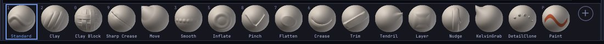

- **Add a brush**: click the **+** tile at the end of the shelf and pick a brush, built-in or custom. Or
  right-click any tile in the brush picker and choose **Add to bottom shelf**.
- **Remove a brush**: right-click its tile and choose **Remove from shelf**.
- **Reorder**: turn on **Edit > Preferences > Saving & Layouts > Customize Shelves**, then <kbd>Ctrl</kbd>+<kbd>Alt</kbd>+drag a
  tile to a new place.
- **Change a brush's key**: <kbd>Ctrl</kbd>+<kbd>Alt</kbd>+click its tile, then press the new key.

Shelf changes last until you quit. **Edit > Preferences > Saving & Layouts > Save Layout** keeps
them. See [The interface](interface.md) for more on customizing.

## Sculpt from a script

The `stroke` command applies a brush along a path on the active Part, as one undo step. It is useful for
scripted detailing and for AI agents:

```sh
sculptforge-cli -c 'new_sphere subdivisions=6; stroke brush=Crease points="-0.6,0.2,0 0,0.4,0 0.6,0.2,0" symmetry=x; export_glb path=out.glb'
```

Points are projected onto the surface along `view` (default `0,0,-1`, the front view). `radius` (world units),
`strength`, `pressure`, `invert`, `spacing`, `curve` and `seed` work as in the viewport. See
[Scripting and automation](scripting.md).

## See also

- [Brush Lab and sharing brushes](brush-lab.md): design brushes with AI, the brush library and brush codes
- [Masking](masking.md): protect areas from every brush
- [Vertex Paint and materials](vertex-paint.md): Paint brush, Rgb and colour
- [Sculpt layers and blend shapes](layers.md): sculpt into a layer you can dial in and out
- [Dynamic topology](dynamic-topology.md): brushes that add triangles where they need them (dynamic topology)
- [Keyboard and mouse reference](shortcuts.md)
