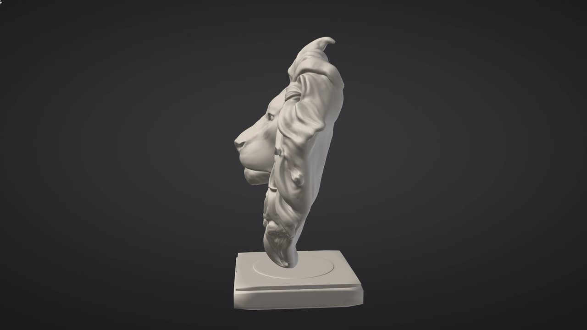

# Security overview for IT reviews

> **In short:**
> - A one-page summary for a studio's security or IT review.
> - `sculptforge-cli --mcp` serves AI tools over stdio only.
> - Single sign-on uses OpenID Connect; a read-only policy file sets central control.

A one-page summary for a studio's security or IT review. Details and settings are in
[SculptForge for studios](studios.md#it-deployment).

## What SculptForge is

A desktop sculpting application (GPL-3.0, source on GitHub), a command-line tool (`sculptforge-cli`) and a Python
module. No account, no licence server, no servers of our own. It runs as the signed-in user with no elevated rights
and installs no services, drivers or background processes.

## Network

| | |
|---|---|
| Telemetry, analytics, crash upload | **None.** Crash logs stay on the computer. |
| Listening ports | **None by default**, and never for AI tools or sign-in. Two features listen while the artist uses them: phone capture (on the local network, so the phone can reach it) and the Unreal link. With the network off by policy, they may use only this computer unless `network.localNetwork` allows the studio network. The Blender and Maya bridges exchange files. The Maya Live link, when the artist turns it on (with a warning each time; off at every start), listens on a per-user socket or pipe on this computer only, never a port; `"maya": {"link": "never"}` forbids it. |
| Outbound connections | Only what the artist uses: the daily update check (a small file from the website, or your own feed), the community brush gallery, and the AI service the artist chose. With `"network": {"enabled": false}` in the policy, a single gate refuses everything except the addresses you list, before anything is sent, and follows no redirects. |
| AI features | Optional, and lockable off by policy. Only the request goes to the chosen service: a brush description, or the picture or text given to Generate 3D. Sculpts are never uploaded or used for training. Providers and addresses can be limited to your own gateway or local models. |

## AI tools (MCP)

`sculptforge-cli --mcp` serves the Model Context Protocol over **stdio only**: the AI tool starts it as a child
process; nothing listens on a port. Each command an AI tool runs is checked against the policy's allowed categories
(read, edit, files, scripts, network, AI) and written to the audit log.

AI tools can't install, remove or switch packs. Controlling an open SculptForge window can be forbidden outright
(`"mcp": {"live": "never"}`), and MCP can be turned off entirely.

## Data at rest

| | Where |
|---|---|
| Artwork | Wherever the artist saves it. SculptForge doesn't copy it elsewhere. |
| Settings | The user's settings folder, owner-only permissions. No secrets in them. |
| API keys, sign-in tokens | The OS keychain only: macOS Keychain, Windows Credential Manager, Linux Secret Service. Never in files or logs. |
| Audit log | JSON lines, local or on a share you choose; no artwork, keys or long text. |

## Identity

Single sign-on uses OpenID Connect with the **device authorization grant** (RFC 8628) against your identity provider:
the artist signs in in their own browser with your MFA, and no local listener or embedded browser is involved. The
token is sent only to the addresses your policy names (your AI gateway).

## Central control

A read-only policy file (`/etc/sculptforge/policy.json`, `/Library/Application Support/SculptForge/policy.json`,
`C:\ProgramData\SculptForge\policy.json`) locks AI on or off, network features, allowed AI providers and addresses,
AI tool access, sign-in, the audit log and updates. A broken policy fails closed. An artist can't override it with
environment variables while it is installed.

## Supply chain

| | Status |
|---|---|
| Builds | Built from the public repository by GitHub Actions, from tagged commits, with every third-party archive pinned by SHA-256 (`cmake/Fetch.cmake`). |
| Release integrity | Every release has `SHA256SUMS.txt` and an Ed25519 signature of it (`SHA256SUMS.txt.sig`); the app's own updater checks both. |
| SBOM | Each release carries a CycloneDX SBOM (`SculptForge-<version>-sbom.cdx.json`), covered by the signed checksums. Licences: `THIRD_PARTY_NOTICES.md`. |
| Code signing | **Not yet.** Windows installers are not Authenticode-signed (SmartScreen warns), and the macOS app is ad-hoc signed, not notarized. Verify downloads with the signed checksums until then. |
| Updates | Off, or from your own feed or mirror, by policy. A studio build reads only its own channel. |
| Vulnerability reports | Private reporting on GitHub (see `SECURITY.md`); fixes go to the latest release. |

## See also

- [SculptForge for studios: IT deployment](studios.md#it-deployment)
- [AI services: privacy and model licences](https://github.com/islandmed/SculptForge/blob/main/docs/ai-services.md)
