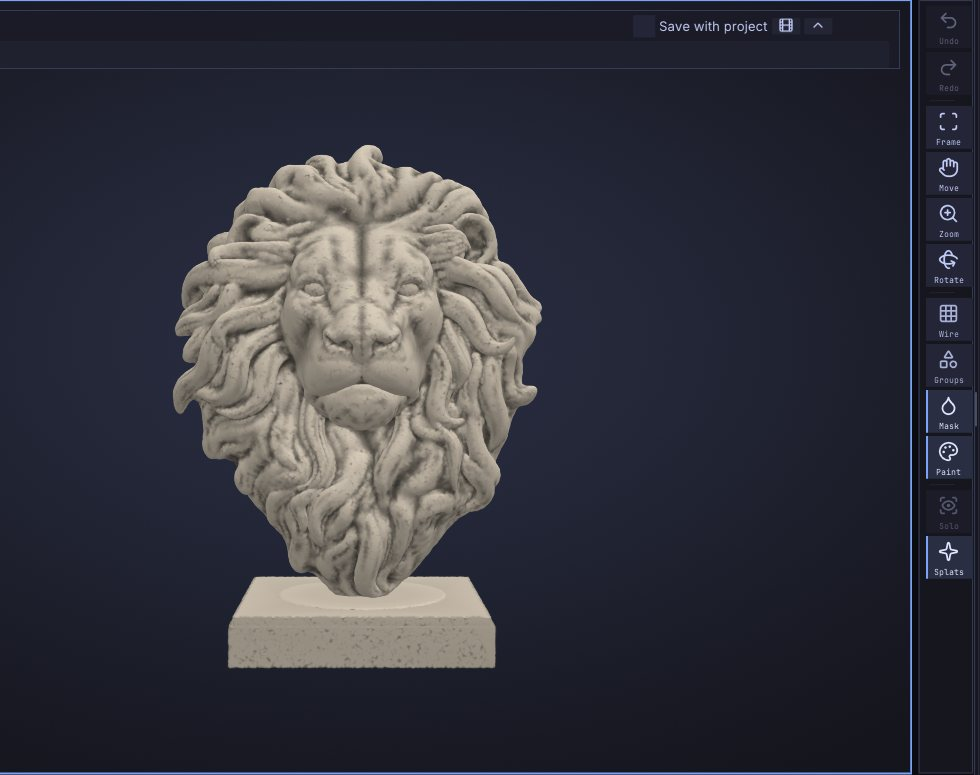

# Gaussian splats

Gaussian splats are the format behind phone and photogrammetry captures from apps such as Polycam, Luma,
Postshot, Scaniverse and KIRI. SculptForge uses them three ways: as a reference to sculpt against, as a source
for a sculptable, animation-ready mesh with its colours, and as an output when you turn a sculpt into splats. This chapter covers all
three.



To make a splat yourself from a phone video or photos, see [Scan an object into a splat](scan-to-splat.md).

## Supported files

| Format | Open | Save |
|---|---|---|
| PLY (standard 3D Gaussian Splatting layout, spherical harmonics up to degree 3) | Yes | Yes |
| `.splat` (compact web-viewer format) | Yes | Yes |
| glTF / GLB with `KHR_gaussian_splatting` | Yes | Yes |
| OpenUSD `.usda` / `.usdz` with a `ParticleField3DGaussianSplat` prim | Yes | Yes |

A PLY file can hold either a mesh or splats; SculptForge tells them apart by their contents.

## Load a capture as a reference

1. Open the capture with **File > Open...** (<kbd>Ctrl</kbd>+<kbd>O</kbd>), drop it onto the window, or
   double-click it in the Library **Splats** tab.
2. The splats load **next to** your sculpt: the current mesh stays, and the capture is drawn around it as a
   reference.
3. **Render > Gaussian Splats** moves into the right tray by itself, and a **Splats** button appears on the right
   shelf to show or hide the capture.

Most captures arrive upside down, off-centre and at an arbitrary scale. Use the buttons in the **Splats**
palette to place them:

| Button | What it does |
|---|---|
| **Flip** | Turns the capture upside down (180 degrees about X). Most captures need this |
| **Turn 90** | Turns it 90 degrees about the vertical axis |
| **Fit** | Centres it at the origin and scales it to the size of a new sphere |
| **Clean floaters** | Removes faint splats and stray outliers around the subject |

The palette also shows the number of splats and their spherical-harmonic degree (for example "1250000 splats
(SH 3)"), and has:

- **Show** and **Show mesh** to show or hide the capture and the sculpt.
- An **opacity** slider (0.05 to 1) to see the sculpt through the capture.

> **Tip:** To sculpt a character over a scan, lower the opacity to about 0.4, turn on **X** symmetry and block
> in the forms on a sphere or a converted mesh with Clay Block and Move.

## Make a capture sculptable

**Make sculptable** (under **From scan** in **Render > Gaussian Splats**) turns the capture into a clean Part you
can sculpt and animate: a watertight surface without floaters, quad topology with loops round the eyes and
mouth when it is a head, and the capture's colours. The splats stay, hidden. It has its own chapter:
[From scan to sculptable mesh](scan-to-sculptable.md).

## Turn a sculpt into splats

**Sculpt to splats** (in **Render > Gaussian Splats** when no splats are loaded, or from the command palette) covers
the visible Parts with flat, oriented splats with soft clay shading baked in. Use it to show a sculpt in
splat viewers, web scenes or engines that render 3D Gaussian splats. It replaces any loaded splats.

From a script you can choose the number of splats and whether to bake shading:

```sh
sculptforge-cli -c 'open path=bust.glb; mesh_to_splats count=500000 shading=true; splat_save path=bust.ply'
```

## Save splats

Click **Save splats...** in **Render > Gaussian Splats**, or **File > Save Splats...**. Choose the format by the
file type: PLY (for SuperSplat, Postshot and most tools), glTF (`.glb` with `KHR_gaussian_splatting`) or
OpenUSD (`.usda` / `.usdz`). The `splat_save` command also writes `.splat`.

Placement you made with **Flip**, **Turn 90** and **Fit** is kept exactly in glTF and USD. PLY has no
placement, so it is baked into the splats; if the capture was rotated, view-dependent colour (spherical
harmonics above degree 0) is dropped from the PLY, because it would point the wrong way.

When you export USD (**File > Export USD / USDZ...**) with splats loaded, they are included in the same file
as a `ParticleField3DGaussianSplat` prim next to the meshes.

Projects (`.sfproj`) keep loaded splats and their placement.

**Clear** in **Render > Gaussian Splats** removes the capture.

## From scripts

| Command | What it does | Key parameters |
|---|---|---|
| `open` | Loads a capture as a reference next to the sculpt | `path` |
| `splat_info` | Reports the loaded splats | |
| `splat_transform` | Rotates and places the capture | `rotate_x`, `rotate_y`, `rotate_z` (degrees), `fit`, `reset` |
| `splat_clean` | Removes faint splats and floaters | `min_opacity` (default 0.05), `keep` (0.5 to 1, default 0.98) |
| `splat_to_mesh` | Make sculptable: a new Part with quads, face loops and colour ([details](scan-to-sculptable.md#from-scripts)) | `detail` (default 256), `preset` (game, film, sculpt), `color` (vertex paint, texture, none), `crop`, `face_guides` |
| `splat_test_capture` | Loads a built-in test capture (a head or a mug) | `kind` |
| `mesh_to_splats` | Turns the visible Parts into splats | `count` (default 250000), `shading` (default true) |
| `splat_save` | Saves `.ply`, `.splat`, `.glb`, `.usda` or `.usdz` | `path` |
| `splat_clear` | Removes the splats | |

A complete phone-capture-to-game-asset pipeline:

```sh
sculptforge-cli -c 'open path=scan.ply; splat_transform rotate_x=180 fit=true; splat_to_mesh preset=game color=texture; export_glb path=asset.glb'
```

To render only the splats headless, use `sculptforge scan.ply --render scan.png --hide-mesh` (see
[Scripting and automation](scripting.md#the-sculptforge-app-on-the-command-line)).

## See also

- [From scan to sculptable mesh](scan-to-sculptable.md): Make sculptable in detail
- [Image and text to 3D](generate-3d.md): another way to get a base mesh
- [Subdivide, Remesh, Decimate and LODs](geometry.md): clean up a converted mesh
- [Exporting](exporting.md): USD and glTF exports that carry splats
