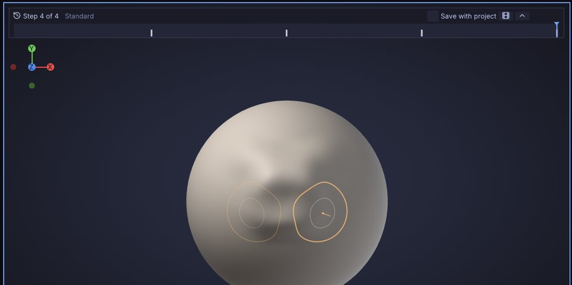

# Sculpt Timeline and timelapse

Every stroke and operation you make is a step on the **Sculpt Timeline**, the strip along the top of the
canvas (or its bottom: **Edit > Preferences > Interface > Timeline position**). Drag its scrubber to see the model at any point of the session, click a step to go back there, and keep
sculpting from it: the steps you had made after it are not thrown away as with a plain undo, they stay as a
branch you can switch back to. You can change how strongly a past stroke shows without redoing the strokes
after it, and render the whole history as a turntable timelapse video.



## The strip

Each step is a tick on the track: sculpt strokes in light grey, masks in blue, vertex paint in pink, visibility
and face groups in green, and topology changes (dynamic topology, remeshing, Divide, Part changes) as tall
teal ticks. The orange scrubber marks the state the canvas shows; the steps after it are dimmed. A dot above a
tick marks a re-tuned stroke.

- **Drag** along the track to scrub through the history: the model follows as you drag.
- **Click** a tick to go to the state after that step.
- **Point** at a tick for what the step was, how many vertices it changed and when.
- **Right-click** a stroke to re-tune it (see below).
- The header shows the step you are at, the number of branches and the step's name. **Save with project**
  keeps the history with the project, the film icon exports a timelapse, and the arrow folds the strip into a
  small **Timeline** tab (click the tab to open it again; **Sculpt Timeline** in the command palette, F3, does
  the same).

Undo and Redo (<kbd>Ctrl</kbd>+<kbd>Z</kbd>, <kbd>Ctrl</kbd>+<kbd>Shift</kbd>+<kbd>Z</kbd>) move the scrubber one
step, as before. Each Part keeps its own timeline, like its own undo history.

## Branches: undo without losing anything

Go back to an earlier step and sculpt: a new branch starts there. The steps you had made after that point stay
in the history as a thin lane above the track, starting where the branch splits off. Click the lane to make
that branch the active one again; the branch you leave becomes the lane. Nothing is lost by trying an idea and
going back.

## Re-tuning a past stroke

Right-click a stroke on the track and drag **Strength**: 1 is the stroke as you made it, 0 removes it, 2 makes it
twice as strong. The model updates at once and the strokes you made after it are kept.

How it works: the change to that one stroke's displacement is added to the model as it is now. Where later
strokes don't touch the area, the result is exactly what you would have had with the new strength. Where later
strokes overlap it, they keep the displacement they made at the time, on top of the re-tuned stroke: they are
not sculpted again. So a Smooth you did afterwards over the same spot won't smooth the stronger version, and a
later Inflate keeps the direction it pushed in then. For most detail passes that is what you want; for a big
change under a lot of later work, check the area afterwards.

A stroke can't be re-tuned when a step after it replaced the mesh as a whole (dynamic topology, a remesh,
Divide, a sculpt layer change): the menu says which step is in the way. Strokes made on a sculpt layer can't be
re-tuned either.

## Big meshes

Scrubbing reuses what undo already keeps for each stroke, only the vertices it moved. A run of strokes is
swapped in one go, with normals and the view updated once for the whole run, and every few steps the timeline
keeps a full copy of the shape (a checkpoint) so a jump across the whole history replays only a few strokes
from the nearest one. Measured on an Apple M1 Pro after 220 strokes (a third of them big, up to 4.4 million
vertices each), while other heavy programs were running:

| Mesh | One step of the scrubber | A jump across the history |
|---|---|---|
| 21 million triangles | 5 ms typical, 50 ms for the biggest strokes | about 0.4 to 0.5 s |
| 33 million triangles | 5 to 14 ms typical, up to 170 ms for the biggest strokes | about 0.6 to 1 s |

See also [Performance and big meshes](performance.md).

The history uses memory: undo keeps up to 1 GB (the oldest steps go first, as before), the timeline up to 1.5 GB
more for inactive branches and the extra copy of each stroke that makes fast seeking possible, and up to 1 GB of
checkpoints (fewer, further apart, on very big models). With those limits a 21 million triangle model keeps
about the last 100 strokes of the size above, a 33 million one about 70; small detail strokes cost far less.

## Saving the history

Tick **Save with project** in the strip's header and saving a project also writes its history beside it, as
`name.sfhist` next to `name.sfproj`. Opening the project brings the timeline back, branches and re-tuned strengths
included, as long as the project hasn't been changed elsewhere since. Sculpt strokes, masks, vertex paint, visibility
and face groups are saved; a topology change (dynamic topology, remesh, Divide, sculpt layers) cuts the saved
history there, keeping what came after it.

## Timelapse video

**Export timelapse** (the film icon in the strip, or **Export timelapse...** in the command palette) renders the
history of the active Part, from the start to the step you are at, as a turntable video: the model builds up
stroke by stroke while the camera goes once around it, with a short pause at the start and the end. Pick 1080p
or 4K, the length, and where to save the MP4. There are no captions or interface in the video. It needs
[ffmpeg](https://ffmpeg.org/) installed.

From the command line, for a project saved with its history:

```
sculptforge creature.sfproj --timelapse creature.mp4 --size 3840x2160 --timelapse-seconds 20
```

## Scripting

The timeline is scriptable: `timeline_info list=true` lists the steps (with their ids), `timeline_seek index=N`
shows step N of the active branch, `timeline_select node=ID` switches to the branch through a step,
`timeline_retune node=ID strength=0.5` re-tunes a stroke, and `timeline_save` / `timeline_load` write and read
the `.sfhist` file.
