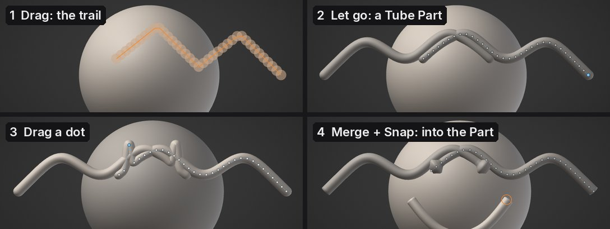
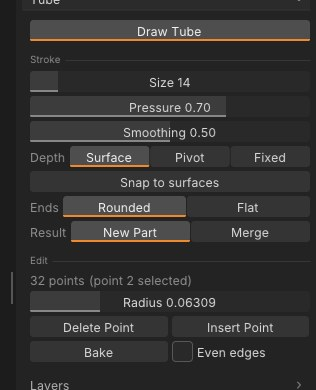

# Tube: draw in 3D space

**Tube** draws clay tubes freely in the air, like a 3D pen: horns, vines, hair strands, tentacles, cables, piping
or the wire of an armature, drawn where you want them instead of pulled out of a surface. Each stroke becomes a
smooth curve with a tube swept along it, and its points stay editable until you bake it into a mesh to sculpt.



## Draw a tube

1. Open **Tool > Tube** and press **Draw Tube**.
2. Drag anywhere in the view: on the model, off it, or from one into the other. A trail shows the tube as you
   draw; let go and it is made.
3. <kbd>Ctrl</kbd>+<kbd>Z</kbd> takes the tube away again.

While Draw Tube is on, <kbd>Alt</kbd>+drag still moves the view (and so do the right and middle buttons), so you can
draw, turn the model, and draw again from another side. The brush ring is replaced by a circle as thick as the tube
will be. Press **Draw Tube** again, <kbd>Esc</kbd>, any brush, or **Draw** / **Move** to stop drawing tubes.



| Setting | What it does |
|---|---|
| **Size** | How thick new tubes are: their radius on screen at the depth you draw at |
| **Pressure** | How much a light touch of the pen thins the tube (0: the same thickness all along). A mouse draws at full size |
| **Smoothing** | How much of the stroke's wobble is smoothed out before the tube is made |
| **Depth** | Where in depth the stroke lies (below) |
| **Snap to surfaces** | Where the pen is over a surface, the tube lies on it, half sunk in, instead of on the drawing plane |
| **Ends** | **Rounded** or **Flat** |
| **Result** | **New Part**: each stroke is a Tube Part you can edit. **Merge**: the stroke goes into the active Part |

**Symmetry** (<kbd>X</kbd>) draws the mirror copy across the X plane too, and keeps it as you edit the tube.

## Depth: where the stroke lies

A stroke on a flat screen needs a depth. The tube's points lie on a plane facing you:

- **Surface** (the default): through the surface under the pen where the stroke starts. A stroke that starts off
  the model uses the depth where your last stroke ended, or the pivot. So a stroke started on a head and pulled out
  sideways grows from that spot into the air.
- **Pivot**: through the view's pivot, the point the camera turns around.
- **Fixed**: at a set **Distance** from the camera. Orbit and draw again to build up a shape in 3D.

Turn **Snap to surfaces** on to draw along a model: a strap round an arm, a seam, a vein.

## Edit the points

A Tube Part's control points show as dots joined by a thin line (with Draw Tube on, the dots of every visible Tube
Part show, and pressing one selects that Part):

- **Drag** a dot to move it across the screen; the tube follows as you drag.
- <kbd>Ctrl</kbd>+drag a dot up or right to make the tube thicker there, down or left to make it thinner.
- <kbd>Alt</kbd>+click a dot to delete it.
- The dot you last dragged is selected (orange): **Radius** sets its thickness exactly, **Insert Point** adds a
  point halfway to the next one, **Delete Point** removes it.
- **Rounded** and **Flat** change the ends of the selected tube.

Each drag and button is one undo step. A Tube Part isn't sculpted while its points are editable: brushes leave it
alone until you bake it. If you move, mirror or otherwise change the Part's mesh, its points no longer fit it and
editing them is refused (undo the change, or bake it as it is).

## Bake and Merge

**Bake** turns the active Tube Part into a plain mesh to sculpt, in quads, with one face group for the body and one
for each end. Tick **Even edges** first to bake it in triangles of one size instead, ready for
[dynamic topology](dynamic-topology.md). Undo brings the points back.

**Result > Merge** skips the Tube Part: each stroke goes straight into the active Part as one undo step, with even
edges close to that Part's own edge length, so dynamic topology carries on smoothly across it. A Part with
subdivision levels or a micro level can't take a merged tube; draw a new Part and merge it with the
[Parts](parts.md) list.

> **Tip:** for clay-like strands, draw with Merge into a Part with dynamic topology on, then smooth and blend the
> joins with the brushes.

## From a script

The `tube_*` commands do the same from the Console, scripts and AI assistants:

```
tube_new points="0,0,0 0.5,0.4,0,0.08 1,0.2,0.3" radius=0.05 caps=round symmetry=x
tube_list
tube_set_point index=1 position="0.5,0.6,0" radius=0.1
tube_insert_point index=0
tube_delete_point index=2
tube_set caps=flat radius_scale=1.5
tube_bake uniform=true
```

Each point is `x,y,z` or `x,y,z,radius`. With `smooth=0.5` the points are treated as raw pen samples: smoothed and
simplified into control points, as a drawn stroke is. `merge=true` puts the tube into the active Part.
