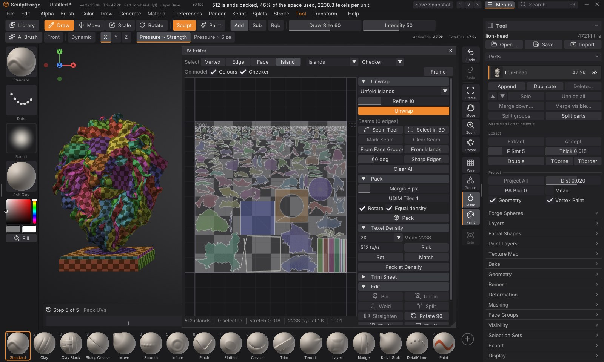
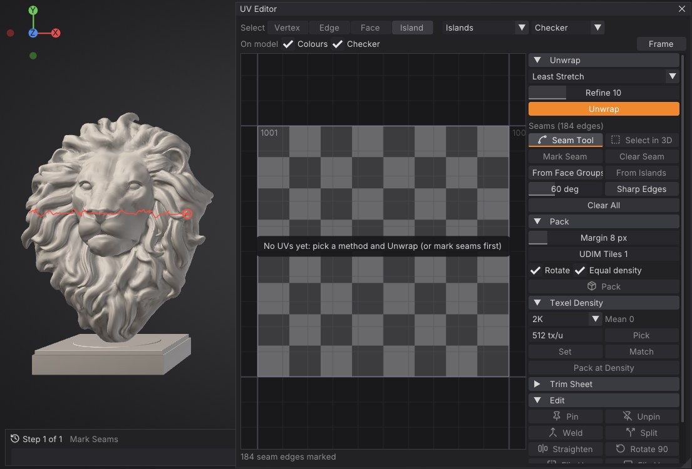
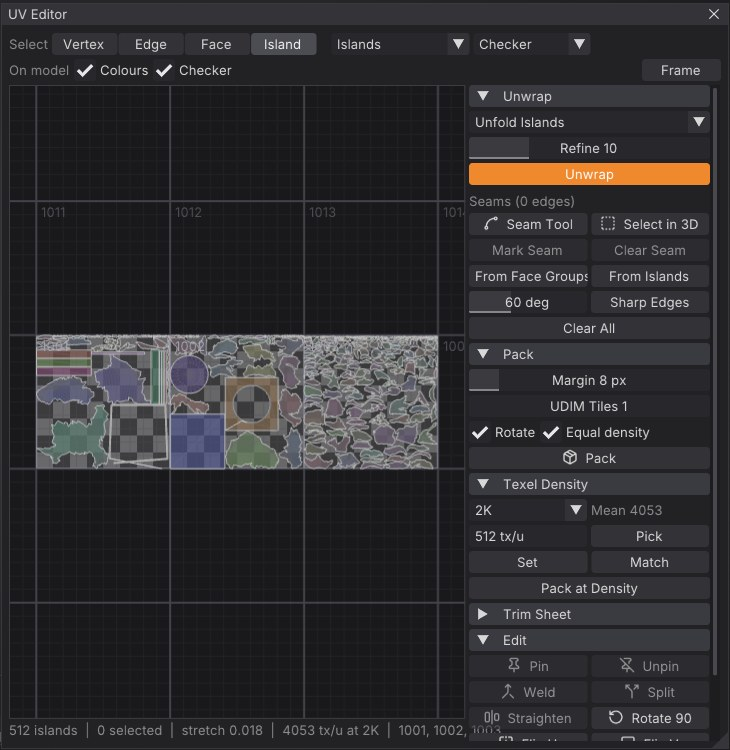
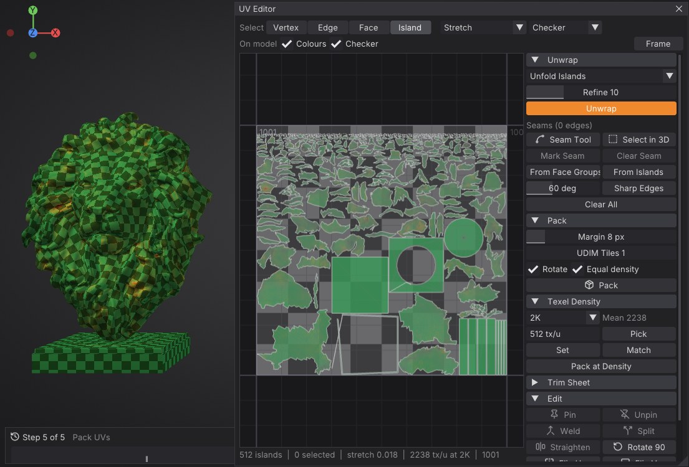
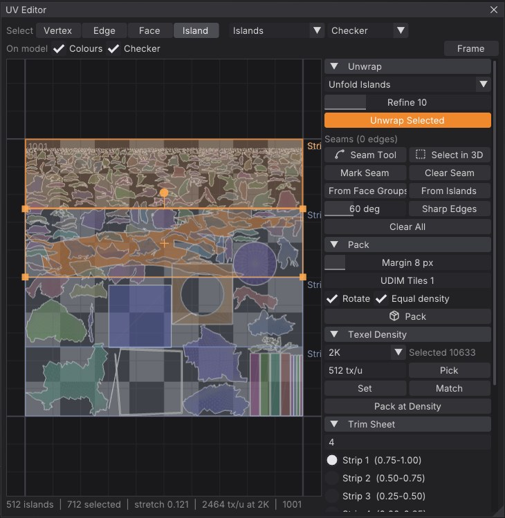

# UV Editor

The UV Editor shows a Part's UVs flat, over the texture's tiles, and gives you everything to make them: seams drawn on
the model, unwrapping that keeps the surface's shape, packing into one tile or across UDIM tiles, texel density,
trim sheets, and hand editing of vertices, edges, faces and islands. While you work, the model shows the same
colours and a checker, so stretch and density show up on the surface the moment they appear, and a painted texture
can move with every edit so the model keeps its look.

Open it with **Tool > Texture Map > UV Editor**, or <kbd>Alt</kbd>+<kbd>U</kbd>. It opens over the right of the
canvas with the model moved to the left; drag its title bar or its edges to place it anywhere.



## The window

- **Select** (top left): what clicks pick, **Vertex**, **Edge**, **Face** or **Island** (<kbd>1</kbd>-<kbd>4</kbd>
  while the pointer is over the view). The selection converts when you switch.
- **Colours**: what the faces show, in the view and on the model: **Islands** (a colour each), **Stretch**,
  **Density** (texel density) or **Plain**.
- **Image**: what's behind the layout: nothing, a **Checker**, or the Part's painted **Texture** (tile 1001).
- **On model**: **Colours** shows the same colours on the model, **Checker** lays a checker on its UVs (a square
  per 32 texels of the texture, tinted per UDIM tile). Squares that stay square mean no stretch.
- **Frame** (<kbd>F</kbd> over the view) fits the selection, or the whole layout, in the view; <kbd>Home</kbd>
  shows tile 1001.
- The status line under the view: islands, what's selected, the mean stretch, the texel density and the UDIM
  tiles in use.
- The sections on the right: **Unwrap** (with the seams), **Pack**, **Texel Density**, **Trim Sheet**, **Edit**
  and **Display**.

The view is drawn by the graphics card, so a million-triangle layout pans, zooms and moves as smoothly as a small
one. Scroll to zoom (around the pointer); drag with the right or middle button to pan. The UDIM tile numbers are written in each tile's corner.

## Selecting

- Click to select (<kbd>Shift</kbd> adds, <kbd>Ctrl</kbd> removes); drag on an empty spot for a box. In Island mode
  the box picks every island it touches; in Face mode the faces inside it.
- <kbd>A</kbd> selects everything, <kbd>Alt</kbd>+<kbd>A</kbd> nothing, <kbd>Ctrl</kbd>+<kbd>I</kbd> inverts.
- **Select in 3D** (Unwrap section): click or drag over the model to select there, in the current mode;
  <kbd>Shift</kbd> adds, <kbd>Alt</kbd> removes. The selection shows orange in both views.

Moving a vertex moves all of its corners that are joined in UV space, so islands stay in one piece while you edit
them; edges along a seam move each side on its own.

## Moving, rotating and scaling

The selection has a box with handles: drag inside it to move, a corner to scale, the knob above it to rotate.
Or press <kbd>G</kbd> (move), <kbd>R</kbd> (rotate) or <kbd>S</kbd> (scale) over the view, move the mouse, and
click (or <kbd>Enter</kbd>) to finish; a right click or <kbd>Esc</kbd> puts it back. During <kbd>G</kbd> and
<kbd>S</kbd>, <kbd>X</kbd> or <kbd>Y</kbd> locks to one axis; <kbd>Ctrl</kbd> snaps (1/64 of a tile, 15 degrees,
tenths of the size). The model's stretch colours and checker follow the drag live. Each drag is one undo step.

## Seams

Seams are the edges Unwrap cuts along. They show in red on the model while the UV Editor is open, and in red in the
view.

- **Seam Tool**: drag along the model over the edges you want cut. Each stretch follows the shortest edge path
  from where the last one ended, so you can draw a loop around an arm in a few strokes. <kbd>Alt</kbd>+drag clears
  seams the same way. A ring under the pointer shows the vertex the next stretch starts from.
- **Mark Seam** / **Clear Seam**: the selected edges, or the border of the selected faces.
- **Face Groups**: every face group border becomes a seam.
- **Island Borders**: the borders of the current UV islands become seams (keeps an imported layout's cuts).
- **Sharp Edges**: every edge sharper than the angle beside it (hard-surface models).
- **Clear All**.



## Unwrapping

Pick a method and click **Unwrap**. With faces selected it says **Unwrap Selected**: only those are unwrapped, and
their new islands are fitted where the old ones were; otherwise the whole Part is unwrapped and packed.

| Method | What it does |
| --- | --- |
| **Least Stretch** (the default) | Cuts along the marked seams and flattens each piece keeping both angles and lengths (a conformal start, then as-rigid-as-possible steps). The best all-round choice |
| **Conformal (LSCM)** | Keeps angles exactly; big curved pieces get smaller towards their ends |
| **By Face Groups** | Least Stretch, also cut along every face group border: group the model, then unwrap |
| **Planar** | Projects each piece flat along its mean direction: for flat panels and decals |
| **Unfold Islands** | Flattens the current islands again where they are, keeping pinned UVs in place: relax after editing |
| **Auto Seams** | Finds its own seams (as **Auto UV** does), for models you don't want to cut by hand |

**Refine** sets how many least-stretch steps run (more keeps lengths better; 0 is plain conformal).

You don't have to cut everything yourself: a piece that is closed (a sphere), a tube or has holes gets the extra
cuts it needs automatically, a closed shell split across its middle and a tangled piece cut into charts the way
Auto Seams would. Without marked seams, a Part that already has UVs is cut along its current island borders.
Unwraps of big meshes run in the background with their progress over the view; a million triangles take a few
seconds.

## Packing and UDIM tiles

**Pack** lays the selected islands (or all) out as large as they fit: each turned to its smallest box, scaled to one
texel density (**Equal density**; off keeps their sizes relative to each other), with **Margin** texels between
them. **Rotate** also allows quarter turns. SculptForge tries packing by the islands' outlines and by their boxes
and keeps whichever holds them larger.

**UDIM Tiles** spreads the islands over that many tiles, 1001, 1002 and on (ten per row, as UDIM numbers go), each
island at the same texel density: more tiles, more texels for everything. **Pack at Density** instead keeps exactly
the target texel density and opens as many tiles as it needs.



## Texel density

Texel density is how many texels of the texture cover a unit of the surface. The **Texel Density** section shows the
selected islands' density (or the mean) at the texture's size (or the size you choose when there is no texture yet),
and the **Density** colours show it on every face: green is the mean, blue fewer texels, red more.

- **Set**: scale the selected islands (or all) to the target density (texels per unit).
- **Match**: give them all their mean density, so a detail looks the same size everywhere.
- **Pick**: take the target from the selection.
- **Pack at Density**: pack at exactly the target (see above).



## Trim sheets

A trim sheet is a texture made of horizontal strips (a moulding, a belt, a seam of rivets), each repeating left to
right. In **Trim Sheet**, describe the strips: a count (`4` equal strips), heights from the top (`0.5,0.25,0.25`)
or v ranges (`0-0.5;0.5-1`); they show over tile 1001 while the section is open. Pick a strip and click **Assign to
Strip**: the selected islands are turned lengthwise, scaled to the strip's height and lined up along it from the
left. **Fit width** squeezes or stretches the row to fill the strip exactly; off, it keeps its proportions and may
run past the right edge, which is fine on a trim that repeats.

The texture doesn't move for trims: the islands take on the strip's look.



## Editing

| Button | Over the view | What it does |
| --- | --- | --- |
| **Pin** / **Unpin** | <kbd>P</kbd> / <kbd>Alt</kbd>+<kbd>P</kbd> | Pinned UVs (blue dots) stay where they are when you Unwrap or Unfold |
| **Weld** | <kbd>W</kbd> | Selected vertices that meet across a seam become one UV each, and the seam between them goes |
| **Split** | <kbd>Y</kbd> | The selected edges, or the border of the selected faces, become seams, so those faces move on their own |
| **Straighten** | | The selected vertices (a border, an edge loop) line up on one horizontal or vertical line |
| **Rotate 90** | | A quarter turn of the selection (or everything) |
| **Flip U** / **Flip V** | | Mirror the selected islands left to right or top to bottom |

A good relax workflow: straighten or move the borders you care about, pin them, then **Unfold Islands**.

## Paint stays on the model

**Paint stays on the model** (at the bottom of the sections, on by default): when the Part has a painted texture,
every UV edit (unwrap, pack, a drag, density, weld...) moves the paint onto the new layout in the same undo step, every
texture layer with it, so the model looks exactly the same. Undo brings back the old UVs and the old texels. Turn it
off when you want the UVs to pick a different part of the texture (as trim sheets do); the trim command leaves it
off by default.

## Undo

Every UV operation is one undo step (<kbd>Ctrl</kbd>+<kbd>Z</kbd>), drags included: the UVs, seams and pins, and the
texture when it moved with them. Seams and pins are saved with the project.

## Scripting

Every operation is a command, for scripts, `sculptforge-cli`, Python (`sf.run(doc, "uv_unwrap", method="isometric")`)
and the AI assistant. "The selection" is the UV Editor's (set it with `uv_select`); with nothing selected the
commands work on the whole Part.

| Command | What it does |
| --- | --- |
| `uv_unwrap` | Unwrap: `method=isometric` (Least Stretch), `conformal`, `polygroups` (By Face Groups), `planar`, `unfold` or `auto`; `iterations=`, `selected=`, `tiles=`, `margin=`, `rotate=`, `density=`, `pack=false` (fit in place), `keep_texture=` |
| `uv_pack` | Pack: `margin=` (texels), `tiles=` (UDIM tiles), `first_tile=`, `rotate=`, `equal_density=`, `density=` (texels per unit, as many tiles as needed), `resolution=`, `keep_texture=` |
| `uv_seam` | Seams: `op=mark` / `clear` (the selection), `path from= to=` (shortest edge path between two vertices; `clear=true`), `polygroups`, `islands`, `angle angle=60`, `clear_all` |
| `uv_select` | `op=all`, `none`, `invert`, `island face=`, `face face=`, `polygroup group=`, `rect u0= v0= u1= v1=`, `seams`, `mode`; `mode=vertex/edge/face/island`, `add=true` |
| `uv_transform` | `move_u=`, `move_v=`, `rotate=` (degrees), `scale=`, `scale_u=`, `scale_v=` about the selection's centre |
| `uv_edit` | `op=pin`, `unpin`, `clear_pins`, `weld`, `split`, `straighten`, `flip_u`, `flip_v` |
| `uv_density` | `op=set value=`, `op=match` (`match=mean` or `first`), `op=info`; `resolution=` |
| `uv_trim` | `strip=2 strips=4` (or `0.5,0.25,0.25` or `0-0.5;0.5-1`), `fit_width=`, `margin=` |
| `uv_info` | Islands, seams, pins, texel density, the UDIM tiles in use and the mean stretch |

```
uv_seam op=polygroups
uv_unwrap method=isometric
uv_pack tiles=2 margin=8
uv_density op=match
uv_info
```

## Limits

- Texture painting paints tile 1001 (UVs between 0 and 1); islands in other UDIM tiles are laid out, measured and
  exported, but painting them comes later.
- Packing works on islands' outlines when there are enough of them and the mesh isn't huge; otherwise on their boxes
  (a little less tight).

> **Coming from ZBrush?** The UV Editor does what ZBrush 2027's UV editing and UV Master do: seams on the model,
> several unwraps, UDIM packing, texel density and trim sheets, plus live stretch and density on the model while you
> edit and paint that stays put when the UVs change.

## See also

- [Texture painting](texture-painting.md): paint on the UVs
- [Baking](baking.md): bake maps onto them
- [Exporting](exporting.md): UVs go out with OBJ, glTF, FBX and USD
