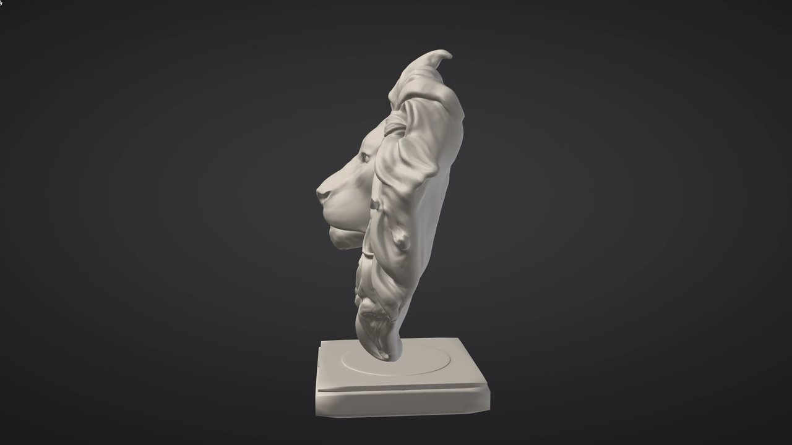

# Welcome to SculptForge



> **In short:**
> - A free, open-source sculpting app for VFX, animation and games, on Windows, macOS and Linux.
> - The brushes, symmetry, masking and navigation experienced sculptors already know.
> - No account, no subscription, no licence server and no telemetry. It works offline.
> - Coming from another sculpting app? Pick **Classic sculpting keys** on the first start.

## Start here

```cards
[Your first sculpt](first-sculpt.md) | images/first-sculpt/12-render.jpg | An owl head from the default sphere, in ten minutes.
[Quick tour](quick-tour.md) | images/quick-tour/01-where.jpg | For experienced sculptors: what is the same and what differs.
[What's new](whats-new.md) | images/wn-0120-tube.jpg | What changed in each release.
[Install](installing.md) | images/interface-overview.jpg | Downloads and set-up for Windows, macOS and Linux.
[Get help](#getting-help-and-reporting-problems) | images/ctrl-help.jpg | Hover help, the Controls sheet, Discord and the issue tracker.
```

## What SculptForge is

SculptForge is a focused sculpting tool. Its menus are grouped by task: **File, Edit, Sculpt, Paint, Mesh, View,
Render, Help**. Shelves sit around the canvas, with a Library of thumbnails and pop-up pickers.

Prefer alphabetical palettes? The Classic layout is one click away, in **Edit > Preferences > Interface > Look > Layout > Classic**.

The Classic sculpting keys and gestures are one choice away too: answer **Classic sculpting keys** when the first
start asks what you are coming from, or pick **Classic** in **Edit > Preferences > Input**.

It is free software under the GNU General Public License v3.0 or later. You own everything you make with it: the
GPL covers the program, not your models.

SculptForge is free for everyone. Members get betas early and vote on what's built: see
[Support and membership](support.md).

## What you can do with it

- **Sculpt** with more than twenty built-in brushes, four stroke types, alphas, X/Y/Z symmetry and tablet
  pressure. See [Sculpting and brushes](sculpting.md).
- **Design brushes in words** with Brush Lab: describe "dry cracked mud" and an AI builds a brush you can tweak and
  share. See [Brush Lab](brush-lab.md).
- **Mask, group and hide** parts of the model. See [Masking](masking.md) and [Face Groups](face-groups.md).
- **Keep separate meshes** as Parts (body, eyes, teeth, armour), each with its own undo. See [Parts](parts.md).
- **Paint colour** on the surface and look at it through Lit Sphere materials. See [Vertex Paint](vertex-paint.md).
- **Sculpt layers** that double as blend shapes. See [Sculpt layers](layers.md).
- **Rebuild the mesh**: subdivide, voxel remesh, decimate and make LODs. See [Geometry](geometry.md).
- **Generate a model** from a sketch, concept art or a description. See [Image and text to 3D](generate-3d.md).
- **Work with Gaussian splats** from phone captures. See [Gaussian splats](splats.md).
- **Export** to glTF, FBX, OpenUSD, OBJ, STL and PLY, or straight into Unreal Engine. See [Exporting](exporting.md).
- **Automate** everything from the console, the command line, Python or an AI agent. See [Scripting](scripting.md).

## What it doesn't do yet

SculptForge is young; [What's new](whats-new.md) shows how fast it moves. Painting across UDIM tiles is still on the
roadmap: the [UV Editor](uv-editor.md) lays tiles out, and painting covers tile 1001.

Poly modeling, the 2.5D canvas and reading other sculpting apps' own project files are not on the roadmap.

> **Not yet:** where a chapter describes a feature SculptForge doesn't have, it says so in a callout
> like this one. The project's ROADMAP.md lists what is planned and in which order.

## Quick tour for experienced sculptors

Most habits carry over. You sculpt with a left drag, hold <kbd>Alt</kbd> to subtract and <kbd>Shift</kbd> to smooth.
Drag on the background to rotate, <kbd>Alt</kbd>+drag to pan, and hold <kbd>Ctrl</kbd> to mask.

<kbd>B</kbd> opens the brush pop-up with the same letter keys (B, S, T picks Standard), and <kbd>,</kbd> opens the
Library. With the Classic sculpting keys on, <kbd>S</kbd> <kbd>U</kbd> <kbd>I</kbd> <kbd>O</kbd>, <kbd>Space</kbd>
and <kbd>Ctrl</kbd>+<kbd>W</kbd> do what your hands expect.

> **Tip:** [Quick tour for experienced sculptors](quick-tour.md) lists what is the same, what differs and every
> shortcut side by side. The [Glossary](glossary.md) explains SculptForge's terms.

## How this guide is organised

- **Getting started**: [installing](installing.md), [the interface](interface.md), [navigating the
  view](navigation.md).
- **Sculpting**: brushes, Brush Lab, masking, face groups, Parts, painting, layers and mesh operations.
- **AI and capture**: generating models from images and text, and Gaussian splats.
- **Files and pipelines**: exporting, projects, scripting and studio deployment.
- **Reference**: [keyboard and mouse](shortcuts.md), [troubleshooting](troubleshooting.md) and the
  [glossary](glossary.md).

Inside SculptForge, **Help > User Guide** (<kbd>Shift</kbd>+<kbd>F1</kbd>) opens this guide in its own window, with
contents, search and links between chapters.

## Getting help and reporting problems

> **Tip:** hold <kbd>Ctrl</kbd> and point at any button, slider or tile to see what it does, its shortcut and its
> script command. <kbd>F1</kbd> shows every shortcut and gesture; <kbd>F3</kbd> finds any command by name.

**Help > Report a problem** opens the [issue tracker on GitHub](https://github.com/islandmed/SculptForge/issues). The
form asks for your hardware and what you did just before the problem. [Troubleshooting](troubleshooting.md) lists
what else helps.

For questions, tips and showing your work, **Help > Join the Discord...** opens the
[SculptForge Discord](https://discord.gg/gWrYkEmQhH). Bugs still go to the issue tracker, so they can be tracked and
fixed.

## See also

- [Installing SculptForge](installing.md)
- [The interface](interface.md)
- [Support and membership](support.md)
