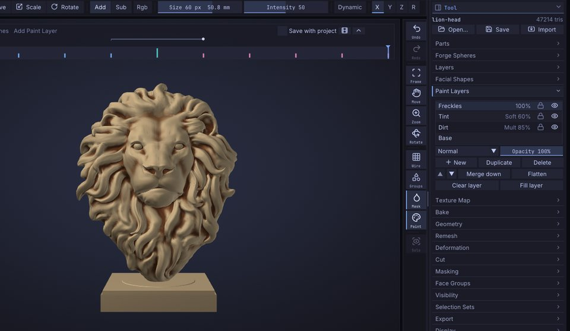

# What's new

What changed in each version of SculptForge, newest first. The first time you start a new version, a window
shows its main features, each with a **Try it** button; **Help > What's New** opens it again. Below are the last
three versions in full, then the older ones in groups. Every detail is in the
[changelog](https://github.com/islandmed/SculptForge/blob/main/CHANGELOG.md).

## Version 0.10.9

```features
date: 2026-11-02
tagline: Your first sculpt in ten minutes, starter meshes, brushes that keep their settings, and tablets that just work.
highlight: Your first sculpt in 10 minutes: a beginner lesson from sphere to a rendered mushroom house
highlight: Starter meshes: heads, a body, hands and clean primitives, all quads with levels ready
highlight: Each brush keeps its own size, intensity, stroke and alpha
highlight: Tablets: plug in while running, pressure with or without Windows Ink, no camera jumps
title: Your first sculpt
line: A 12-step lesson that turns the default sphere into a painted, rendered mushroom house.
image: images/wn-first-sculpt.jpg
action: help.first_sculpt
link: first-sculpt.md
title: Starter meshes
line: Start from a head, bust, body, hand or clean primitive, all quads at life size.
image: images/wn-starter-meshes.jpg
action: file.new_starter
link: projects.md#start-from-a-starter-mesh
title: Brushes keep their settings
line: Size, intensity, falloff, stroke and alpha follow each brush; Save Brush Settings keeps them.
image: images/wn-brush-settings.jpg
action: brush:Clay
link: sculpting.md#each-brush-keeps-its-own-settings
title: What's New, redesigned
line: The main features as cards with a Try it button; older versions fold into short groups.
image: images/wn-whats-new.jpg
action: guide:whats-new.md
```

- **Each brush keeps its own settings**: Draw Size, Intensity, Falloff, RGB Intensity, stroke and alpha follow
  the brush, custom and Community brushes included. **Brush > Save Brush Settings** keeps them for the next start,
  **Reset Brush to Default** puts back the shipped values, and **Preferences > Input > Share size and intensity
  across brushes** keeps the old way (#78). See [Sculpting](sculpting.md#each-brush-keeps-its-own-settings).
- **Alpha options** (**Alpha** palette): **Follow stroke direction** turns the alpha along the stroke, smoothed as
  Blender's Rake does; **Angle** and **Angle jitter** turn it by a fixed or a random amount; **Tile** repeats it
  inside the brush. They work with custom and Community brushes too, and each brush keeps its own (#76). See
  [Alpha options](sculpting.md#alpha-options).
- **Blender style: Alt+drag masks** on the model and Ctrl+Alt+drag unmasks, as in Blender 5.1 and later; beside the
  model Alt+drag still turns the view. **Preferences > Input > Emulate 3 Button Mouse** makes Alt+drag turn the view
  everywhere. Shift+F now sets the brush's Intensity, not Smooth's (#77).
- **View > Lock camera** (<kbd>Shift</kbd>+<kbd>L</kbd>): drags that start beside the model sculpt instead of
  turning the view, and the status bar shows **CAMERA LOCKED** while it is on (#62).
- **Tablets**: plug a tablet in while SculptForge runs and it just works ("Tablet connected" in the status bar),
  also through Wacom Bridge. On Windows, pressure works with the Wacom driver's **Use Windows Ink** on or off.
  **Preferences > Input** shows whether pressure is detected, with a troubleshooting link. The view no longer jumps
  when the pen comes back into range, and the active Part changes only with **Alt+click** on the keyboard; the
  status bar names the new Part. See [Troubleshooting](troubleshooting.md#pen-tablets).
- **Smaller (or larger) corner axes**: **Draw > Camera > Gizmo size** sets Small, Medium or Large
  ([Navigation](navigation.md)).
- **View Figure**: turn it on beside **Axes** for a small head in the corner that turns with the view; click it to
  snap to the nearest side.
- **Starter meshes**: start a sculpt from a human head with eye and mouth loops, a bust, a full body in A-pose, a
  hand, a foot, an ear, an eye, a stylised head, a creature head, a torso, or a bevelled box, cylinder, capsule or
  ring, all clean quads at life size with subdivision levels ready. **File > New from Starter Mesh**, the Library's
  **Tool > Starter meshes**, or **Start from a head** in the welcome. See
  [Projects](projects.md#start-from-a-starter-mesh).
- **Your first sculpt in 10 minutes**: a step-by-step lesson for people who have never sculpted. Turn the
  default sphere into a little mushroom house with a spotted red cap, a door and glowing windows, using masks,
  Move, Inflate, Crease and Clay, Vertex Paint and PBR shading, and save a render to share. Start it from the
  welcome's **Start the 10-minute lesson** button or **Help > Your first sculpt (10 min)**. See
  [Your first sculpt](first-sculpt.md).
- **Save Render** (**Render > Materials**): the view without the interface, at twice its size, as a PNG in your
  Library (**Library > Image**).

- **A new What's New**: after an update, a window shows the main features as cards with a picture, one line and a
  **Try it** button that opens the feature (switch the look, select the brush, open the membership card...).
  **Help > What's New** opens it again; <kbd>Esc</kbd> closes it. This chapter shows the last three versions in
  full and folds the older ones into short groups, on the website too.
- **Image to 3D with no setup**: the free default is now Hunyuan3D 2.1, which needs no token. TRELLIS.2 ("Best
  detail") still needs a free Hugging Face token (**Preferences > AI**); without one, Hunyuan3D 2.1 runs instead
  and the status line tells you. Your own model choice is kept. See [Image and text to 3D](generate-3d.md).
- **Generated models arrive as clean quads**: Quad Remesh is now the default, with one subdivision level holding
  the detail, so you can sculpt and subdivide straight away. Voxel remesh and Off are still in **Remesh**.
- **Calm, clear hover**: buttons, menus and shelves brighten a little as you point at them, tiles lift a little,
  sliders show their exact value, and the keyboard focus gets a ring as strong as your **Outlines** setting. Prefer less
  movement? Turn on **Preferences > Interface > Reduce motion** ([Interface](interface.md)).
- **Picker thumbnails on top**: the enlarged thumbnail you point at in a picker is no longer hidden under its
  neighbours (#86).
- **Focus Detail (experimental)**: sculpt a head of a billion micro triangles from one compressed file. Detail
  loads where you look and where the brush is heading, and the rest shows a lighter version. Saving writes only
  what you changed. Try it with `sculptforge --benchmark standard-1b` (Linux and macOS for now).
- **Precision work** for pores, wrinkles, jewellery and trims: **Steady Stroke** (<kbd>L</kbd>) with every stroke
  type and a catch-up on release; **World Size**, so the brush keeps its size in mm on the surface as you zoom;
  Draw Size down to 0.5 px with <kbd>Shift</kbd>+<kbd>[</kbd> / <kbd>]</kbd> for 1 px steps; hold
  <kbd>Shift</kbd>+<kbd>Alt</kbd> while drawing to move the brush at a quarter of the pen's speed; and a pressure
  curve for each brush with a **Fine detail** preset. The brush centre now sits exactly under the cursor at any
  zoom. See [Precision work](sculpting.md#precision-work).
- **UI scale works live**: **Preferences > Interface > UI scale** (100% to 200%) resizes text and panels at once,
  no restart. **Automatic** follows the monitor the window is on, so on Windows moving it between a 100% and a
  150% monitor rescales it right away (#87). See [The interface](interface.md#interface-preferences).
- **The pen keeps working the panels**: with some tablets (Huion, pen displays, Wacom with Windows Ink on or off)
  the pen picked one brush, then stopped clicking menus and the canvas until you used the mouse. SculptForge now
  makes the pen's clicks itself (#95). See [Troubleshooting](troubleshooting.md#pen-tablets).
- **Mouse mode is relative again**: with **Mouse mode** on (Preferences > Tablet) the pen moves the cursor by how
  far it moves, whatever the driver's mode, and the arrow is drawn right at the brush (#72).
- **Two screens**: SculptForge no longer slows down when the pointer is on your other screen; it rests only when
  its window loses focus.
- **Turn AI off**: **Preferences > AI > Enable AI features** (the welcome asks too). Off hides AI Brush and
  Generate 3D everywhere and SculptForge makes no AI network calls. Your art is never uploaded or used for training. AI features run only when you use them and can be turned off. Studios can set `SF_AI=off`.
  See [The interface](interface.md#turning-ai-off).
- **Big brushes stay smooth on dense meshes**: on models from about 4 million triangles a stroke's dabs are worked
  out beside the view, so a 240 px brush on 33 million triangles no longer freezes the view for a third of a
  second at a time (slowest frames about 35 ms instead of 300), and letting go of the pen is instant. The stroke
  itself comes out the same.
- **Move keeps up on dense meshes**: Move no longer slows to a crawl on 33 million triangles with a fast pen, and the
  first orbit after a long stroke no longer hitches.
- **No more running out of memory**: **Help > Benchmark** skips a scene your computer hasn't got the free memory
  for (and says how much to free), and Subdivide, Divide, Micro and Voxel Remesh ask first when the result
  wouldn't fit in the memory free now.
- **Clay follows Intensity and pressure**: Clay and Clay Block build gently with a light pen or a low Intensity
  instead of planing flat as at full strength (#83). See [Sculpting](sculpting.md#built-in-brushes).
- **Alphas on micro levels**: Drag Stamp and every stroke stamp your alpha on a micro level too (#92).
- **Brushes hold on at silhouettes**: a stroke sliding past the edge of a form in profile keeps sculpting while the
  brush still covers it (#84).
- **Smooth face group borders**: a Brush palette option that straightens jagged clothing edges between face
  groups and leaves the rest alone (#81). See [Smooth face group borders](sculpting.md#smooth-face-group-borders).
- **Colour tints the material**: pick a colour and Parts with no vertex paint take it on in the Lit Sphere
  material. See [Vertex Paint and materials](vertex-paint.md#materials-lit-spheres).
- **Cut**: one tool that cuts the active Part with a **Line**, **Lasso**, **Rectangle** or **Polyline**. **Away**
  removes what the shape covers and closes the cut with a flat cap, **In** cuts a flat-bottomed pocket and **Add**
  raises the shape out of the surface. The result stays watertight and follows the symmetry. Hold
  <kbd>Ctrl</kbd>+<kbd>Shift</kbd> and pick a Cut shape, or open **Tool > Cut**. See [Cut](cut.md) (#101, #91).
- **Mask: Front faces only**: Mask Lasso and Mask Rectangle can leave the far side alone
  ([Masking](masking.md#mask-with-a-lasso-or-rectangle), #91).
- **Duplicate Part** has a shortcut: <kbd>Ctrl</kbd>+<kbd>Shift</kbd>+<kbd>D</kbd> ([Parts](parts.md)).
- **Brush previews fixed**: the shelf shows Tendril and Elastic Tendril as long horns pulled out past the ball, as
  they behave in the viewport, and Layer and Nudge with clean shapes; previews are rebuilt once after updating.
- **Library**: projects no longer show twice on Windows (#90); the close button stays on small screens and
  <kbd>Esc</kbd> closes the Library (#80).
- **Cleaner outlines**: the right shelf's outline draws correctly and the **x** buttons are centred (#98).
- **macOS**: a window closed in full screen reopens maximised, with the window buttons reachable (#85).
- **Stroke popup**: press <kbd>G</kbd> (<kbd>Z</kbd> in the Blender style) or the button under the **Stroke**
  tile for a grid at the cursor: the stroke types plus **Add**, **Sub**, **Smooth**, **Mask** and **Select**. Hold
  the key, point and let go, or tap it and click. Smooth, Mask and Select stay on without holding
  <kbd>Shift</kbd> or <kbd>Ctrl</kbd>. See [Strokes](sculpting.md#the-stroke-popup).

## Version 0.10.8

```features
date: 2026-11-02
tagline: Tablets in mouse mode follow the pen again.
highlight: Tablet mouse mode: the brush follows the pen again on some Windows tablets (#72)
```

- **Tablets in mouse mode work again**: on some Windows tablets with **Mouse mode** on (Preferences > Tablet) the
  brush stopped following the pen in 0.10.7. When the system can't say where its cursor is, the pen now moves the
  brush by how far it moves, from where it was (#72).

## Version 0.10.7

```features
date: 2026-11-01
tagline: A new look, clearer memberships, full alphas on every brush and a benchmark you can run.
highlight: A new look: Forge Terminal with menus by task, a status bar and a one-row tool shelf
highlight: Memberships: Supporter, Insider and Studio, side by side on a clearer card
highlight: Benchmark: a standard 15 or 33 million triangle scene that measures your machine
title: A new look
line: Forge Terminal with Tokyo Night and menus by task. Your layout stays until you try it.
image: images/wn-new-look.jpg
action: look:new
link: interface.md#looks-and-layouts
title: Clearer memberships
line: Supporter, Insider and Studio side by side, in your look's colours.
image: images/wn-memberships.jpg
action: card:membership
link: https://sculptforge.app/support.html
title: Full alphas, every brush
line: Custom and Community brushes show the whole alpha at Focal Shift -100 (#75).
image: images/wn-full-alpha.jpg
action: brush:Clay Slab
link: sculpting.md
title: Native Wayland
line: Every Linux package opens without XWayland and stays sharp at fractional scales.
image: images/wn-wayland.jpg
action: guide:installing.md#wayland-and-x11
title: Benchmark your machine
line: Sculpt a standard 15 or 33 million triangle head and get frame times you can share.
image: images/wn-benchmark.jpg
action: help.benchmark
link: performance.md#proof-mode-see-it-for-yourself
```

- **A clearer membership card**: the three memberships side by side with what each one gets you, in your look's
  colours. **Maybe later** now hides it for 30 days.
- **New memberships**: Supporters get the credits (in the app and on the website), the monthly pack and a vote;
  Insiders also get daily drops and preview builds about a week early; Studio covers the whole company with a
  custom studio build (Founding Studio: the first 10 studios lock in $150 a month). Every release stays free for
  everyone; bug-fix and security releases go out to everyone the same day.
- **Full alphas on custom brushes**: at Focal Shift -100, Clay Slab and the other custom and Community brushes now
  show the whole alpha to its corners, as the built-in brushes do (#75).
- **A new look**: new installs start in **Forge Terminal** with the Tokyo Night colours and the **SculptForge
  layout**: menus by task (File, Edit, Sculpt, Paint, Mesh, View, Render, Help) holding every palette, a status
  bar and a one-row tool shelf. If you are updating, nothing changes until you say so: a card offers **Try it** or
  **Keep my layout**. Coming from ZBrush? **Preferences > Interface > Look > ZBrush-style layout** (or the button in
  the welcome) brings back the palette bar and the two-row shelf. Six more colour schemes, Match my desktop theme,
  Phosphor, Blueprint and the Classic look are there too. See [The interface](interface.md#looks-and-layouts).
- **Native Wayland on Linux**: every Linux package opens without XWayland, stays sharp at fractional scales and
  reads pen pressure through tablet-v2. The RHEL and Rocky builds now include libdecor (title bars on GNOME
  Wayland). See [Wayland and X11](installing.md#wayland-and-x11).
- **Benchmark your machine** (**Help > Benchmark**, or `sculptforge --benchmark standard-15m`): a procedural 15 or
  33 million triangle head sculpted with Clay at 25, 60 and 120 px, Move, Smooth and a 240 px brush, reporting frame
  times (p50, p95, p99), stroke lag, the worst stall and memory. See [Performance](performance.md#proof-mode-see-it-for-yourself).

## Version 0.10.6

```features
date: 2026-11-01
tagline: See materials as a game engine does, wear that follows the sculpt, and packs you can share.
highlight: PBR viewport: the texture's material lit by an environment, as fast as Lit Sphere
highlight: Fill layers: edge wear, dirt and gradients laid through a mask of effects
highlight: Packs and macros: install brushes, alphas and macros after a review of what's inside
title: PBR viewport
line: See the texture's material lit by an environment, as a game engine shows it.
image: images/pbr-viewport.jpg
action: guide:pbr-painting.md#the-pbr-viewport
title: Fill layers
line: Edge wear, dirt and gradients laid over the whole Part through a mask of effects.
image: images/fill-painted-edges.jpg
action: guide:fill-layers.md
title: More maps to bake
line: Curvature, thickness, position and ID, and UDIM tiles as one set of files per tile.
image: images/bake-mesh-maps.jpg
action: guide:baking.md
```

- **PBR viewport** (**Material > Viewport Shading > PBR**): see the texture's material as a game engine shows it,
  lit by an environment: Studio, Photo Studio, Small Studio or Outdoor Sky, with exposure, rotation, the
  environment behind the model and a choice of tone map. Painted height and normals catch the light. It stays as
  fast as Lit Sphere on a 20-million-triangle Part. See [Material painting](pbr-painting.md#the-pbr-viewport).
- **Fill layers** (**Tool > Paint Layers > + Fill Layer**): lay a material over the whole Part through a mask of
  effects (edge wear, dirt, gradient, thickness, light direction, 3D noise, a painted mask, levels, blur) instead
  of painting it by hand. Change it any time. See [Fill layers](fill-layers.md).
- **Wear that follows the sculpt**: Fill layers read the Part's Mesh Maps (occlusion, curvature, thickness and
  more), and after each stroke only the part of the maps near the stroke is baked again in the background, so
  chipped paint and dirt move with the form while you sculpt.
- **Material Recipes**: Worn Metal, Painted Edges, Dirt and Dust and Rusted Iron in one click, and your own saved
  as small files.
- **Packs and macros** (**File > Install Pack...**, **Library > Packs**): install a `.sfpack` of brushes, alphas,
  Lit Spheres, Material Recipes, VDMs, keymaps, pie menus and macros after a review that shows exactly what's
  inside, its license and its author. Switch packs off, remove them, or make your own with **New Pack**. Record
  the commands you run as a **macro**, edit it as plain text, and run it from <kbd>F3</kbd>, a key or a pie menu as
  one undo step. Packs are data only and macros only run SculptForge's own commands; `--no-packs` starts without
  any pack. See [Packs and macros](packs-and-macros.md).
- **More maps from Tool > Bake**: curvature, thickness, position and ID; bake a Part's top subdivision level (or
  micro level) onto its lowest level without a second Part; UDIM tiles bake as one set of files per tile. See
  [Baking](baking.md).
- **Forge Spheres with the pointer alone** (#8): **Drag places child** (or <kbd>Ctrl</kbd> while you drag) moves a
  new sphere away from its parent in one drag; **Delete Selected**, **Insert Between** and **Set as Root** work on
  the sphere you last clicked, and a right click on a sphere opens a menu with the same. See
  [Forge Spheres](forge-spheres.md#pointer-only).
- **Maya zoom** (#32): in the Maya input style <kbd>Alt</kbd>+right drag now zooms with a sideways drag, as Maya's own
  dolly (right zooms in). To keep zooming up and down as before, choose **Preferences > Input > Zoom drag > Up and
  down**. **Invert zoom** turns any zoom drag around; <kbd>Ctrl</kbd>+<kbd>Alt</kbd>+<kbd>Shift</kbd> erases
  the mask. See [Maya keys](shortcuts.md#maya-keys).
- **Move along the normal** (from the discussions): Move, Tendril, Elastic Tendril and KelvinGrab started with
  <kbd>Alt</kbd> held pull the surface straight out of itself (or push it straight in) instead of across the screen.
  See [Sculpting](sculpting.md#along-the-normal).
- **Polish, Relax, Smooth and Balloon** (from the discussions): **Tool > Deformation** works on the whole Part by an
  amount: Polish flattens fine noise and keeps edges, Relax evens out the spacing, Smooth can keep the volume, and
  Balloon fills the form out. The mask holds what it covers; one undo step each. See
  [Sculpting](sculpting.md#whole-part-deformations).
- **Smooth without remeshing** (from the discussions): **Smooth remesh** in **Draw > Dynamic topology** sets how
  much Shift-smoothing changes the topology, down to **Smooth only**. See
  [Dynamic topology](dynamic-topology.md#smooth-remesh).
- **Connected only and View falloff** (from the discussions): brush options that keep a stroke to the piece under
  the cursor (the other leg, the next finger stay put) or reach through the model along the view, as Blender's
  proportional editing. See [Sculpting](sculpting.md#falloff-options).
- **The SculptForge Discord** (**Help > Join the Discord...**): the official community, for questions, tips and
  work in progress. It is also on the support card, in the welcome note and on the website. Bugs still go to
  **Help > Report a problem** (GitHub issues).
- **Backface culling** (#68, **Tool > Display**): don't draw the back faces of the model, for speed on open meshes
  and to see through their openings. Brushes then work only on what you see. Off by default.
- **A crosshair over the view** (#73): the pointer is a crosshair where brushes act and the arrow over the panels.
  **Preferences > Interface > Viewport cursor** brings the arrow back.
- **A radial menu on the right button** (#74): choose **Right mouse button** for a menu in **Preferences > Input >
  Radial Menus**; turn the view with <kbd>Shift</kbd>+right-drag then. A menu on a mouse button now opens only
  without modifier keys, so <kbd>Alt</kbd>+middle still pans.
- **Fixed: Smooth on quad meshes** (#69): smoothing a Quad Remesh result no longer shears the quads into zigzags.
- **Fixed: Keep Masked remeshing** (#67): Voxel Remesh with Keep Masked works on real sculpts, tidies awkward mask
  edges by itself, and says what to change when it can't.
- **Fixed: tablet mouse mode** (#72): the brush stays on the system cursor after the pen is lifted and put down
  elsewhere, and clicks land where the arrow is.

## Version 0.10.5

```features
date: 2026-11-01
tagline: Selection sets, a full UV Editor, radial symmetry and SculptForge's own names.
highlight: UV Editor: seams, unwrapping, UDIM packing and live stretch on the model
highlight: Selection sets: named snapshots of mask, groups, visibility and shape
highlight: Radial symmetry: every stroke repeated 2 to 64 times around an axis
title: UV Editor
line: Draw seams, unwrap, pack across UDIM tiles and see stretch live on the model.
image: images/uv-editor.jpg
action: ui.uv_editor
link: uv-editor.md
```

- **Selection sets** (**Tool > Selection Sets**): store as many named snapshots of a Part's mask, face groups,
  visibility, vertex paint, UVs and shape as you like, and restore them at any subdivision level, not only the one
  they were stored at. Combine two sets (union, intersect, subtract), restore one onto the current mask or
  visibility the same way, or take a quick set from the visible faces. Every step is one undo step, and the sets are
  saved with the project. See [Selection sets](selection-sets.md).
- **Morph brush and Morph to Set**: a set with its shape is a morph target. The new **Morph** brush pulls the
  surface back toward it (<kbd>Alt</kbd> pushes away), and **Morph to Set** blends the whole Part toward it by any
  amount, within the mask, at any subdivision level.
- **Sets for pipelines**: `selection_set_*` commands for scripts, `sculptforge-cli` and the AI assistant,
  `doc.selection_set()` / `doc.set_selection_set()` in Python, `.sfsets` files to move sets between Parts and
  scenes, and USD exports that carry them as GeomSubsets and primvars (read back on import).
- **UV Editor** (**Tool > Texture Map > UV Editor**, <kbd>Alt</kbd>+<kbd>U</kbd>): the Part's UVs flat over the UDIM
  tiles, drawn by the graphics card so a million triangles stay smooth. Draw seams on the model with the **Seam
  Tool** (or take them from face groups, island borders or sharp edges), then **Unwrap**: **Least Stretch**,
  **Conformal**, **By Face Groups**, **Planar**, **Unfold Islands** or **Auto Seams**, with closed and tangled pieces
  cut for you. **Pack** into one tile or across UDIM tiles, **Set** and **Match** texel density, lay islands into
  **trim sheet** strips, and select vertices, edges, faces or islands (in the view or on the model) to move, rotate,
  scale, pin, weld, split, straighten and flip them. The model shows stretch, texel density, islands and a checker
  live while you edit, and a painted texture moves with every change so the model keeps its look. Every step is one
  undo step and a `uv_*` command for scripts. See [UV Editor](uv-editor.md).

- **Fixed: the viewport on some Windows PCs** (#29): on displays whose window uses another colour format (seen with
  NVIDIA and high-resolution screens) the model never appeared and the cursor left trails. The view now reaches the
  window on every format, and falls back to drawing directly if a driver still refuses.
- **Features use SculptForge's own names** (Parts, Forge Spheres, Vertex Paint, Face Groups, Library, Lit Spheres,
  Quad Remesh, Send to ZBrush, Snapshot...); searching for ZBrush terms still finds them, and MatCaps are now Lit
  Spheres. The table is in [Coming from ZBrush](coming-from-zbrush.md#zbrush-terms-in-sculptforge).
- **New installs start with the SculptForge keys**, and the first start asks what you are coming from (ZBrush,
  Blender, Maya or new to sculpting) to pick the key style. Your saved style is kept; ZBrush's keys are
  **ZBrush-style** in **Preferences > Input**. See [Keyboard and mouse](shortcuts.md#zbrush-style-keys).

### From your requests on GitHub

- **Start strokes off the model** (#62): an option in **Preferences > Input**, off by default, and
  <kbd>Shift</kbd>+<kbd>L</kbd> to turn it on and off. With it on, a left-drag that starts on the background
  sculpts once it reaches the model instead of turning the view. See [Navigation](navigation.md#mouse-and-pen).
- **Radial and local symmetry** (#63): **R** in **Transform > Symmetry** (and on the top shelf) repeats every
  stroke around the X, Y or Z axis, 2 to 64 times (**Radial Count**), together with the X / Y / Z mirrors. Every
  brush, mask, vertex paint and texture stroke, the mask and select shapes, Dynamic Topology and Insert follow it,
  and the brush cursor shows on every copy. **Local** puts the planes and the axis through the active Part's centre.
  Saved with the project and scriptable (`radial`, `radial_axis`, `local`). See [Sculpting](sculpting.md#radial-symmetry).
- **The Sculpt Timeline is at the top of the viewport** (#63), away from the brushes on the bottom shelf. **Preferences >
  Interface > Timeline position** puts it back at the bottom; Store Config keeps the choice. See
  [Sculpt Timeline](timeline.md).

## Version 0.10.4

```features
date: 2026-11-01
highlight: Keep Masked remeshing: the masked part keeps its triangles and detail exactly
highlight: Radial menus: hold T or Y, flick and let go, or make your own
highlight: Insert your own mesh: a copy of a Part or an .obj, .ply or .glb, placed by a drag
```

### From your requests on GitHub

- **Insert your own mesh** (#34): **Append > Insert on the model** now takes a copy of another Part or an
  `.obj`, `.ply` or `.glb` file, placed, sized and turned by the drag like the shapes. See [Parts](parts.md).
- **Keep Masked** for Voxel Remesh, Decimate and Quad Remesh (#43): the masked part keeps its triangles and detail
  exactly; only the rest is rebuilt and joined to it. See [Geometry](geometry.md).
- **Hold Space and drag to move the camera** (#43): an option in **Preferences > Input**, off by default. See
  [Navigation](navigation.md).
- **Triple-click** another Part in the viewport to select and frame it (#43).
- **Twelve new alphas** (Pores, Cracks, Scales, Rivets, Stitches, Fabric Weave, Bark, Rock Strata, Wrinkles, Skin
  Folds, Hair Strands, Dot Grid) and **six new VDM brushes** (Rivet, Stitches, Skin Fold, Wrinkle Line, Crack, Rock
  Ledge), with thumbnails in the Library (#43). See [Sculpting](sculpting.md).
- **Mask from the mesh border** (#61): **Tool > Masking > By border** masks open edges (and face group borders),
  so sculpting leaves them in place. See [Masking](masking.md).
- **SculptForge in Spanish** (#44): **Preferences > Interface > Language > Español**.
- **Maya bridge** (#42): **File > Maya** and a SculptForge shelf for Maya swap meshes through a folder you
  pick: no connections, nothing run. See [Working with Maya](maya.md).
- **Radial (pie) menus** (#45): hold **T** (brushes) or **Y** (masking), flick and let go; make your own in
  **Preferences > Input > Radial Menus**. See [Sculpting](sculpting.md#radial-menus).
- **Falloff works with alphas** (#60): -100 shows the whole alpha, 0 rounds it off, +100 leaves a soft point
  (alpha brushes are softer at the default 0 than before; set -100 for the old crisp look).
- **Select Rectangle and Select Lasso** follow X / Y / Z symmetry, like the mask versions (#51).

### Become an Insider

SculptForge stays free for everyone. Every release stays free for everyone; bug-fix and security releases go out
to everyone the same day. **Help > Support SculptForge** opens the page to join.

When SculptForge starts for the first time, after an update, and otherwise at most once a week, a card shows the
ways to support it: **Supporter**, **Insider** and **Studio** memberships and the one-time Supporter, each opening its
checkout page in your browser. **Maybe later**, <kbd>Esc</kbd> or a click outside closes it; **I'm already a
supporter** hides it for good, and **Preferences > Support** turns it off. It never shows while you work, and
nothing about you is sent anywhere.

## Version 0.10.3

```features
date: 2026-11-01
highlight: Alternate smooth: let go of Shift mid-stroke to smooth without shrinking the form
```

### From your requests on GitHub

- **Alternate smooth** (#40): start smoothing with Shift held, then let go of Shift while still pressing, and the
  rest of the stroke smooths without shrinking the form. **Brush > Smooth keeps volume** makes it the default. See
  [Sculpting](sculpting.md).
- **Masking** (#48, #51): Ctrl+drag on the background draws a mask rectangle; Lasso and Rectangle masks follow
  symmetry; a Ctrl+click with them blurs the mask. See [Masking](masking.md).
- **Pen tablets in mouse mode** (#54): **Preferences > Tablet > Mouse mode (relative)** stops the cursor jumping
  back when you lift the pen.
- **Axis gizmo**: click X, Y or Z to snap to that view (#43). **Undo and Redo** on the right shelf, **Continuous**
  in the stroke picker, **Part thumbnails**, and **Insert on the model** follows symmetry. See
  [Navigation](navigation.md) and [Parts](parts.md).
- **macOS** (#41): reopening in full screen keeps the menu bar and window buttons reachable.

### Support SculptForge

SculptForge stays free for everyone. **Help > Support SculptForge** opens the page where you can become a
member. Every release stays free for everyone; bug-fix and security releases go out to everyone the same day.

## Version 0.10.2

```features
date: 2026-11-01
highlight: Quad Remesh 2: two to fifty times fewer poles, loops that follow the forms
highlight: Elastic brushes: KelvinGrab, KelvinTwist, KelvinScale and Elastic Tendril
highlight: Capture from view: turn any detail into an alpha or a vector displacement brush
```

### Quad Remesh 2

A new quad remesher is now the default in **Tool > Remesh** and **Tool > Geometry**: two to fifty times fewer poles
than before at the same accuracy, edge loops that follow the forms (round the mouth and nose), exact symmetry, and a
quality report after each run. The previous method is still there as **Legacy**, and pieces with closed guide loops
use it for now. See [Quad retopology](retopology.md).

### Kelvinlet brushes and Capture from view

**KelvinGrab**, **KelvinTwist**, **KelvinScale** and **Elastic Tendril** move the surface like elastic clay, with a Squash
slider from rubber to firm clay; they're at their best below about 10 million triangles for now. **Capture from view**
(<kbd>Ctrl</kbd>+<kbd>Alt</kbd>+<kbd>C</kbd>) turns any detail into an alpha or a vector displacement brush, and
**Detail Clone** stamps it along a stroke. See [Sculpting](sculpting.md).

### Also

- Insert on the model (#34): the drag's direction also turns the shape about the surface.
- Security: video exports (timelapse, Benchmark) no longer pass the file name to ffmpeg in a way a crafted name
  could abuse. Update if you use them.
- The local API added in 0.10.1 is removed; SculptForge doesn't listen for other programs.

## Version 0.10.1

```features
date: 2026-11-01
highlight: Micro levels: about a billion sculptable triangles in under 2 GB of memory
highlight: PBR painting: roughness, metallic, normal and height, exported for every engine
highlight: Sculpt Timeline: scrub back through every stroke and branch from any point
highlight: Maya navigation: Alt+left orbits, Alt+middle pans, Alt+right zooms
```

### From your feedback on GitHub

- **Maya navigation** (#32): **Preferences > Input > Maya**. Alt+left orbits, Alt+middle pans, Alt+right zooms.
- **Focal length** (#26): **Draw > Camera**, 15-300 mm with 35 / 50 / 85 / 135 presets, saved with the project.
- **More primitives** (#31): Cylinder, Cone, Torus, Capsule, Icosphere and Quad Sphere in **Tool > Parts >
  Append**, plus **Insert on the model** (#34): choose a shape, then drag on the surface to add it.
- **Continuous** in the Stroke palette keeps the brush working while you hold it still, and an X / Y / Z gizmo
  shows the view's direction (#31).
- **Local API** (#36): other programs on your computer (symmetry tools, scripts) can run commands in the open
  app. Off by default; see [Scripting](scripting.md).
- The window opens where and how big you left it (#35), and a drawing problem on some graphics drivers that left
  trails in the viewport is fixed (#29).

### Micro levels: hundreds of millions of polygons

**Tool > Geometry > Micro** adds a micro-displacement level above your top subdivision level: up to about a
billion sculptable triangles in under 2 GB of memory, drawn at the detail your screen can show. Move reshapes the
base and the detail rides along. Bake it down or export displacement maps. See
[Micro levels](micro-levels.md).

### Material painting (PBR)

Paint roughness, metallic, normal, height, AO, emissive and opacity alongside colour, per paint layer, and export
packed maps with presets for Unreal, Unity, glTF, Godot, Blender and USD. Texture brushes are much faster on
dense meshes. See [Material painting](pbr-painting.md) and [Export presets](export-presets.md).

### Sculpt Timeline and proof mode

Scrub back through every stroke, branch from any point, retune an old stroke's strength, and export a timelapse
turntable. **Help > Benchmark** runs a scripted stroke on 5M to 33M triangles with a live readout and records a
video and a report you can share. See [Sculpt Timeline](timeline.md) and [Performance](performance.md).

### Hardware profile

On first start SculptForge measures your computer for a second and picks settings for it (Laptop, Workstation or
a safe mode); on battery it saves power. See **Preferences > Performance**.

### Also new

- The brush ring lies on the surface and follows its shape (#25). **Preferences > Input > Cursor follows surface**
  turns it off.
- Faster normals on big meshes. **Predictive strokes** (a GPU preview of each dab ahead of the solver) are in
  **Preferences > Performance** as an experiment.
- The status bar shows only the file name of what you open.

## Version 0.9.7

```features
date: 2026-10-31
highlight: Faster big brushes: half the lag for a 200-pixel brush on 21 million triangles
```

### Faster big brushes on dense meshes

A large brush on a model of 20 million triangles or more keeps up much better: on a 21-million-triangle sphere
with a 200-pixel brush, the brush now trails the pointer by half as far, a frame takes a third less time, the
first dab appears in half the time, and lifting the pen no longer pauses for up to a second while waiting dabs
are placed. See [Performance](performance.md).

### Right click for the Quick Menu

A right click on the canvas opens the Quick Menu under the cursor, as in ZBrush (Space still does too). A right
drag turns the view as before, and **Preferences > Input > Right click opens the Quick Menu** turns it off. See
[The Quick Menu](sculpting.md#the-quick-menu).

### Fixes

- The orthographic view (<kbd>Numpad 5</kbd>) shades like the perspective one: Lit Spheres and the lights no longer
  look inside out.
- Dynamic topology with symmetry now adds detail on the mirrored side too when the model's two sides aren't
  built from mirrored polygons (a QRemeshed head, say): before, only the side under the brush got the new
  triangles. See [Dynamic topology](dynamic-topology.md).

## Version 0.9.6

```features
date: 2026-10-31
highlight: Extract: a masked area becomes a shell that fits the surface exactly
highlight: Mirror And Weld: one side mirrored onto the other as one watertight mesh
highlight: Flatpak: one sandboxed file for x86_64 and ARM64 Linux
```

### Extract

Mask part of a Part and **Tool > Parts > Extract** turns it into a shell that fits the surface exactly: a
helmet, a strap, a piece of armour. Set **Thick**, **E Smt** and **Double** while the preview shows, then
**Accept** keeps it as a new Part (and <kbd>Ctrl</kbd>+<kbd>Z</kbd> takes it away again). **TCorne** and
**TBorder** give the rim triangles instead of quads. See [Extract a shell](parts.md#extract-a-shell).

### Mirror And Weld

**Tool > Geometry > Modify Topology > Mirror And Weld** mirrors one side of a model onto the other across X, Y
or Z and welds the seam into one watertight mesh, keeping face groups and vertex paint. **Tool > Deformation >
Mirror** flips a Part. See [Mirror And Weld](geometry.md#mirror-and-weld).

### A flat background

**Preferences > Display > Background** (also in the Render palette) switches the view from the gradient to a
flat colour you pick. Store Config keeps it, and projects keep their own. See
[The background](interface.md#the-background).

### Flatpak

SculptForge comes as a Flatpak for x86_64 and ARM64 Linux: one file on the releases page that runs in Flatpak's
sandbox on any distribution, installed with `flatpak install --user ./SculptForge-linux-x86_64.flatpak`. It can
open projects and models anywhere in your home folder, works with pen tablets and a
SpaceMouse, and the Blender bridge finds it by itself. See
[Installing SculptForge](installing.md#flatpak).

### Fixes

- Fast strokes on very dense meshes keep their curve. When one dab cost more than a frame, a quick arc came out
  as a straight line; now the dabs wait in a queue the app works through between frames, so it keeps reading
  the pointer. Based on a patch by @bribblej-web. See [Performance](performance.md).
- The AppImage has a PNG icon at its root, so AppImage managers (AppManager, Gear Lever) show SculptForge's
  icon when they add it to your menu.
- Divide (<kbd>Ctrl</kbd>+<kbd>D</kbd>) no longer crashes on models with a point where many polygons meet, such
  as a Blender cylinder with Triangle Fan caps of 22 or more sides or a UV sphere's poles.
- Generating with a [ComfyUI](generate-3d.md) workflow and a fixed seed could crash at random; fixed.
- SculptForge now keeps a log file, `sculptforge.log`, in its settings folder (**Help > Open log folder**). After
  a crash it says what crashed and what you did last; attach it when you report a problem. See
  [The log file](troubleshooting.md#the-log-file).

## Version 0.9.5

```features
date: 2026-10-31
highlight: Forge Spheres: block out bodies and creatures from connected spheres
highlight: Blender keys: Blender's navigation and Sculpt Mode keys
highlight: SpaceMouse: turn, pan and zoom with a 3Dconnexion SpaceMouse (experimental)
```

### Forge Spheres

Block out a body, creature or plant from connected spheres, the ZBrush way: **Tool > Forge Spheres > New Forge Sphere**,
drag on a sphere to grow a limb, Move and Scale it into proportion, Alt+click to delete, with Symmetry mirroring
every edit. **Preview** (<kbd>A</kbd>) shows the skin, and **Make Mesh** turns it into a sculptable, all-quad
Part with a face group per limb, keeping the Forge Spheres to change later. See [Forge Spheres](forge-spheres.md).

### Blender keys

**Preferences > Input > Style > Blender** brings Blender's navigation and Sculpt Mode keys: middle-drag to
orbit (Alt+drag with a pen), the numpad views, F / Shift+F, V S P I G C K for brushes, M for the mask. You can
also import a keymap you exported from Blender. See [Blender keys](shortcuts.md#blender-keys).

### Flat shading

**Material > Shading > Flat** shows every polygon as its own facet, to read a low-poly blockout's planes and
check exactly what a brush did; **This Part** keeps one Part smooth or flat whatever the scene says. See
[Vertex Paint and materials](vertex-paint.md).

### SpaceMouse (experimental)

A 3Dconnexion SpaceMouse now moves the view: twist, tilt and push the cap to turn, pan and zoom around the model
with one hand while the other holds the pen, in every input style and even mid-stroke. The two side buttons
frame the model and show the front. **Preferences > Input > SpaceMouse** sets the speed, the dead zone, turntable
rotation, a dominant-axis mode, inverts any axis, and maps the buttons. It reads the device directly, without
3Dconnexion's driver, and hasn't been tried on real hardware yet: see
[SpaceMouse](navigation.md#spacemouse-experimental) if yours doesn't show up.

### Your own Lit Spheres

**Material > Load Lit Sphere...** turns any image (PNG, JPG or EXR) into a material, and images you put in
**Documents/SculptForge/MatCaps** show up in the material list, even while SculptForge is running. Right-click one
and choose **Remove** to send it to the trash. Projects carry the Lit Sphere they use, so they look the same on any
computer. See [Your own Lit Spheres](vertex-paint.md#your-own-lit-spheres).

### Fixes

- Pens whose drivers send stray mouse events (a Ugee M708 on Linux) can rotate, pan and zoom on the background
  again instead of shaking the view.
- The S / U / I / O slider opens with its knob under the cursor and stays open while you drag it.
- The Blender Bridge add-on installs again: its zip was missing a file.
- Pens on Windows (Wacom Intuos Pro and others through Windows Ink): taps on menus and buttons land, and Alt+pen
  drag, the Move button and the S / U / O slider follow the pen instead of jumping.
- Idle, SculptForge no longer keeps your graphics card busy: it draws a new frame only when something changes
  (before, 60 or more a second all the time).

## Version 0.9.4

```features
date: 2026-10-29
```

### Fixes and packaging

Exports without a material of their own (FBX, USD) and splats made from an unpainted sculpt use the Soft Clay
grey instead of the old peach. Linux AppImages are now named `SculptForge-0.9.4-x86_64.AppImage` (and
`-aarch64`) and carry update information for AppImageUpdate. On macOS you can install with Homebrew:
`brew install --cask islandmed/tap/sculptforge`.

## Version 0.9.3

```features
date: 2026-10-28
```

### A cleaner look

The default material is now **Soft Clay**: matte, with a clear light and shadow side, so sculpted detail reads at
a glance. Orange marks only the current tool; options that are on are a lighter grey with a thin orange line.
Every brush icon is drawn the same way, with a mark that shows what the brush does. A material you picked
before is kept: choose **Soft Clay** in the Material menu to see the new look. See [The interface](interface.md).

### Bigger brush tiles, your size

The brush tiles on the bottom shelf are bigger. Right-click any brush on the shelf and choose **Tile size**:
Small, Medium or Large (also in **Preferences > Interface > Shelf tiles**).

### Export STL from the File menu

**File > Export STL...** is its own menu item, for 3D printing.

## Version 0.9.2

```features
date: 2026-10-28
```

### View in AR on Android

On Android, **View in AR** used to just download a file. It now opens an AR page in **Chrome**: your sculpt comes
to it encrypted through SculptForge's relay, so it works even when Chrome can't reach your computer, and it updates
as you sculpt. Show it with Chrome's AR or with Google's AR viewer. If the capture page is open in Firefox, tap
**Open in Chrome**. See [Phone capture and AR](phone-capture.md).

### One port for the phone link

Face capture and AR now use the same network port as the capture page. On Linux with a firewall, allow that port
for both TCP and UDP from your home network.

## Version 0.9.1

```features
date: 2026-10-27
```

Fixes from the first day of 0.9.

### Phone capture: when the phone can't open the page

Recent versions of Chrome on Android can refuse to open any address on your home network and just say **This
site can't be reached**. The **Capture from phone** window now says so and suggests Firefox, and its **The phone
can't open the page?** list covers Linux firewalls too. See [Phone capture and AR](phone-capture.md).

### Easier to read

This guide, including What's New, and the update banner now use larger text.

### Baking

**Cancel** now stops small bakes too.

## Version 0.9.0

```features
date: 2026-10-26
highlight: Scan to sculptable: a phone scan becomes a clean, animatable quad mesh
highlight: Facial shapes: the 52 ARKit blend shapes on any sculpted head, driven live by your face
highlight: Phone capture: your phone as SculptForge's camera, with no app to install
```

Maquette to performance: scan an object or a clay maquette with your phone, turn the scan into a clean mesh you
can sculpt and animate, give a head the 52 ARKit facial shapes, and drive them live with your own face.

### Facial shapes and live face

**Tool > Facial Shapes > Generate Facial Shapes** gives a sculpted head the 52 Apple ARKit blend shapes
(`eyeBlinkLeft`, `jawOpen`, `mouthSmileRight`, ...) as sculpt layers, fitted to its proportions from a template head
with those shapes (ICT-FaceKit, MIT licence). Eyes, teeth and tongue Parts get theirs too. Fix any shape by
sculpting into its layer, check them with the **Face test** presets and sliders, and export them with their ARKit
names to GLB, USD, FBX and Blender (as shape keys). `face_weights` drives them live from a face feed, and recorded
takes play in the viewport and bake into a glTF animation or USD time samples. `new_head` starts a scene with a
human head to sculpt on. See [Facial shapes and live face](facial-shapes.md).

### Scan an object into a splat

Film an object with your phone, or take photos all around it, and SculptForge trains a Gaussian splat from it on
your own graphics card. The splat appears in the viewport after a few hundred steps and sharpens while it trains;
you can orbit around it, stop when it's good enough, or cancel. Pick **Video...** or **Photos Folder...** under
**Splats > Train from capture**, or drop a video onto the window. The free Brush trainer is offered as a one-click
download the first time. See [Scan an object into a splat](scan-to-splat.md).

### Make sculptable: from a scan to a production asset

One click in the **Splats** palette turns a Gaussian-splat capture into a clean Part you can sculpt, rig and
animate: a watertight surface with the floaters and background gone and open bottoms sealed, quad topology at a
Game, Film or Sculpt budget, edge loops round the eyes and mouth and along the nasolabial folds when the capture
is a head (mirrored across the face), and the capture's colours as vertex paint or a texture. A crop box cuts away
the table or the room; Review shows the face landmarks to nudge before remeshing. The splats stay, hidden. Five
million splats take about ten seconds on a laptop. See [From scan to sculptable mesh](scan-to-sculptable.md).

### Your phone as SculptForge's camera

**File > Capture from phone** shows a QR code: scan it and your phone's browser can send SculptForge a scan (walk
round an object for 20 to 60 seconds), a photo to turn into a model, or a splat file from a scanning app. Tap
**View in AR** to see your sculpt standing on your desk, updated as you sculpt, and **Face capture** to drive a
character's facial shapes with your own face, live. No app to install. See [Phone capture and AR](phone-capture.md).

## Version 0.8.1

```features
date: 2026-10-25
```

Fixes from a ZBrush artist's testing, and a way to bring your ZTools over.

### More like ZBrush

- **ZBrush zoom direction.** With the ZBrush input style, dragging up zooms out on every zoom drag, as in ZBrush.
  See [Navigation](navigation.md).
- **Ctrl and Ctrl+Shift brushes.** Hold <kbd>Ctrl</kbd> and the left shelf shows the mask brush; with
  <kbd>Ctrl</kbd> held the Brush and Stroke pickers pick Mask Pen, Mask Lasso or Mask Rectangle. <kbd>Ctrl</kbd>+<kbd>Shift</kbd>
  does the same for Select Rectangle and Select Lasso. See [Masking](masking.md).
- **Group by UVs.** One face group per UV island, in **Tool > Face Groups**. See [Face Groups and visibility](face-groups.md).

### Texture painting: one click to start, and faster

With the Paint brush on, a Part without a texture now shows **New Texture** on the top shelf and in the Color
palette: click it and SculptForge unwraps the model if it has no UVs (Auto UV, in the background) and gives it a
texture, so the next stroke paints texels. Big brushes on 4K textures paint four to five times faster. See
[Texture painting](texture-painting.md).

### Bring your ZTools over

ZBrush's `.ZTL` files are proprietary, but a free plug-in for ZBrush now converts them once, and then
SculptForge opens the `.ZTL` itself, every Part with its face groups, vertex paint, mask and UVs. See
[Coming from ZBrush](coming-from-zbrush.md#bring-your-ztools-over).

## Version 0.8

```features
date: 2026-10-25
highlight: Dynamic topology: the brush adds triangles where it needs detail
highlight: Vector displacement brushes: stamp whole shapes, overhangs and all
highlight: Quad Remesh Guides: draw the edge loops you want
```

Dynamic topology, vector displacement brushes, Quad Remesh Guides, and sculpt layers on every subdivision level.

### Dynamic topology (Sculptris Pro)

Turn on **Dynamic** on the top shelf and the brush adds triangles where it needs detail and removes them where
it doesn't: pull a sphere into horns or fingers without stretching, block in from a ball without remeshing.
**Detail** sets how small the triangles get, relative to the brush (zoom in for finer ones) or, with **Constant
detail**, one size for the whole mesh. Symmetry makes mirrored triangles, borders and masks are kept, and each
stroke is one small undo step. See [Dynamic topology](dynamic-topology.md).

### Vector displacement brushes

One drag stamps a whole shape, overhangs and all: the new **VDM** brush presses a vector displacement map, so a
horn can lean over, an ear can curl and scales can overlap, which no alpha can do. Four maps come with it (Horn,
Ear Curl, Scales, Nostril); make your own by sculpting on a **VDM Plane** and clicking **Create VDM**, or load the
EXRs Blender's VDM Brush Baker makes (and export yours for Blender). The new **Slide Stamp** stroke slides a stamp
into place. See [Vector displacement brushes](sculpting.md#vector-displacement-brushes).

### ZBrush keys in Blender's Sculpt Mode

The Blender add-on has a new preference, **ZBrush-style keys in Sculpt Mode**: S, U and O for Draw Size,
Strength and Falloff, B for the brushes by their ZBrush names, Space for the quick menu, Alt to dig in,
Ctrl to mask, Ctrl+Shift to hide, D and Shift+D for subdivision levels, and more. See
[Working with Blender](blender.md#zbrush-style-keys-in-sculpt-mode).

### Draw the edge loops you want

**Quad Remesh Guides** work like ZBrush's ZRemesher Guides brush: draw curves on the sculpt, around the eyes, the mouth or a
joint, and Quad Remesh puts an edge loop on each one and turns the flow around it to follow. A curve that ends where
it started becomes a loop that closes cleanly, symmetry mirrors what you draw, and **Curves Strength** sets how far
around a curve the flow follows it. Guides are kept with each Part and saved in the project. See
[Quad Remesh Guides](retopology.md#quad-remesh-guides).

### Sculpt layers on every subdivision level

Sculpt layers now have a guide section on how they work with subdivision levels, like ZBrush's 3D Layers: record
a layer at the top, step down and up, divide, reconstruct or delete levels, save, and it's still there, with one
weight for every level. See [Layers and subdivision levels](layers.md#layers-and-subdivision-levels).

## Version 0.7

```features
date: 2026-10-25
highlight: Blender bridge: send models between Blender and SculptForge in one click
```

ZBrush's keys and gestures by default, and a bridge that sends models between Blender and SculptForge.

### Your ZBrush hands just work

SculptForge now follows ZBrush's keys and gestures by default. A ZBrush sculptor tried an earlier version and
put it down because it didn't feel like ZBrush; this release goes through every habit of the first hour.
[Coming from ZBrush](coming-from-zbrush.md) lists what's the same, what's different and every shortcut side by
side.

- **S, U, I, O** open Draw Size, Intensity, RGB Intensity and Falloff under the cursor, and
  <kbd>Space</kbd> opens the Quick Menu with all of them plus the brush, stroke, alpha and material.
- **Falloff** shapes the brush falloff, shown as the cursor's inner ring. **RGB Intensity** gives painting a
  strength of its own, and **Smooth keeps its own Intensity**, so a gentle brush still smooths properly.
- **ZBrush's brush letters**: B C B Clay Block, B D S Sharp Crease, B M V Move, B I N Inflate...
- **Masking**: <kbd>Ctrl</kbd>+click the model blurs the mask, <kbd>Ctrl</kbd>+<kbd>Alt</kbd>+click sharpens it;
  <kbd>Ctrl</kbd>+<kbd>A</kbd>, <kbd>Ctrl</kbd>+<kbd>Shift</kbd>+<kbd>A</kbd>, <kbd>Ctrl</kbd>+<kbd>I</kbd>,
  <kbd>Ctrl</kbd>+<kbd>H</kbd> and <kbd>Ctrl</kbd>+<kbd>W</kbd> (group masked) work as in ZBrush.
- **Strokes and the view**: <kbd>Shift</kbd> pressed mid-stroke draws a straight line; <kbd>Shift</kbd>+click,
  let go and drag rolls the view; <kbd>Shift</kbd>+<kbd>Alt</kbd>+click frames a Part; <kbd>L</kbd> toggles
  Lazy Stroke and <kbd>V</kbd> swaps colours.
- **Visibility**: <kbd>Ctrl</kbd>+<kbd>Shift</kbd>+click on a partly hidden mesh hides the group, as in ZBrush.
- **Prefer the old keys?** **Preferences > Input > Style > SculptForge** brings back the number keys for brushes,
  <kbd>I</kbd> for Intensity and the <kbd>Ctrl</kbd>+drag zoom.

See [Sculpting and brushes](sculpting.md), [Masking](masking.md) and [Keyboard and mouse](shortcuts.md).

### Works with Blender

Keep Blender for your scene and sculpt in SculptForge: the new **SculptForge Bridge** add-on for Blender 4.2 and
newer sends the selected objects to SculptForge with one click (starting it if needed), and **File > Blender >
Send to Blender** sends them back. The objects update in place, keeping their transform, materials and
modifiers; quads, UVs, colours, the mask and face sets (face groups) come across both ways. See
[Working with Blender](blender.md).

## Version 0.6

```features
date: 2026-10-24
highlight: Half the memory: 100 million triangles and more on a 32 GB laptop
```

Performance: half the memory, a view that turns twice as fast, quicker brushes on huge meshes, and SculptForge
now tells you when there's a new version.

### Lighter sculpts

A sculpt with subdivision levels takes about half the memory it did: a 33 million triangle model with its levels
needs about 3.4 GB instead of 5.6, so a laptop with 32 GB holds models of 100 million triangles and more.

- **Divide goes past 100 million triangles.** The limit now follows your computer's memory instead of stopping at
  50 million.
- **Opening a project is twice as fast** and no longer needs twice the model's memory while it loads. Project files
  of divided models are about 30% smaller. Projects from 0.5 open as before; save a copy if you still need to open
  it in 0.5.
- Sculpting gives exactly the same results as before: only the way the levels and the mesh's neighbour lists are
  stored changed.

See [Performance and big meshes](performance.md).

### Big brushes on huge meshes

Brushes are quicker on tens of millions of polygons. On a 33 million triangle model a medium brush takes about
7.5 ms per dab (12 in 0.5), a brush covering a tenth of the model (a million vertices per dab with symmetry)
about 45 ms (60 to 80 in 0.5), and masking and painting about twice as fast. Undoing a big stroke is about twice
as fast too, and sculpting needs about 300 MB less memory at that size. See
[Performance and big meshes](performance.md).

### A faster, lighter viewport

Turning the view around a huge sculpt is now about twice as fast (a 33 million triangle model: 109 frames a
second with 4x antialiasing, 270 with Fast Navigation, from 49 and 68), and the graphics card needs about a third
of the memory it did.

- **Only what you can see is drawn.** The mesh is drawn in patches of a few thousand triangles; patches outside
  the view, and on closed meshes the ones facing away from you, are skipped.
- **Fast Navigation draws a lighter version** of big meshes while the view moves, about a fifth of the triangles,
  and the full mesh again as soon as it stops. A 100 million triangle sphere turns at about 100 frames a second
  on an M1 Pro laptop.
- **A third of the graphics memory**: about 15 bytes per triangle (it was over 40 on meshes with quads), so
  bigger sculpts fit on the graphics card. The wireframe's edges are only kept while the wireframe is on.
- Opening a big model or dividing it sends it to the graphics card about 40% faster.

See [Performance and big meshes](performance.md).

### STL files print at the right size

STL export is now in millimetres with Z up, as slicers expect: models used to arrive 1000 times too small and
lying on their back. Set a print height in millimetres when you export, and STL files you open come in upright
at their real size. See [Exporting](exporting.md#3d-printing).

### Update notifications

Once a day SculptForge looks on its website for a newer version, and if there is one, a small banner says what's
in it, with **What's new**, **Download**, **Later** and **Skip this version**. It downloads one small file and
sends nothing about you or your computer. Turn it off under **Preferences > Updates**, or check by hand with
**Help > Check for updates**. Builds from a package manager (such as the AUR package) leave the checking to the
package manager.

## Version 0.5

```features
date: 2026-10-23
highlight: Subdivision levels: big forms low, fine detail high, without losing anything
highlight: Map baking: normal, displacement and AO maps for game engines and renderers
highlight: Gizmo: move, scale, rotate and pose the unmasked part
```

The ZBrush workflow core: subdivision levels, quad retopology, map baking, the Gizmo, and speed at tens of
millions of polygons.

### Subdivision levels

Sculpt one model at several resolutions, as with ZBrush's SDiv: big forms low, fine detail high, and back down
without losing anything.

- **Divide** (<kbd>Ctrl</kbd>+<kbd>D</kbd>) adds a level and keeps the ones below. Quads stay quads
  (Catmull-Clark); **Smt** off divides without smoothing.
- **Lower Res** / **Higher Res** (<kbd>Shift</kbd>+<kbd>D</kbd> / <kbd>D</kbd>) and the **SDiv** slider step
  between levels. Detail sculpted high rides along when you reshape low, and edits high show up softened below.
  Stepping back and forth is instant, even at millions of polygons.
- Mask, vertex paint, paint layers, face groups, hidden faces, UVs and sculpt layers follow the levels.
- **Del Lower**, **Del Higher** and **Reconstruct Subdiv** (find the lower levels of a model subdivided
  elsewhere). Undo walks back through strokes and level changes; projects save every level; the Parts list
  shows "SDiv 3/5".
- <kbd>Ctrl</kbd>+<kbd>D</kbd> now divides with levels; the old one-way **Subdivide** is still in
  **Tool > Geometry**.

See [Subdivision levels](subdivision-levels.md).

### Gizmo: move, scale, rotate and pose

ZBrush's Gizmo 3D, with the same keys: <kbd>W</kbd> Move, <kbd>E</kbd> Scale, <kbd>R</kbd> Rotate, <kbd>Q</kbd>
back to Draw (also on the top shelf and in the **Transform** palette).

- **Handles over the model.** Arrows, plane squares and a free-move centre; axis rings and a view ring; axis
  boxes and a uniform centre. <kbd>Shift</kbd> snaps to 15 degrees, the grid or 10% steps.
- **Only the unmasked part moves**, so posing is: mask the body, <kbd>Alt</kbd>+click the shoulder to put the
  pivot there, raise **Falloff** for a soft joint, turn the arm. With X symmetry both arms move together.
- **Pivot tools**: <kbd>Alt</kbd>+drag the gizmo to move it alone, **Reset**, **To Surface**, World or Surface
  axes.
- **Numeric entry** in the Gizmo panel, **All Parts** (Transpose All), one undo step per drag, sculpt
  layers move with the surface, and the `transform` command for scripts.
- Fast on big models: a drag frame on 1.3 million triangles takes about 10 ms.

<kbd>W</kbd> no longer toggles the wireframe: use <kbd>Shift</kbd>+<kbd>F</kbd> (as in ZBrush) or **Wire** on the
right shelf. See [Moving, rotating and posing](gizmo.md).

### Normal, displacement and AO map baking

Bake the detail of a high-poly sculpt into maps on a low-poly's UVs, for game engines and renderers:
**Tool > Bake**.

- **Six maps in one go**: tangent-space normal, object-space normal, displacement (16-bit PNG with mid-grey =
  0, plus a 32-bit EXR in world units), ambient occlusion, cavity and colour (vertex paint or texture).
- **Right in every engine.** Tangent-space maps use MikkTSpace tangents, as Blender, Unreal, Unity and Godot
  do; pick the OpenGL or DirectX green convention.
- **Check it on the model.** The low-poly shows its baked normal map in the viewport as soon as the bake ends,
  next to the high-poly.
- **ZBrush-style controls**: source Part, 1K-8K, anti-aliasing, automatic or manual front and rear ray
  distances, padding around UV islands. Bakes run in the background on every core, with progress and Cancel.
- **Send to Unreal** brings the normal map along, set up as a normal map. The `bake` command does it all from
  scripts.

See [Baking normal and displacement maps](baking.md).

### Quad retopology and detail projection

- **Quad Remesh** (**Tool > Geometry**, like ZRemesher) rebuilds a sculpt as clean quads whose edge loops follow
  the forms, near a **Target Polygons** count, in the background. **Keep Groups**, **Adaptive Size**,
  **Use Vertex Paint**, **Symmetry** and **Half / Same / Double** work as in ZBrush.
- **Project All** (**Tool > Parts > Project**) puts the sculpted detail and vertex paint back onto the divided
  quads, with **Dist**, **Mean** and **PA Blur**, and respects the mask.

See [Quad retopology and detail projection](retopology.md).

### Performance at tens of millions of polygons

Sculpting a 33 million triangle model on a laptop now keeps up with the display: a medium brush costs about
10 ms per dab instead of 400, and turning the view runs at 50-70 frames a second instead of 32.

- **Brushes use every core**: every brush, mask and paint stroke, the normal updates and the picking structure.
  Results are exactly the same as on one core.
- **Strokes send the graphics card only what they changed.** Before, a dab with symmetry on a subdivided model
  re-sent most of the mesh.
- **Fast undo**: undo keeps only the vertices a stroke changed, and the first vertex paint stroke on a model no
  longer copies the whole mesh for undo.
- **Less memory**: about 30% less per triangle for a sculpting mesh.
- **Faster projects**: saving and opening big projects is faster, and projects over 4 GB save (ZIP64).
- **Preferences > Performance**: Antialiasing (Off to 8x), **Fast Navigation** (big scenes drop antialiasing
  while the view moves), Multithreading, what your last stroke cost per dab, and the memory the scene holds. A
  Part too big for the graphics card is left out of the view with a message, instead of failing.
- `sculptforge --bench` measures your machine.

See [Performance and big meshes](performance.md).

### Polish

- **Your paint survives Auto UV and retopology.** Auto UV on a painted Part moves the texture and its layers
  onto the new UVs. Voxel Remesh and Quad Remesh have a **Keep Texture** option (on by default) that unwraps the new
  surface and projects the texture onto it, and merging Parts keeps their textures in one. Each is a single
  undo step. See [Texture painting](texture-painting.md#uvs-and-geometry).
- **Faster, safer Auto UV on dense sculpts:** no more crash or folded UVs on dense smooth meshes, and a
  million-triangle sculpt unwraps in a quarter of a minute or so. Decimate keeps the texture exact across UV
  seams.
- **Subdivision levels, polished.** Tools that rebuild the mesh (remesh, Decimate, Quad Remesh, Subdivide, Delete
  Hidden, merge and split) tell you they removed the levels and that the level you were on became the new base;
  <kbd>Ctrl</kbd>+<kbd>Z</kbd> brings them all back. Sculpt layers' fine detail turns with a low level you pose
  with the Gizmo, and Parts you aren't working on no longer hold cached levels in memory.
- **Quad Remesh symmetry follows your model.** Symmetry (now on by default) mirrors across the model's own middle, so
  a model away from the centre comes out mirror-symmetric too. If the model isn't symmetric, Quad Remesh remeshes it
  whole and tells you. Eyes, teeth and rivets get their own quads instead of disappearing, and thin hard-edged
  parts such as blades and fins keep both sides and their edges. See [Quad retopology](retopology.md).
- **Tidier top shelf:** the **Vertex / Texture** paint target only shows when the Part has a texture.
- **Exports checked by other tools:** textured GLB, USD/USDZ, FBX and OBJ files were checked with the Khronos
  validator, OpenUSD and ufbx, and the texture is the right way up in each. A model saved as `my scene.obj` now
  writes `my_scene.mtl` so other apps find it. See [Exporting](exporting.md#3d-printing).

## Version 0.4.2

```features
date: 2026-10-23
```

### Texture painting on UV maps

Paint into a texture instead of the vertices, so the colour detail comes from the texture (1K to 8K), not from
the mesh: sharp decals, pores and freckles on a light game mesh.

- **Auto UV.** **Tool > Texture Map > Auto UV** unwraps any sculpt in the background. Models that come in with
  UVs keep them, and now OBJ, FBX, USD and glTF carry UVs in and out too.
- **New Texture.** Pick a size and click **New Texture**: the Paint brush, **Rgb** sculpting, fills, cavity paint
  and colour picking (<kbd>C</kbd>) now work on the texture, with the mask, symmetry, pen pressure and alphas.
  Strokes never paint through to the far side, and seams stay invisible.
- **Vertex or Texture.** A toggle on the top shelf chooses where paint goes for each Part.
- **The same paint layers.** **Tool > Paint Layers** works on the texture's layers: blend modes, opacity,
  merge, flatten, all undoable.
- **Convert both ways**, **Show UVs**, **Import / Export Texture** (PNG). Projects save textures and their
  layers, and model exports write the texture next to the model (OBJ `.mtl`, glTF, USD, FBX, GoZ-compatible files).

See [Texture painting](texture-painting.md).

## Version 0.4.1

```features
date: 2026-10-23
```

A fix for graphics tablets: the brush ring no longer flickers between two places on the model (it looked like
a second brush blinking, most often while masking or smoothing). Some tablet drivers, Windows Ink among them,
send extra mouse movements beside the pen's; now, while the pen is in range, only the pen moves the brush. See
[Pen tablets](troubleshooting.md#pen-tablets) if your pen still misbehaves.

## Version 0.4

```features
date: 2026-10-22
```

Version 0.4 is about making SculptForge feel like home to ZBrush artists. It was shaped by feedback from a
working ZBrush modeler and by what sculptors say on the ZBrush and Mudbox forums.

### Navigation that works like ZBrush

- **Free rotation.** Dragging turns the model the way the cursor moves and can roll it right over the top,
  as in ZBrush. If you prefer the model to stay upright, set **Preferences > Interface > Rotation** to
  **Turntable**.
- **Snap to a view.** Hold <kbd>Shift</kbd> while rotating to snap to the nearest front, back, side, top or
  bottom view.
- **ZBrush zoom.** <kbd>Alt</kbd>+drag on the background pans; let go of <kbd>Alt</kbd> while still dragging
  and the rest of the drag zooms. With the right mouse button, <kbd>Alt</kbd> pans and <kbd>Ctrl</kbd> zooms.

See [Navigating the view](navigation.md).

### Mask and isolate with a lasso or rectangle

- **Mask Lasso and Mask Rectangle.** Pick the shape at the top of **Tool > Masking**, then <kbd>Ctrl</kbd>+drag to
  mask everything inside it; add <kbd>Alt</kbd> to unmask. The drag can start on the model or beside it.
- **Select Lasso.** In **Tool > Visibility**, pick **Select Lasso** next to Select Rectangle, then
  <kbd>Ctrl</kbd>+<kbd>Shift</kbd>+drag a free-hand shape to keep only what's inside (add <kbd>Alt</kbd> to
  hide it instead).

See [Mask with a lasso or rectangle](masking.md#mask-with-a-lasso-or-rectangle) and
[Face Groups and visibility](face-groups.md).

### A material made for sculpting

The new **Sculpt** material is the default: plain clay under a strong key light, with crisp highlights and
deep shading in the creases, so even small strokes stay easy to read. The other materials are still in the
material picker (<kbd>M</kbd>), and projects keep the material they were saved with. See
[Vertex Paint and materials](vertex-paint.md).

### Quads stay quads

Models you bring in from ZBrush (Send to ZBrush) or as OBJ, FBX, PLY or USD keep their quads: **Wire** shows them as
quads, and exporting writes them back as quads. Subdivide turns each quad into four, voxel remesh now gives
an even grid of quads (like DynaMesh), and new cubes and planes are made of quads. See
[Quads and triangles](geometry.md#quads-and-triangles).

### Paint layers

Vertex Paint now has layers, like Photoshop: each Part can have a stack of colour layers with their own
opacity, visibility, lock and blend mode (Multiply, Screen, Overlay, Soft Light, Add and more). Painting on a
layer never destroys what's underneath, and you can merge, flatten, duplicate and reorder layers. ZBrush has
never had this. Find it in **Tool > Paint Layers**, and see [Paint layers](vertex-paint.md#paint-layers).



### Easier to install

The [download links](installing.md) now always get the newest version, and there are one-command installers
for Windows, macOS and Linux.

## Version 0.3

```features
date: 2026-10-22
```

- **Parts**: several separate meshes in one scene. Append, duplicate, split, merge, solo, and
  <kbd>Alt</kbd>+click to select. See [Parts](parts.md).
- **A ZBrush-style interface**: shelves around the canvas, alphabetical palettes, the Library
  (<kbd>,</kbd>), the brush, stroke, alpha and material pickers, hold-<kbd>Ctrl</kbd> help on every control
  and a command palette (<kbd>F3</kbd>). See [The interface](interface.md).
- **Graphics tablets**: pen pressure, the eraser end and pen buttons. See [Sculpting and brushes](sculpting.md).
- **A brush library** with brush codes to share and a community gallery. See
  [Brush Lab and sharing brushes](brush-lab.md).
- **ComfyUI** workflows for image and text to 3D. See [Image and text to 3D](generate-3d.md).
- **This user guide**, built into the app (**Help > User Guide**, <kbd>Shift</kbd>+<kbd>F1</kbd>).

## Version 0.2

```features
date: 2026-10-21
```

- [Masking](masking.md), [face groups and visibility](face-groups.md), and
  [vertex paint with Lit Spheres](vertex-paint.md).
- New brushes: Sharp Crease, Clay Block, Tendril, Trim, Layer and Nudge, with strokes and alphas.
- [Project files](projects.md) with autosave, recent files and snapshots, and
  [exchange with ZBrush (Send to ZBrush)](exporting.md).

## Version 0.1

```features
date: 2026-10-20
```

The first release: sculpting with symmetry and sculpt layers, voxel remesh and decimation, game-ready LOD
chains and Send to Unreal, image and text to 3D with free AI models, Gaussian splats, OpenUSD, and scripting
from the command line, Python and AI agents.
